# UCOS Ω∞ — Universal Capability Operating System
## Master Architecture & Build Specification (Consolidated, Canonical)

| Field | Value |
|---|---|
| Document ID | `UCOS-MASTER-ARCH` |
| Author | Bipin Kumar |
| Version | 1.4.0 (75 amendments applied, A-01…A-75; see §35) |
| Status | Canonical — supersedes every architecture fragment in `Chat.txt` |
| Date | 2026-10-03 |
| Audience | Platform architects, engineers, designers, SRE, security, compliance, and AI coding agents |
| Normative keywords | **MUST**, **MUST NOT**, **SHOULD**, **MAY** as defined in RFC 2119 |

> **This is the single context document for building UCOS.** Every earlier layer list, universe list, factory pipeline and constitution fragment has been merged here, de-duplicated, and given exactly one canonical home. Where the source material was aspirational ("infinite", "every product ever known", "multi-planet"), this document turns it into an engineering mechanism that can actually be built, tested and certified. Section 33 maps every source concept to its home.

> **v1.1 companion documents.** This document stays the constitution. Four companions hold the detail it points to:
> - `constitutions/`: 82 universe specifications (12 sections each), `COVERAGE-REGISTER.md`, `TEMPORAL-BINDING-MATRIX.md` and `INDUSTRY-PRODUCT-DOMAIN-CATALOGUE.md`;
> - `engineering/`: `KERNEL-DESIGN.md` and `PHASE1-READINESS.md`;
> - `spec/`: machine-readable schemas, 109 capability manifests, rule facts, Cedar policies, decisions and reference platform definitions;
> - `tools/ucos_check.py`: the consistency checker that CI runs.
>
> All amendments raised by those documents are applied below and listed in §35.

---

## Table of Contents

**Part I — Foundations**
1. [Executive Summary](#1-executive-summary)
2. [How to Use This Document](#2-how-to-use-this-document)
3. [Constitutional Principles & Enforceable Laws](#3-constitutional-principles--enforceable-laws)
4. [Glossary](#4-glossary)
5. [Canonical Layer Architecture](#5-canonical-layer-architecture)
6. [Universe Catalog & Canonical Ownership](#6-universe-catalog--canonical-ownership)

**Part II — The Meta-System**
7. [Universal Meta-Model](#7-universal-meta-model)
8. [Capability Genome & Capability Pack Specification](#8-capability-genome--capability-pack-specification)
9. [Universal Temporal Universe](#9-universal-temporal-universe)
10. [Global Product & Service Intelligence Network](#10-global-product--service-intelligence-network)
11. [Universal Composition Substrate](#11-universal-composition-substrate)
12. [Generation Engine & Platform Factory](#12-generation-engine--platform-factory)

**Part III — Runtime & Data**
13. [Runtime Fabric](#13-runtime-fabric)
14. [Data Architecture](#14-data-architecture)
15. [API & Event Specification](#15-api--event-specification)
16. [Workflow, Decision & Rules](#16-workflow-decision--rules)
17. [Integration Universe](#17-integration-universe)

**Part IV — Trust**
18. [Authority, Governance & Policy](#18-authority-governance--policy)
19. [Security Architecture](#19-security-architecture)
20. [Privacy & Compliance-as-Code](#20-privacy--compliance-as-code)
21. [AI & Agent Universe](#21-ai--agent-universe)

**Part V — Experience**
22. [Experience Architecture](#22-experience-architecture)
23. [UI/UX Design System & Principles](#23-uiux-design-system--principles)
24. [Information Architecture & User Journeys](#24-information-architecture--user-journeys)
25. [Wireframes](#25-wireframes)

**Part VI — Operate & Evolve**
26. [Observability, Operations & Resilience](#26-observability-operations--resilience)
27. [Infrastructure & Deployment](#27-infrastructure--deployment)
28. [Testing, Certification & Release](#28-testing-certification--release)
29. [Evolution & Autonomy](#29-evolution--autonomy)

**Part VII — Build**
30. [Reference Compositions (Worked Examples)](#30-reference-compositions-worked-examples)
31. [Technology Stack, Repository & NFRs](#31-technology-stack-repository--nfrs)
32. [Delivery Roadmap, Team & ADRs](#32-delivery-roadmap-team--adrs)
33. [Consolidation Traceability Matrix](#33-consolidation-traceability-matrix)
34. [Build Rules for Humans & AI Agents](#34-build-rules-for-humans--ai-agents)
35. [Amendment Log & Companion Documents (v1.1)](#35-amendment-log--companion-documents-v11)

---

# PART I — FOUNDATIONS

## 1. Executive Summary

### 1.1 What UCOS is

UCOS Ω∞ is a **platform factory**. It does not hard-code any single application. It composes running platforms (marketplaces, commerce, mobility, media, fintech, ERP, CRM, ITSM, healthcare, government, education and future types) from:

```text
PLATFORM  =  CAPABILITIES  +  CONTEXT  +  POLICIES  +  WORKFLOWS
           +  KNOWLEDGE    +  AI       +  EXPERIENCE +  GOVERNANCE
           —  composed, validated, certified, deployed, observed and evolved from METADATA
```

Core equation: **Application = Capability Composition, NOT custom code.**

```text
Amazon-like      = Identity + Product + Catalog + Inventory + Pricing + Offer + Cart + Order
                   + Payment + Logistics + Review + Recommendation + Marketplace + Analytics
Uber-like        = Identity + Geo + Temporal + Dispatch + Routing + Matching + Dynamic Pricing
                   + Payment + Rating + Tracking
Netflix-like     = Identity + Subscription + Entitlement + Media + Streaming + Recommendation
                   + Billing + Analytics
Salesforce-like  = Identity + CRM + Workflow + Decision + Analytics + AI + Communication
SAP-like         = Identity + ERP + Finance/Ledger + Procurement + Inventory + Manufacturing
                   + Workforce + Analytics
```

### 1.2 What "no code changes" means precisely

The source vision says "without writing new business code". A literal reading can't be built, so this specification defines it precisely:

| Change type | Requires platform source-code change? | Mechanism |
|---|---|---|
| New tenant, company, marketplace, brand, store | **No** | Platform Definition (metadata) |
| New country, language, currency, tax regime, holiday calendar | **No** | Reference-data registries + jurisdiction packs |
| New product/service type, attribute, taxonomy node, variant | **No** | Ontology/Taxonomy/Attribute registries |
| New workflow, approval chain, SLA, trigger, offer rule, pricing rule | **No** | Workflow DSL, Decision tables, Temporal policies |
| New UI screen, portal, layout, theme, journey | **No** | UI Meta-Model + renderers |
| New compliance control mapping, policy, role | **No** | Compliance-as-code + Policy registry |
| New integration with a system that has a supported protocol | **No** | Connector manifest + mapping |
| Switch AI model/provider | **No** | Model registry + AI gateway routing |
| **New capability primitive** never modelled before (e.g. a new settlement algorithm) | **Yes — once**, as a certified **Capability Pack** | Built once, registered once, certified once, then reused by every tenant |
| New engine type (e.g. a new runtime kind) | Yes — platform release | Governed platform evolution |

**Invariant:** there is never *tenant-specific* or *application-specific* code. Code exists only in (a) the platform kernel and engines, and (b) reusable, certified Capability Packs.

### 1.3 The five things that make UCOS different from a normal SaaS

1. **One meta-model:** every artifact is a Canonical Object with identity, ownership, context, lifecycle, policy, audit and evidence (§7).
2. **Capability Genome:** every capability ships as a self-describing manifest with data, API, events, workflows, UI, policies, security, compliance, tests and docs (§8).
3. **Composition Substrate:** a deterministic resolver turns a business intent into a full blueprint and **finds what is missing** (§11).
4. **Completeness gate:** no platform activates while `mandatory_gap_count > 0` or uncertified artifacts exist (§11.6, §28).
5. **Knowledge Once:** global registries (time, geography, currency, products, services, regulations) are authored once and referenced everywhere (§9, §10).

### 1.4 System context diagram

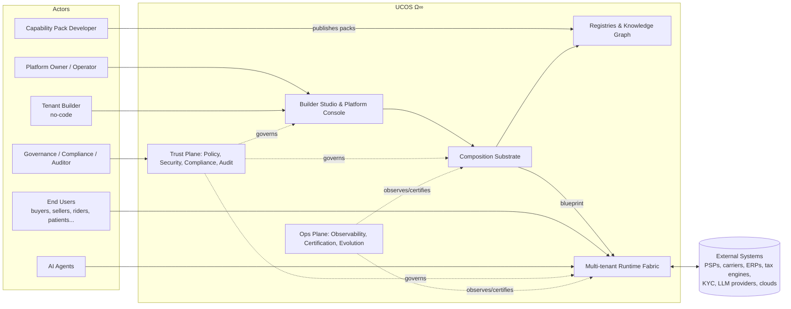

---

## 2. How to Use This Document

### 2.1 Reading order

| Role | Read first | Then |
|---|---|---|
| Architect / Tech lead | §1, §3, §5, §6, §7, §8, §11 | everything |
| Backend engineer | §7, §8, §13–§17 | §18–§20 |
| Frontend / designer | §22–§25 | §7.3, §8, §15 |
| SRE / Platform | §13, §14, §26, §27 | §19, §28 |
| Security / Compliance | §18–§21 | §28 |
| AI coding agent | §34 **first**, then §3, §7, §8 | the section relevant to the task |
| Universe implementer | §6.2 row → `constitutions/U<NN>-*/constitution.md` | `spec/capabilities/packs/<id>.yaml`, `TEMPORAL-BINDING-MATRIX.md` |

### 2.2 Conventions

- IDs: `ucos:<kind>:<ulid>` (§7.2). Capability IDs: `<universe>.<capability>` e.g. `commerce.cart`.
- Event names: `<universe>.<object>.<pastTenseVerb>` e.g. `order.order.placed` (§15.5).
- All schemas are expressed in YAML for readability; the runtime stores them as JSON Schema 2020-12.
- Diagrams use Mermaid (renders in GitHub, GitLab, VS Code, most doc tools); wireframes use ASCII.
- "Universe" = a bounded context that owns a family of canonical objects. "Capability" = an installable unit of behaviour inside a universe.

### 2.3 Document authority

This document is **Constitution-level** (§18.1). Changes require a Constitutional Change Proposal (CCP) approved by the Architecture Authority (§18.4). Sub-specifications (one per universe, generated per §12.5) MUST NOT contradict it.

---

## 3. Constitutional Principles & Enforceable Laws

The chat stated more than 40 principles. They are consolidated here into **20 laws**. Each law has an **enforcement mechanism**: a principle with no enforcement mechanism is not a law.

| # | Law | Statement | Enforcement (where / how) |
|---|---|---|---|
| L1 | **Knowledge Once** | Every fact, definition, rule or reference datum has exactly one canonical home. Author once → register once → certify once → reuse everywhere. | Registry uniqueness constraints; Composition linter rejects duplicate concept definitions (semantic dedupe via ontology `sameAs`); CI check `ucos lint --duplicates`. |
| L2 | **Zero Hard Coding** | No tenant, industry, country, language, currency, gateway, model, workflow, UI or topology is hard-coded in platform or pack code. | Static analysis rules (banned literals: ISO country codes, currency codes, provider names outside adapters); pack certification check; code review checklist. |
| L3 | **Canonical Ownership** | Every object type, capability and registry belongs to exactly one universe and has a named steward. | `owner` and `steward` are required fields in the meta-model; registry rejects orphan entries. |
| L4 | **Zero Duplication / Zero Overlap** | Two capabilities MUST NOT provide the same object type or the same command. | Composition Substrate conflict detector (§11.5); pack publish fails on `provides` collision. |
| L5 | **Zero Orphans** | Every artifact traces up to Constitution → Law → Policy → Capability → Requirement, and down to Test → Evidence → Certification. | Traceability graph check; certification gate `TRACE-001`. |
| L6 | **Composition over Construction** | Applications are compositions of certified capabilities, never bespoke code. | No `apps/<tenant>` code directories permitted; repo policy. |
| L7 | **Context Awareness** | Every execution carries an explicit Context (identity, tenant, jurisdiction, time, locale, channel, risk). | Runtime rejects calls without a resolved `ContextEnvelope` (§7.6). |
| L8 | **Policy before Execution** | No command executes without a policy decision (allow/deny + obligations). | Policy Enforcement Point embedded in the gateway and the command bus; deny-by-default. |
| L9 | **Governed Change** | No change to definitions bypasses governance (proposal → validation → approval → certification → activation). | Definition lifecycle state machine (§7.5); activation requires a `Certification` reference. |
| L10 | **Completeness before Activation** | A platform instance cannot be activated while `mandatory_gap_count > 0` (unless there is an explicit, authorised, time-boxed waiver). | Certification gate `GAP-000` (§11.6). |
| L11 | **Security by Construction** | Zero trust, least privilege, encryption at rest/in transit, tenant isolation are defaults, never options. | Security baseline policies installed at Layer 0; pack certification `SEC-*` checks. |
| L12 | **Compliance by Construction** | Regulatory obligations are resolved from context (jurisdiction × industry × data class × capability) and enforced as controls. | Compliance resolver (§20); evidence collectors; gate `CMP-*`. |
| L13 | **Audit Everything** | Every command, decision, policy evaluation, AI output, approval, deployment and access is recorded immutably. | Append-only audit log with hash chaining (§19.9). |
| L14 | **Observable Everything** | Every capability emits standard traces, metrics, logs and business signals. | Pack certification requires an OTel instrumentation manifest. |
| L15 | **Vendor & Model Agnosticism** | External providers (cloud, PSP, LLM, carrier, tax) are reached only through adapters behind canonical ports. | Port/adapter architecture; dependency rules in build (`packs/*` may not import vendor SDKs except `adapters/*`). |
| L16 | **Versioned & Evolvable** | Every definition is versioned (SemVer), backward-compatibility rules are enforced, and deprecations follow a published timeline. | Schema compatibility checker (§29.4). |
| L17 | **Human Authority over Autonomy** | AI/automation can propose and act only within delegated, bounded authority. Constitutional, security-critical and irreversible financial changes require human approval. | Autonomy levels (§29.2); Authority objects for agents (§21.5). |
| L18 | **Deterministic Composition** | The same Platform Definition + registry snapshot always yields the same blueprint (content-hash identical). | Composer is a pure function; snapshot IDs pinned; reproducibility test in CI. |
| L19 | **Isolation & Sovereignty** | Tenant data, keys and (where required) compute are isolated. Data residency is honoured per jurisdiction. | Cell architecture + RLS + per-tenant keys (§14.3, §19.6). |
| L20 | **Discover the Unknown** | The platform continuously asks *what exists, what is missing, what overlaps, what conflicts, what violates, what should evolve*. | Completeness Engine scheduled scans + on-change scans (§11, §29). |

### 3.1 The Ultimate System Loop

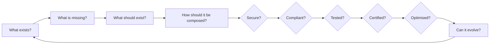

### 3.2 Capability quality attributes (every capability MUST be)

Constitutional · Discoverable · Composable · Reusable · Extensible · Evolvable · Governed · Versioned · Certified · Observable · Secure · Context-aware · Auditable · Localisable · Tenant-isolated.

---

## 4. Glossary

| Term | Definition |
|---|---|
| **Constitution** | Top-level, human-authored rules (this document plus the per-universe constitutions). |
| **Law** | An enforceable invariant derived from the Constitution (§3). |
| **Universe** | A bounded context owning a coherent family of canonical object types, e.g. Temporal Universe, Offer Universe. |
| **Domain** | A grouping of universes for navigation and team ownership, e.g. Foundation, Commerce. |
| **Canonical Object** | An instance of any type that conforms to the root object envelope (§7.1). |
| **Object Type** | A registered definition (schema + behaviour bindings) of a kind of canonical object. |
| **Capability** | An installable unit of behaviour that provides object types, commands, queries, events, workflows, UI models and policies. |
| **Capability Pack** | The signed, versioned distribution artifact of one or more capabilities (§8). |
| **Registry** | An authoritative, versioned store of definitions or reference data, e.g. Capability Registry, Product Registry, Temporal Registry. |
| **Knowledge Graph (UKG)** | The graph of all definitions, instances (selected) and relationships, used for reasoning, discovery and traceability. |
| **Context** | The resolved situation of an execution: tenant, identity, jurisdiction, time, locale, channel, currency, risk, device, observer (§7.6). |
| **Platform Definition (PD)** | A tenant's declared intent: industry, business model, countries, channels, capabilities, compliance and security profile (§11.2). |
| **Blueprint** | The fully resolved, deterministic output of composition: every capability, object type, policy, workflow, UI, integration, infra and control needed (§11.4). |
| **Platform Instance** | A deployed, certified blueprint serving a tenant in one or more cells. |
| **Gap** | A required element that is missing, unresolved, conflicting or uncertified (§11.6). |
| **Waiver** | A time-boxed, authorised acceptance of a non-mandatory gap, or an exceptional acceptance of a mandatory one. |
| **Certification** | A signed attestation that an artifact passed defined gates with linked evidence. |
| **Evidence** | An immutable record proving that a control or test is satisfied. |
| **Cell** | An isolated deployment unit (region + stack) hosting a set of tenants. |
| **Pack Developer** | An engineer who builds Capability Packs, the only place where new business code is written. |
| **Steward** | The accountable owner of a universe, registry or object type. |
| **Agent** | An AI actor with an identity, delegated authority, tools, memory and guardrails. |
| **Digital Twin** | A live model of a real thing (platform, organisation, product, supply chain), built from definitions and telemetry, used for simulation. |

---

## 5. Canonical Layer Architecture

### 5.1 Consolidation decision

The source material contains at least **eight incompatible layer numberings** (Layer 000–021, Level 0–14, Layer 0–27, Universe 001–047, Layer A–J, Layer 00–21, Level 0–20, Layer 01–28). They are merged into **one 13-layer model with 4 cross-cutting planes**. Every concept from every numbering maps to exactly one layer (§33).

### 5.2 The canonical stack

```text
┌────────────────────────────────────────────────────────────────────────────────────┐
│  L12  CERTIFICATION · EVOLUTION · AUTONOMY                                         │
│       Certification Engine · Gap/Completeness Engine · Evolution Engine ·          │
│       Self-healing · Self-optimisation · Learning · Digital Twins · Simulation     │
├────────────────────────────────────────────────────────────────────────────────────┤
│  L11  OPERATIONS · OBSERVABILITY · RESILIENCE · INFRASTRUCTURE                     │
│       OTel · SLO · AIOps · DR/BCP · Chaos · FinOps · Cells · K8s · IaC · GitOps    │
├────────────────────────────────────────────────────────────────────────────────────┤
│  L10  EXPERIENCE                                                                   │
│       UI Meta-Model · Renderers (web, mobile, desktop, kiosk, POS, TV, voice,      │
│       chat, agent, AR/VR adapters) · Portals · Design System · i18n · a11y         │
├────────────────────────────────────────────────────────────────────────────────────┤
│  L9   INTEGRATION                                                                  │
│       API Gateway · GraphQL Federation · gRPC · Webhooks · Connectors · EDI ·      │
│       ETL/CDC · MCP Server · Protocol translation · Federation                     │
├────────────────────────────────────────────────────────────────────────────────────┤
│  L8   RUNTIME FABRIC                                                               │
│       Command Bus · Object Service · Durable Workflow · Decision/Rules · Event Bus ·│
│       Temporal Scheduler · Query · Search · Graph · Vector · AI Runtime · Agents   │
├────────────────────────────────────────────────────────────────────────────────────┤
│  L7   COMPOSITION & GENERATION                                                     │
│       Builder Studio · Composition Substrate (resolvers) · Blueprint Store ·       │
│       Generators (SDK, docs, tests, IaC, UI bundles) · Platform Factory            │
├────────────────────────────────────────────────────────────────────────────────────┤
│  L6   INTELLIGENCE                                                                 │
│       Model Registry · Prompt Registry · Agent Registry · Recommendation · Search  │
│       AI · Forecasting · Fraud/Risk · Optimisation · Planning · Reasoning          │
├────────────────────────────────────────────────────────────────────────────────────┤
│  L5   BUSINESS CAPABILITY UNIVERSES                                                │
│       Product · Service · Catalog · Offer · Pricing · Commerce · Marketplace ·     │
│       Order · Inventory · Fulfillment · Logistics · Payment · Ledger/Finance ·     │
│       Tax · Subscription · Entitlement · CRM · Support · Communication ·           │
│       Content/Media · Document · Asset · ERP/HRMS/Procurement · Industry Packs     │
├────────────────────────────────────────────────────────────────────────────────────┤
│  L4   FOUNDATION UNIVERSES                                                         │
│       Identity · Organization/Tenant · Geography · Temporal · Currency/Unit ·      │
│       Language/Localization · Context · Resource                                   │
├────────────────────────────────────────────────────────────────────────────────────┤
│  L3   KNOWLEDGE & REGISTRY FABRIC                                                  │
│       Ontology · Taxonomy · Universal Knowledge Graph · Registry Fabric ·          │
│       Global Product & Service Intelligence Network · Reference Data · Evidence    │
├────────────────────────────────────────────────────────────────────────────────────┤
│  L2   DATA FABRIC                                                                  │
│       Relational · Document · Graph · Vector · Object · Stream · Time-series ·     │
│       Lakehouse · Data Contracts · Lineage · Quality · Residency · Retention       │
├────────────────────────────────────────────────────────────────────────────────────┤
│  L1   META-MODEL                                                                   │
│       Canonical Object · Field Types · Cardinality · Relationships · Lifecycle ·   │
│       Versioning · Context Envelope · Traceability                                 │
├────────────────────────────────────────────────────────────────────────────────────┤
│  L0   CONSTITUTION & AUTHORITY                                                     │
│       Constitution · Laws · Authority Model · Governance · Policy Registry ·       │
│       Decision Records · Delegation · Ratification                                 │
└────────────────────────────────────────────────────────────────────────────────────┘
  CROSS-CUTTING PLANES (apply to every layer):
  ▌TRUST PLANE      Security · Privacy · Compliance · Audit · Risk · Trust/Reputation
  ▌CONTEXT PLANE    Context resolution and propagation (identity, tenant, jurisdiction, time, locale)
  ▌OBSERVABILITY    Traces · Metrics · Logs · Business, security, AI and governance signals
  ▌GOVERNANCE PLANE Policy decision & enforcement, change control, certification status
```

### 5.3 Layer dependency rules

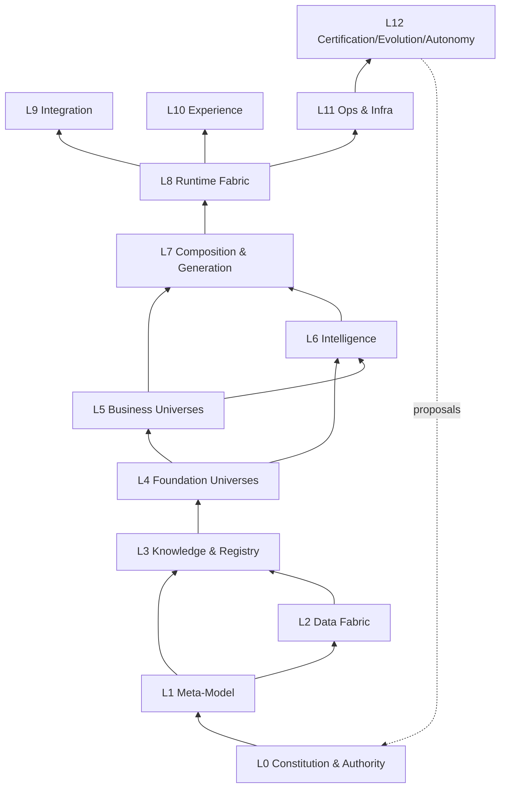

Rules:
1. A layer MAY depend only on layers below it (arrows point upward to dependents). The **only upward flow** is L12 → L0 *proposals*, which still pass through governance.
2. Business universes (L5) MUST NOT depend on each other directly for data ownership. They reference other universes' objects by `ref` (ID + version) and communicate through events and published queries.
3. Foundation universes (L4) MUST NOT depend on any L5 universe.
4. L8 runtime engines are generic. They MUST NOT contain business-universe-specific code; all business behaviour comes from packs and metadata.

### 5.4 Runtime-view architecture (what actually runs)

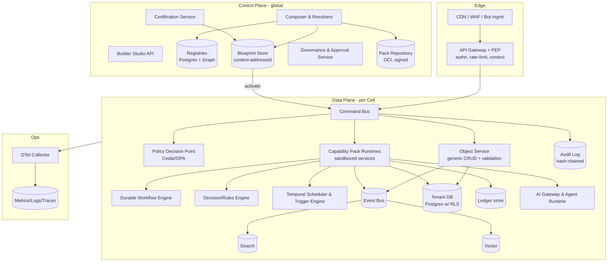

**Control plane vs data plane**
- The **control plane** (global, highly governed) owns definitions: registries, packs, compositions, blueprints, certifications, approvals.
- The **data plane** (one per cell or region, horizontally scaled) executes certified blueprints for tenants. It reads blueprints from a local, signed cache and never mutates definitions.

---

## 6. Universe Catalog & Canonical Ownership

### 6.1 Domains → Universes

The 72 universes named in the Genesis Directive, plus those added in later turns of the chat, are grouped into 12 domains. These domains also form the Platform Console navigation (§24.1).

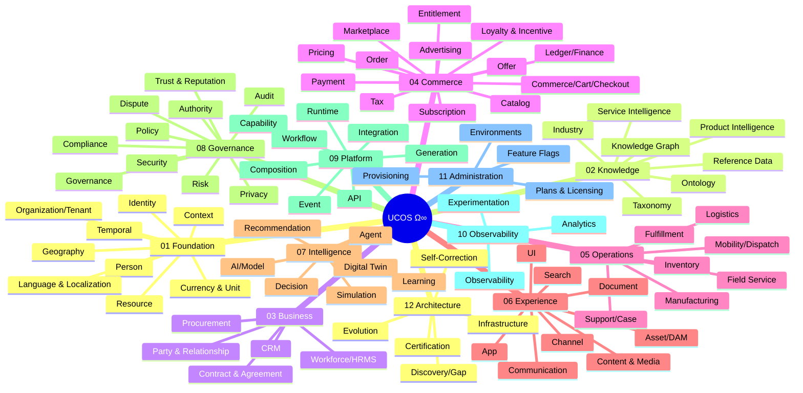

### 6.2 Universe catalog (canonical homes)

Legend: **Phase** = delivery phase from §32. **Owns** = the canonical object types for which this universe is the *only* writer.

| # | Universe | Layer | Owns (canonical objects) | Depends on | Phase |
|---|---|---|---|---|---|
| U01 | Authority | L0 | Authority (with quorum), Delegation, DecisionRecord (types incl. Ratification, Annulment, BreakGlass) | Meta, Temporal | 0 |
| U02 | Governance | L0 | ChangeProposal, ChangeItem, ImpactAnalysis, Review, Waiver, ReleasePlan, ChangeWindow, ChangeTemplate | Authority, Policy, Temporal | 0 |
| U03 | Policy | L0 | Policy, PolicySet, PolicyTest, Obligation, EntitySchema (generated), AdmissionPolicy | Authority, Meta, Temporal | 0 |
| U04 | Meta | L1 | ObjectType, FieldType, ValueType (registry; `Classification` owned by U65), RelationshipType, LifecycleModel, ExtensionSchema, KindRegistry | — | 0 |
| U05 | Ontology | L3 | Concept, ConceptRelation, Mapping (sameAs/broader/narrower) | Meta | 0 |
| U06 | Taxonomy | L3 | Taxonomy, TaxonomyNode, Classification | Ontology | 0 |
| U07 | Knowledge Graph | L3 | KnowledgeObject, Assertion, Provenance, TrustScore | Ontology | 1 |
| U08 | Reference Data | L3 | CodeList, CodeValue, CodeMapping, CodeListRelease (ISO 3166/4217/639, IANA tz, UCUM, UN/LOCODE, HS, ISIC, NAICS, NACE, NIC, UN CPC, SAC, APQC PCF, ISCO, ISCED, WIPO …) | Meta | 0 |
| U09 | Identity | L4 | Identity, Credential, Session, Role, Permission, Group, RoleGrant, Delegation, FederatedProvider (incl. social login), VerificationRecord | Authority, Policy, Party, Temporal | 0 |
| U10 | Organization & Tenant | L4 | Tenant, Organization, OrgUnit, Workspace, Brand, Store, TenantLink | Identity, Geography, Entitlement, Temporal | 0 |
| U11 | Person & Party | L4 | Party, Person, PartyRole, PartyRoleType, ContactPoint, Preference, PartyRelationship | Geography, Localization, Meta | 0 |
| U12 | Geography | L4 | Place, Address, AddressFormat, GeocodeResult, Jurisdiction, Zone, Geofence, ServiceArea (all frame-aware, A-23) | Reference Data, Frame (U77) | 0 |
| U13 | **Temporal** | L4 | value types TimePoint, LocalDate, LocalTime, LocalDateTime, LocalTimeWindow, TimeRange, Duration, BusinessDuration, Recurrence, TemporalRef; Calendar, CalendarEntry, TemporalPolicy, AvailabilityWindow, Slot, Reservation, SLADefinition, SLAClock, Trigger, Schedule, Waitlist, QueueToken, CalendarFeed, ExternalCalendarLink, Invitation, Reminder, TimezoneRelease | Geography (timezones), Reference Data, Frame (U77) | 0 |
| U14 | Currency & Unit | L4 | Currency, ExchangeRate, RateSource, RatePolicy, RoundingRule, Money (value type), Unit, Dimension, UnitConversion, PackagingUnit, Quantity (value type) | Reference Data, Temporal, Frame (U77) | 0 |
| U15 | Language & Localization | L4 | Locale, Translation, MessageBundle, FormatProfile | Reference Data | 0 |
| U16 | Context | L4 | ContextProfile, ContextRule (resolution rules) | all L4 | 0 |
| U17 | Resource | L4 | Resource (people, vehicles, rooms, machines, compute), ResourcePool, Capacity | Temporal, Geography | 2 |
| U18 | Product (Intelligence) | L3/L5 | GlobalProduct (GPID), ProductModel, Variant, Attribute, AttributeValue, Brand, Manufacturer | Taxonomy, Unit | 1 |
| U19 | Service (Intelligence) | L3/L5 | GlobalService (GSID), ServicePlan, ServiceLevel, DeliveryModel | Taxonomy, Temporal | 1 |
| U20 | Industry | L3 | Industry, IndustryTemplate, IndustryStandard | Taxonomy | 1 |
| U21 | Catalog | L5 | Catalog, CatalogEntry/Listing, Collection, Assortment | Product, Service, Organization | 1 |
| U22 | Offer | L5 | Offer, Promotion, Coupon, Voucher, Bundle, Campaign, Incentive | Catalog, Pricing, **Temporal**, Policy | 1 |
| U23 | Pricing | L5 | PriceList, PriceRule, PriceComponent, Quote | Currency, Decision, Temporal | 1 |
| U24 | Commerce (Cart/Checkout) | L5 | Cart, CartLine, Checkout | Catalog, Offer, Pricing, Tax | 1 |
| U25 | Marketplace | L5 | Seller, SellerAgreement, CommissionPlan, MarketplacePolicy | Organization, Ledger | 2 |
| U26 | Order | L5 | Order, OrderLine, OrderAdjustment, ReturnRequest | Commerce, Payment, Fulfillment | 1 |
| U27 | Subscription | L5 | Subscription, SubscriptionPlan, BillingSchedule, UsageRecord | Temporal, Pricing, Payment | 2 |
| U28 | Entitlement | L5 | Plan, Feature, Quota, Entitlement, UsageCounter, Seat, Licence | Temporal, Currency (Subscription in P2) | 0 (platform plans), 1, 2 (customer entitlements) |
| U29 | Payment | L5 | PaymentIntent, PaymentMethod (tokenised), Refund, Payout, Dispute (chargeback) | Ledger, Currency, adapters | 1 |
| U30 | Ledger & Finance | L5 | LedgerAccount, JournalEntry, Posting, Settlement, Invoice, CreditNote, RevenueSchedule | Currency, Temporal | 2 |
| U31 | Tax | L5 | TaxRegime, TaxRule, TaxCategory, TaxDetermination, TaxDocument | Geography, Product, Temporal | 1 |
| U32 | Loyalty & Incentive | L5 | LoyaltyProgram, PointsAccount, Reward, Referral | Ledger, Offer | 3 |
| U33 | Advertising | L5 | Campaign(Ad), Placement, Auction(Ad), Creative | Content, Decision | 4 |
| U34 | Inventory | L5 | StockItem, StockLevel, Reservation(Stock), Location(Stock) | Product, Geography | 1 |
| U35 | Fulfillment | L5 | FulfillmentOrder, Shipment, Package, ReturnShipment | Order, Inventory, Logistics | 1 |
| U36 | Logistics | L5 | Carrier, Route, Leg, DeliverySlot (ref Temporal Slot), TrackingEvent, Fleet, Vehicle | Geography, Temporal, Resource | 2 |
| U37 | Mobility & Dispatch | L5 | Trip, RideRequest, Match, DriverShift | Logistics, Geography, Temporal, Pricing | 5 |
| U38 | CRM | L5 | Account, Contact, Lead, Opportunity, Pipeline, Activity | Person, Organization | 3 |
| U39 | Support & Case | L5 | Case, Ticket, Incident, KnowledgeArticle, SLAInstance | Temporal (SLAClock), Communication | 3 |
| U40 | Communication | L5 | Channel, Template, NotificationRule, Message, Notification (in-app), InboundMessage, Conversation, ConversationMessage, Broadcast, AgentMessage, ProxyContact (campaign orchestration → U86) | Party, Localization, Consent, Temporal, Integration | 1 (base capability) |
| U41 | Content & Media | L5 | ContentItem, MediaAsset, Rendition, Playlist, Stream | Asset, Entitlement | 4 |
| U42 | Document | L5 | DocumentTemplate, Document, RenderRecord, SignatureEnvelope | Asset, Localization, Currency, Temporal | 1 |
| U43 | Asset (DAM) | L5 | BinaryAsset, Rendition, AssetRights | Data/Object store | 1 |
| U44 | Search | L6 | SearchIndexDefinition, Synonym, RankingProfile | Knowledge, Vector | 1 |
| U45 | ERP / Procurement | L5 | PurchaseRequisition, PurchaseOrder, Supplier, GoodsReceipt | Ledger, Inventory | 4 |
| U46 | Workforce / HRMS | L5 | Employee, Position, Shift (ref Temporal), Attendance, PayrollRun | Person, Temporal, Ledger | 4 |
| U47 | Manufacturing | L5 | BillOfMaterials, WorkOrder, Routing, ProductionSchedule | Product, Inventory, Temporal | 6 |
| U48 | Healthcare / Education / Gov (Industry packs) | L5 | Industry-specific objects as packs (e.g. Encounter, Course, Permit) | Foundation + relevant universes | 6 |
| U49 | AI / Model | L6 | Model, ModelVersion, Provider, Route, Evaluation, Guardrail | Policy, Security | 3 |
| U50 | Prompt | L6 | PromptTemplate, PromptVersion | AI | 3 |
| U51 | Agent | L6 | Agent, AgentAuthority, Tool, Memory, AgentRun | Identity, Authority, AI | 3 |
| U52 | Recommendation | L6 | RecommenderDefinition, Strategy, Placement(Rec) | AI, Knowledge | 4 |
| U53 | Decision | L8 | DecisionModel (DMN), DecisionTable, DecisionLog | Policy | 1 |
| U54 | Simulation | L12 | Scenario, SimulationRun, Assumption, Outcome | Digital Twin | 5 |
| U55 | Digital Twin | L12 | TwinDefinition, TwinInstance, StateSnapshot | Knowledge, Observability | 5 |
| U56 | Learning | L12 | LearningSignal, Insight, ModelFeedback | AI, Analytics | 5 |
| U57 | Capability | L7 | CapabilityDefinition, CapabilityPack, ExtensionPoint | Meta | 0 |
| U58 | Composition | L7 | PlatformDefinition, Blueprint, GapReport, ResolutionTrace | Capability, Context, Policy | 0 |
| U59 | Generation | L7 | GeneratorDefinition, GenerationRun, GeneratedArtifact | Composition | 2 |
| U60 | Workflow | L8 | WorkflowDefinition, WorkflowInstance, HumanTask | Temporal, Decision | 1 |
| U61 | Event | L8 | EventType, EventSchema, Subscription(Event) | Meta | 0 |
| U62 | Integration | L9 | Connector, ConnectorInstance, InboundWebhook, OutboundCall, Mapping, SyncJob, TenantWebhookSubscription | Event, Security, Temporal | 1 |
| U63 | API | L9 | APIDefinition, APIProduct, APIKey, RateLimitPlan | Capability | 1 |
| U64 | UI / App / Channel | L10 | ViewDefinition, Layout, Component, Theme, App, Portal, Journey | Meta, Localization | 1 |
| U65 | Security | Plane | SecurityControl, Key, Secret(ref), ThreatModel, Finding | Authority | 0 |
| U66 | Privacy & Consent | Plane | Consent, Purpose, ProcessingActivity, DataSubjectRequest, RetentionRule | Identity, Compliance | 1 |
| U67 | Compliance | Plane | Regulation, Clause, Control, ControlMapping, Obligation | Policy, Geography | 1 |
| U68 | Audit & Evidence | Plane | AuditRecord, Evidence, EvidenceCollector | — | 0 |
| U69 | Risk | Plane | RiskModel, RiskScore, RiskAssessment | Decision, AI | 2 |
| U70 | Trust & Reputation | Plane | Rating, Review, TrustScore, Verification (KYC/KYB) | Identity, Risk | 2 |
| U71 | Dispute & Resolution | L5 | Claim, Dispute, Arbitration, Appeal | Order, Payment, Case | 3 |
| U72 | Observability & Analytics | L11 | SignalDefinition, SLO, AlertRule, Dashboard, MetricDefinition, Report, FeatureFlag, Experiment | Event, Temporal | 1 |
| U73 | Infrastructure & Deployment | L11 | Cell, Environment, Deployment, Release | — | 0 |
| U74 | Certification | L12 | CertificationGate, Certification, CertificationRun | Audit & Evidence | 0 |
| U75 | Discovery & Gap | L12 | GapRule, Gap, GapScan | Composition | 0 |
| U76 | Evolution | L12 | EvolutionProposal, Deprecation, Migration | Governance | 3 |
| U77 | Existence & Reality Frame | L1/L4 | Reality, Body, SpatialReferenceFrame, TimeScale, CalendarSystem, MonetarySystem, UnitSystem, LanguageSystem, GoverningAuthority, Frame, RealityLink | see spec | 0 |
| U78 | Product Configuration | L5 | ConfigurableProduct, OptionGroup, Option, Constraint, Configuration, KitDefinition | see spec | 2 |
| U79 | Physical Asset & Installed Base | L5 | AssetUnit, CustodyEvent, MaintenancePlan, MaintenanceRecord, Disposal | see spec | 3 |
| U80 | Warranty & After-sales | L5 | WarrantyDefinition, Coverage, Claim, RepairOrder, RMA, ServiceContract | see spec | 3 |
| U81 | Ticketing & Events | L5 | Venue, SeatMap, Event, Session, TicketType, Ticket, Scan | see spec | 6 |
| U82 | Field Service & Work Management | L5 | ServiceCatalogItem, ServiceRequest, WorkOrder, DispatchPlan, TimeLog | see spec | 5 |
| U83 | Rental & Leasing | L5 | RentalProduct, RentalAgreement, ConditionReport, DamageAssessment, Lease | see spec | 5 |
| U84 | Stored Value & Wallet | L5 | StoredValueProgram, Instrument, StoredValueTransaction | see spec | 2 |
| U85 | Customer Data & Segmentation (CDP) | L6 | TrackingPlan, IdentityGraph, Trait, Segment, Audience | see spec | 3 |
| U86 | Marketing Automation | L5 | Campaign(Marketing), Journey, AttributionModel | see spec | 4 |
| U87 | Web Presence & SEO | L10 | Route, Slug, Redirect, MetaTemplate, StructuredDataMapping, Sitemap, SiteSettings | see spec | 1 |
| U88 | Social & Community | L5 | SocialProfile, Edge, Post, Comment, Question, Group, ModerationCase, ConnectedSocialAccount | see spec | 5 |
| U89 | Contract & Agreement | L5 | ClauseLibrary, AgreementTemplate, Agreement, Obligation, Acceptance | see spec | 2 |
| U90 | Global Trade & Customs | L5 | CustomsTerritory, TariffClassification, OriginDetermination, LandedCostQuote, TradeRestriction, ScreeningResult, CustomsDeclaration | see spec | 2 |
| U91 | Auction, Bidding & Negotiation | L5 | Auction, Bid, RFQ, Proposal, Negotiation, Mandate, Award | see spec | 5 |
| U92 | IoT & Devices | L5/L9 | DeviceType, Device, Command, FirmwareRelease, EdgeNode | see spec | 5 |
| U93 | Data Governance & Data Products | L2 | Dataset, DataContract, DataProduct, QualityRule, LineageEdge, MasterEntity, ShareAgreement | see spec | 2 |
| U94 | ML Platform | L6 | FeatureDefinition, TrainingDataset, TrainingPipeline, Experiment(ML), Deployment(ML), MonitorPolicy | see spec | 2 |
| U95 | Software Delivery & Source Control (Git) | L7/L11 | Repository, ChangeRequest, PipelineDefinition, PipelineRun, Artifact, ReleaseTrain, DevEnvironment | see spec | 0 |
| U96 | Work & Collaboration | L5 | Space, Project, Task, Thread, Timesheet, Page | see spec | 5 |
| U97 | Forms, Surveys & Feedback | L10/L5 | FormDefinition, Distribution, Response | see spec | 3 |
| U98 | Sustainability & ESG | L5 | EmissionFactor, ActivityRecord, FootprintResult, EnvironmentalClaim, EPRObligation, ESGReport | see spec | 6 |
| U99 | Digital Assets & Distributed Ledger | L5/L9 | Network, TokenDefinition, Wallet(Chain), ChainTransaction, ProductPassport, TokenGate | see spec | 6 |
| U100 | Financial Products | L5 | FinancialProduct, Application, FinancialContract, Policy(Insurance), Instrument(Investment), TradingOrder | see spec | 6 |
| U101 | Quality, Health, Safety & Environment (QHSE) | L5 | Nonconformance, CAPA, Audit, ControlledDocument, Inspection, Incident, RiskAssessment, PermitToWork, EnvironmentalPermit | see spec | 5 |
| U102 | Strategy & Performance Management | L6/L5 | StrategyStatement, Objective, KeyResult, Scorecard, Initiative, PlanningCycle, Scenario | see spec | 5 |
| U103 | Corporate Governance & Equity | L5 | LegalEntityRecord, Officer, Meeting, Resolution, ShareClass, EquityEvent, OptionPlan, Grant, Dividend, StatutoryFiling, BeneficialOwner | see spec | 6 |
| U104 | Legal Matters, Ethics & IP | L5 | Matter, LegalHold, EthicsReport, IPAsset, InfringementCase | see spec | 6 |
| U105 | Workplace & Facilities | L5 | Building, Space, Visit, OccupancyReading, MoveRequest | see spec | 6 |
| U106 | Travel & Expense | L5 | TravelRequest, ExpenseClaim, MileageEntry, PerDiem, CardTransaction, Reimbursement | see spec | 6 |
| U107 | Partner, Channel & Franchise | L5 | PartnerProgram, PartnerMembership, DealRegistration, MDFRequest, Rebate, SellThroughReport, Franchisee, RoyaltyStatement | see spec | 4 |
| U108 | Product Development, R&D & Innovation | L5 | Idea, DevelopmentProject, Requirement, DesignItem, EngineeringBOM, TestResult, ChangeRequest, ChangeOrder, LabRecord, LaunchPlan | see spec | 6 |
| U109 | Real-time Communications & Contact Centre | L5/L9 | Queue, AgentProfile, Interaction, IvrFlow, BotFlow, Callback, Recording, VideoSession | see spec | 3 |


> **Coverage expansion (v1.1):** U77–U109 were added by the completeness reviews, so the catalogue now has 109 universes. Industry, product, service and domain coverage is mapped against ISIC, CPC and APQC in `constitutions/INDUSTRY-PRODUCT-DOMAIN-CATALOGUE.md`. `constitutions/COVERAGE-REGISTER.md` maps every domain to its owner and defines the protocol for adding anything new, for any region, planet, reality, language, currency, time system or unit.

### 6.3 Ownership resolution of commonly duplicated concepts

These were the main duplication risks in the source material. The rulings below are binding.

| Concept | Canonical home | Everyone else… |
|---|---|---|
| Any date, time, period, validity, schedule, recurrence, slot, SLA clock, expiry, trigger time | **Temporal (U13)** | stores a `TemporalRef` / `TemporalPolicyRef`, never `start_date`/`end_date` pairs |
| Money, currency, FX | **Currency & Unit (U14)** — `Money` value type; FX rates are temporal facts | MUST use `Money {amount (decimal string), currency}` |
| Address, country, region, jurisdiction, timezone | **Geography (U12)** | references a `Place`/`Jurisdiction` |
| Product master facts (brand, specs, GTIN) | **Product Intelligence (U18)** | tenants create **Listings** (U21) that reference GPID and add tenant-specific data |
| Price | **Pricing (U23)** | Offer applies adjustments; Catalog never stores price |
| Discounts/promotions/coupons | **Offer (U22)** | Pricing evaluates offers via the Decision engine |
| What a customer may use (features, plans, quotas) | **Entitlement (U28)** | Identity permissions are about *actions*; entitlements are about *commercial rights* |
| Financial truth | **Ledger (U30)** | Payment, Marketplace, Subscription post journal entries; nothing else stores balances |
| Review/rating | **Trust & Reputation (U70)** | Product pages query it |
| Notifications of any kind | **Communication (U40)** | other universes emit events + template IDs |
| Files, images, video | **Asset (U43)** | others hold `AssetRef` |
| Approval chains | **Workflow (U60)** + **Governance (U02)** for definition changes | — |
| Rules and thresholds | **Decision (U53)** | no `if` statements on business thresholds inside pack code |
| Catalog vs Product | Product = global truth; Catalog = a tenant's curated assortment | — |
| Marketplace vs Commerce | Commerce = buying flow; Marketplace = multi-sided economics (sellers, commissions, payouts) | — |
| Segments and audiences | **CDP (U85)** | Offer, Pricing, Marketing and Search reference `SegmentRef`. Nobody else computes segments. (A-30) |
| Campaigns and journeys | **Marketing Automation (U86)** | Communication (U40) only delivers messages. Offer (U22) only defines incentives. (A-31) |
| Gift cards, store credit, wallets | **Stored Value (U84)** | Offer references them only as incentives. Ledger keeps the books. (A-29) |
| Commercial entitlements (plans, quotas, seats, licences) | **Entitlement (U28)** | Code calls `Check`/`Consume`. No plan names in code. (A-61) |
| Frames of reference (reality, body, time scale, calendar, monetary, unit and language systems) | **Existence & Reality Frame (U77)** | Geography, Temporal, Currency, Localization and Context consume frames. Earth is a default, not an assumption. (A-23…A-28) |

---

# PART II — THE META-SYSTEM

## 7. Universal Meta-Model

Everything in UCOS is a **Canonical Object**: definitions (object types, capabilities, policies, workflows, UI views) and instances (orders, products, people) alike. One meta-model lets the platform reason about itself.

### 7.1 Root Canonical Object envelope

Every object, of any type, carries this envelope. Type-specific data lives in `attributes`.

```yaml
# ucos:meta:CanonicalObject  (JSON Schema 2020-12 in the registry)
CanonicalObject:
  id:            UGID            # required, immutable — §7.2
  type:          TypeRef         # e.g. "commerce.order.Order@1.4"
  subtype:       string?         # taxonomy-driven specialisation
  tenant:        TenantRef       # "ucos:tenant:01J..." ; "global" for shared registries
  name:          LocalizedText?
  description:   LocalizedText?
  status:        LifecycleState  # §7.5
  version:       integer         # optimistic-concurrency counter (instances)
  defVersion:    SemVer?         # for definitions only
  owner:         PartyRef        # accountable party (org/person/agent)
  steward:       PartyRef?       # for definitions & registries — required there
  context:       ContextRef      # §7.6 — context in which it was created/valid
  attributes:    object          # validated against the ObjectType schema
  relationships: RelationshipRef[]  # §7.4 (materialised for hot paths; full set in graph)
  policies:      PolicyRef[]     # attached policies (beyond type-level ones)
  classification:                # §19.7 data classification
    confidentiality: public|internal|confidential|restricted
    dataClasses: [PII, PCI, PHI, FINANCIAL, ...]
  compliance:    { jurisdictions: [JurisdictionRef], controls: [ControlRef] }
  temporal:                      # bitemporal — §14.6
    validFrom: TimePoint ; validTo: TimePoint?
    recordedAt: TimePoint ; supersededAt: TimePoint?
  provenance:    { source: SourceRef, method: manual|import|generated|ai, confidence: 0..1 }
  audit:         { createdBy, createdAt: TimePoint, updatedBy, updatedAt: TimePoint, lastAuditRecord: AuditRef }
  evidence:      EvidenceRef[]
  metadata:      { tags: string[], labels: map<string,string>, extensions: object }
```

### 7.2 Universal identity scheme (UGID)

The source listed many identifier families (UID, GID, PID, OID, CID, BID, SID, DID, AID, RID, EID, TID, KID, GPID, GSID). They are unified as **one format with a kind prefix**:

```text
ucos:<kind>:<ULID>                         e.g. ucos:order:01J9Z3K8Q4V6X2...
ucos:<kind>:<namespace>/<natural-key>      e.g. ucos:currency:iso4217/INR   (reference data)
```

| Legacy name | Kind prefix | Notes |
|---|---|---|
| UGID | (all) | the general form |
| UID / PID | `person`, `identity` | Person vs authenticating Identity are separate |
| OID / BID | `org`, `brand` | |
| TID | `tenant` | |
| CID | `customer` → modelled as `party-role` | Customer is a *role* a Party plays, not a separate identity |
| SID | `service` (GSID for global services) | |
| GPID | `gproduct` | Global Product ID (§10) |
| AID | `agent` | AI agent identity |
| DID | `did:` W3C DID (optional) | for verifiable credentials and cross-org trust |
| DeviceID | `device` | |
| EID / KID / RID | `event`, `knowledge`, `resource` | |

Rules: IDs are opaque, immutable and never reused. Natural keys (GTIN, ISBN, VIN, LEI, tax IDs) are stored as `identifiers[]` attributes with a scheme, never as the primary ID. ULIDs give time-ordered, index-friendly keys.

### 7.3 Object Type definition (how new things are modelled without code)

```yaml
# registry: ucos:objecttype:commerce.order.Order@1.4.0
kind: ObjectType
id: commerce.order.Order
version: 1.4.0
universe: U26-order
steward: ucos:org:platform-commerce-team
extends: ucos.meta.CanonicalObject
description: "A confirmed commitment by a buyer to purchase offers from one or more sellers."
attributes:
  orderNumber:   { type: String, pattern: "^[A-Z0-9-]{6,32}$", generated: sequence(tenant, "ORD-{yyyy}-{seq:8}") }
  buyer:         { type: Reference, target: party.PartyRole, cardinality: "1", constraint: "role == 'buyer'" }
  channel:       { type: Reference, target: experience.Channel, cardinality: "1" }
  lines:         { type: Composition, target: commerce.order.OrderLine, cardinality: "1..N" }
  totals:        { type: Object, schemaRef: commerce.order.OrderTotals }   # Money values
  placedAt:      { type: TemporalRef, kind: TimePoint }                   # Temporal Universe
  fulfillmentWindow: { type: TemporalRef, kind: TimeRange, optional: true }
  shippingAddress:   { type: Reference, target: geo.Address, optional: true }
  customAttributes:  { type: Extension, governedBy: tenant }              # tenant-defined, JSONB
indexes:
  - [tenant, orderNumber]  # unique
  - [tenant, buyer, placedAt]
lifecycle: commerce.order.OrderLifecycle@1.0   # state machine (§16.1)
classification: { confidentiality: confidential, dataClasses: [PII, FINANCIAL] }
retention: ucos:retention:financial-records-default   # resolved per jurisdiction
events: [order.order.placed, order.order.confirmed, order.order.cancelled, order.order.completed]
commands: [PlaceOrder, ConfirmOrder, CancelOrder, AmendOrder]
uiModels: [order.list@1, order.detail@1, order.timeline@1]
search: { indexed: [orderNumber, buyer.name, lines.title], facets: [status, channel] }
```

### 7.4 Field types, cardinality and relationships

**Canonical field types:** `String, Text, LocalizedText, Number, Integer, Decimal, Boolean, Enumeration (taxonomy-backed), Money, Quantity (value+unit), Percentage, TemporalRef (TimePoint|TimeRange|Duration|Recurrence|TemporalPolicy), Coordinate, GeoShape, Reference, Composition, Array, Object, Map, Binary, AssetRef, Media, Json, Graph, PolicyRef, RuleRef, WorkflowRef, ModelRef, Extension, Computed, Encrypted<T>`.

Types the source called "Date / Time / DateTime / Duration / Currency / Location" are deliberately **not primitive**. They are value types owned by the Temporal, Currency and Geography universes, which enforces Knowledge Once.

**Cardinality:** `1`, `0..1`, `1..N`, `0..N`, plus modifiers `conditional(expr)`, `inherited`, `derived(expr)`, `computed(expr)`, `generated(strategy)`.

**Relationship object:**

```yaml
Relationship:
  id: UGID
  type: RelationshipTypeRef        # from the registry below
  source: ObjectRef                # id + type + version
  target: ObjectRef
  context: ContextRef
  validity: TemporalRef            # TimeRange
  constraints: ExpressionRef[]
  attributes: object               # e.g. quantity, share %, role
  evidence: EvidenceRef[]
  audit: AuditRef
```

**Relationship type registry (seed set, extensible):**

| Category | Types |
|---|---|
| Structural | `contains`, `partOf`, `composedOf`, `aggregates`, `inheritsFrom`, `versionOf`, `supersedes`, `replaces`, `equivalentTo (sameAs)`, `similarTo` |
| Ownership & authority | `owns`, `belongsTo`, `memberOf`, `stewardOf`, `authorizes`, `delegatesTo`, `approves`, `certifies`, `governs`, `controls` |
| Dependency | `dependsOn`, `requires`, `provides`, `consumes`, `produces`, `extends`, `conflictsWith`, `references` |
| Operational | `executes`, `monitors`, `observes`, `evaluates`, `validates`, `verifies`, `audits`, `learnsFrom` |
| Commercial | `sells`, `purchases`, `offers`, `ships`, `settles`, `books`, `schedules`, `subscribesTo`, `reviews`, `rates`, `supports`, `fulfills` |
| Social | `communicatesWith`, `collaboratesWith`, `follows`, `refers` |

Every relationship type declares `domain`, `range`, `inverse`, `cardinality`, `transitive?`, `symmetric?`, and whether it is **materialised** (stored with the object for fast reads) or **graph-only**.

### 7.5 Universal lifecycle

Two lifecycles exist. **Definitions** (types, capabilities, policies, workflows, views, packs) follow the governed lifecycle below. **Instances** (orders, products…) follow their own type-specific state machines (§16).

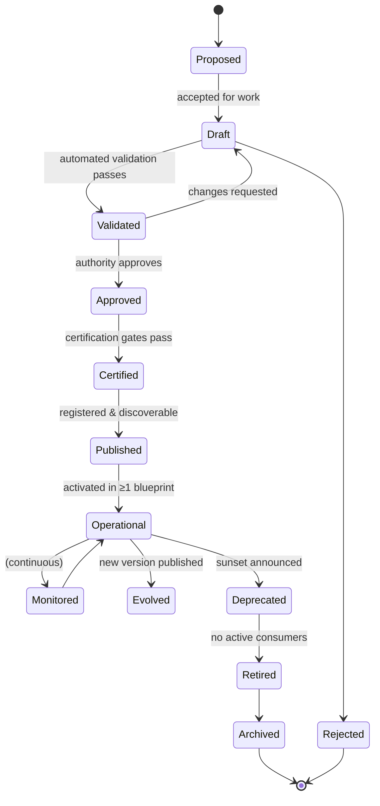

Transition guards (examples):
- `Validated → Approved` requires an `Approval` from an authority whose scope covers the definition's universe (§18).
- `Approved → Certified` requires every applicable `CertificationGate` (§28.2) to be green.
- `Deprecated → Retired` requires `activeConsumers == 0` (computed from the graph) or a forced migration (§29.4).

### 7.6 Context model

Every request, event, workflow step and AI call carries a **ContextEnvelope**. Context is resolved once at the edge and propagated (W3C Baggage + signed header `ucos-context`).

```yaml
ContextEnvelope:
  tenant: TenantRef
  platformInstance: BlueprintRef      # which certified blueprint is executing
  actor:  { identity: IdentityRef, kind: human|service|agent|device, onBehalfOf: IdentityRef? }
  roles: RoleRef[]
  organization: OrgRef?
  jurisdiction:                       # role-keyed map (A-08); consumers declare which role decides
    { actor: [JurisdictionRef], buyer-delivery: [..], seller: [..], data-storage: [..], store: [..], payment-acquirer: [..] }
  locale: LocaleRef                   # language + region formats
  currency: CurrencyRef
  timezone: TZRef
  time: { now: TimePoint, asOf: TimePoint? }   # asOf enables time-travel queries & simulation
  channel: ChannelRef                 # web, ios, android, pos, voice, agent, api...
  device: { id, trust: low|medium|high, fingerprintRisk }
  geo: { coordinate?, place? }
  risk: { score: 0..100 | null, band: low|medium|high|unknown, signals: [] }   # Phase 1: unknown (treated as medium)
  consent: ConsentSnapshotRef
  frame: { reality, body, spatialFrame, timeScale, calendarSystem, sideEffectPolicy }   # U77 (A-27); default ucos:frame:earth-physical
  simulation: boolean                 # derived: frame.reality.kind ∈ {simulated, hypothetical} → no external side effects (§29.6)
  purpose: PurposeRef?                # narrowing only (CTX-L2), e.g. customer-support
  trace: { traceId, spanId }
```

**Context dimensions** (consolidated from all versions): Identity, Organizational, Tenant, Temporal, Spatial/Geographic, Jurisdictional/Regulatory, Linguistic, Cultural, Economic/Financial, Commercial/Marketplace, Channel/Device, Security, Risk, Behavioral, Operational, Environmental, Knowledge, AI, Observer, Reality (physical/digital/simulated), Hypothetical/Simulation.

Dimensions that need no runtime fields (Cultural, Observer, Reality) are resolved through `ContextRule`s. For example, `if locale=ar-* then layoutDirection=rtl`, or `if simulation=true then reality=simulated`.

### 7.7 Traceability model

Every artifact MUST be reachable in the graph along this chain (the "Graph of Everything"):


`ucos trace <id>` returns the full chain. A missing link is reported as a Gap of kind `TRACEABILITY` (§11.6).

---

## 8. Capability Genome & Capability Pack Specification

### 8.1 The genome

Every capability follows one structure. This solves the gap the source repeatedly called "the biggest missing artifact", the **Universal Capability Ontology**:

```text
Capability
 ├── Identity & Purpose         id, version, universe, steward, purpose, outcomes
 ├── Constitution binding       laws/policies it implements
 ├── Ontology & Taxonomy        concepts it introduces/uses
 ├── Data Model                 object types provided / extended / referenced
 ├── Commands & Queries         API model (sync)
 ├── Events                     emitted / consumed
 ├── Workflows                  state machines, human tasks
 ├── Decisions                  decision tables / models it exposes for configuration
 ├── Temporal bindings          triggers, SLAs, schedules (by reference)
 ├── Policies                   default authz policies, obligations
 ├── Security model             data classes, scopes, threat model ref
 ├── Compliance model           control mappings
 ├── AI model                   agents/tools/models it offers or uses
 ├── UI model                   views, components, journeys
 ├── Integration                ports (outbound) + adapters it supports
 ├── Configuration schema       what a tenant may configure
 ├── Dependencies               requires / optional / conflicts / extensionPoints
 ├── Analytics & Signals        metrics, SLOs, business KPIs
 ├── Tests                      contract, unit, scenario, security, perf
 ├── Documentation              user, admin, API, runbooks
 ├── Cost & capacity model      cost drivers, scaling hints
 ├── Risks                      known risks + mitigations
 ├── Certification              required gates
 └── Evolution path             deprecations, successors, migrations
```

### 8.2 Capability manifest (`capability.yaml`): full example

```yaml
apiVersion: ucos.io/v1
kind: Capability
metadata:
  id: commerce.cart
  version: 2.3.0
  universe: U24-commerce
  steward: ucos:org:team-commerce-core
  purpose: "Collect offers a buyer intends to purchase, price them in context, and hand off to checkout."
  outcomes: [cart-conversion, accurate-pricing]
  maturity: certified            # experimental | beta | certified | deprecated
implements:
  laws: [L1, L2, L7, L8, L13]
spec:
  provides:
    objectTypes:
      - commerce.cart.Cart@2
      - commerce.cart.CartLine@2
    commands: [CreateCart, AddLine, UpdateLineQuantity, RemoveLine, ApplyCoupon, RemoveCoupon, MergeCarts, ConvertToCheckout]
    queries:  [GetCart, GetCartByBuyer]
    events:
      emits:    [commerce.cart.created, commerce.cart.line-added, commerce.cart.line-removed, commerce.cart.coupon-applied, commerce.cart.abandoned, commerce.cart.converted]
      consumes: [catalog.listing.unpublished, pricing.pricelist.changed, inventory.stock.depleted]
    decisions:
      - id: commerce.cart.max-lines         # tenant-configurable decision table
      - id: commerce.cart.abandonment-rule
  requires:
    - capability: catalog.listing        version: ">=1.2 <2"
    - capability: pricing.engine         version: ">=3"
    - capability: identity.core          version: ">=1"
    - capability: temporal.core          version: ">=1"     # abandonment timer, coupon validity
  optional:
    - capability: offer.engine           enables: [ApplyCoupon]
    - capability: inventory.availability enables: [real-time-stock-check]
    - capability: tax.determination      enables: [tax-inclusive-estimates]
  conflicts: []
  extensionPoints:
    - id: commerce.cart.line-validators   # other packs may contribute validators
      contract: ucos.ext.Validator@1
    - id: commerce.cart.ui.line-widgets
      contract: ucos.ext.UIWidget@1
  temporal:
    triggers:
      - id: cart-abandonment
        kind: inactivity
        durationRef: decision:commerce.cart.abandonment-rule.idleDuration   # default PT2H
        emits: commerce.cart.abandoned
  configuration:
    schema:
      guestCheckoutAllowed: { type: Boolean, default: true }
      cartTTL: { type: TemporalRef, kind: Duration, default: "P30D" }
      mergeOnLogin: { type: Enumeration, values: [merge, replace, ask], default: merge }
  policies:
    defaults:
      - policy: commerce.cart.owner-only     # buyer can read/write own cart
      - policy: commerce.cart.agent-scope    # agents need delegated 'cart:write' authority
  security:
    dataClasses: [PII]          # buyer link
    scopes: [cart:read, cart:write]
    threatModel: docs/threat-model.md
  compliance:
    controls: [ucos.ctrl.data-minimisation, ucos.ctrl.audit-logging]
  ai:
    tools:
      - id: cart.add_line          # exposed via MCP/agent tool registry
        command: AddLine
        authority: cart:write
  ui:
    views: [cart.mini@1, cart.page@2, cart.drawer@1]
    journeys: [buy-flow@1]
  signals:
    metrics: [cart_created_total, cart_conversion_ratio, cart_abandon_ratio, add_line_latency_ms]
    slos:
      - name: AddLine latency
        objective: "p99 < 150ms"
        rollingWindow: P28D
  tests:
    contract: tests/contract/
    scenarios: tests/scenarios/*.feature
    security: tests/security/
    performance: { profile: tests/perf/cart.k6.js, target: "2k rps/cell" }
  docs: { user: docs/user.md, admin: docs/admin.md, api: generated, runbooks: docs/runbooks/ }
  cost:
    drivers: [carts_active, lines_per_cart]
  risks:
    - id: price-drift
      mitigation: "Re-price at ConvertToCheckout; display 'price changed' notice."
  certification:
    gates: [ARCH-*, SEC-*, CMP-*, TEST-*, PERF-*, A11Y-*, DOC-*, OBS-*]
  evolution:
    deprecates: []
    migrations: [migrations/2.2-to-2.3.yaml]
```

### 8.3 Pack anatomy and packaging

```text
packs/commerce.cart/
├── capability.yaml            # the genome (above)
├── schemas/                   # object types, value types (YAML → JSON Schema)
├── api/                       # OpenAPI fragments, GraphQL SDL, protobuf
├── events/                    # AsyncAPI + CloudEvents schemas
├── workflows/                 # workflow DSL
├── decisions/                 # DMN / decision tables with defaults
├── policies/                  # Cedar policies (+ OPA for infra)
├── ui/                        # view definitions (UI meta-model), widgets
├── src/                       # pack behaviour (only place code lives)
│   ├── handlers/              # command handlers, event handlers
│   ├── ports/                 # outbound interfaces (e.g. PaymentProviderPort)
│   └── adapters/              # vendor adapters (only here can vendor SDKs be imported)
├── migrations/
├── tests/
├── docs/
└── i18n/                      # message bundles (no hard-coded strings in src/ or ui/)
```

- Packs are built into an **OCI artifact**, then signed with Sigstore/cosign. Each carries an SBOM (CycloneDX) and SLSA level-3 provenance.
- Pack runtime: a containerised service implementing the **Pack Runtime Contract** (§13.4), or a WASM module for lightweight extension points (validators, computed fields). WASM is strongly sandboxed.
- Publishing a pack requires certification (§28) and registers it in the Capability Registry and the Knowledge Graph.
- **Capability kinds (A-13):** `abstract` (port only), `core`, `adapter` (implements a port for a provider), `simulator` (contract-faithful stand-in, required for every external-I/O port), `extension` (WASM, extension points only), `ui-pack`, `data-pack` (reference/regime/compliance content), `industry-pack`. Each manifest also declares `scope`: `platform` (always present control-plane or global service) or `tenant` (composed into blueprints). The formal gRPC `PackRuntime` contract is in U57 §5.1, and the SDK in `engineering/KERNEL-DESIGN.md` §7.
- **Machine-readable manifests** live in `spec/capabilities/packs/*.yaml` (109 manifests in v1.1), validated by `spec/capabilities/capability-manifest.schema.json` and `tools/ucos_check.py`.

### 8.4 Dependency semantics

| Keyword | Meaning | Resolver behaviour |
|---|---|---|
| `requires` | Hard dependency with a SemVer range | Pull into the closure. If unsatisfiable → `MANDATORY` gap. |
| `optional` | Unlocks listed features when present | Not pulled automatically. Suggested if the PD intent mentions an enabled feature. |
| `conflicts` | Cannot coexist | Conflict gap; the builder must choose. |
| `provides` | Object types/commands/events this pack is the **sole** owner of | Collision with another pack → publish rejected (L4). |
| `extensionPoints` | Typed slots others may fill | Contributions are validated against the contract. |
| `implements` (interface) | Pack implements an abstract capability, e.g. `payment.provider` | Several implementations may coexist (adapters). Context selects one at runtime (e.g. country → PSP). |

**Abstract vs concrete capabilities:** `payment.provider` is abstract; `payment.provider.stripe`, `payment.provider.razorpay` and `payment.provider.adyen` implement it. The Composition Substrate chooses implementations from context rules. For example, `jurisdiction=IN ∧ method=UPI → razorpay|payu`. That is how "no payment gateway is hard-coded" is achieved.

### 8.5 Capability Registry & Marketplace

The Capability Marketplace (Layer 005 of the source) is the Capability Registry plus a storefront:
- **Discovery:** search by outcome, industry, object type, compliance coverage, maturity, rating, cost.
- **Packaging:** packs, plus **Capability Bundles**, which are curated sets such as "Marketplace Starter" or "Subscription Media".
- **Licensing & billing:** each pack can declare a price model (free, per-tenant, usage-based, revenue-share). This is metered by the Entitlement and Ledger universes, so third-party pack vendors can be paid.
- **Trust:** publisher verification, certification badge, security score, runtime health and adoption.
- **Governance:** pack-level policies, allowed-publisher lists per tenant, and kill-switch (revocation propagates to all cells within a defined SLA).

---

## 9. Universal Temporal Universe

The chat elevated Temporal to a **top-tier constitutional universe** and did not leave it as a Calendar feature. This section is its build specification. **Every** universe that deals with time consumes it.

### 9.1 Canonical temporal objects

| Object | Definition | Representation |
|---|---|---|
| **TimePoint** | An instant | RFC 3339 UTC + original TZ: `{ "utc": "2026-10-01T06:30:00Z", "tz": "Asia/Kolkata" }` |
| **LocalDateTime** | Wall-clock time without an instant (e.g. "store opens 10:00") | `{ "local": "10:00", "tz": "Asia/Kolkata" }` resolved per date |
| **LocalDate / LocalTime / LocalTimeWindow** | Calendar date, wall time, daily window (A-03) | `"2026-10-02"`, `"10:00"`, `{ start: "10:00", end: "22:00" }` (end < start crosses midnight) |
| **BusinessDuration** | Duration counted only in a named calendar's working time (A-03) | `{ value: "P2D", calendar: "ucos:cal:in-business" }` |
| **TimeRange** | Interval `[start, end)` | `{ start: TimePoint, end: TimePoint? }` (open-ended allowed) |
| **Duration** | Length of time | ISO 8601 `PT2H`, `P3D`, `P2M`, plus business-time variants `{ value: "P2D", calendar: "ucos:cal:in-business" }` |
| **Recurrence** | Repeating pattern | RFC 5545 RRULE + EXDATE + calendar binding: `FREQ=WEEKLY;BYDAY=SA,SU` |
| **Calendar** | Named set of working/non-working periods | Types: Gregorian, Fiscal (4-4-5, custom FY), Holiday (country/region/tenant), Business-hours, Resource, Settlement, Trading session |
| **AvailabilityWindow** | When a resource/offer/store can be used | `Recurrence × TimeRange × Calendar × Capacity` |
| **Slot** | A bookable unit derived from availability | `{ resource, range: TimeRange, capacity, remaining }` |
| **Reservation** | A claim on slot capacity | `{ slot, holder, status: held|confirmed|released, holdExpires }` |
| **SLAClock** | Elapsed business time against a target, with pauses | `{ target: Duration, calendar, pausedOn: [states], breachAt }` |
| **Trigger** | A temporal or hybrid condition that fires an event | §9.3 |
| **Timeline** | Ordered events of an object (past, present, scheduled future) | Projection over events and schedules |
| **TemporalPolicy** | **Reusable** bundle of validity + recurrence + windows + timezone + calendar | §9.2 |
| **Forecast** | Predicted temporal series | Produced by the Forecasting engine, stored as time-series |
| **SLADefinition / Schedule** | SLA template; named group of triggers with one lifecycle (A-03) | U13 §3.8, §3.10a |
| **Waitlist / QueueToken** | Ordered demand when capacity is full; walk-in and virtual queues (A-45) | U13 Appendix E |
| **CalendarFeed / ExternalCalendarLink / Invitation / Reminder** | ICS publishing; Google, Microsoft and CalDAV sync; invites; relative reminders (A-45) | U13 Appendix E |

**Frame-aware time (A-24):** `TimePoint` may carry a time `scale` (UTC by default; TAI, Mars MTC, Lunar LTC, world or simulation clocks). Calendars belong to a calendar system (Gregorian by default; Hijri, Vikram Samvat, Mars sol-based…). See U77.
**Naming rule (A-45, A-47):** field names carry their Temporal type. `*At`, `expires*`, `deadline` and `validUntil` are TimePoints; `validity`, `period` and `term` are TimeRanges; `window` is a TemporalPolicy; `ttl` and `timeout` are Durations; `schedule` is a Recurrence. These names are reserved for time fields. `TEMPORAL-BINDING-MATRIX.md` binds every universe's time needs (U01–U109) to these mechanisms, and gate `ARCH-TMP-05` enforces it.

### 9.2 TemporalPolicy (Knowledge Once in practice)

**Never** model `offer.start_date/end_date`, `coupon.start_date/end_date`, `subscription.start_date/end_date` or `booking.start_date/end_date` independently.

```yaml
kind: TemporalPolicy
id: ucos:tmp:TMP-001
name: "Weekend Evening Window — India"
tenant: ucos:tenant:acme
validity:   { start: "2026-01-01T00:00:00+05:30", end: "2026-12-31T23:59:59+05:30" }
recurrence: "FREQ=WEEKLY;BYDAY=SA,SU"
window:     { local: "10:00-22:00" }
timezone:   Asia/Kolkata
calendar:   { include: [], exclude: [ucos:cal:in-national-holidays-2026] }
blackouts:  [ { start: "2026-11-01", end: "2026-11-03" } ]   # Diwali stock freeze
precedence: 100
```

The same policy is referenced by 100 offers, 50 campaigns, 20 coupons, loyalty multipliers, seller incentives and marketplace promotions:

```yaml
kind: Offer
id: ucos:offer:01J...
type: percentage-discount
temporalPolicy: ucos:tmp:TMP-001          # ← reference, not dates
eligibilityPolicy: ucos:pol:new-buyers
pricingPolicy: { percent: 15, cap: { amount: "500.00", currency: INR } }
governancePolicy: ucos:pol:marketing-approval-required
```

### 9.3 Trigger Engine

| Trigger kind | Example | Implementation |
|---|---|---|
| Time | "At 10:00 Asia/Kolkata daily" | Durable timer (scheduler shards) |
| Recurrence | "Every Monday", "Every month end", "Every festival (holiday calendar tag)" | RRULE expansion, materialised in a 90-day rolling horizon |
| Relative | "2 hours after payment", "3 days before expiry" | Event-anchored timer: `anchor: payment.payment.captured, offset: PT2H` |
| Inactivity | "Cart idle 2h" | Timer reset on matching events |
| Event | "After shipment" | Event subscription |
| Condition | "If inventory < 10", "If risk score > 90" | Continuous query on a stream (stateful stream processor) |
| Hybrid | "If SLA breached during business hours" | Composition of the above via Decision engine |
| Geo-temporal | "When driver enters geofence between 18:00–22:00" | Geo stream + window |
| Policy/Compliance | "Retention period elapsed", "Certificate expires in 30 days" | Temporal facts on objects |
| AI | "When forecast demand exceeds capacity" | Forecast series + condition trigger |

Triggers are **data**: `Trigger { kind, spec, target: (event | command | workflowSignal), idempotencyKey, misfirePolicy: fire-once|skip|catch-up, owner }`.

Guarantees: at-least-once delivery with idempotency keys; misfire handling defined per trigger; clock source is cell-synchronised NTP/PTP with monotonic guards; DST transitions follow the IANA tz database rules (a nonexistent local time shifts forward, an ambiguous one uses the first occurrence unless specified).

### 9.4 Temporal consumers (binding map)

| Domain | Uses |
|---|---|
| Commerce/Offer | offer validity, flash sales (10:00–11:00 every Friday), coupon expiry, campaign schedules, price-change effective dates, inventory allocation windows |
| Subscription/Billing | renewal recurrence, billing cycles, proration (Duration math), grace periods, dunning schedules |
| Logistics | pickup windows, delivery slots, transit durations, cut-off times, driver shifts, route schedules |
| Marketplace | seller onboarding windows, auction/bid periods, settlement periods (T+N on settlement calendar) |
| Finance | interest accrual (day-count conventions), EMI schedules, trading sessions, fiscal periods, period close |
| ERP/HRMS | payroll cycles, attendance, leave, shifts, production schedules |
| CRM/Support | follow-ups, reminders, SLA clocks, escalation timelines |
| AI | training windows, retraining cadence, feature freshness |
| Security | credential, session, token and certificate expiry; key rotation schedules |
| Compliance | retention periods, filing deadlines, audit periods |

> **Complete binding:** `constitutions/TEMPORAL-BINDING-MATRIX.md` lists, for all 100 universes, every time need and the Temporal mechanism it must use. `constitutions/U13-temporal/constitution.md` Appendix E adds calendar feeds and sync, invitations, multi-party availability, waitlists, queue tokens, reminders and time off.

### 9.5 Universal Calendar Product (generated from Temporal)

A Calendar capability (`temporal.calendar`) renders any calendar-typed object: personal (with Google/Outlook sync connectors), resource (rooms, vehicles, machines), commerce (sales, offers, campaigns), logistics (delivery/pickup), workforce (shifts, attendance), manufacturing (production), financial (fiscal, settlement), AI (training). It provides the views `calendar.month|week|day|agenda|timeline|resource-grid` (see wireframe W10).

### 9.6 Temporal governance, simulation and twin

- **Governance:** timezone database version pinned per release; holiday calendars have stewards per country and are versioned; fiscal calendars are approved by Finance authority.
- **Simulation:** `ContextEnvelope.time.asOf` lets any decision, price or availability be evaluated "as of" a past or future time. Scenarios such as "what if a 20% discount runs every weekend in Q4" run against the Simulation universe (§29.6).
- **Temporal twin questions:** what happened (event store), what is happening (live state), what will happen (schedules), what could happen (simulation), what should happen (optimisation).

### 9.7 Temporal API (excerpt)

```http
POST /v1/temporal/availability:query
{ "resources": ["ucos:resource:room-12"], "range": {"start":"2026-10-05T00:00:00+05:30","end":"2026-10-06T00:00:00+05:30"},
  "duration": "PT30M", "calendar": "ucos:cal:clinic-hours" }
→ 200 { "slots": [ {"start":"...","end":"...","capacity":1,"remaining":1}, ... ] }

POST /v1/temporal/reservations          (Idempotency-Key required)
{ "slot": "ucos:slot:01J...", "holder": "ucos:person:01J...", "hold": "PT10M" }

POST /v1/temporal/policies:evaluate
{ "policy": "ucos:tmp:TMP-001", "at": "2026-10-03T19:00:00+05:30" }
→ 200 { "active": true, "nextChange": "2026-10-03T22:00:00+05:30" }
```

---

## 10. Global Product & Service Intelligence Network

The chat asked for "every product and service in existence available for reuse". It is built as a **knowledge network** with provenance, not as a static catalog.

### 10.1 Master vs tenant separation

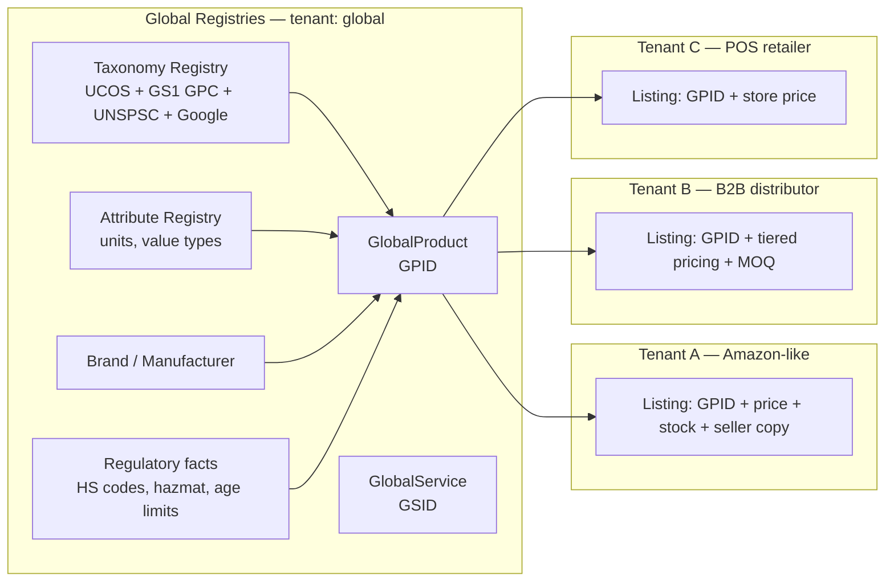

Example: **"Apple iPhone 17, 256 GB, Black"** exists **once** as `ucos:gproduct:01J…` with GTINs, specs, compliance facts and media rights. An Amazon-like store, a Flipkart-like store, a B2B marketplace, an ERP, a POS, a WMS, analytics, the recommendation engine and AI agents all reference that GPID. Tenant-specific facts (price, stock, seller description, warranty terms) live in tenant **Listings**.

### 10.2 Global product model

```yaml
GlobalProduct:
  id: ucos:gproduct:01J...
  identifiers: [ {scheme: GTIN-13, value: "0195949xxxxxx"}, {scheme: MPN, value: "MYxx3HN/A"} ]
  brand: ucos:brand:apple
  manufacturer: ucos:org:apple-inc
  productModel: ucos:gproductmodel:iphone-17        # family/model level
  variantAxes: [storage, color]
  variantValues: { storage: {value: 256, unit: GB}, color: ucos:color:black }
  classification:
    ucos: ucos:tax:electronics/phones/smartphones
    gs1-gpc: "10008047"
    unspsc: "43191501"
    hs: "8517.13"
  attributes:                              # each key is a registered Attribute
    display.diagonal: { value: 6.3, unit: in }
    battery.capacity: { value: 3600, unit: mAh }
    connectivity.5g: true
  regulatory: { batteryHazmat: UN3481, eWasteCategory: "...", minAge: null }
  media: [ucos:asset:...]                  # with rights metadata
  provenance: { sources: [manufacturer-feed, gs1-registry, tenant-contribution], confidence: 0.97 }
  lifecycle: { status: Published, launchedOn: TemporalRef }
```

**Services** follow the same pattern (`GlobalService` with `GSID`): consulting, transport, healthcare, education, streaming, banking, telecom, legal, repair, AI services, robot services. Each has a delivery model (on-site, remote, hybrid, async), SLA templates, scheduling requirements (Temporal) and capacity semantics (Resource).

**Attribute Registry:** every attribute has an id, value type, unit dimension (length, mass, power, data size, currency, rate…), allowed values (taxonomy-backed enumerations), localisation and validation. Physical, digital, financial, behavioural, operational and regulatory attribute families exist. New attributes are added as data.

**Product natures and regulated goods (A-29, A-56):** a product-nature registry covers 21 natures: physical durable and consumable, perishable/cold-chain, living, bulk commodity, energy, water, real property, vehicle, digital download, licence and streaming right, data product, IP licence, environmental credit, rights/permits/spectrum, financial instrument (U100 only), virtual item (U77), tokenised asset (U99), labour time, admission, gift value and service plan. A `RegulatedGoodsProfile` (25 categories, per jurisdiction) is enforced at catalogue, checkout, fulfilment, tax, customs and search. Product relationships (accessories, spare parts, compatibility/fitment, successors), product documents (SDS, certificates, manuals) and lifecycle facts are in U18 Appendices D and E. Configurable products, installed base, warranty, rental, ticketing and stored value have their own universes (U78–U84).

### 10.3 Ingestion & enrichment pipeline

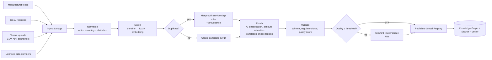

- **Survivorship rules** (data, per attribute): `manufacturer > gs1 > licensed > tenant > ai`, overridable by a steward.
- **Quality score:** completeness, consistency, freshness, source trust, conflict count.
- **AI enrichment** is always flagged `provenance.method=ai` with a confidence value. Facts below the confidence threshold are never auto-published.
- **Legal:** a crawled or licensed source carries a licence and usage rights. The registry enforces rights on redistribution to tenants. "Auto crawl" is allowed only for sources whose terms permit it.

### 10.4 Commercial intelligence (attached, not merged)

Pricing intelligence (market price ranges), demand signals and competitor observations are separate `KnowledgeObject`s linked to GPIDs. They carry their own provenance and trust score, and are aggregated across tenants **only** with consent and k-anonymity thresholds (§20.5).

### 10.5 Industry & template registry

Industry templates bundle a taxonomy subset, attribute sets, typical capability bundles, workflows, compliance packs and UI templates. Starter templates: Retail, Grocery, Fashion, Electronics, Pharmacy, Restaurants/Food delivery, Mobility, Hospitality, Travel, Healthcare clinic, Education/LMS, Media/OTT, Fintech-brokerage, B2B distribution, Manufacturing, Government services. Using a template pre-fills a Platform Definition (§11.2).

---

## 11. Universal Composition Substrate

The chat identified this as **"the constitutional core"** and "the most critical missing document". It is the engine that answers, *without hard-coding*:

> Given Industry = Commerce, Countries = 40, Channels = Web + Mobile, Capabilities = Marketplace + Logistics + Payments, which entities, workflows, APIs, databases, UI, tests, security controls, compliance controls and AI agents must exist, and which are missing?

### 11.1 Pipeline overview

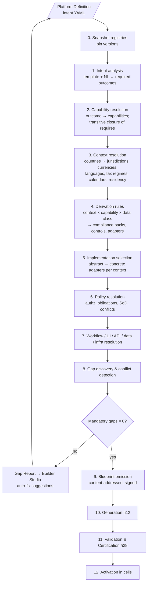

### 11.2 Platform Definition (input)

```yaml
apiVersion: ucos.io/v1
kind: PlatformDefinition
metadata:
  id: ucos:pd:bazaar-marketplace
  tenant: ucos:tenant:bazaar
  version: 1.0.0
spec:
  template: ucos:industry-template:multi-vendor-marketplace@2
  industry: [ucos:industry:retail/general-merchandise, ucos:industry:retail/electronics]
  businessModel: [B2C, marketplace, C2C?]       # '?' = exploring, generates recommendations only
  geography:
    countries: [IN, AE]
    primaryCurrency: { IN: INR, AE: AED }
    languages: [en, hi, ar]
    dataResidency: strict                     # data stays in-country where law requires
  channels: [web, ios, android, whatsapp, agent-api]
  capabilities:                               # explicit asks (resolver adds the rest)
    include: [marketplace.core, logistics.multi-carrier, payment.core, offer.engine, reviews.core, recommendation.basic, support.case]
    exclude: [loyalty.*]
  portals: [storefront, seller, admin, support, finance, governance]
  compliance:
    frameworks: [PCI-DSS, SOC2, ISO27001]     # declared; jurisdictional ones are derived
  security:
    profile: ucos:secprofile:high             # e.g. MFA for sellers, step-up for payouts
  ai:
    profile: ucos:aiprofile:assistive         # agents may propose, humans approve financial actions
    providers: { default: anthropic, allowed: [anthropic, openai, self-hosted] }
  scale:
    expected: { monthlyActiveBuyers: 5_000_000, peakOrdersPerMinute: 3000, sellers: 50_000 }
  operatingModel:
    cells: auto                               # resolver picks cells honoring residency
    availabilityTier: T1                      # 99.95%
  brand: { theme: ucos:theme:bazaar, domains: [bazaar.in, bazaar.ae] }
  overrides: { "payment.provider@IN": payment.provider.payu }   # explicit adapter choice (A-14); still certified
  targetPhase: 2                                                  # blueprint must be achievable in this phase (A-66)
  frame: ucos:frame:earth-physical                                # U77 (A-27)
```

### 11.3 Derivation rules ("how the platform knows")

Required items are derived by **rules stored as data** in the Rule Registry. These are Datalog-style facts and rules evaluated over the Knowledge Graph. Adding a new country, regulation or capability means adding facts or rules. **The composer itself never changes.**

```prolog
% Facts (registry data)
jurisdiction_of(country:IN, jur:IN).            
regulation_applies(reg:DPDP-2023, jur:IN).
regulation_applies(reg:RBI-PA-Guidelines, jur:IN) :- capability(payment.core).
regulation_applies(reg:UAE-PDPL, jur:AE).
data_class(payment.core, PCI).
data_class(identity.core, PII).
requires_control(reg:DPDP-2023, ctrl:consent-notice).
requires_control(reg:DPDP-2023, ctrl:dsr-access-erasure).
control_implemented_by(ctrl:consent-notice, privacy.consent).
control_implemented_by(ctrl:dsr-access-erasure, privacy.dsr).
adapter_for(payment.provider, jur:IN, method:UPI, payment.provider.razorpay).
adapter_for(tax.determination, jur:IN, tax.gst-india).
adapter_for(tax.determination, jur:AE, tax.vat-uae).
residency_required(jur:IN, data_class:PCI, payment-data-localisation).

% Rules (generic — never change for new countries)
required_capability(C) :- requested(C).
required_capability(D) :- required_capability(C), requires(C, D).
required_capability(Impl) :- required_capability(Abs), abstract(Abs), in_scope(J), adapter_for(Abs, J, Impl).
required_capability(Impl) :- in_scope(J), regulation_applies(R, J), requires_control(R, Ctrl),
                             control_implemented_by(Ctrl, Impl).
gap(missing_capability, C) :- required_capability(C), not available(C).
gap(uncertified, C)       :- required_capability(C), available(C), not certified(C).
gap(conflict, C1, C2)     :- required_capability(C1), required_capability(C2), conflicts(C1, C2).
gap(residency, Cell, J)   :- assigned_cell(Cell, J), residency_required(J, _, _), not cell_in(Cell, J).
```

Reference engine: a Datalog evaluator (e.g. Soufflé or a Rust Datalog crate embedded in the composer) over a snapshot of the graph. The **ResolutionTrace** records which rule produced each requirement. This powers the "**Why is this here?**" explanation in the UI (wireframe W5).

**v1.1 (A-60, A-62, A-66): facts as data.** Applicability facts live in `spec/rules/facts/{regulations,controls,defaults}.yaml`, and the generic rules in `spec/rules/core/closure.dl`. The base capability set (identity, org, party, geo, temporal, currency, l10n, context, entitlement, decision, workflow, integration, api, ui, tenant admin, observability, privacy ×3, compliance, and **communication core + in-app + inbound**) is data in `defaults.yaml`. So are channel requirements (web, push, WhatsApp, live chat, voice, video, social messengers) and default payment methods per country. `tools/ucos_check.py` runs the reference semantics over three reference platform definitions (D2C India+UAE, B2B India, omnichannel India). Each composes with **0 gaps**, deterministically.

### 11.4 Blueprint (output)

```yaml
apiVersion: ucos.io/v1
kind: Blueprint
metadata:
  id: ucos:blueprint:sha256:7f3c...            # content-addressed
  platformDefinition: ucos:pd:bazaar-marketplace@1.0.0
  registrySnapshot: ucos:snapshot:2026-10-02T09:00Z
  composerVersion: 3.4.1
spec:
  capabilities:                                  # fully pinned
    - { id: identity.core, version: 1.9.2 }
    - { id: temporal.core, version: 1.4.0 }
    - { id: catalog.listing, version: 1.6.1 }
    - { id: commerce.cart, version: 2.3.0 }
    - { id: marketplace.core, version: 2.0.3 }
    - { id: payment.core, version: 3.1.0 }
    - { id: payment.provider.razorpay, version: 1.8.0, scope: { jurisdiction: IN } }
    - { id: payment.provider.network-intl, version: 1.2.0, scope: { jurisdiction: AE } }
    - { id: tax.gst-india, version: 4.0.1, scope: { jurisdiction: IN } }
    - { id: tax.vat-uae, version: 2.2.0, scope: { jurisdiction: AE } }
    - { id: privacy.consent, version: 2.0.0 }
    - { id: privacy.dsr, version: 1.3.0 }
    # ... ~60 more
  objectTypes: 214
  commands: 486
  events: 371
  workflows: [order.lifecycle@3, seller.onboarding@2, payout.cycle@2, return.flow@2, dsr.flow@1, ...]
  policies: { authz: 912, obligations: 140, sod: 22 }
  controls: { total: 318, byFramework: { PCI-DSS: 112, DPDP: 41, UAE-PDPL: 38, SOC2: 87, ISO27001: 93 } }
  ui: { portals: 6, views: 402, journeys: 37, locales: [en-IN, hi-IN, en-AE, ar-AE] }
  integrations: [razorpay, network-intl, delhivery, aramex, gupshup-whatsapp, ...]
  ai: { agents: [catalog-enrichment, support-triage, seller-assistant], autonomy: L2 }
  infrastructure:
    cells: [ { id: cell-in-mum-1, jurisdiction: IN }, { id: cell-ae-dxb-1, jurisdiction: AE } ]
    tier: T1
  certification: { required: [ARCH, SEC, CMP, TEST, PERF, A11Y, DOC, OBS, DR] }
  resolutionTrace: ucos:trace:sha256:...
  config: { commerce.cart: { guestCheckoutAllowed: true }, ... }   # merged tenant config (A-14)
  decisions: { order.return-eligibility: tenant-v3, ... }          # pinned decision versions
  adapters: [ { abstract: payment.provider, jurisdiction: IN, method: upi, implementation: payment.provider.razorpay } ]
  placement: { IN: cell-in-mum-1, AE: cell-ae-dxb-1 }               # residency-driven (A-16)
```

### 11.5 Conflict & overlap detection

| Check | Example | Resolution |
|---|---|---|
| Ownership collision | Two packs both `provide` `Coupon` | Publish-time rejection (L4) |
| Capability conflict | `inventory.single-location` vs `inventory.multi-node` | Builder chooses; resolver suggests based on scale |
| Policy conflict | Allow and deny on the same action/resource with equal precedence | Policy analyser (Cedar validator / SMT) flags it; precedence must be set |
| Temporal conflict | Two TemporalPolicies on one offer with overlapping windows and different discounts | Decision table hit-policy must be declared |
| Compliance conflict | Data-retention minimum (tax law: 8 years) vs erasure request (privacy law) | Rule: legal hold overrides erasure; the record is minimised, not deleted (encoded as a control precedence) |
| Residency conflict | Cell placement violates residency | Resolver places the tenant shard in a compliant cell, or emits a gap |
| SoD violation | Same role can create a payout and approve it | Gap `SOD` with suggested role split |

### 11.6 Gap discovery: taxonomy, severity and report

**Gap kinds** (consolidating every "Missing X Detection" list in the source): `CAPABILITY, DOMAIN, OBJECT, RELATIONSHIP, WORKFLOW, DECISION, POLICY, SECURITY_CONTROL, COMPLIANCE_CONTROL, DATA (contract/retention/residency), INTEGRATION, API, UI (view/journey/locale/a11y), AI (guardrail/eval), TEST, DOCUMENTATION, OBSERVABILITY (signal/SLO/alert/runbook), RESILIENCE (backup/DR), INFRASTRUCTURE, GOVERNANCE (steward/approver), CERTIFICATION, TRACEABILITY, FAILURE_SCENARIO, USER_JOURNEY, PERFORMANCE, SCALABILITY, COST`.

**Discovery kinds (A-18):** `DUPLICATION, OVERLAP, CONFLICT, OBSOLESCENCE, UNUSED, UNDERPERFORMANCE, OPPORTUNITY`, plus `PHASE_NOT_AVAILABLE`, `MISSING_ADAPTER`, `MISSING_SIMULATOR`, `CONTROL_NOT_IMPLEMENTED` and `EVENT_WITHOUT_PRODUCER_IN_BLUEPRINT` (emitted by the checker).

**Severity:** `MANDATORY` (blocks activation), `RECOMMENDED` (blocks certification unless waived), `OPTIONAL` (advisory), `INSIGHT` (discovery output that feeds Evolution only; A-18). Fixes are first-class catalogue objects (`fix.add-capability`, `fix.choose-implementation`, `fix.split-role`, …), each with an effort type and a preview diff (U75 §3.3).

```json
{
  "kind": "GapReport",
  "blueprintCandidate": "ucos:pd:bazaar-marketplace@1.0.0",
  "summary": { "mandatory": 3, "recommended": 7, "optional": 12 },
  "gaps": [
    {
      "id": "GAP-0001",
      "kind": "COMPLIANCE_CONTROL",
      "severity": "MANDATORY",
      "title": "Card data localisation required for India",
      "because": ["regulation_applies(RBI-PA-Guidelines, IN)", "data_class(payment.core, PCI)"],
      "fixes": [
        { "action": "add-capability", "target": "payment.tokenization.network", "effort": "config" },
        { "action": "assign-cell", "target": "cell-in-mum-1", "effort": "config" }
      ],
      "authorityToWaive": "none"
    },
    {
      "id": "GAP-0004",
      "kind": "UI",
      "severity": "MANDATORY",
      "title": "Arabic (RTL) translations missing for 41 checkout strings",
      "fixes": [ { "action": "machine-translate-and-review", "effort": "ai+human" } ]
    },
    {
      "id": "GAP-0009",
      "kind": "OBSERVABILITY",
      "severity": "RECOMMENDED",
      "title": "No SLO alert route for payout.cycle workflow",
      "fixes": [ { "action": "apply-default-alert-policy", "effort": "config" } ]
    }
  ]
}
```

**Activation rule (L10):** `activate(blueprint) ⇔ mandatory = 0 ∧ ∀ recommended: (resolved ∨ waived_by_authority ∧ waiver.expiry > now) ∧ certification.status = PASSED`.

### 11.7 Composer properties

- **Pure and deterministic** (L18): `compose(PD, snapshot, composerVersion) → blueprint` is a pure function, hence cacheable and reproducible.
- **Explainable:** every element of the blueprint links to the rule(s) and input(s) that caused it.
- **Incremental:** a PD diff recomposes only the affected subgraph. The Studio shows a blueprint diff before apply (W5).
- **Simulatable:** a blueprint can be activated in a **simulation cell**, where external adapters are replaced by contract-faithful simulators.

---

## 12. Generation Engine & Platform Factory

### 12.1 Key architectural decision: interpret first, generate second (ADR-001)

The source asked for UI, API, DB, workflow, infra and test generation. There are two strategies:

| Strategy | Pros | Cons |
|---|---|---|
| **Generate code per tenant** | Familiar output; tenants can "eject" | N tenants × M versions of code to patch and secure; drift; slow rollout; violates L6 and L2 in practice |
| **Interpret metadata at runtime** (metadata-driven multi-tenant runtime, like Salesforce/ServiceNow) | One codebase to secure and scale; instant config changes; tenant changes are data | Runtime engines must be excellent; performance work goes into the engines |

**Decision:** UCOS **interprets** blueprints at runtime for data, API, workflow, policy, decision and UI. It **generates** only artifacts that are consumed *outside* the runtime or that benefit from static compilation:

| Generated artifact | Generator | Consumer |
|---|---|---|
| Client SDKs (TS, Kotlin, Swift, Python, Go) | OpenAPI/GraphQL → SDK generator | tenant developers, mobile apps |
| API reference & developer portal | spec → docs | developers |
| User/admin manuals, runbooks | capability docs + blueprint → doc generator (with AI drafting + human review) | users, SRE |
| Physical DB migrations for core object types | schema diff → SQL migration | data plane |
| Mobile app shells (white-label) | blueprint + theme → React Native/Expo build config | app stores |
| Infrastructure-as-code for cells | blueprint infra section → OpenTofu/Crossplane claims | GitOps |
| Test suites (contract, scenario, load, a11y) | blueprint → test generator | CI / certification |
| Dashboards & alert rules | signals → Grafana/alert manifests | ops |
| Compliance evidence packs, SBOM | evidence + SBOM → reports | auditors |
| Diagrams (C4, ERD, flows) | graph → Mermaid/Structurizr | everyone |

### 12.2 Generator contract

```yaml
kind: Generator
id: gen.sdk.typescript
version: 2.1.0
input:  [Blueprint.api, Blueprint.objectTypes]
output: { kind: npm-package, path: generated/sdk/ts }
deterministic: true                 # same input → byte-identical output (hash recorded)
templates: templates/sdk-ts/        # Handlebars/Jinja; no AI in deterministic generators
validation: [tsc --noEmit, contract-tests]
```

AI-assisted generators (documentation drafting, translations, test-idea generation) are marked `deterministic: false`. Their output is always a **proposal** that goes through review and certification. It is never activated directly.

### 12.3 Platform Factory flow (end to end)

```mermaid
sequenceDiagram
  autonumber
  actor B as Tenant Builder
  participant ST as Builder Studio
  participant CO as Composer
  participant GE as Generators
  participant CE as Certification
  participant GV as Governance
  participant DP as Data Plane (cells)
  B->>ST: Choose template, countries, channels, capabilities
  ST->>CO: compose(PD draft) [simulate=true]
  CO-->>ST: Blueprint candidate + Gap Report + Cost estimate
  B->>ST: Apply auto-fixes / configure / request waivers
  ST->>CO: compose(PD v1.0.0)
  CO-->>ST: Blueprint (0 mandatory gaps)
  ST->>GE: generate(blueprint)
  GE-->>CE: SDKs, docs, tests, IaC, dashboards
  CE->>CE: Run gates (ARCH, SEC, CMP, TEST, PERF, A11Y, DOC, OBS, DR)
  CE-->>GV: Certification report + evidence
  GV->>B: Approval request (release authority)
  B-->>GV: Approve (MFA step-up)
  GV->>DP: Activate blueprint (canary → full)
  DP-->>ST: Live; telemetry streaming to Platform Twin
```

### 12.4 Builder Studio (no-code builders)

Tenant/Company/Marketplace builder · Product & Service builder · Commerce-model builder · Object Designer · Workflow Designer · Decision Table editor · Temporal Policy editor · Policy editor · UI/Journey designer · Theme/brand designer · Integration/mapping builder · AI agent builder · Analytics/report builder · Compliance profile builder · Operations builder (SLOs, alerts) · Governance builder (authorities, approval chains).

Every builder writes **definitions** (canonical objects in Draft). It never writes code.

### 12.5 Specification repository generation (the "Genesis" process)

The Master Genesis Directive asked for 50 artifacts per universe across ~72 universes. That corpus is produced **incrementally, universe by universe**, from this document, using the repository layout in §31.3:

```text
Constitution (this doc) → Universe constitution → Ontology → Taxonomy → Object types → Schemas
→ Relationships → Events → Commands/APIs → Workflows → Decisions → Policies → Controls
→ UI models → Tests → Docs → Certification criteria
```

The per-universe template (the 50 sections from the Genesis Directive) is consolidated into **12 required sections**, with no loss of content:

| # | Section | Covers Genesis items |
|---|---|---|
| 1 | Constitution, authority, principles, laws | 1–4 |
| 2 | Ontology & taxonomy | 5–6 |
| 3 | Registry model & canonical objects/schemas/relationships | 7–10 |
| 4 | Events, APIs, service & runtime contracts | 11–12, 21–22 |
| 5 | Workflows, state machines, rules | 13–14, 16 |
| 6 | Policies, security, encryption, audit, compliance | 15, 17–20 |
| 7 | Validation, certification, versioning, dependency, reuse rules | 23–24, 26–28 |
| 8 | Discovery, gap detection, self-healing, evolution rules | 25, 29–31 |
| 9 | AI & agent governance | 32–33 |
| 10 | Twin, analytics, reporting, monitoring, operations | 34–38 |
| 11 | UI, UX, accessibility, localisation | 39–42 |
| 12 | Scalability, performance, DR, HA, multi-tenant/region/cloud | 43–50 |

---

# PART III — RUNTIME & DATA

## 13. Runtime Fabric

### 13.1 Engines (one execution fabric, generic engines)

| Engine | Responsibility | Reference implementation (§31.1) |
|---|---|---|
| API Gateway + PEP | TLS, authn, rate limit, context resolution, policy enforcement | Envoy-based gateway + custom filters |
| Command Bus | Routes commands to the owning capability; idempotency; audit | In-house (Go), backed by Postgres outbox |
| Object Service | Generic CRUD/query for any registered object type; schema validation; RLS | In-house (Go) |
| Policy Decision Point | Authorisation and obligations | Cedar (app authz), OPA (infra/admission) |
| Durable Workflow Engine | Long-running orchestrations, sagas, human tasks, timers | Temporal.io-class engine (name collision note: the *engine* vs the *Temporal Universe*) |
| Decision Engine | DMN decision tables, scoring, rule sets | DMN engine (e.g. GoRules ZEN) |
| Temporal Scheduler | Recurrences, timers, triggers, SLA clocks | In-house on top of the workflow engine + stream processor |
| Event Bus | Domain events, CDC, streams | Kafka-compatible (Kafka / Redpanda) |
| Stream Processor | Condition triggers, aggregates, fraud features | Flink |
| Query Engine | Read models, GraphQL federation | GraphQL federation router + read-model projections |
| Search Engine | Full-text, faceting, hybrid | OpenSearch |
| Vector Engine | Semantic retrieval | pgvector (small), Qdrant (scale) |
| Graph Engine | Knowledge Graph, traceability, dependency | Neo4j (control plane); Postgres + recursive CTE for tenant graphs |
| AI Gateway & Agent Runtime | Model routing, guardrails, tool calling, budgets | In-house gateway; MCP for tools |
| Simulation Engine | Runs blueprints/scenarios with simulated adapters and `asOf` time | Simulation cells |
| Twin Engine | Maintains twin state from definitions + telemetry | Stream projections |

### 13.2 Request lifecycle (command)

```mermaid
sequenceDiagram
  autonumber
  participant C as Client (web/app/agent)
  participant G as Gateway (PEP)
  participant X as Context Resolver
  participant P as PDP (Cedar)
  participant B as Command Bus
  participant K as Capability Pack (e.g. commerce.cart)
  participant D as Tenant DB (RLS)
  participant O as Outbox → Event Bus
  participant A as Audit Log
  C->>G: POST /v1/commerce/carts/{id}:addLine (JWT, Idempotency-Key)
  G->>X: resolve context (tenant, jurisdiction, locale, risk)
  X-->>G: ContextEnvelope (signed)
  G->>P: isAuthorized(principal, action=cart:AddLine, resource=cart, context)
  P-->>G: ALLOW + obligations [mask:none, audit:standard]
  G->>B: Command(AddLine) + context
  B->>B: idempotency check (key, hash)
  B->>K: handle(AddLine)
  K->>D: BEGIN; SELECT ... FOR UPDATE (version); INSERT line; UPDATE cart(version+1); INSERT outbox; COMMIT
  K-->>B: Result(cartVersion=8)
  B->>A: append(audit record, hash-chained)
  B-->>G: 200 {cart}
  G-->>C: 200 + ETag: "8"
  O-->>O: relay outbox → commerce.cart.line-added
```

### 13.3 Transaction, consistency and concurrency model

| Concern | Rule |
|---|---|
| Transaction boundary | One **aggregate** per transaction (e.g. Cart, Order, LedgerJournal). ACID inside it (Postgres). |
| Cross-aggregate / cross-capability | **Sagas** in the workflow engine, with compensating commands (e.g. `ReleaseStockReservation`). |
| Event publication | **Transactional outbox** → relay → event bus. No dual writes. |
| Concurrency | Optimistic locking (`version`), `If-Match` ETags on APIs; pessimistic `SELECT … FOR UPDATE` only inside short command handlers. |
| Idempotency | `Idempotency-Key` required on all non-GET commands; stored 24h–30d per command type; same key + different payload → 409. |
| Read models | Eventually consistent projections (target lag p99 < 2s); read-your-writes supported via `X-Consistency: strong` for the owning aggregate. |
| Money | Decimal strings, banker's rounding only where regulation says; ledger is double-entry and immutable; corrections are reversing entries. |
| Ordering | Per-aggregate ordering via event-bus partition key = aggregate id. |
| Exactly-once effects | At-least-once delivery + idempotent consumers (consumer offset + processed-event table). |

### 13.4 Pack Runtime Contract

Each pack service MUST:
1. Expose `/.well-known/ucos/pack` (manifest hash, version, health, readiness).
2. Accept commands via gRPC `ucos.pack.v1.CommandHandler/Handle(CommandEnvelope) → ResultEnvelope`.
3. Accept events via subscription on the bus with the standard consumer library (idempotency, retries, DLQ).
4. Use **only** the platform SDK for DB access, so that tenancy/RLS, encryption, auditing and outbox are enforced automatically.
5. Emit OTel traces/metrics/logs with standard attributes (`ucos.tenant`, `ucos.capability`, `ucos.command`).
6. Never call another pack's database. It calls commands/queries or consumes events only.
7. Run with a non-root, read-only filesystem, network policy limited to declared ports and adapters, and secrets via workload identity.
8. (v1.1) Have **no direct internet egress**. All external I/O goes through the U62 connector runtime and egress gateway (INT-L1). Every external-I/O port has a simulator (INT-L5).

### 13.5 Multi-tenancy model

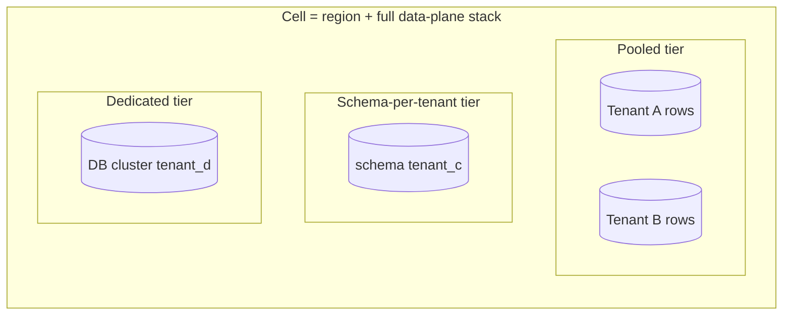

| Tier | Isolation | Use for |
|---|---|---|
| Pooled | Shared tables + Postgres Row-Level Security on `tenant_id` + per-tenant DEKs | SMB tenants, trials |
| Schema | Dedicated schema, shared cluster | Mid-market, custom indexes |
| Dedicated | Dedicated DB cluster (and optionally dedicated cell) | Enterprise, regulated (banking, health, government), residency |

Tier moves are online migrations orchestrated by the platform (logical replication + cutover). Noisy-neighbour controls: per-tenant rate limits, connection quotas, workload priority classes, and per-tenant Kafka quotas.

---

## 14. Data Architecture

### 14.1 Polyglot storage mapping

| Data kind | Store | Notes |
|---|---|---|
| Transactional canonical objects | PostgreSQL 16+ (Citus or cloud-managed, partitioned) | Core universes: generated physical tables; tenant extensions: `JSONB` + GIN indexes (ADR-003) |
| Ledger | PostgreSQL, append-only tables, hash-chained journals | Separate cluster in regulated tiers |
| Events / streams | Kafka-compatible | Retention per topic; compacted topics for state |
| Search | OpenSearch | Projections from events |
| Vector | pgvector / Qdrant | Embeddings for products, knowledge, support |
| Graph | Neo4j (control-plane UKG); Postgres for tenant relationships | |
| Documents / binaries | S3-compatible object storage | Encrypted, versioned, lifecycle rules |
| Time-series | Prometheus/Mimir (ops); ClickHouse (business series) | |
| Analytics / lakehouse | Apache Iceberg on object storage + Trino/Spark; ClickHouse for real-time | CDC from Postgres via Debezium |
| Cache | Redis (tenant-namespaced keys) | Never the source of truth |
| Audit | Append-only store (Postgres + WORM object storage replica) | Hash chain anchored daily |

### 14.2 Physical modelling of dynamic object types (ADR-003)

- **Core object types** (owned by certified packs) → generated physical tables with typed columns, constraints and indexes. Migrations are produced by the schema-diff generator and are always backward-compatible (expand → migrate → contract).
- **Tenant custom attributes** (`Extension` fields) → `custom JSONB` column validated against the tenant's extension schema. Tenants may request indexes, which the platform creates as expression indexes within quotas.
- **Registry-only types** (reference data, low volume) → generic `objects` table (`type, id, attributes JSONB`).

### 14.3 Residency, sovereignty and cells

- Each cell is pinned to a jurisdiction. A tenant's **data shards** are placed in cells that satisfy `residency_required` rules (§11.3).
- Cross-border flows (e.g. global catalog → tenant cell) carry only non-personal data unless a transfer mechanism (SCCs, adequacy, consent) is recorded as a fact in the Compliance universe.
- Global registries (products, taxonomies, reference data) replicate read-only to all cells.

### 14.4 Data contracts, lineage and quality

```yaml
kind: DataContract
id: dc.order.placed.v3
producer: commerce.order
schema: events/order.placed.v3.json
semantics: "Emitted once per order when payment authorisation succeeded or COD accepted."
sla: { freshnessObjective: "p99 < PT5S", completeness: "100%" }
classification: { dataClasses: [PII, FINANCIAL] }
consumers: [fulfillment.core, ledger.core, analytics.lakehouse, recommendation.basic]
breakingChangePolicy: "new major version; dual-publish for 90 days"
```

Lineage: OpenLineage events from pipelines plus the event-catalog graph give column-level lineage from source to report. Quality: Great-Expectations-style checks are attached to contracts, and failures create `DATA` gaps and alerts.

**Owner (A-41):** data catalogue, data contracts, data products, lineage, quality, master data and governed sharing are owned by **U93 Data Governance & Data Products**. Every persistent dataset must be registered before use (DATA-L1).

### 14.5 Data lifecycle

Classification → retention rule (resolved per jurisdiction × data class × legal hold) → archival (cold storage) → deletion or crypto-shredding (destroy the per-tenant or per-subject DEK). Legal hold suspends deletion. Every deletion produces evidence.

### 14.6 Bitemporal model

Canonical objects record **valid time** (`validFrom/validTo`, when it is true in the world) and **transaction time** (`recordedAt/supersededAt`, when the system knew it). This enables `asOf` queries, regulatory reconstruction ("what did we show the customer on 3 Oct?"), and simulation. It is implemented with history tables (temporal tables pattern) for core types and event replay for the rest.

---

## 15. API & Event Specification

### 15.1 API styles

| Style | Use | Contract |
|---|---|---|
| REST (JSON) | Public/tenant APIs; commands & queries | OpenAPI 3.1 generated from capability manifests |
| GraphQL (federated) | Experience/BFF reads, portals | One subgraph per universe |
| gRPC | Internal service-to-service, pack runtime contract | Protobuf |
| Events | Async integration, projections | AsyncAPI 3 + CloudEvents 1.0 |
| Webhooks | Tenant/external notification | Signed (HMAC-SHA256 + timestamp), retries with backoff |
| MCP | AI agents (internal & external) using platform tools | Tools generated from commands with authority scopes |

### 15.2 REST conventions

```text
Base:            https://{tenant-domain}/api/v1
Resources:       /{universe}/{collection}/{id}
                 /commerce/carts/{cartId}
Commands:        POST /{universe}/{collection}/{id}:{command}
                 POST /commerce/carts/{cartId}:addLine
Queries:         GET  /{universe}/{collection}?filter=...&sort=...&page[cursor]=...&page[size]=50
Generic object:  /objects/{type}/{id}   (any registered type, policy-checked)
Headers:         Authorization: Bearer <JWT> | Idempotency-Key | If-Match | Accept-Language
                 X-UCOS-Context-AsOf (simulation/time-travel, privileged) | traceparent
Versioning:      URL major (/v1); additive changes only within a major; deprecation via Sunset header
Errors:          RFC 9457 application/problem+json
Pagination:      cursor-based; total counts opt-in
Rate limits:     RateLimit-* headers (IETF draft), per tenant × API product × principal
```

Error example:

```json
{
  "type": "https://errors.ucos.io/policy/denied",
  "title": "Action not permitted",
  "status": 403,
  "detail": "Payout approval requires a different approver than the creator (SoD).",
  "instance": "/api/v1/marketplace/payouts/01J...:approve",
  "ucos": { "code": "POLICY_SOD_VIOLATION", "policy": "marketplace.payout.sod", "traceId": "4bf9..." }
}
```

### 15.3 Generic object API (works for any registered type)

```http
POST /api/v1/objects/healthcare.encounter.Encounter
GET  /api/v1/objects/healthcare.encounter.Encounter/{id}?expand=patient,practitioner
POST /api/v1/objects/{type}:query     { "where": {...}, "select": [...], "asOf": "..." }
GET  /api/v1/meta/types/{type}        # schema, commands, views — enables generic UIs/agents
```

### 15.4 Event envelope (CloudEvents + UCOS extensions)

```json
{
  "specversion": "1.0",
  "id": "01J9Z4...",
  "source": "ucos://cell-in-mum-1/commerce.order",
  "type": "order.order.placed",
  "dataschema": "ucos://schemas/order.placed/3.0.0",
  "subject": "ucos:order:01J9Z3...",
  "time": "2026-10-02T09:15:22.481Z",
  "datacontenttype": "application/json",
  "ucostenant": "ucos:tenant:bazaar",
  "ucosblueprint": "sha256:7f3c...",
  "ucoscontext": "eyJqdXIiOlsiSU4iXSwibG9jYWxlIjoiaGktSU4i...",
  "ucoscausation": "01J9Z4...prev",
  "ucoscorrelation": "checkout-01J9Z3...",
  "ucosclassification": "confidential",
  "traceparent": "00-4bf92f...-01",
  "data": {
    "orderId": "ucos:order:01J9Z3...",
    "orderNumber": "ORD-2026-00042117",
    "buyer": "ucos:party-role:01J...",
    "sellerSplit": [ { "seller": "ucos:org:...", "lines": 2, "subtotal": { "amount": "2499.00", "currency": "INR" } } ],
    "total": { "amount": "3127.40", "currency": "INR" },
    "placedAt": { "utc": "2026-10-02T09:15:22Z", "tz": "Asia/Kolkata" }
  }
}
```

### 15.5 Event naming & catalog

- `type = <universe>.<object>.<past-tense-verb>` (kebab-case verbs): `order.order.placed`, `payment.payment-intent.captured`, `temporal.trigger.fired`, `governance.blueprint.activated`.
- Topics: `ucos.<cell>.<universe>.<object>.v<major>`, partition key = aggregate id.
- Every event type is registered (schema, owner, classification, retention, consumers). Unregistered events are rejected by the producer SDK.
- Compatibility: schema registry enforces BACKWARD_TRANSITIVE within a major version.
- **Categories (A-12):** `domain` (business facts), `integration` (curated public facts for webhooks), `system` (definition and lifecycle), `signal` (high-volume telemetry-like, short retention), `audit` (to the audit store only).
- **Claim-check (A-12):** payloads ≤ 64 KB. Larger payloads go to object storage and the event carries a reference.
- Consumers MUST be idempotent (EVT-L6). Replays carry `ucosreplay=true`, and consumers with side effects skip them by default.

### 15.6 Canonical event families (seed)

| Universe | Events |
|---|---|
| Identity | identity.identity.registered, .verified, .suspended; identity.session.started, .ended; identity.role.granted, .revoked |
| Catalog | catalog.listing.created, .published, .unpublished, .updated |
| Offer | offer.offer.created, .activated, .expired, .redeemed |
| Pricing | pricing.pricelist.changed, pricing.price.overridden |
| Cart | commerce.cart.created, .line-added, .line-removed, .coupon-applied, .abandoned, .converted |
| Order | order.order.placed, .confirmed, .cancelled, .amended, .completed; order.return.requested, .approved |
| Payment | payment.payment-intent.created, .authorized, .captured, .failed; payment.refund.issued; payment.dispute.opened |
| Ledger | ledger.journal.posted, ledger.period.closed, ledger.settlement.completed |
| Inventory | inventory.stock.adjusted, .reserved, .released, .depleted |
| Fulfillment | fulfillment.shipment.created, .dispatched, .delivered, .failed |
| Temporal | temporal.trigger.fired, temporal.reservation.held, .confirmed, .expired; temporal.sla.breached |
| Governance | governance.proposal.submitted, .approved, .rejected; governance.blueprint.certified, .activated, .rolled-back |
| Compliance | compliance.control.failed, compliance.evidence.collected, privacy.dsr.received, .completed |
| AI | ai.agent-run.started, .tool-called, .completed, .escalated; ai.guardrail.triggered |

---

## 16. Workflow, Decision & Rules

### 16.1 Workflow DSL (state machine + orchestration)

```yaml
apiVersion: ucos.io/v1
kind: WorkflowDefinition
id: order.lifecycle
version: 3.0.0
object: commerce.order.Order
states:
  placed:      { on: { PaymentAuthorized: confirmed, PaymentFailed: payment_failed, Cancel: cancelled } }
  confirmed:   { entry: [ reserveStock, createFulfillmentOrders, postLedger(ORDER_CONFIRMED) ],
                 on: { AllShipmentsDispatched: shipped, Cancel: cancelling } }
  shipped:     { on: { AllShipmentsDelivered: delivered, DeliveryFailed: exception } }
  delivered:   { entry: [ startTimer(returnWindow) ],
                 timers: { returnWindow: { temporalPolicy: ref(decision:returns.window-by-category), then: completed } },
                 on: { ReturnRequested: return_in_progress } }
  completed:   { final: true, entry: [ releaseSellerPayoutHold ] }
  cancelling:  { saga: [ { do: releaseStock, compensate: none },
                         { do: voidOrRefundPayment, compensate: alertFinance },
                         { do: notify(template: order-cancelled) } ],
                 then: cancelled }
  cancelled:   { final: true }
  payment_failed: { timers: { retry: { duration: PT15M, then: cancelled } }, on: { PaymentAuthorized: confirmed } }
  exception:   { humanTask: { queue: support.logistics-exceptions, sla: ref(tmp:SLA-4H-BUSINESS) },
                 on: { Resolved: shipped, Refund: cancelling } }
  return_in_progress: { subworkflow: return.flow@2, then: completed }
guards:
  Cancel: "state in [placed, confirmed] and not anyShipmentDispatched"
observability: { slo: { "placed→confirmed": "p95 < 60s" } }
```

**YAML note (A-74):** quote the `"on"` key. YAML 1.1 parsers (PyYAML, Go yaml.v2) read a bare `on:` as the boolean `true`; the machine-readable definitions in `spec/workflows/` quote it, and CI rejects boolean keys.

Human tasks support assignment rules (Decision), approvals (n-of-m, sequential, parallel), delegation, escalation chains bound to SLA clocks, and four-eyes/SoD guards from policy.

### 16.2 Decision tables (configurable business logic)

```yaml
kind: DecisionTable
id: returns.window-by-category
hitPolicy: FIRST
inputs:  [ listing.category, buyer.tier, context.jurisdiction ]
outputs: [ returnWindow (Duration), restockingFee (Percentage) ]
rules:
  - [ "electronics/*", "*",       "IN", "P7D",  "0%"  ]
  - [ "fashion/*",     "premium", "*",  "P30D", "0%"  ]
  - [ "fashion/*",     "*",       "*",  "P15D", "0%"  ]
  - [ "grocery/*",     "*",       "*",  "PT0S", "n/a" ]
  - [ "*",             "*",       "AE", "P14D", "10%" ]
  - [ "*",             "*",       "*",  "P10D", "0%"  ]
```

Other seed decision models: pricing waterfall, offer stacking, fraud scoring thresholds, seller risk tiering, payout hold rules, dispatch matching weights, support routing, credit limits, KYC escalation.

**Expression language (A-22):** CEL is the single expression language for decision cells, schema constraints, workflow guards, segment rules and policy context. FEEL is not used.

### 16.3 Automation modes

Event-driven · rule-driven · workflow-driven · schedule-driven (Temporal) · goal-driven (agent plans validated against policies) · policy-driven (obligations triggering actions).

---

## 17. Integration Universe

### 17.1 Connector framework

> **Owner and phase (v1.1):** U62 Integration is a Phase 1 universe. It provides the connector runtime, webhook ingress (verify, dedupe, store raw), outbound resilience, egress allow-lists, sandboxes and simulators, and signed tenant webhooks.


```yaml
kind: Connector
id: connector.carrier.delhivery
implements: [logistics.carrier-port@2]
auth: { type: api-key, secretRef: vault://tenants/{tenant}/delhivery }
capabilities: [rateQuote, createShipment, cancelShipment, trackingWebhook, pickupSchedule]
mappings:
  createShipment:
    request:  mappings/create-shipment.jsonata
    response: mappings/shipment-response.jsonata
rateLimits: { rps: 20 }
retries: { policy: exponential, max: 6, retryOn: [429, 5xx] }
webhooks: { path: /hooks/delhivery, verify: hmac-sha256 }
certification: [SEC-CONN-*, CONTRACT-*]
```

- **Ports and adapters:** packs call canonical ports (`PaymentProviderPort`, `CarrierPort`, `TaxEnginePort`, `KYCPort`, `MessagingPort`, `LLMPort`, `MapsPort`); connectors implement them.
- **Patterns:** request/response, webhook ingestion, polling, CDC (Debezium), batch/file (SFTP, EDI X12/EDIFACT), streaming, and federation (GraphQL subgraph of an external system).
- **Mapping:** declarative (JSONata/JOLT) with AI-assisted mapping suggestions that a human approves.
- **Seed connector families:** PSPs (Stripe, Adyen, Razorpay, PayU, Network International, PayPal), carriers (Delhivery, Shiprocket, Aramex, DHL, FedEx), tax (Avalara, Vertex, local GST/VAT engines), messaging (Twilio, Gupshup, Meta WhatsApp, SES, FCM/APNs), ERP/CRM (SAP S/4, Oracle, Salesforce, Dynamics, ServiceNow, Workday), maps (Google, Mapbox, OSM), KYC (Onfido, Digio), identity (Okta, Entra ID, Google), LLM providers (Anthropic, OpenAI, Google, self-hosted), and clouds (AWS, Azure, GCP).

### 17.2 Integration reliability

Outbound calls go through a resilience layer (timeouts, circuit breakers, bulkheads, retries with jitter, hedging for idempotent reads). Inbound webhooks are deduplicated by provider event ID. Reconciliation jobs (Temporal recurrences) compare provider state with UCOS state (payments, shipments) and open `Case`s for mismatches.

---

# PART IV — TRUST

## 18. Authority, Governance & Policy

### 18.1 Authority hierarchy

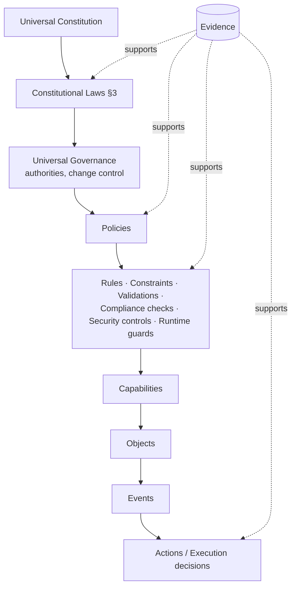

Nothing executes outside this hierarchy, and no lower level may contradict a higher one. The policy analyser rejects any policy that permits what a Law forbids.

### 18.2 Authority types

| Type | Controls | Examples | Typical holders |
|---|---|---|---|
| Foundational | Constitution, laws | Constitutional amendment, law retirement | Architecture Board (multi-party) |
| Governance | Policies, approvals, certifications | Capability certification, release approval | Governance council, CISO, DPO |
| Administrative | Configuration, operations | Tenant setup, environment config | Platform admins, tenant admins |
| Domain | Universe-specific governance | Product data stewardship, financial controls | Universe stewards |
| Operational | Runtime operations | Deploy, scale, failover, incident actions | SRE on-call |
| Autonomous | Bounded automated action | Auto-remediation, agent tool calls | AI agents, automation engines (§21.5) |

### 18.3 Authority & Decision objects

```yaml
Authority:
  id: ucos:authority:01J...
  type: governance
  scope: { universes: [U29-payment, U30-ledger], tenants: [ucos:tenant:bazaar], actions: [approve-release, approve-waiver] }
  level: 3                         # 1 (low) … 5 (constitutional)
  holder: ucos:role:bazaar-finance-controller
  constraints: { maxAmount: { amount: "1000000", currency: INR }, requiresMfa: true, sod: [creator≠approver] }
  validity: TemporalRef(TimeRange)
  delegation: { allowed: true, maxDepth: 1, mustBeLowerLevel: true }
  revocation: { by: [ucos:role:bazaar-cfo], effect: immediate }
  evidence: [ucos:evidence:board-resolution-2026-07]
  quorum: { required: 2, of: 3, distinctOrgUnits: true }   # required for level ≥ 4 (A-09)

DecisionRecord:
  id: ucos:decision:01J...
  type: waiver | approval | certification | policy-change | incident-action | ai-action
  authority: AuthorityRef
  context: ContextRef
  inputs: [...]        # gap ids, proposals, evaluations
  outputs: [...]
  rationale: Text
  risk: { score, assessment: RiskAssessmentRef }
  compliance: { assessment: ComplianceAssessmentRef }
  approvals: [ { by, at: TimePoint, method: mfa|hardware-key } ]
  audit: AuditRef
  certificationStatus: n/a | pending | certified
```

### 18.4 Change control (governed change)

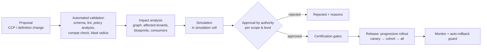

Change classes: **Standard** (pre-approved templates, e.g. a new offer), **Normal** (one approval), **Significant** (multi-party, impact > threshold), **Constitutional** (Architecture Board, CCP, minimum review period), **Emergency** (break-glass with retrospective approval within 24h).

### 18.5 Policy model (authorisation unified)

RBAC, ABAC, ReBAC and PBAC are all expressed as **Cedar policies** evaluated by one PDP. Infrastructure and admission policies use OPA/Rego.

```cedar
// Sellers may update their own listings while their account is in good standing
permit (
  principal in Role::"seller",
  action in [Action::"catalog:UpdateListing", Action::"catalog:PublishListing"],
  resource is Catalog::Listing
)
when {
  resource.seller == principal.organization &&
  principal.organization.standing == "good" &&
  context.risk.score < 70
};

// Separation of duties on payouts
forbid (
  principal,
  action == Action::"marketplace:ApprovePayout",
  resource is Marketplace::PayoutBatch
)
when { resource.createdBy == principal };

// Agents may only act within delegated authority & budget
forbid (
  principal is Agent,
  action,
  resource
)
unless { principal.authority.actions.contains(action) && context.agent.budgetRemaining > 0 };
```

**Layered evaluation (A-11):** precedence is `platform` forbids (final) → `emergency` forbids (final) → any forbid in universe-default, tenant or organization layers → any permit. Obligations merge strictest-wins. List queries use **`PartialEvaluate`**: the residual constraint becomes a SQL/search filter, so results and facet counts are authorised before they are computed. Platform baseline P-001…P-007 (tenant isolation, inactive principals, agent bounds, **reality isolation with bridging (A-28)**, asOf read-only, separation of duties, unknown risk treated as medium) is in `spec/policies/platform-baseline.cedar`.

Policy obligations (returned with ALLOW): `mask(fields)`, `audit(level)`, `stepUpAuth`, `notify(role)`, `rateLimit(class)`, `watermark`, `requireReason`. Every PDP decision is logged with the policy IDs that matched.

### 18.6 Governance domains

Policy · Capability · AI · Data · Security · Compliance · Knowledge · Financial · Operational · Evolution · Architecture · Certification. Each has a steward authority and its own registry view in the Governance portal (W11).

---

## 19. Security Architecture

### 19.1 Principles

Zero trust · identity-first · policy-first · encryption-first · least privilege · separation of duties · multi-party approval for critical actions · secure by design / by default / by construction · continuous verification, monitoring and audit · crypto-agility.

### 19.2 Identity types & authentication

| Principal | Authentication | Notes |
|---|---|---|
| End user (buyer, patient, student) | OIDC; passkeys (WebAuthn) preferred; OTP fallback; social login optional | Risk-based step-up |
| Business user (seller, admin, agent supervisor) | OIDC + mandatory MFA (passkey/TOTP/hardware key); SSO federation (SAML/OIDC) with tenant IdP | Session binding to device |
| Workload / pack service | SPIFFE/SPIRE workload identity, mTLS | No static secrets |
| AI agent | Agent identity (`ucos:agent:*`) + signed delegation token from a human/org authority | Scoped, time-bound, budgeted |
| Device / IoT / POS | Device certificates (X.509), attestation where available | |
| External system | OAuth2 client credentials / mTLS; API keys only for low-risk read | Keys hashed, rotatable |

Identity Intelligence (KYC/KYB, sanctions/PEP screening, document verification, fraud signals) is a capability family (`identity.kyc`, `identity.kyb`). Jurisdiction rules select providers.

### 19.3 Authorisation

PDP (Cedar) at the gateway and command bus. Policies are compiled per blueprint and cached in each cell. Decision latency target p99 < 5 ms. Field-level controls come through obligations (masking/redaction). Row-level isolation is enforced by Postgres RLS using the context's tenant and organisation (defence in depth).

### 19.4 Threat model (STRIDE by layer, summary)

| Layer | Key threats | Primary controls |
|---|---|---|
| Edge/Gateway | Credential stuffing, DDoS, bot scraping, injection | WAF, bot management, rate limits, passkeys, input validation from schemas |
| Composition/Studio | Malicious definition (privilege-escalating policy), supply-chain pack | Policy analyser, multi-party approval, signed packs, SLSA provenance, pack sandboxing |
| Runtime | Cross-tenant data access, IDOR, replay | RLS, PDP on every command, ETag/idempotency, audience-bound tokens |
| Data | Exfiltration, insider misuse | Field-level encryption, DLP, PAM with session recording, just-in-time access |
| Integration | Webhook spoofing, SSRF | HMAC verification, egress allow-lists per connector |
| AI/Agents | Prompt injection, tool abuse, data leakage, excessive agency | Tool scopes, authority tokens, content isolation (untrusted-content tagging), output filters, HITL for high-risk actions |
| Supply chain | Dependency compromise | SBOM, vulnerability scanning, pinned digests, reproducible builds |
| Operations | Misconfiguration, secret leakage | GitOps, OPA admission policies, secret scanning, workload identity |

Every capability pack ships a threat model (`docs/threat-model.md`). Gate `SEC-TM-001` checks that it exists and was reviewed. The models live in `docs/threat-models/`.

### 19.5 Cryptography

- In transit: TLS 1.3 everywhere; mTLS service-to-service.
- At rest: envelope encryption. KMS/HSM-backed KEKs; **per-tenant DEKs**; optional **BYOK/HYOK** for enterprise tiers.
- Field-level: `Encrypted<T>` fields (PAN tokens, national IDs, health data) encrypted application-side with per-tenant/per-purpose keys. Searchable fields use blind indexes.
- Tokenisation: card data never touches UCOS. PSP tokens are used, keeping UCOS cardholder-data scope at SAQ-A / A-EP where possible. Network tokenisation is supported.
- In use: confidential computing nodes for designated workloads (e.g. dedicated healthcare tenants, model inference on sensitive data).
- **Crypto-agility / post-quantum readiness:** algorithm identifiers are stored with ciphertexts and signatures. Hybrid TLS key exchange (X25519+ML-KEM) where the stack supports it. ML-DSA signatures planned for audit-chain anchoring. Key rotation is automated through Temporal schedules.

### 19.6 Tenant & capability isolation

Network policies per pack; namespace per cell tier; separate KMS keys per tenant; optional dedicated cells; sandboxed WASM extensions with no network by default; per-tenant resource quotas.

### 19.7 Data classification

`public` · `internal` · `confidential` · `restricted`, crossed with data classes `PII, SPI (sensitive personal), PCI, PHI, FINANCIAL, CREDENTIAL, CHILD, BIOMETRIC, LOCATION, TRADE_SECRET`. Classification drives encryption, masking, retention, residency, logging redaction and DLP rules automatically.

**Classification is a value type** owned by U65 (A-01). Additional classes are `SECURITY_SENSITIVE` and `NEURAL`.

**Security profiles (A-15), ordered** `standard < high < regulated < sovereign`. Tenants may only choose a stricter profile.

| Control area | standard | high | regulated | sovereign |
|---|---|---|---|---|
| Business-user MFA | TOTP or passkey | passkey | passkey + hardware for admins | hardware keys |
| Minimum isolation tier | pooled | pooled | schema | dedicated-cell |
| Keys | per tenant | per tenant | BYOK option | HYOK / in-country HSM |
| Audit of reads | sampled | full for restricted | full | full + external anchoring |

**Handling matrix (A-15):** `restricted` data (PII-high, SPI, PCI, PHI, CREDENTIAL, BIOMETRIC, CHILD) is field-encrypted, masked by default and never logged. It reaches AI only through zero-retention models with tenant policy and purpose. Export needs approval and a watermark.

### 19.8 Security operations

SIEM (all audit + security signals), SOAR playbooks (auto-contain: revoke tokens, isolate tenant, freeze payouts), EDR/XDR on nodes, CSPM/KSPM, continuous vulnerability scanning, continuous automated penetration testing (DAST + attack-simulation), bug bounty, incident response runbooks with legal/regulatory notification timers (Temporal triggers: GDPR 72h, CERT-In 6h, DPDP as applicable).

### 19.9 Immutable audit

```yaml
AuditRecord:
  id, time (TimePoint), tenant, actor (identity, kind, onBehalfOf), action, resource (ref + version),
  decision (allow/deny + policy ids + obligations), context hash, request hash, result,
  prevHash, hash = SHA-256(prevHash || canonical(record))
```

Records are written synchronously on the command path. Chains are per tenant per day, and daily roots are anchored to WORM storage (optionally to an external timestamping authority, RFC 3161). Audit reads are themselves audited.

---

## 20. Privacy & Compliance-as-Code

### 20.1 Compliance model

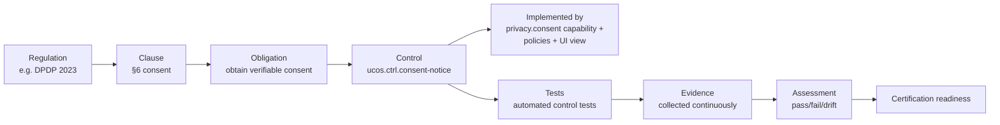

### 20.2 Control definition (example)

```yaml
kind: Control
id: ucos.ctrl.dsr-erasure
title: "Erase personal data on verified request within statutory deadline"
objective: "Data subjects can obtain erasure subject to legal holds."
mappings:
  - { regulation: GDPR, clauses: ["Art.17"] }
  - { regulation: DPDP-2023, clauses: ["S.12"] }
  - { regulation: CCPA, clauses: ["1798.105"] }
  - { regulation: UAE-PDPL, clauses: ["Art.15"] }
  - { framework: ISO27701, clauses: ["7.3.6"] }
implementedBy: [privacy.dsr, data.crypto-shredding, workflow:dsr.flow@1]
parameters:
  deadlineOffset: { decision: privacy.dsr-deadline-by-jurisdiction }   # Duration from request receipt; the deadline TimePoint is computed by an SLAClock   # e.g. 30 days GDPR
tests:
  - id: test.dsr.erasure-e2e         # synthetic subject → request → verify deletion across stores
    schedule: "FREQ=WEEKLY"
evidence:
  collectors: [dsr-completion-log, crypto-shred-receipts, search-index-purge-proof]
owner: ucos:role:dpo
severity: high
```

### 20.3 Framework library (seed, extensible as data)

Privacy: GDPR, UK GDPR, CCPA/CPRA, DPDP (India), UAE PDPL, PIPL, LGPD, PDPA (SG). Security: ISO 27001, SOC 2, NIST CSF 2.0, NIST 800-53, FedRAMP, CIS. Payments/finance: PCI DSS v4, PSD2/SCA, RBI (payment aggregator, card tokenisation, data localisation), SEBI, FINRA, MiFID II, DORA, SOX. Health: HIPAA, HITECH. AI: ISO/IEC 42001, EU AI Act, NIST AI RMF. Telecom: TRAI. Sector: FDA 21 CFR Part 11, EMA, accessibility (WCAG 2.2, EN 301 549, ADA). Country- and industry-specific packs are added as data, along with future regulations.

### 20.4 Privacy capabilities

Consent & preference registry (purpose-based, versioned notices, proof of consent) · purpose limitation enforced through policy obligations · data minimisation (schema-level `purpose` tags) · retention engine · DSR portal & workflow (access, rectification, erasure, portability, objection, grievance) · records of processing (auto-generated from the graph) · DPIA templates · cross-border transfer registry · cookie/tracking consent for web channels · children's data rules (age gating, parental consent).

**DSR handler extension point (A-21):** every universe that holds personal data implements `privacy.dsr-handler` (`Export`, `Rectify`, `Erase(mode)`), checked by gate `CMP-PRV-01`. Erasure respects legal holds (U104/U68), and crypto-shredding covers event history.

### 20.5 Cross-tenant learning & aggregation

Cross-tenant learning, the federated intelligence the source mentions, is allowed only through: (1) explicit tenant opt-in recorded as a contract fact; (2) aggregation with k-anonymity ≥ configured threshold and differential-privacy noise for published statistics; (3) federated learning where raw data never leaves the tenant boundary. These are enforced by a dedicated `analytics.cross-tenant` capability with its own controls.

### 20.6 Continuous compliance

Evidence collectors run on schedules and events. Control drift creates `compliance.control.failed` events, cases and (if mandatory) gaps on affected blueprints. Audit-readiness dashboards per framework sit in the Compliance portal (W11). Auditor read-only access is time-boxed, watermarked and logged.

---

## 21. AI & Agent Universe

### 21.1 Architecture

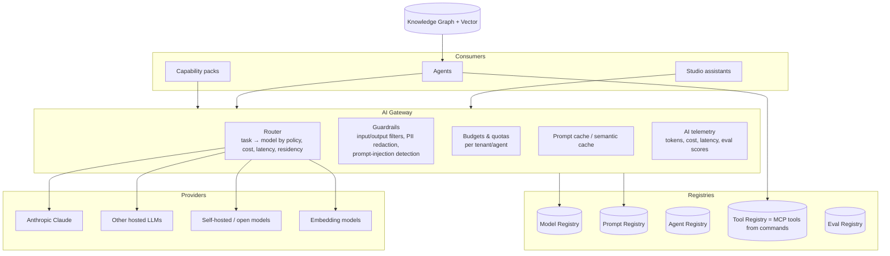

### 21.2 Model registry & routing

```yaml
kind: Model
id: model.anthropic.claude-opus-5-5
provider: anthropic
modelId: claude-opus-5-5
capabilities: [reasoning, tool-use, vision, long-context, code]
residency: [us, eu]              # where inference may run (per contract)
dataPolicy: { training: none, providerRetention: zero-retention-endpoint }
cost: { inputPerMTok: ..., outputPerMTok: ... }   # from price list registry, not hard-coded
evaluations: [eval.support-triage@3: 0.92, eval.catalog-attr-extract@5: 0.95]
status: certified
---
kind: Route
id: route.default
rules:   # evaluated by Decision engine
  - when: { task: complex-reasoning|agentic-planning }                then: model.anthropic.claude-opus-5-5
  - when: { task: general|tool-use, latencyBudgetMs: "<3000" }        then: model.anthropic.claude-sonnet-5-5
  - when: { task: classification|extraction|routing, volume: high }   then: model.anthropic.claude-haiku-4-5
  - when: { context.dataClass: PHI, tenant.policy: on-prem-only }     then: model.selfhosted.medical-llm
fallbacks: [model.anthropic.claude-sonnet-5-5, model.selfhosted.general]
```

Default reference routing uses the Claude family: `claude-opus-5-5` for complex reasoning and agent planning, `claude-sonnet-5-5` for general and tool-use tasks, `claude-haiku-4-5-20251001` for high-volume classification and extraction. Providers remain swappable per L15. Routing is policy, not code.

### 21.3 AI capability families

Recommendation · semantic & hybrid search · conversational commerce · support triage and answer drafting · catalog enrichment (classification, attribute extraction, translation, image tagging) · pricing intelligence · demand forecasting · fraud/risk scoring (ML models, not LLMs) · document understanding (invoices, KYC docs) · code/definition assistance in Studio (proposes definitions, never activates them) · compliance mapping assistance · anomaly explanation for ops · simulation narratives.

**Classical ML (A-42)** (features, training, serving, drift and fairness monitoring for fraud, forecasting, ranking and pricing models) is owned by **U94 ML Platform**. LLMs, prompts and agents remain U49–U51. All models share one registry and one set of AI certification gates.

### 21.4 Agent object

```yaml
kind: Agent
id: ucos:agent:catalog-enrichment
version: 1.4.0
purpose: "Enrich seller-submitted listings with taxonomy, attributes and translations."
identity: ucos:agent:catalog-enrichment            # first-class identity
owner: ucos:role:catalog-steward
authority:
  ref: ucos:authority:agent-catalog-enrichment
  actions: [catalog:ProposeAttributeValues, catalog:ProposeClassification, localization:ProposeTranslation]
  forbidden: [catalog:PublishListing, pricing:*, payment:*]
  limits: { maxActionsPerHour: 5000, maxCostPerDay: { amount: "200", currency: USD } }
autonomy: L2          # propose → steward auto-approves above confidence 0.95, else human review (§29.2)
model: { route: route.default, task: extraction }
tools: [catalog.get_listing, product.search_global, taxonomy.suggest, attribute.validate, localization.propose]
memory: { type: episodic+semantic, store: vector://agent-memory/catalog, retention: P90D, tenantScoped: true }
knowledge: [kg://taxonomy, kg://attributes, kg://global-products]
guardrails: [no-pii-in-prompts, untrusted-content-isolation, output-schema-validation, profanity-filter]
evaluation: { suite: eval.catalog-attr-extract@5, minScore: 0.93, cadence: "FREQ=WEEKLY" }
escalation: { queue: catalog.steward-review, when: [confidence<0.8, conflicting-sources, regulated-category] }
audit: full            # every prompt hash, tool call, output, decision
```

### 21.5 Agent governance

- **Identity & delegation:** agents act with their own identity. When acting for a user, they carry a delegation token (`onBehalfOf`) whose scope is the intersection of the agent's authority and the user's permissions.
- **Bounded authority:** authority objects (§18.3) with action lists, monetary limits, rate limits and budgets. Financially material, irreversible, or legally significant actions need human approval (L17).
- **Tool safety:** tools are generated from commands, inherit PDP checks, and declare side-effect class (`read`, `reversible-write`, `irreversible-write`, `external-communication`).
- **Prompt-injection defence:** retrieved and user content is tagged untrusted and kept out of the system instructions. Tool-call plans are validated against policy before execution. Sensitive tools require confirmation.
- **Multi-agent orchestration:** a supervisor agent pattern with explicit hand-off contracts. Agent-to-agent messages go through the Communication universe and are audited.
- **Evaluation & drift:** offline eval suites, online quality signals (acceptance rate, edits), drift alerts, and rollback to previous prompt/model versions.
- **AI governance & regulation:** risk classification per use case (EU AI Act classes), model cards, data sheets, human oversight design, and incident reporting. ISO/IEC 42001 control mapping.

### 21.6 RAG over the Knowledge Graph

Hybrid retrieval: (1) graph traversal for authoritative facts with provenance, (2) vector search for unstructured content, (3) keyword search for exact identifiers. Answers cite object IDs. Facts below a trust threshold are excluded or flagged. Tenant boundaries are enforced in retrieval filters, never only in prompts.

---

# PART V — EXPERIENCE

## 22. Experience Architecture

### 22.1 UI is metadata, renderers are code

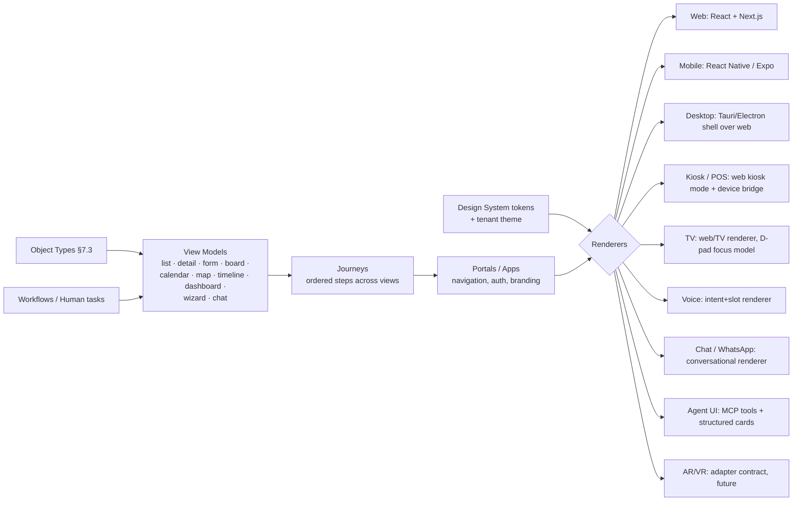

The same `ViewDefinition` renders on every channel. Each renderer maps abstract components (`Field`, `Collection`, `Action`, `Media`, `Map`, `Calendar`, `Chart`) to native widgets. Channels that cannot render a component fall back through declared fallbacks (for example, a map falls back to an address list on voice).

### 22.2 View definition (UI meta-model)

```yaml
apiVersion: ucos.io/v1
kind: ViewDefinition
id: catalog.listing.edit
version: 2.1.0
object: catalog.listing.Listing
type: form
audience: [seller, catalog-admin]
layout:
  - section: { title: t("listing.basics"), columns: { sm: 1, md: 2 } }
    fields:
      - gproduct: { widget: product-match-picker, help: t("listing.gproduct.help") }   # GPID match (W9)
      - title:    { widget: text, maxLength: 150, ai: { suggest: catalog-enrichment } }
      - condition: { widget: segmented, source: taxonomy:item-condition }
  - section: { title: t("listing.pricing") }
    fields:
      - price:    { widget: money, currencyFrom: context.currency }
      - priceList: { widget: reference-select, target: pricing.PriceList, visibleWhen: "tenant.features.priceLists" }
  - section: { title: t("listing.availability") }
    fields:
      - stock:    { widget: stock-by-location, source: inventory.StockLevel }
      - availabilityPolicy: { widget: temporal-policy-picker }                        # Temporal (W10)
  - section: { title: t("listing.media") }
    fields:
      - media:    { widget: asset-gallery, accept: [image/*, video/*], min: 1 }
actions:
  primary:   { command: catalog:PublishListing, label: t("publish"), confirm: false }
  secondary: [ { command: catalog:SaveDraft }, { command: catalog:PreviewListing } ]
validation: schema + decision:catalog.listing-quality-gate
permissions: policy            # fields hidden/masked per PDP obligations
analytics: { track: [view, field-error, publish] }
a11y: { landmarks: auto, errorSummary: top, focusOnError: true }
variants:
  mobile: { layout: single-column, stickyPrimaryAction: true }
  voice:  { mode: slot-filling, required: [gproduct, price, stock] }
```

### 22.3 Portals & apps (generated per blueprint)

| Portal | Audience | Purpose |
|---|---|---|
| **Platform Console** | Platform owner/operators | Cells, tenants, packs, health, governance across all tenants |
| **Builder Studio** | Tenant builders, solution architects | Compose platforms: definitions, workflows, UI, policies, integrations |
| **Tenant Admin** | Tenant administrators | Users, roles, settings, plans, feature flags, environments |
| **Storefront / Customer apps** | End customers | Web + iOS + Android + WhatsApp + voice |
| **Seller / Vendor / Partner portal** | Marketplace participants | Listings, orders, payouts, performance, support |
| **Operations portal** | Ops staff | Fulfillment, logistics exceptions, inventory, dispatch |
| **Support portal / Agent desktop** | Support agents | Cases, conversations, knowledge, customer 360 |
| **Finance portal** | Finance | Ledger, settlements, reconciliation, invoices, tax |
| **Governance & Compliance portal** | Governance, DPO, CISO, auditors | Approvals, policies, controls, evidence, certifications, audit |
| **Developer portal** | Developers | API docs, SDKs, sandbox, webhooks, pack publishing |
| **AI Operations portal** | AI owners | Models, prompts, agents, evals, guardrail incidents, costs |
| **Observability / Twin portal** | SRE, leadership | SLOs, incidents, cost, platform & business twin |

### 22.4 Channel capabilities matrix

| Capability | Web | iOS/Android | WhatsApp/Chat | Voice | POS/Kiosk | TV | Agent (MCP) |
|---|---|---|---|---|---|---|---|
| Browse/search | ✓ | ✓ | ✓ (carousel) | ✓ (top-3) | ✓ | ✓ | ✓ |
| Cart/checkout | ✓ | ✓ (native pay) | ✓ (pay link) | ✓ (confirm by voice + OTP) | ✓ (device pay) | ✓ (QR handoff) | ✓ (with confirmation obligation) |
| Account/DSR | ✓ | ✓ | link-out | link-out | — | link-out | ✓ |
| Offline | PWA cache | ✓ local store + sync | — | — | ✓ store-and-forward | — | — |
| Push/notifications | web push | APNs/FCM | native | — | — | — | events |

---

**Communication channels (A-64, A-65).** Notifications and messages over email, SMS, WhatsApp, web and mobile push, in-app inbox, RCS, Telegram, LINE, WeChat, Viber, Messenger, Instagram, voice and postal mail are owned by U40, with an adapter per channel. Inbound replies (opt-out first), real-time chat (presence, typing, receipts, masked parties), broadcast and emergency alerts, and agent-to-agent messaging are also U40. Synchronous voice, IVR, video sessions, live chat with bot hand-off, and the contact centre are owned by **U109**.

## 23. UI/UX Design System & Principles

### 23.1 UX principles for a composition platform

1. **Intent first, configuration second:** builders describe outcomes ("multi-vendor marketplace in India and UAE"). The system proposes, and the builder refines.
2. **Explain every automatic decision:** every auto-added capability, control or gap has a "Why?" link to its resolution trace (§11.3).
3. **Preview, simulate, diff, then apply:** no change goes live without a visible diff and an optional simulation run.
4. **Safe by default:** destructive or high-risk actions require confirmation, reason capture and step-up auth, with undo where reversible.
5. **Progressive disclosure:** sensible defaults hide advanced settings until needed. Expert mode exposes raw YAML with schema-aware editing.
6. **One mental model:** every object has the same anatomy (header, status, key facts, tabs: Details · Relationships · Timeline · Policies · Audit · Evidence).
7. **Status is always visible:** lifecycle state, certification badge, gap count and environment (sandbox/simulation/production) are pinned in the header.
8. **Accessible and global by construction:** WCAG 2.2 AA minimum, RTL, locale-aware formats, plain language.
9. **Human-in-the-loop clarity:** AI suggestions are visually distinct, show confidence and source, and are never auto-applied unless authority allows it.
10. **Performance as UX:** interactive in < 2.5s (LCP) on mid-range mobile over 4G; optimistic UI where safe.

### 23.2 Design tokens (theming & white-label)

```json
{
  "color": {
    "brand":   { "primary": "{tenant.brand.primary|#4F46E5}", "onPrimary": "#FFFFFF" },
    "neutral": { "0": "#FFFFFF", "50": "#F8FAFC", "100": "#F1F5F9", "700": "#334155", "900": "#0F172A" },
    "status":  { "success": "#15803D", "warning": "#B45309", "danger": "#B91C1C", "info": "#1D4ED8" },
    "gap":     { "mandatory": "#B91C1C", "recommended": "#B45309", "optional": "#64748B" }
  },
  "font":   { "family": { "base": "{tenant.font|Inter}, system-ui", "mono": "JetBrains Mono" },
              "size": { "xs": 12, "sm": 14, "md": 16, "lg": 20, "xl": 24, "2xl": 32 } },
  "space":  { "1": 4, "2": 8, "3": 12, "4": 16, "6": 24, "8": 32 },
  "radius": { "sm": 4, "md": 8, "lg": 12, "full": 9999 },
  "motion": { "fast": "120ms", "base": "200ms", "reduce": "respect prefers-reduced-motion" },
  "breakpoints": { "sm": 0, "md": 768, "lg": 1024, "xl": 1440 },
  "modes": ["light", "dark", "high-contrast"]
}
```

Tenant themes override only tokens, never components. Contrast is validated automatically (≥ 4.5:1 for text). A theme that fails contrast creates a `UI` gap.

### 23.3 Component library (abstract → per-renderer)

App shell · Navigation (sidebar, top bar, tab bar, breadcrumb) · Object header · Data table (virtualised, column config, saved views, bulk actions) · Card · Form fields (text, number, money, quantity+unit, temporal pickers, reference picker, taxonomy tree picker, address/geo picker, asset uploader, rich text, code/YAML editor) · Status badge · Gap badge · Certification badge · Timeline · Kanban board · Calendar (month/week/day/resource grid) · Map · Graph canvas (composition/dependency) · Diff viewer · Chart set (via the dataviz standard) · Wizard/stepper · Command palette (⌘K) · AI suggestion chip · Approval panel · Empty states · Skeletons · Toasts · Modal/drawer.

### 23.4 Accessibility, localisation, personalisation

- **A11y:** semantic landmarks, keyboard paths for every action, focus management on route change, ARIA only where semantics are insufficient, captions/transcripts for media, motion reduction. Automated axe checks in CI plus manual audits on top journeys (gate `A11Y-*`).
- **Localisation:** ICU MessageFormat; no string literals in views (lint). Pseudo-localisation in CI. RTL mirroring. Locale-aware number, currency, date, address and name formats from the Localization universe. Translation workflow: machine translation, then human review for regulated or customer-facing strings.
- **Personalisation:** recommendation placements, saved views, role-based home dashboards, adaptive navigation (frequently used first), all consent-aware.

---

## 24. Information Architecture & User Journeys

### 24.1 Platform Console navigation (single canonical IA)

```text
UCOS Ω∞
├── 01 Foundation      Identity · Organizations & Tenants · Geography · Temporal · Currency · Localization
├── 02 Knowledge       Products · Services · Industries · Categories · Brands · Manufacturers · Suppliers ·
│                      Assets · Documents · Media · Knowledge Graph · Ontology · Taxonomy · Semantic Registry
├── 03 Business        Customers · Sellers · Buyers · Vendors · Partners · Distributors · Workforce · CRM
│                      (Leads, Opportunities, Accounts, Contacts, Activities, Pipelines) · Contracts · Agreements
├── 04 Commerce        Catalogs · Pricing · Price Lists · Offers · Promotions · Coupons · Loyalty · Referrals ·
│                      Affiliates · Marketplace · Advertising · Merchandising · Cart · Checkout · Orders ·
│                      Subscriptions · Memberships · Billing · Payments · Settlements · Invoices · Tax · Revenue
├── 05 Operations      Inventory · Warehousing · Procurement · Fulfillment · Logistics · Transportation · Shipping ·
│                      Tracking · Returns · Exchanges · Service Delivery · Field Ops · Support · SLA · Incidents ·
│                      Cases · Work Orders · Maintenance
├── 06 Experience      Websites · Mobile Apps · Portals · Kiosks · POS · Themes · Branding · Journeys ·
│                      UI Components · Channels · Personalisation · Accessibility · Localisation
├── 07 Intelligence    Models · Agents · Agent Teams · Prompts · Recommendation · Search · Forecasting · Fraud ·
│                      Risk · Optimisation · Simulation · Digital Twins · Learning
├── 08 Governance      Policies · Standards · Regulations · Compliance · Security · Privacy · Risk · Controls ·
│                      Evidence · Certifications · Audits · Approvals · Change Control · Traceability · AI Governance
├── 09 Platform        Capabilities · Marketplace · Builder Studio · Generators · APIs · Events · Workflows ·
│                      Decisions · Integrations · Connectors · Runtime · Deployments · Extensions ·
│                      Capability Discovery · Gap Detection · Dependency & Conflict Analysis
├── 10 Observability   Monitoring · Metrics · Logs · Traces · Dashboards · Alerts · SLO/SLA · Cost · Usage ·
│                      Health · RCA · Diagnostics
├── 11 Administration  Tenants · Companies · Stores · Workspaces · Users · Roles · Permissions · Licenses ·
│                      Plans · Billing · Provisioning · Environments · Secrets · Settings · Feature Flags
└── 12 Architecture    Constitution · Universes · Ontologies · Taxonomies · Registries · Canonical Objects ·
                       Schemas · Events · APIs · Workflows · Graphs (Capability, Knowledge, Dependency,
                       Traceability) · Reference Architectures · Build Specs · Evolution
```

Every menu item resolves to one canonical home (Law L3). The same object never appears in two menus as two different things. Cross-links open the canonical page.

### 24.2 Journey J1: Create a platform (Builder)

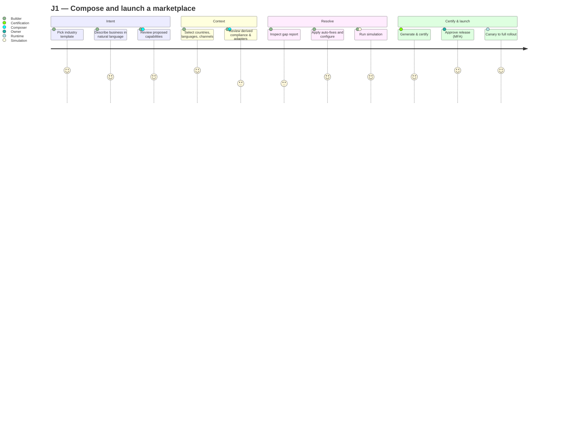

### 24.3 Journey J2: Add a new country (zero code)

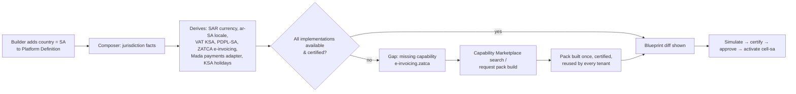

### 24.4 Journey J3: Seller onboarding (marketplace)

```mermaid
sequenceDiagram
  actor S as Seller
  participant SP as Seller Portal
  participant ID as Identity/KYB
  participant WF as Workflow seller.onboarding
  participant CM as Compliance
  participant LG as Ledger
  S->>SP: Sign up (business email, passkey)
  SP->>ID: Create org identity, start KYB (tax ID, bank, documents)
  ID-->>WF: KYB result (auto-pass / review / fail)
  WF->>CM: Screen sanctions/PEP, category restrictions (rules by jurisdiction)
  CM-->>WF: Cleared
  WF->>SP: Agreement e-sign (Document universe)
  S->>SP: Sign seller agreement
  WF->>LG: Open seller ledger accounts, payout schedule (Temporal: T+7 settlement calendar)
  WF-->>S: Welcome; listing tools unlocked (Entitlement)
```

### 24.5 Journey J4: Buyer purchase (storefront, cross-capability)

```mermaid
flowchart LR
  A[Search / browse<br/>Search + Recommendation] --> B[PDP<br/>Listing + GPID facts + Reviews +<br/>Offer badges + delivery promise]
  B --> C[Add to cart<br/>Pricing + Offer + Tax estimate]
  C --> D[Checkout<br/>address Geo · slot Temporal · payment adapter by context]
  D --> E[Payment auth<br/>3DS/UPI/wallet]
  E --> F[Order placed<br/>event fan-out]
  F --> G[Fulfillment & tracking<br/>Logistics + Communication]
  G --> H[Delivered → review prompt<br/>Trust & Reputation]
  H --> I[Return window timer<br/>Temporal + Decision]
```

### 24.6 Journey J5: Governed change & approval

Proposal → automated validation → impact analysis (affected tenants, consumers) → simulation → approval (authority by scope; MFA) → certification → progressive rollout → monitoring with auto-rollback. See §18.4 and wireframe W11.

### 24.7 Journey J6: Data subject request

Request via portal/app/email → identity verification → scope discovery (graph: all objects linked to subject) → legal-hold check → fulfil (export package or erase/crypto-shred) → evidence → response within jurisdictional deadline (Temporal SLA clock) → audit.

---

## 25. Wireframes

Low-fidelity wireframes for the key screens. They define **layout, hierarchy and behaviour**, not visual styling (§23 covers that). Desktop width is ~120 columns. Mobile wireframes are marked 📱.

### W1 — Platform Console · Home (operator)

```text
┌────────────────────────────────────────────────────────────────────────────────────────────────────────────┐
│ ◈ UCOS Ω∞   [⌘K Search everything…]                       Env: PRODUCTION ▾   🔔 3   ⚠ Gaps 2   (●) Ops ▾ │
├───────────────┬────────────────────────────────────────────────────────────────────────────────────────────┤
│ 01 Foundation │  Good morning, Platform Ops                                         Last 24h ▾  Region: All ▾│
│ 02 Knowledge  │ ┌──────────────┐┌──────────────┐┌──────────────┐┌──────────────┐┌──────────────┐            │
│ 03 Business   │ │ Tenants      ││ Platforms    ││ Availability ││ Open gaps    ││ Pending      │            │
│ 04 Commerce   │ │ 1,284  ▲12   ││ 1,902 active ││ 99.982%  SLO ││ 2 mandatory  ││ approvals 7  │            │
│ 05 Operations │ └──────────────┘└──────────────┘└──────────────┘└──────────────┘└──────────────┘            │
│ 06 Experience │ ┌─ Cells ───────────────────────────────────┐ ┌─ Governance queue ──────────────────────┐  │
│ 07 Intelligence││ cell-in-mum-1  ●healthy  412 tenants  41% │ │ ▸ CCP-219 Add ZATCA e-invoicing   [Review]│  │
│ 08 Governance │ │ cell-ae-dxb-1  ●healthy  96 tenants   22% │ │ ▸ Waiver W-88 (bazaar) expires 3d [Open]  │  │
│ 09 Platform   │ │ cell-eu-fra-1  ◐degraded 230 tenants  67% │ │ ▸ Pack payment.provider.x 2.0     [Certify]│ │
│ 10 Observab.  │ │ cell-us-iad-1  ●healthy  546 tenants  58% │ └──────────────────────────────────────────┘  │
│ 11 Admin      │ └───────────────────────────────────────────┘ ┌─ Incidents ─────────────────────────────┐  │
│ 12 Architect. │ ┌─ Capability adoption (top 8) ─────────────┐ │ INC-5521 SEV2 eu-fra search latency      │  │
│               │ │ identity.core      ████████████████ 100%  │ │   Owner: @sre-eu  12m  [War room]        │  │
│               │ │ commerce.cart      ███████████░░░░░  71%  │ └──────────────────────────────────────────┘  │
│               │ │ marketplace.core   ██████░░░░░░░░░░  38%  │ ┌─ AI spend (MTD) ────────────────────────┐  │
│               │ │ subscription.core  █████░░░░░░░░░░░  31%  │ │ $41.2k / $60k budget   ▁▂▃▅▆▇            │  │
│               │ └───────────────────────────────────────────┘ └──────────────────────────────────────────┘  │
└───────────────┴────────────────────────────────────────────────────────────────────────────────────────────┘
```

Behaviour: KPI tiles drill into filtered lists. Gap and approval counts are always in the header. The ⌘K palette searches objects, commands and docs across the graph.

### W2 — Builder Studio · New Platform · Step 1: Intent

```text
┌────────────────────────────────────────────────────────────────────────────────────────────────────────────┐
│ Builder Studio ▸ New platform                                                  Draft · Not certified  [✕]  │
├────────────────────────────────────────────────────────────────────────────────────────────────────────────┤
│  ① Intent ──── ② Geography & channels ──── ③ Capabilities ──── ④ Resolve gaps ──── ⑤ Review & launch      │
├────────────────────────────────────────────────────────────────────────────────────────────────────────────┤
│  What are you building?                                                                                    │
│  ┌──────────────────────────────────────────────────────────────────────────────────────────────────────┐ │
│  │ A multi-vendor electronics and general-merchandise marketplace for India and the UAE, with same-day  │ │
│  │ delivery in metros, WhatsApp ordering and Arabic support.                                            │ │
│  └──────────────────────────────────────────────────────────────────────────────── ✦ Analyse intent ───┘ │
│                                                                                                            │
│  Or start from a template                                                                                  │
│  ┌──────────────────┐ ┌──────────────────┐ ┌──────────────────┐ ┌──────────────────┐ ┌──────────────────┐ │
│  │ 🛒 Multi-vendor   │ │ 🏬 Single brand   │ │ 🚗 Mobility /     │ │ 🎬 Subscription   │ │ 🏢 B2B           │ │
│  │   marketplace    │ │   D2C store      │ │   ride-hailing   │ │   media (OTT)    │ │   distribution   │ │
│  │ ● selected       │ │                  │ │                  │ │                  │ │                  │ │
│  └──────────────────┘ └──────────────────┘ └──────────────────┘ └──────────────────┘ └──────────────────┘ │
│                                                                                                            │
│  ✦ Detected from your description                                       (AI suggestion · confidence 0.91) │
│   Industry: Retail › Electronics, Retail › General merchandise      Model: B2C · Marketplace              │
│   Outcomes: same-day delivery · conversational ordering · RTL localisation        [Accept all] [Edit]     │
│                                                                                                            │
│                                                                              [Save draft]   [Next  →]     │
└────────────────────────────────────────────────────────────────────────────────────────────────────────────┘
```

### W3 — Builder Studio · Step 2–3: Geography, channels & capabilities

```text
┌────────────────────────────────────────────────────────────────────────────────────────────────────────────┐
│  ① Intent ✓ ──── ② Geography & channels ●──── ③ Capabilities ──── ④ Resolve gaps ──── ⑤ Review & launch   │
├──────────────────────────────────────────────┬─────────────────────────────────────────────────────────────┤
│ Countries                                    │ Derived automatically  (why? ⓘ)                             │
│  [🇮🇳 India ✕] [🇦🇪 UAE ✕] [+ Add country]       │  Currencies   INR, AED                                      │
│ Languages   [English ✕][हिन्दी ✕][العربية ✕]        │  Locales      en-IN, hi-IN, en-AE, ar-AE (RTL)              │
│ Data residency  (●) Strict  ( ) Flexible     │  Tax          GST India 4.0 · VAT UAE 2.2                   │
│                                              │  Privacy      DPDP 2023 · UAE PDPL                          │
│ Channels                                     │  Payments     UPI, cards, netbanking (IN) · cards, Apple    │
│  [✓] Web  [✓] iOS  [✓] Android                │               Pay (AE)  → adapters: razorpay, network-intl  │
│  [✓] WhatsApp  [ ] Voice  [ ] POS  [✓] Agent API│  Calendars    IN national + state holidays, AE holidays   │
│                                              │  Cells        cell-in-mum-1, cell-ae-dxb-1                   │
├──────────────────────────────────────────────┴─────────────────────────────────────────────────────────────┤
│ Capabilities                                     Search capability marketplace… [            ] [Browse all]│
│  REQUESTED              AUTO-ADDED (dependencies & obligations)                     OPTIONAL (suggested)   │
│  ☑ marketplace.core     ☑ identity.core        why? ⓘ  ☑ privacy.consent  why? ⓘ   ☐ loyalty.points       │
│  ☑ logistics.multi-     ☑ catalog.listing      why? ⓘ  ☑ privacy.dsr      why? ⓘ   ☐ advertising.sponsored│
│    carrier              ☑ pricing.engine       why? ⓘ  ☑ tax.gst-india    why? ⓘ   ☐ subscription.core    │
│  ☑ payment.core         ☑ temporal.core        why? ⓘ  ☑ tax.vat-uae      why? ⓘ   ☐ recommendation.ai    │
│  ☑ offer.engine         ☑ inventory.multi-node why? ⓘ  ☑ payment.tokenization     ☐ seller.ads          │
│  ☑ reviews.core         ☑ ledger.core          why? ⓘ  ☑ communication.whatsapp                            │
│  ☑ support.case         … 38 more  [show]                                                                  │
│                                                       Est. cost: $18.4k/mo at expected scale   [← Back][Next →]│
└────────────────────────────────────────────────────────────────────────────────────────────────────────────┘
  "why? ⓘ" popover example:
  ┌───────────────────────────────────────────────────────────────┐
  │ privacy.dsr is required because:                              │
  │  • DPDP 2023 applies to jurisdiction IN (you selected India)  │
  │  • DPDP §12 → control ucos.ctrl.dsr-erasure                   │
  │  • control implemented by privacy.dsr@1.3                     │
  │ Rule: required_capability/1 (rule R-CMP-004)   [View trace]  │
  └───────────────────────────────────────────────────────────────┘
```

### W4 — Capability Marketplace · Browse & detail

```text
┌────────────────────────────────────────────────────────────────────────────────────────────────────────────┐
│ Platform ▸ Capability Marketplace           [Search: "subscription billing"           ]  [Publish a pack]  │
├──────────────────────┬─────────────────────────────────────────────────────────────────────────────────────┤
│ Filters              │  48 results                                                   Sort: Relevance ▾     │
│ Universe             │ ┌───────────────────────────────────────────────────────────────────────────────┐  │
│  ☐ Commerce (21)     │ │ subscription.core  v3.2.0     ✔ Certified   ★ 4.8 (312 tenants)   Free       │  │
│  ☑ Subscription (9)  │ │ Plans, renewals, proration, dunning, usage records. Requires temporal.core,   │  │
│  ☐ Finance (12)      │ │ pricing.engine, payment.core, ledger.core.    Controls: PCI-DSS 12, SOC2 8     │  │
│ Maturity             │ │                                                    [Details] [Add to platform]│  │
│  ☑ Certified         │ ├───────────────────────────────────────────────────────────────────────────────┤  │
│  ☐ Beta              │ │ billing.usage-metering v1.4.1  ✔ Certified  ★ 4.6   Usage-based $0.002/event │  │
│ Compliance           │ ├───────────────────────────────────────────────────────────────────────────────┤  │
│  ☐ PCI-DSS ☐ HIPAA   │ │ entitlement.core  v2.0.3      ✔ Certified   ★ 4.7   Free                     │  │
│ Publisher            │ └───────────────────────────────────────────────────────────────────────────────┘  │
│  ☑ UCOS  ☐ Verified  │                                                                                     │
├──────────────────────┴─────────────────────────────────────────────────────────────────────────────────────┤
│ DETAIL ▸ subscription.core v3.2.0                                                                          │
│ [Overview] [Objects (7)] [Commands (22)] [Events (15)] [Workflows (4)] [UI (11)] [Controls] [Security]    │
│ [Dependencies] [SLOs] [Changelog] [Certification report]                                                   │
│  Dependency graph:  subscription.core ─requires→ temporal.core, pricing.engine, payment.core, ledger.core │
│                                       ─optional→ entitlement.core (feature gating), tax.determination     │
│  Security score A · Last pen-test 2026-09-14 · SBOM ✓ · Signed ✓ (cosign) · SLSA L3                      │
└────────────────────────────────────────────────────────────────────────────────────────────────────────────┘
```

### W5 — Composition Canvas · Blueprint graph, "Why?" & diff

```text
┌────────────────────────────────────────────────────────────────────────────────────────────────────────────┐
│ Builder ▸ bazaar-marketplace ▸ Composition     Blueprint candidate sha256:7f3c…   [Simulate] [Diff vs live]│
├───────────────────────────────────────────────────────────────────────┬────────────────────────────────────┤
│  Layers: [✓]Foundation [✓]Business [✓]Intelligence [ ]Infra   Zoom ─●─ │ Inspector                          │
│                                                                       │ ▸ payment.provider.razorpay 1.8.0  │
│        ┌────────────┐      ┌────────────┐       ┌───────────────┐     │   implements payment.provider      │
│        │identity    │◄─────│commerce.   │──────►│ pricing.engine│     │   scope: jurisdiction = IN         │
│        │.core       │      │cart        │       └──────┬────────┘     │   Selected by rule R-PAY-IN-01:    │
│        └────────────┘      └─────┬──────┘              │              │    IN ∧ methods ∋ UPI → razorpay   │
│              ▲                   ▼                     ▼              │   Alternatives: payu, cashfree     │
│        ┌─────┴──────┐      ┌────────────┐       ┌───────────────┐     │   [Prefer alternative ▾]           │
│        │temporal    │◄─────│order.core  │──────►│payment.core   │     │                                    │
│        │.core       │      └─────┬──────┘       └──┬─────────┬──┘     │ Controls provided: 14              │
│        └────────────┘            ▼                 ▼         ▼        │ Data classes: PCI (tokens only)    │
│                            ┌────────────┐   ┌──────────┐ ┌──────────┐ │ Cells: cell-in-mum-1               │
│                            │fulfillment │   │razorpay ◆│ │net-intl ◆│ │                                    │
│                            └────────────┘   └──────────┘ └──────────┘ │ [Open pack] [View trace]           │
│  Legend: ▢ requested  ▢ auto-added  ◆ adapter  ┄ optional  ✖ conflict │                                    │
├───────────────────────────────────────────────────────────────────────┴────────────────────────────────────┤
│ DIFF vs live (v0.9.0 → v1.0.0):  + 6 capabilities  ~ 3 upgraded  − 0 removed  · + 41 policies · + 12 views │
│  + tax.vat-uae 2.2.0      + payment.provider.network-intl 1.2.0      ~ commerce.cart 2.2.1 → 2.3.0 (minor)  │
└────────────────────────────────────────────────────────────────────────────────────────────────────────────┘
```

### W6 — Gap Report & Certification Gate

```text
┌────────────────────────────────────────────────────────────────────────────────────────────────────────────┐
│ Builder ▸ bazaar-marketplace ▸ Resolve & certify                                                           │
│  Mandatory ⛔ 3    Recommended ⚠ 7    Optional ℹ 12          Activation: BLOCKED (mandatory gaps > 0)      │
├────────────────────────────────────────────────────────────────────────────────────────────────────────────┤
│ [All] [Compliance 2] [UI 1] [Observability 4] [Security 1] [Docs 2] [Tests 1] …          [Auto-fix all ✦] │
├────┬──────────┬──────────────────────────────────────────────────────┬──────────────┬─────────────────────┤
│ Sev│ Kind     │ Gap                                                  │ Fix          │ Action              │
├────┼──────────┼──────────────────────────────────────────────────────┼──────────────┼─────────────────────┤
│ ⛔ │COMPLIANCE│ Card data localisation required for India (RBI)      │ config       │ [Apply fix] [Why?]  │
│ ⛔ │UI        │ 41 checkout strings missing in ar-AE                 │ AI + review  │ [Translate ✦][Assign]│
│ ⛔ │SECURITY  │ Payout approval lacks SoD (same role creates/approves)│ config      │ [Split role] [Why?] │
│ ⚠  │OBSERV.   │ No SLO alert route for payout.cycle                  │ default      │ [Apply] [Waive…]    │
│ ⚠  │DOCS      │ Seller runbook missing for COD reconciliation        │ AI draft     │ [Draft ✦] [Waive…]  │
├────┴──────────┴──────────────────────────────────────────────────────┴──────────────┴─────────────────────┤
│ Certification gates                                                                                        │
│  ARCH ✔   SEC ⏳ running (14/22)   CMP ⛔ blocked   TEST ✔ 4,812 passed   PERF ⏳   A11Y ✔   DOC ⚠   OBS ⚠   DR ✔ │
│                                                                                                            │
│ Waive "No SLO alert route…"  ─────────────────────────────────────────────────────────────                │
│  Reason* [Alert routing will be configured by NOC on onboarding day                 ]                      │
│  Expires* [2026-10-30 ▾]   Authority: bazaar-ops-lead (level 2)   ☐ Notify governance  [Request waiver]   │
└────────────────────────────────────────────────────────────────────────────────────────────────────────────┘
```

### W7 — Object Designer (no-code data modelling)

```text
┌────────────────────────────────────────────────────────────────────────────────────────────────────────────┐
│ Architecture ▸ Object types ▸ healthcare.encounter.Encounter  v0.3.0 (Draft)        [Validate] [Propose ▶] │
├───────────────────────────┬────────────────────────────────────────────────────────────┬───────────────────┤
│ Types                     │ Fields                                         [+ Add field]│ Field: period     │
│ ▾ healthcare              │ ┌──────────────┬────────────────┬──────┬────────┬────────┐  │ Type  TemporalRef │
│   ▸ Patient (ref Person)  │ │ Name         │ Type           │ Card.│ Class  │ Index  │  │ Kind  TimeRange   │
│   ● Encounter             │ ├──────────────┼────────────────┼──────┼────────┼────────┤  │ Required ☑        │
│   ▸ Practitioner          │ │ patient      │ Reference→Pers.│ 1    │ PHI    │ ✓      │  │ Calendar  clinic- │
│   ▸ Observation           │ │ practitioner │ Reference→Prac.│ 1..N │ PII    │        │  │   hours ▾         │
│ ▾ commerce                │ │ period       │ TemporalRef    │ 1    │ PHI    │ ✓      │  │ Validation        │
│   ▸ Order                 │ │ location     │ Reference→Place│ 0..1 │ intern.│        │  │  end ≥ start      │
│   ▸ Cart                  │ │ reasonCode   │ Enum(tax: ICD) │ 0..N │ PHI    │ facet  │  │ ⓘ Do not add      │
│                           │ │ notes        │ Encrypted<Text>│ 0..1 │ PHI    │        │  │ start/end dates — │
│ Relationships             │ │ custom.*     │ Extension      │      │ tenant │        │  │ use TemporalRef   │
│  patient ─subjectOf→ Enc. │ └──────────────┴────────────────┴──────┴────────┴────────┘  │ (Law L1)          │
│  Enc. ─partOf→ EpisodeOfC │ Lifecycle: planned → arrived → in-progress → finished      │                   │
│                           │ Policies: 4  Events: 5  Views: 3  Controls: HIPAA 9        │                   │
├───────────────────────────┴────────────────────────────────────────────────────────────┴───────────────────┤
│ Validation:  ✔ schema   ✔ naming   ⚠ 'notes' PHI requires purpose tag   ✔ no duplicate concept (ontology)  │
└────────────────────────────────────────────────────────────────────────────────────────────────────────────┘
```

### W8 — Workflow Designer

```text
┌────────────────────────────────────────────────────────────────────────────────────────────────────────────┐
│ Platform ▸ Workflows ▸ order.lifecycle v3.0.0                 [Test with sample] [Simulate 1k] [Propose ▶] │
├───────────────┬────────────────────────────────────────────────────────────────────────┬───────────────────┤
│ Palette       │                                                                        │ State: delivered  │
│  ○ State      │   (placed) ──PaymentAuthorized──► [confirmed] ──AllDispatched──► [shipped]│ Entry actions     │
│  ◇ Decision   │      │                              │ entry: reserveStock         │    │  ▸ startTimer     │
│  ▭ Human task │      │PaymentFailed                 │        createFulfillment    │    │    returnWindow   │
│  ⏱ Timer      │      ▼                              │        postLedger           │    │ Timer             │
│  ↯ Saga step  │  [payment_failed] ⏱15m→(cancelled)  ▼Cancel                       ▼    │  policy: decision │
│  ⧉ Subflow    │                               [cancelling]↯saga          [delivered]⏱  │  returns.window-  │
│  ✉ Notify     │                                  │                          │          │  by-category      │
│  ✦ AI step    │                                  ▼                          ▼          │ Transitions       │
│               │                              (cancelled)              [completed]◉     │  ReturnRequested →│
│               │                                                                        │  return_in_progr. │
├───────────────┴────────────────────────────────────────────────────────────────────────┴───────────────────┤
│ Simulation (1,000 synthetic orders): completed 912 · cancelled 61 · exception 27 · SLA breaches 3 (0.3%)  │
└────────────────────────────────────────────────────────────────────────────────────────────────────────────┘
```

### W9 — Product Intelligence · Match & steward review

```text
┌────────────────────────────────────────────────────────────────────────────────────────────────────────────┐
│ Knowledge ▸ Products ▸ Review queue (312)                       Filter: confidence < 0.9 ▾  Category: All ▾│
├──────────────────────────────────────────────┬─────────────────────────────────────────────────────────────┤
│ Incoming (seller upload: TechMart)           │ Best global match  ✦ 0.86                                   │
│ ┌────────┐ "iPhone17 256gb blk new sealed"   │ ┌────────┐ Apple iPhone 17 · 256 GB · Black                 │
│ │  img   │ GTIN: —      MPN: MYxx3HN/A       │ │  img   │ GPID ucos:gproduct:01J…  GTIN 0195949xxxxxx       │
│ └────────┘ Brand: Apple  Color: blk          │ └────────┘ Sources: manufacturer ✓ GS1 ✓  Quality 97        │
│                                              │                                                             │
│ Attribute comparison                         │ Other candidates: iPhone 17 Pro 256 (0.41) · iPhone 16 (0.22)│
│  storage   256 GB  ✔ match                   │                                                             │
│  color     blk → Black (normalised) ✔        │ ⚠ Conflict: seller says 'dual SIM', master says 'eSIM only' │
│  network   5G ✔                              │    (region variant?)  [Create regional variant] [Flag]      │
├──────────────────────────────────────────────┴─────────────────────────────────────────────────────────────┤
│ [✔ Link to GPID]   [＋ Create new global product]   [✖ Reject listing]   [Skip]          Keyboard: L N R S │
└────────────────────────────────────────────────────────────────────────────────────────────────────────────┘
```

### W10 — Temporal Policy editor & calendar

```text
┌────────────────────────────────────────────────────────────────────────────────────────────────────────────┐
│ Foundation ▸ Temporal ▸ Policies ▸ TMP-001 "Weekend Evening Window — India"     Used by: 47 objects [view] │
├──────────────────────────────────────────────┬─────────────────────────────────────────────────────────────┤
│ Validity   [2026-01-01] → [2026-12-31]       │  October 2026                       [Month ▾] Asia/Kolkata  │
│ Repeats    [Weekly ▾]  on [S][M][T][W][T][F][S●]│  Mo  Tu  We  Th  Fr  Sa  Su                              │
│            (●) Sat (●) Sun                    │            1   2   3▓  4▓                                   │
│ Window     [10:00] – [22:00] local            │   5   6   7   8   9  10▓ 11▓                                │
│ Timezone   [Asia/Kolkata ▾]                   │  12  13  14  15  16  17▓ 18▓                                │
│ Exclude    [IN national holidays 2026 ✕]     │  19  20  21  22  23  24▓ 25▓                                │
│ Blackouts  [+ Add]  Nov 1–3 (stock freeze)   │  26  27  28  29  30  31▓                                    │
│                                              │  ▓ active window   ░ excluded (holiday)                     │
│ Natural language ✦ ["every weekend evening   │                                                             │
│   10am–10pm except national holidays"]       │ Next activations: Sat 3 Oct 10:00 · Sun 4 Oct 10:00 · …    │
├──────────────────────────────────────────────┴─────────────────────────────────────────────────────────────┤
│ Impact if changed: 31 offers · 12 coupons · 4 campaigns · 2 seller incentives  →  [Simulate change] [Save] │
└────────────────────────────────────────────────────────────────────────────────────────────────────────────┘
```

### W11 — Governance & Compliance portal

```text
┌────────────────────────────────────────────────────────────────────────────────────────────────────────────┐
│ Governance ▸ Approvals (7)  |  Compliance ▸ Frameworks  |  Evidence  |  Certifications  |  Audit          │
├────────────────────────────────────────────────────────────────────────────────────────────────────────────┤
│ CCP-219  Add capability e-invoicing.zatca 1.0.0 to registry                    Class: Significant          │
│ Proposed by: pack-team-mena · 2026-10-01  · Required approvers: Architecture (✔), CISO (⏳), Tax lead (⏳) │
│ ┌─ Impact ───────────────────────────┐ ┌─ Validation ─────────────────────┐ ┌─ Certification ──────────┐  │
│ │ Tenants eligible: 38 (SA)          │ │ ✔ schema  ✔ policy analysis      │ │ SEC 22/22 ✔  CMP 9/9 ✔   │  │
│ │ Active blueprints affected: 0      │ │ ✔ no ownership collision         │ │ TEST ✔ PERF ✔ DOC ✔      │  │
│ │ New controls: ZATCA-Ph2 (14)       │ │ ✔ backward compatible            │ │ Evidence pack [download] │  │
│ └────────────────────────────────────┘ └──────────────────────────────────┘ └──────────────────────────┘  │
│ Comment [                                                                        ]                         │
│                                         [Request changes]  [Reject]  [Approve with passkey 🔑]             │
├────────────────────────────────────────────────────────────────────────────────────────────────────────────┤
│ Compliance posture — bazaar                                                                                │
│  PCI-DSS v4  ████████████████████░ 96%  (4 controls drifting)    DPDP 2023  ███████████████████░ 94%        │
│  SOC 2       ███████████████████░░ 92%                            UAE PDPL   ████████████████████ 100%      │
└────────────────────────────────────────────────────────────────────────────────────────────────────────────┘
```

### W12 — Generated storefront 📱 (mobile: Home → PDP → Cart → Checkout)

```text
 HOME                     PDP                       CART                      CHECKOUT
┌──────────────────────┐ ┌──────────────────────┐ ┌──────────────────────┐ ┌──────────────────────┐
│ bazaar      🔍  🛒 2 │ │ ←            ♡  ⤴   │ │ ← Cart (2)           │ │ ← Checkout     1/3   │
│ [Search products…  ] │ │ ┌──────────────────┐ │ │ ┌──┐ iPhone 17 256GB │ │ Deliver to           │
│ ┌──────────────────┐ │ │ │     image        │ │ │ │  │ Black           │ │ ● Home · Andheri W   │
│ │ Weekend sale 15% │ │ │ │   ● ○ ○ ○        │ │ │ └──┘ ₹79,900  [−1+] │ │   Change             │
│ │ Sat–Sun 10am–10pm│ │ │ └──────────────────┘ │ │ ┌──┐ Case            │ │ Delivery slot        │
│ └──────────────────┘ │ │ Apple iPhone 17      │ │ │  │ ₹1,299   [−1+]  │ │ (●) Today 6–9 pm     │
│ For you              │ │ 256 GB · Black       │ │ └──┘                 │ │ ( ) Tomorrow 9–12    │
│ ┌────┐┌────┐┌────┐   │ │ ★4.6 (2,341)         │ │ Coupon [WEEKEND15]✔ │ │ Payment              │
│ │    ││    ││    │   │ │ ₹79,900  M.R.P ₹84k │ │ Subtotal   ₹81,199  │ │ (●) UPI  ( ) Card    │
│ └────┘└────┘└────┘   │ │ 🏷 15% weekend offer  │ │ Discount  −₹500 cap │ │ ( ) Net banking      │
│ Categories           │ │ 🚚 Get it today 6–9pm│ │ GST incl.  ₹12,386  │ │ ( ) Cash on delivery │
│ [📱][💻][🎧][🏠][👕] │ │ Sold by TechMart ✓   │ │ Delivery   FREE     │ │                      │
│                      │ │ [Storage: 128 256 512]│ │ Total     ₹80,699  │ │ Total ₹80,699        │
│                      │ │ [ Add to cart ]      │ │ [ Checkout ]        │ │ [ Pay with UPI ]     │
│ 🏠  🔍  ♡   👤       │ │ [ Buy now ]          │ │                      │ │ 🔒 Secured           │
└──────────────────────┘ └──────────────────────┘ └──────────────────────┘ └──────────────────────┘
  Notes: every label comes from i18n bundles; ar-AE mirrors layout (RTL); offer badge text and
  window come from TMP-001; delivery promise from Temporal slots × Logistics; price/tax from Pricing+Tax.
```

### W13 — Seller portal · Dashboard

```text
┌────────────────────────────────────────────────────────────────────────────────────────────────────────────┐
│ bazaar Seller Hub   TechMart ▾                                        🔔  Help  ⚙   Rahul (Owner) ▾       │
├────────────┬───────────────────────────────────────────────────────────────────────────────────────────────┤
│ Dashboard  │ ┌──────────────┐┌──────────────┐┌──────────────┐┌──────────────┐  Account health ● Good       │
│ Listings   │ │ Orders today ││ GMV (7d)     ││ Next payout  ││ Return rate  │  Cancellation 0.8% (≤2%)     │
│ Orders     │ │ 184  ▲9%     ││ ₹1.82 Cr     ││ ₹14.6L · Thu ││ 3.1%         │  Late dispatch 1.2% (≤4%)    │
│ Returns    │ └──────────────┘└──────────────┘└──────────────┘└──────────────┘                              │
│ Inventory  │ ┌─ Action needed ──────────────────────────────┐ ┌─ Listing quality ─────────────────────────┐ │
│ Offers     │ │ ⚠ 12 orders to dispatch before 6 pm cut-off   │ │ 1,204 live · 38 need attention           │ │
│ Payouts    │ │ ⚠ 3 listings unlinked to global product ✦     │ │ ✦ 22 AI-suggested attribute fixes [Review]│ │
│ Ads        │ │ ℹ KYB document expires in 21 days             │ └──────────────────────────────────────────┘ │
│ Reports    │ └───────────────────────────────────────────────┘ ┌─ Payout schedule (T+7 settlement cal.) ──┐ │
│ Support    │                                                    │ Thu 08 Oct ₹14.6L · Thu 15 Oct ₹11.2L est │ │
│            │                                                    └──────────────────────────────────────────┘ │
└────────────┴───────────────────────────────────────────────────────────────────────────────────────────────┘
```

### W14 — Observability · Platform Twin

```text
┌────────────────────────────────────────────────────────────────────────────────────────────────────────────┐
│ Observability ▸ Platform Twin ▸ bazaar (blueprint sha256:7f3c…)          Live ● │ Time travel [asOf ▾]     │
├───────────────────────────────────────────────────────────┬────────────────────────────────────────────────┤
│ Capability health map                                     │ SLOs (28d)                                     │
│  identity.core ●  catalog ●  cart ●  order ●  payment ◐   │  Checkout success     99.71%  target 99.5  ✔   │
│  ledger ●  tax ●  fulfillment ●  logistics ◐  search ●    │  AddLine p99          132ms   target 150   ✔   │
│  ◐ payment: razorpay adapter error rate 2.4% (↑)          │  Payment auth p95     2.8s    target 3.0   ⚠   │
│  ◐ logistics: carrier X tracking webhook lag 14m          │  Error budget left    41%                      │
├───────────────────────────────────────────────────────────┼────────────────────────────────────────────────┤
│ Business signals         orders/min ▁▂▃▅▇▆▅▃  GMV ▂▃▅▆▇    │ Suggested actions ✦ (AIOps)                   │
│ Security signals         blocked logins 1.2k  anomalies 3 │  1. Shift 30% UPI traffic to payu (rule)      │
│ Compliance signals       controls drifting 4              │     [Simulate] [Apply w/ approval]            │
│ AI signals               agent actions 18k  escalations 92│  2. Open case with carrier X                  │
│ Cost                     $612/day (▲4%)                   │     [Create case]                             │
└───────────────────────────────────────────────────────────┴────────────────────────────────────────────────┘
```

### W15 — AI Operations · Agent console

```text
┌────────────────────────────────────────────────────────────────────────────────────────────────────────────┐
│ Intelligence ▸ Agents ▸ catalog-enrichment v1.4.0     Autonomy L2  ● Running   Budget $142 / $200 today    │
├────────────────────────────────────────────────────────────────────────────────────────────────────────────┤
│ [Runs] [Authority] [Tools] [Prompts] [Evals] [Guardrail events] [Costs] [Audit]                            │
│ ┌─ Last 24h ─────────────────────────────┐ ┌─ Eval suite catalog-attr-extract@5 ──────────────────────┐   │
│ │ Runs 18,204 · Proposals 61,390         │ │ Score 0.951 (min 0.93) ✔   Trend ▅▆▆▇▇▆▇                 │   │
│ │ Auto-approved 48,117 (≥0.95 conf.)     │ │ Model: claude-haiku-4-5 · Route: extraction              │   │
│ │ Human review 13,273 · Rejected 2.1%    │ └──────────────────────────────────────────────────────────┘   │
│ └────────────────────────────────────────┘                                                                │
│ Run 01J9Z… ▸ listing ucos:listing:01J…                                                                     │
│  1 tool catalog.get_listing ✔   2 tool product.search_global ✔ (3 candidates)                             │
│  3 model → proposal {classification: phones/smartphones, attrs: 7, confidence: 0.97}                      │
│  4 policy check: catalog:ProposeAttributeValues ALLOW (authority ucos:authority:agent-catalog-enrichment)  │
│  5 auto-approved (confidence ≥ 0.95)   [View prompt hash] [Replay in sandbox] [Report issue]              │
└────────────────────────────────────────────────────────────────────────────────────────────────────────────┘
```

### W16 — Audit Explorer

```text
┌────────────────────────────────────────────────────────────────────────────────────────────────────────────┐
│ Governance ▸ Audit     Tenant [bazaar ▾]  Actor [any ▾]  Action [marketplace:* ▾]  Range [Last 7d ▾] [Go] │
├──────────────────────┬────────────────────┬──────────────────────────┬────────┬───────────────┬────────────┤
│ Time (IST)           │ Actor              │ Action                   │ Result │ Policy        │ Chain      │
├──────────────────────┼────────────────────┼──────────────────────────┼────────┼───────────────┼────────────┤
│ 02 Oct 14:02:11.481  │ anita@bazaar (MFA) │ marketplace:ApprovePayout│ ALLOW  │ payout.approve│ ✔ verified │
│ 02 Oct 14:01:58.120  │ ravi@bazaar        │ marketplace:ApprovePayout│ DENY   │ payout.sod    │ ✔ verified │
│ 02 Oct 13:55:03.007  │ agent:support-triage│ support:ProposeReply     │ ALLOW  │ agent.scope   │ ✔ verified │
├──────────────────────┴────────────────────┴──────────────────────────┴────────┴───────────────┴────────────┤
│ Record detail: hash 9c1f…  prev 77ab…  context {jur: IN, risk: 12, device: trusted}  obligations [audit:full]│
│ [Export evidence (signed)]  [Show related decisions]  [Open trace 4bf9…]                                   │
└────────────────────────────────────────────────────────────────────────────────────────────────────────────┘
```

### v1.2 additions — universe screens (W17–W40)

These screens cover the universes specified in v1.2 (A-71). They follow the same conventions as W1–W16. Each one names the universes whose commands and queries it uses, so a screen never invents behaviour that no universe owns.

### W17 — Support · Agent desktop

*Universes: U39 Support, U109 Contact Centre, U40, U26, U51*

```text
┌────────────────────────────────────────────────────────────────────────────────────────────────────────────┐
│ Support ▸ Agent desktop    Meera (Available ●)    Queue orders-hi: 4 waiting, EWT 1m 40s    [Break ▾]      │
├──────────────────────────────┬─────────────────────────────────────────────────────────────────────────────┤
│ My work (6)                  │ Case #C-88213  Where is my order?  P2   First-response SLA ● 3m 12s left    │
│                              │ Priya S. (verified ✔) · 14 orders · Gold · hi-IN                            │
│ ● Chat Priya S. WISMO 00:42  │ Order ORD…8823 · shipped 30 Sep · Shiprocket · NDR: address incomplete      │
│   Case #C-88213  SLA 3m left │ Promise 03 Oct by 9 pm (at risk)                                            │
│ ○ Voice +91-98…  Refund 02:10│ ── Conversation (WhatsApp) ──                                               │
│ ○ Email Ali K.  Damaged  1h  │  Priya 10:02  mera order kab aayega?                                        │
│ ○ WhatsApp  Return status    │  Bot   10:02  Out for delivery today                                        │
│ ○ Callback 14:30  Rahul      │  Priya 10:03  talk to human                                                 │
│                              │  ✦ Suggested reply (AI · grounded: KB-112, NDR status)                      │
│ [Next interaction]           │    "Hi Priya, the courier needs a landmark…" [Use] [Edit] [Discard]         │
│                              │ Actions: [Fix address & reattempt] [Reship] [Refund] [Escalate → dispute]   │
│                              │ Macro [NDR fix ▾]  Reply ▸ ______________  [Send] [Resolve ▾]               │
└──────────────────────────────┴─────────────────────────────────────────────────────────────────────────────┘
```

### W18 — Contact centre · Supervisor wallboard

*Universes: U109, U39, U72*

```text
┌────────────────────────────────────────────────────────────────────────────────────────────────────────────┐
│ Contact Centre ▸ Wallboard ▸ Bazaar India        Live ●   Business hours ● open (closes 21:00 IST)         │
├────────────────────────────────────────────────────────────────────────────────────────────────────────────┤
│ Queue            Waiting  Longest  SLA(20s)  Agents (avail/busy/wrap)  Abandon  CSAT                       │
│ orders-hi            4    01:40     88% ⚠      3 / 11 / 2                3.1%    4.5                       │
│ orders-en            1    00:12     96% ✔      5 /  9 / 1                1.2%    4.6                       │
│ payments             0    00:00     99% ✔      2 /  3 / 0                0.4%    4.7                       │
│ voice-ivr            7    03:05     71% ✖      1 /  8 / 3                9.8%    4.1                       │
├────────────────────────────────────────────────────┬───────────────────────────────────────────────────────┤
│ Agents                                             │ Alerts & actions ✦                                    │
│ Meera  Chat ×2 04:12 ● on SLA                      │ ⚠ voice-ivr SLA breach forecast in 6 min              │
│ Arjun  Voice  07:55 ⚠ long                         │   Suggest: move 2 agents from orders-en (skills ok)   │
│   [Monitor][Whisper][Barge]                        │   [Apply with approval]  [Ignore]                     │
│ Sana   Wrap-up 00:45                               │ ℹ Callback backlog 9 (oldest 18m) → [Open callbacks]  │
│ Dev    Break 12:00 ⚠ over break                    │                                                       │
└────────────────────────────────────────────────────┴───────────────────────────────────────────────────────┘
```

### W19 — In-app notification centre (mobile)

*Universes: U40 communication.inapp*

```text
┌───────────────────────────────────────┐
│ ←  Notifications              ⚙  ✓ all│
│ [All] [Orders] [Offers] [Account]     │
├───────────────────────────────────────┤
│ ● Your order is out for delivery      │
│   ORD…8823 · today by 9 pm   [Track]  │
│   2 min ago                           │
├───────────────────────────────────────┤
│ ● Refund of ₹1,299 issued             │
│   to UPI ****@okhdfc · 3–5 days       │
│   1 h ago                             │
├───────────────────────────────────────┤
│ ○ Diwali offer: 20% on home decor     │
│   Ends Sun 23:59 IST     [View]       │
│   (marketing · you opted in) Yesterday│
├───────────────────────────────────────┤
│ ○ New sign-in on Chrome · Pune        │
│   Not you? [Secure account]  2 days   │
└───────────────────────────────────────┘
```

### W20 — Ledger · Period close cockpit

*Universes: U30 Ledger & Finance, U13 (fiscal calendar), U31*

```text
┌────────────────────────────────────────────────────────────────────────────────────────────────────────────┐
│ Finance ▸ Ledger ▸ Bazaar Retail Pvt Ltd (INR)   Period Sep 2026 (FY26-27 P06)   CLOSING   [Close ▸]       │
├──────────────────────────────────────────────────────┬─────────────────────────────────────────────────────┤
│ Close checklist                     Owner  Status    │ Trial balance (as of 30 Sep 23:59 IST)              │
│ 1 Sub-ledgers posted                sys    ✔         │ Account                     Debit        Credit     │
│ 2 PSP clearing reconciled (RZP)     Anil   ✔         │ 1100 Bank — HDFC           ₹4.21 Cr                 │
│ 3 COD remittance reconciled         Anil   ⚠ 3 breaks│ 1210 PSP clearing — RZP    ₹0.18 Cr                 │
│ 4 Revenue schedules run             sys    ✔         │ 1220 COD clearing          ₹0.06 Cr   ⚠             │
│ 5 Commissions accrued               sys    ✔         │ 2100 Seller payables                    ₹2.94 Cr    │
│ 6 GST payable vs GSTR-1 draft       Neha   ● doing   │ 2300 GST payable                        ₹0.41 Cr    │
│ 7 Accruals, manual journals         Neha   ○         │ 4100 Commission revenue                 ₹0.37 Cr    │
│ 8 Trial balance review              CFO    ○         │ … 46 more accounts                                  │
│                                                      │ Σ  ₹9.84 Cr      ₹9.84 Cr   balanced ✔              │
├──────────────────────────────────────────────────────┴─────────────────────────────────────────────────────┤
│ Journal JE-2026-09-118220   source payment.payment-intent.captured (evt 01J…)   rule psp-capture@3         │
│   Dr 1210 PSP clearing ₹1,299.00   Cr 2050 Customer advances ₹1,299.00   [Open source event] [Reverse…]    │
└────────────────────────────────────────────────────────────────────────────────────────────────────────────┘
```

### W21 — Marketplace operator · Payout run

*Universes: U25 Marketplace, U29, U30, U13*

```text
┌────────────────────────────────────────────────────────────────────────────────────────────────────────────┐
│ Marketplace ▸ Payouts ▸ Run 2026-10-08 (settlement calendar T+7 after delivery)     Status: DRAFT          │
├────────────────────────────────────────────────────────────────────────────────────────────────────────────┤
│ Sellers 1,284   Gross ₹3.12 Cr   Commissions ₹0.34 Cr   Fees ₹0.06 Cr   TCS ₹0.03 Cr   Holds ₹0.11 Cr      │
│ Net payable ₹2.58 Cr   Bank file: HDFC H2H   Approval: 2 of 2 required (SoD: maker ≠ checker)              │
├────────────────────────────────────────────────────────────────────────────────────────────────────────────┤
│ Seller            Delivered   Returns   Commission   Holds (reason)            Net         Status          │
│ TechMart          ₹14.9L      ₹0.3L     ₹1.6L        —                         ₹12.6L      ✔ ready         │
│ Kala Crafts       ₹2.1L       ₹0.0L     ₹0.2L        ₹0.4L (open dispute D-77) ₹1.5L       ⚠ partial       │
│ Urban Shoes       ₹6.3L       ₹1.1L     ₹0.7L        ₹4.5L (risk review)       ₹0.0L       ⛔ held          │
│ [Export statement] [Simulate] [Submit for approval]   Next run: Thu 15 Oct 10:00 IST                       │
└────────────────────────────────────────────────────────────────────────────────────────────────────────────┘
```

### W22 — Subscription · Manage my plan (customer)

*Universes: U27 Subscription, U28, U23, U29*

```text
┌────────────────────────────────────────────────────────────────────────────────────────────────────────────┐
│ Account ▸ Subscription ▸ Bazaar Plus (annual)         Renews 12 Mar 2027 · UPI AutoPay mandate ✔           │
├────────────────────────────────────────────────────┬───────────────────────────────────────────────────────┤
│ Change plan                                        │ Preview: switch to Plus Family today                  │
│ ( ) Plus Monthly   ₹149 / month                    │ Unused Annual credit (148 of 365 days)   −₹607.84     │
│ (●) Plus Annual    ₹1,499 / year  ← current        │ Family annual, prorated to 12 Mar       ₹891.04       │
│ ( ) Plus Family    ₹2,199 / year (4 members)       │ GST 18%                                   ₹160.39     │
│                                                    │ Due today                                 ₹443.59     │
│ [Pause up to 3 months]   [Cancel subscription]     │ Next renewal 12 Mar 2027                ₹2,199.00     │
│ Cancel is one step; no call needed (SUB-L2).       │ Pre-debit notice will be sent 24 h before.            │
│                                                    │ [Confirm change]                                      │
└────────────────────────────────────────────────────┴───────────────────────────────────────────────────────┘
```

### W23 — Logistics · NDR action queue

*Universes: U36 Logistics, U35, U40*

```text
┌────────────────────────────────────────────────────────────────────────────────────────────────────────────┐
│ Logistics ▸ Delivery exceptions (NDR)    Open 142 · Due today 38 · Auto-resolved by buyer link 61%         │
├────────────────────────────────────────────────────────────────────────────────────────────────────────────┤
│ AWB       Carrier     Reason                 Tries  Buyer action           Deadline  Action                │
│ 1Z…4471   Shiprocket  Address incomplete     1      Landmark added ✔       14:00     [Reattempt]           │
│ DL…0921   Delhivery   Customer unavailable   2      Reschedule → Sat 10–1  Sat       [Confirm]             │
│ BD…7310   BlueDart    Refused (COD)          1      —                      18:00     [Call] [RTO]          │
│ XB…5512   Xpressbees  Not serviceable        1      —                      today     [Switch carrier]      │
├────────────────────────────────────────────────────────────────────────────────────────────────────────────┤
│ ✦ 9 refusals match a COD-abuse pattern (same device, 3 pincodes) → [Open risk review]   RTO rate 7d: 4.8%  │
│   (target 5%)                                                                                              │
└────────────────────────────────────────────────────────────────────────────────────────────────────────────┘
```

### W24 — Risk · Review queue

*Universes: U69 Risk, U53, U26, U29*

```text
┌────────────────────────────────────────────────────────────────────────────────────────────────────────────┐
│ Risk ▸ Reviews ▸ checkout   Waiting 23   SLA 15 min (● 2 near breach)   Model checkout-gbm v7 + rules      │
├────────────────────────────────────────────┬───────────────────────────────────────────────────────────────┤
│ Queue                                      │ ORD…9012  iPhone 17 · Card (new) · Ship to Bengaluru · Bill to│
│ ● ORD…9012  score 86  ₹42,999  2m          │   Pune                                                        │
│ ● ORD…9020  score 79  ₹8,450   6m          │ Top reasons (explainable, RSK-L1)                             │
│ ○ ORD…9031  score 71  ₹3,999   9m          │   +31 card first seen, 3 attempts in 10 min (velocity)        │
│                                            │   +22 device linked to 2 chargebacks (graph)                  │
│ Filters: [score ≥70] [method: card]        │   +14 shipping ≠ billing city, new account (<1 day)           │
│                                            │   −8  verified phone, passkey login                           │
│                                            │ Evidence graph: device ── card ── 2 accounts ── chargeback    │
│                                            │ [Approve] [Decline] [Ask for verification] [Escalate]  Reason │
│                                            │   code [▾]                                                    │
└────────────────────────────────────────────┴───────────────────────────────────────────────────────────────┘
```

### W25 — Product page · Reviews and Q&A

*Universes: U70 Trust, U21, U49 (summary)*

```text
┌────────────────────────────────────────────────────────────────────────────────────────────────────────────┐
│ PDP ▸ Ratings & reviews     ★★★★☆ 4.3 (2,184 ratings · 612 reviews)   How ratings are calculated ⓘ         │
├────────────────────────────────────────┬───────────────────────────────────────────────────────────────────┤
│ 5 ★ ████████████████  58%              │ ✦ Customers say (AI summary, from 612 reviews)                    │
│ 4 ★ ███████           24%              │   Battery lasts 2 days; camera good in daylight; some report      │
│ 3 ★ ███                9%              │   heating while gaming.   [See reviews mentioning heating]        │
│ 2 ★ █                  3%              │ Filters: [Verified purchase ✔] [With photos] [Language: all ▾]    │
│ 1 ★ ██                 6%              │   [Sort: Most helpful ▾]                                          │
│                                        │ ★★★★★ "Great value"  — Ankit · Verified purchase · Bengaluru · 2  │
│ [Write a review] (verified buyers)     │   Oct                                                             │
│                                        │   Photos ▢▢   Helpful (41)  Report                                │
│                                        │   Seller response: Thanks Ankit! …                                │
└────────────────────────────────────────┴───────────────────────────────────────────────────────────────────┘
```

### W26 — AI · Use-case registry and release gate

*Universes: U49 AI/Model, U50 Prompt, U74*

```text
┌────────────────────────────────────────────────────────────────────────────────────────────────────────────┐
│ Intelligence ▸ AI use cases ▸ support.reply-suggestion   Risk: limited (EU AI Act Art. 50)   Owner: Support│
├────────────────────────────────────────────────────┬───────────────────────────────────────────────────────┤
│ Purpose: draft agent replies grounded in KB + order│ Release gate for prompt v12 → production              │
│ Data classes allowed: PII (masked), ORDER          │ AI-UC-01   use case registered           ✔            │
│ Human oversight: agent must accept/edit (L1)       │ AI-PROMPT-01 golden tests 48/48           ✔           │
│ Routes                                             │ AI-EVAL-01  groundedness 0.94 (≥0.92)    ✔            │
│   primary  claude-sonnet-5-5   (IN residency ✔)    │             helpfulness  4.4 (≥4.2)      ✔            │
│   fallback claude-haiku-4-5-20251001               │             bias slices: hi/en/ta Δ<0.03 ✔            │
│ Budget: $40/day · used $12.10                      │ AI-REDTEAM-01 injection suite 212/212     ✔           │
│ Guardrails: PII-out filter, prompt-injection, tone │ AI-CARD-01  model card present            ✔           │
│                                                    │ [Promote to 10% canary]  [Compare v11 ↔ v12]          │
└────────────────────────────────────────────────────┴───────────────────────────────────────────────────────┘
```

### W27 — CRM · Pipeline board

*Universes: U38 CRM, U23 (CPQ), U89*

```text
┌────────────────────────────────────────────────────────────────────────────────────────────────────────────┐
│ CRM ▸ Pipeline: B2B distribution   Owner: me ▾   FY27 Q3 (fiscal)   Commit ₹1.9 Cr of quota ₹2.4 Cr        │
├────────────────────────────────────────────────────────────────────────────────────────────────────────────┤
│ Qualify (12) ₹0.8 Cr   │ Proposal (7) ₹1.1 Cr   │ Negotiation (4) ₹0.9 Cr │ Won (9) ₹1.2 Cr                │
│ ──────────────────────┼────────────────────────┼─────────────────────────┼──────────────────────           │
│ Sharma Traders ₹12L   │ Apex Hotels ₹38L       │ Metro Mart ₹55L          │ City Pharma ₹22L ✔             │
│   next: demo Tue      │  quote Q-118 sent      │  discount 14% ⚠ approval │  → order ORD…7731              │
│ Green Foods ₹6L       │ Nova Clinics ₹21L      │ ✦ risk: no contact 12d   │                                │
│   ✦ score 72          │  expires 10 Oct        │                          │                                │
├────────────────────────────────────────────────────────────────────────────────────────────────────────────┤
│ [+ Opportunity]  [Log call]  [Create quote]   Forecast: commit ₹1.9 Cr · best case ₹2.6 Cr · pipeline      │
│   coverage 2.8×                                                                                            │
└────────────────────────────────────────────────────────────────────────────────────────────────────────────┘
```

### W28 — Loyalty · Member wallet (mobile)

*Universes: U32 Loyalty, U84 Stored Value*

```text
┌───────────────────────────────────────┐
│ ←  Bazaar Rewards                     │
├───────────────────────────────────────┤
│  GOLD member                          │
│  4,820 points  ≈ ₹482                 │
│  1,200 pending (after return window)  │
│  ████████████░░░░ 3,180 to Platinum   │
│  Tier year ends 31 Mar 2027           │
├───────────────────────────────────────┤
│ ⚠ 600 points expire 31 Oct  [Use now] │
├───────────────────────────────────────┤
│ Challenges                            │
│  Review 3 purchases   ●●○  +150 pts   │
│  Refer a friend       code PRIYA50    │
├───────────────────────────────────────┤
│ History                               │
│  +129  Order ORD…8823      pending    │
│  −500  Redeemed at checkout  28 Sep   │
└───────────────────────────────────────┘
```

### W29 — Frame registry

*Universes: U77 Existence, Reality & Frame*

```text
┌────────────────────────────────────────────────────────────────────────────────────────────────────────────┐
│ Platform ▸ Frames of reference     Default: earth-physical (UTC, Gregorian, ISO 4217, SI, BCP 47)          │
├────────────────────────────────────────┬───────────────────────────────────────────────────────────────────┤
│ Realities                              │ Frame: mars-surface-ops   Status: proposed → review               │
│ ● physical (production)                │ Body: Mars   Spatial: Mars 2000 (IAU)  Time scale: MTC            │
│ ● simulated (sandbox cells)            │ Calendar system: Darian (synthetic test ✔)                        │
│ ● hypothetical (what-if)               │ Monetary system: inherited (ISO 4217)                             │
│ ○ virtual: metaverse-X (proposed)      │ Unit system: SI   Language system: BCP 47                         │
│                                        │ Conversions: UTC↔MTC (pack mars-time@1, certified ✔)              │
│ Bodies                                 │ Light-time facts: Earth↔Mars 3–22 min (TemporalRef)               │
│ ● Earth   ○ Moon   ○ Mars (registered) │ Gates: ARCH-FRM-01 ✔  ARCH-FRM-02 ✔  ARCH-TMP-04 ✔                │
│                                        │ [Submit to Architecture Board]                                    │
└────────────────────────────────────────┴───────────────────────────────────────────────────────────────────┘
```

### W30 — Coverage dashboard (`ucos coverage`)

*Universes: COVERAGE-REGISTER, INDUSTRY-PRODUCT-DOMAIN-CATALOGUE, U48*

```text
┌────────────────────────────────────────────────────────────────────────────────────────────────────────────┐
│ Platform ▸ Coverage    Universes 109/109 specified ✔   Manifests 165 (56 experimental)   Checker ● 0 errors│
├────────────────────────────────────────────────────┬───────────────────────────────────────────────────────┤
│ Standards coverage                                 │ By phase           specified  manifests  certified    │
│ ISIC Rev.4 divisions     88 / 88  ██████████ 100%  │ P0 foundations       23         ✔ hand     ○          │
│ UN CPC 2.1 divisions     71 / 71  ██████████ 100%  │ P1 commerce          30         ✔ hand     ○          │
│ APQC PCF categories      13 / 13  ██████████ 100%  │ P2 marketplace/fin    8         ◐ derived  ○          │
│ Industry packs (GA)       2 / 10  ██░░░░░░░░  20%  │ P3 builders/AI       14         ◐ derived  ○          │
│ Gates defined             55  (33 referenced) ✔    │ P4–P6 verticals      34         ◐ derived  ○          │
│                                                    │ [Open gaps] [Export register]                         │
└────────────────────────────────────────────────────┴───────────────────────────────────────────────────────┘
```

### W31 — Dispute workbench

*Universes: U71 Dispute, U29, U25, U42*

```text
┌────────────────────────────────────────────────────────────────────────────────────────────────────────────┐
│ Disputes ▸ CB-2026-4471  Chargeback (Visa 13.1 not received)  ₹8,450   Respond by 06 Oct 23:59 IST ⚠ 3d    │
├──────────────────────────────────────────────────────┬─────────────────────────────────────────────────────┤
│ Timeline                                             │ Evidence (auto-collected)                           │
│ 28 Sep  Order placed ORD…7790 (card, 3DS ✔)          │ ✔ Order snapshot & invoice (U42, hash ok)           │
│ 30 Sep  Shipped · Delhivery AWB DL…221               │ ✔ Proof of delivery: OTP + photo                    │
│ 01 Oct  Delivered · OTP verified ✔ · geo-stamp       │ ✔ Customer chat 01 Oct "received, thanks"           │
│ 02 Oct  Chargeback received (PSP webhook)            │ ✔ 3DS authentication result                         │
│ 03 Oct  ✦ Evidence pack assembled (5 items)          │ ✦ Win likelihood 82% → recommend represent          │
│                                                      │ [Represent] [Accept] [Ask seller for more]          │
└──────────────────────────────────────────────────────┴─────────────────────────────────────────────────────┘
```

### W32 — Product configurator

*Universes: U78 Product Configuration, U23, U20*

```text
┌────────────────────────────────────────────────────────────────────────────────────────────────────────────┐
│ Configure: Modular Sofa "Kali"                          Price updates live · Delivery est. 18–21 Oct       │
├────────────────────────────────────────────────────────┬───────────────────────────────────────────────────┤
│ [ 3D / image preview of current configuration ]        │ Summary                                           │
│                                                        │ Base 3-seater                ₹54,000              │
│ Shape     ( ) 2-seater  (●) 3-seater  ( ) L-shape      │ Linen grey                       ₹0               │
│ Fabric    (●) Linen grey  ( ) Velvet green (+₹6,000)   │ Teak legs                        ₹0               │
│ Legs      (●) Teak  ( ) Black metal                    │ Lumbar ×2                    ₹1,800               │
│ Cushions  [x] Extra lumbar ×2 (+₹1,800)                │ GST 18%                     ₹10,044               │
│ ✖ Velvet green unavailable with teak legs (rule R-12)  │ Total                       ₹65,844               │
│                                                        │ BOM: 14 parts · all in stock ✔                    │
│                                                        │ [Add to cart]  [Save design]  [Share]             │
└────────────────────────────────────────────────────────┴───────────────────────────────────────────────────┘
```

### W33 — Warranty claim

*Universes: U80 Warranty & After-sales, U79, U82*

```text
┌────────────────────────────────────────────────────────────────────────────────────────────────────────────┐
│ My products ▸ Washing machine WM-8K (WM8K-22091…)   Warranty ● active until 14 Feb 2028 (+1y extended)     │
├────────────────────────────────────────────────────┬───────────────────────────────────────────────────────┤
│ Raise a claim                                      │ Coverage check                                        │
│ Problem   [Not spinning ▾]                         │ ✔ Within warranty (purchase 15 Feb 2025, invoice)     │
│ Since     [02 Oct 2026]                            │ ✔ Part: motor & drum (covered)                        │
│ Photos/video  ▢ ▢  [+ Upload]                      │ ○ Labour: covered by extended plan                    │
│ Error code  E21                                    │ Next step: technician visit                           │
│ ✦ Troubleshoot first: "Clean drain filter" (3      │ Slots: [Sat 10–12] [Sat 14–16] [Mon 10–12]            │
│   steps)                                           │ [Book visit]   Case → work order (U82)                │
│   [Tried it, still failing]                        │                                                       │
└────────────────────────────────────────────────────┴───────────────────────────────────────────────────────┘
```

### W34 — Ticketing · Seat selection

*Universes: U81 Ticketing & Events, U13 reservations, U91*

```text
┌────────────────────────────────────────────────────────────────────────────────────────────────────────────┐
│ Indie Nights · NSCI Dome Mumbai · Sat 15 Nov 19:30 IST     Seats held for you: 09:42 left (reservation TTL)│
├──────────────────────────────────────────────────────────────┬─────────────────────────────────────────────┤
│                     [ STAGE ]                                │ Your seats                                  │
│   A  ○ ○ ○ ● ● ○ ○ ○ ○ ○ ○ ○   ₹4,500                        │ C5, C6       2 × ₹2,500                     │
│   B  ○ ○ ● ● ● ● ○ ○ ○ ○ ○ ○   ₹3,500                        │ Convenience fee      ₹236                   │
│   C  ○ ○ ○ ○ ◆ ◆ ○ ○ ● ○ ○ ○   ₹2,500                        │ GST                  ₹42                    │
│   D  ○ ○ ○ ○ ○ ○ ○ ○ ○ ○ ♿ ♿   ₹2,500                        │ Total             ₹5,278                    │
│   ○ available  ● sold  ◆ your selection  ♿ accessible        │ Limit 4 per buyer · ID check at gate        │
│                                                              │ Resale: allowed at face value only          │
│                                                              │ [Continue to payment]                       │
└──────────────────────────────────────────────────────────────┴─────────────────────────────────────────────┘
```

### W35 — Strategy · OKR tree

*Universes: U102 Strategy & Performance, U72 metrics*

```text
┌────────────────────────────────────────────────────────────────────────────────────────────────────────────┐
│ Strategy ▸ OKRs ▸ FY27 H2          Company → Teams → Individuals           Check-in due Fri 09 Oct         │
├────────────────────────────────────────────────────────────────────────────────────────────────────────────┤
│ O1 Become the most trusted marketplace in South India                         Progress ███████░░░ 68%      │
│   ├ KR1 Order defect rate ≤ 1.0% (now 1.3%, metric: order_defect_rate)       ██████░░░░ 60%  ⚠ at risk     │
│   │   └ Team Ops: O "Fix NDR loop" → KR NDR resolution ≤ 24h (now 31h)      █████░░░░░ 50%                 │
│   ├ KR2 CSAT ≥ 4.6 (now 4.5)                                                 ████████░░ 80%                │
│   └ KR3 Seller rating ≥ 4.4 for 90% of GMV (now 86%)                          ███████░░░ 70%               │
│ O2 Profitable growth                                                            ████████░░ 77%             │
│   ├ KR1 Contribution margin ≥ 8% (ledger metric, now 7.1%)                    ███████░░░ 72%               │
│   └ KR2 Ads revenue ₹4 Cr / half (now ₹3.2 Cr)                               ████████░░ 80%                │
│ [Check in] [Add KR] [Align to parent]   KRs bind to governed metrics (U72) — no manual numbers             │
└────────────────────────────────────────────────────────────────────────────────────────────────────────────┘
```

### W36 — Board portal

*Universes: U103 Corporate Governance, U42, U09 e-sign*

```text
┌────────────────────────────────────────────────────────────────────────────────────────────────────────────┐
│ Board ▸ Bazaar Retail Pvt Ltd ▸ Meeting #42 · Thu 22 Oct 2026 11:00 IST (hybrid)   Quorum: 3 of 5 needed   │
├──────────────────────────────────────────────────┬─────────────────────────────────────────────────────────┤
│ Agenda                                           │ Board pack (watermarked, view-only)                     │
│ 1 Minutes of meeting #41 (approve)               │ ▢ Q2-financials.pdf      v3  signed ✔                   │
│ 2 Q2 financial statements (U30)                  │ ▢ ESOP-pool-2026.pdf     v2                             │
│ 3 ESOP grant pool 2026 (resolution)              │ ▢ RPT-logistics-JV.pdf   v1                             │
│ 4 Related-party transaction: logistics JV        │ Resolutions to vote: 2   Circular: 0                    │
│   ⚠ Director R. Mehta: conflict declared         │ Attendance: 4 confirmed · 1 pending                     │
│ 5 Risk register review (U69)                     │ [Join meeting] [Annotate] [Vote]                        │
└──────────────────────────────────────────────────┴─────────────────────────────────────────────────────────┘
```

### W37 — Shop-floor terminal

*Universes: U47 Manufacturing, U92 IoT, U101 QHSE*

```text
┌────────────────────────────────────────────────────────────────────────────────────────────────────────────┐
│ LINE 2 · Work centre CNC-04    Operator S. Patil    Shift B (14:00–22:00)    Online ● (offline-capable)    │
├────────────────────────────────────────────────────┬───────────────────────────────────────────────────────┤
│ PRODUCTION ORDER  PO-2026-1182                     │                                                       │
│ Part: Bracket BR-220  Rev C   BOM v7 ✔             │   [ START ]      [ PAUSE ]                            │
│ Operation 20: Milling   Routing v4                 │                                                       │
│ Target 400   Done 236   Scrap 4                    │   [ REPORT GOOD ]  [ REPORT SCRAP ]                   │
│ Cycle time 41 s (std 40 s)                         │                                                       │
│ Machine: spindle temp 61°C ● ok                    │   [ QUALITY CHECK ]  next due in 14 pcs               │
│                                                    │   [ CALL MAINTENANCE ]                                │
└────────────────────────────────────────────────────┴───────────────────────────────────────────────────────┘
```

### W38 — Learning · Course player

*Universes: U56 Learning, U41, U51 (tutor)*

```text
┌────────────────────────────────────────────────────────────────────────────────────────────────────────────┐
│ Course: Food Safety Level 2 (FSSAI)   Module 3 of 6   Progress ████████░░░░ 58%   Certificate valid 2 yrs  │
├──────────────────────────────────────────────────────────────────┬─────────────────────────────────────────┤
│ [ Video 3.2  Cross-contamination  07:42 / 12:10  CC hi/en ]      │ ✦ AI tutor (course scope only)          │
│                                                                  │ Q: Why separate cutting boards?         │
│ Notes   Transcript   Resources                                   │ A: To stop raw-meat bacteria from       │
│                                                                  │    reaching ready-to-eat food (3.2,     │
│ Quiz 3 (graded, 3 attempts, 15 min)  [Start]                     │    02:15).  [Jump to clip]              │
│                                                                  │ Grading is not done by AI.              │
└──────────────────────────────────────────────────────────────────┴─────────────────────────────────────────┘
```

### W39 — Mobility · Dispatcher live map

*Universes: U37 Mobility & Dispatch, U12, U17*

```text
┌────────────────────────────────────────────────────────────────────────────────────────────────────────────┐
│ Dispatch ▸ Pune zone    Online 412 · on-trip 318 · idle 94    Open requests 37    Surge zone 2 (×1.3)      │
├──────────────────────────────────────────────────────────────────────┬─────────────────────────────────────┤
│ [ live map: heat layer of requests · driver dots · surge polygons ]  │ Selected trip TR-88120              │
│                                                                      │ Pickup Hinjewadi Ph 2 · 3 offers    │
│   Kothrud ●●●○○   Hinjewadi ●●●●●● (surge ×1.3)   Viman Nagar ●●○    │   declined                          │
│                                                                      │ Candidates (ETA, rating)            │
│ Unassigned > 2 min: 5   [Auto-dispatch: batched, nearest ETA]        │   D-1182  4 min  4.9  [Assign]      │
│                                                                      │   D-2041  6 min  4.7  [Assign]      │
│                                                                      │ SOS: none ●   Masked call [Rider]   │
│                                                                      │   [Driver]                          │
└──────────────────────────────────────────────────────────────────────┴─────────────────────────────────────┘
```

### W40 — Evolution · Rollout cockpit

*Universes: U76 Evolution, U02, U72, U54*

```text
┌────────────────────────────────────────────────────────────────────────────────────────────────────────────┐
│ Evolution ▸ Rollout R-311 "checkout.express-pay v2"   Proposal EP-88 (level 2 ✔)   Simulation ✔ +1.8% conv.│
├────────────────────────────────────────────────────────────────────────────────────────────────────────────┤
│ Cohort           Tenants   Started          Status     Gates (SLO, cert, errors)        Action             │
│ canary 1%        12        01 Oct 10:00     ● healthy  ✔ ✔ ✔                          —                    │
│ wave 10%         140       02 Oct 10:00     ● healthy  ✔ ✔ ✔                          —                    │
│ wave 50%         700       03 Oct 10:00     ◐ paused   ⚠ payment p95 +11% (AE cell)   [Resume] [Rollback]  │
│ all              1,402     —                ○ pending                                                      │
│ Auto-halt rule: any SLO burn-rate > 2× for 15 min (EVO-L4)   Rollback window: 14 days   [View diff] [Open  │
│   incident]                                                                                                │
└────────────────────────────────────────────────────────────────────────────────────────────────────────────┘
```

---

# PART VI — OPERATE & EVOLVE

## 26. Observability, Operations & Resilience

### 26.1 Signals

All components emit **OpenTelemetry** traces, metrics and logs with standard resource attributes (`ucos.cell`, `ucos.tenant` (hashed in shared backends), `ucos.capability`, `ucos.blueprint`, `ucos.command`, `ucos.agent`).

| Signal family | Examples | Consumers |
|---|---|---|
| Runtime | latency, errors, saturation, queue lag, DB locks | SRE, AIOps |
| Business | orders/min, GMV, conversion, payout volume, cart abandonment | Tenants, leadership, anomaly detection |
| Security | auth failures, policy denies, anomaly scores, WAF blocks | SOC/SIEM |
| Compliance | control pass/fail/drift, evidence freshness, DSR SLA | DPO, compliance |
| AI | tokens, cost, latency, eval scores, guardrail triggers, escalation rate | AI Ops |
| Governance | pending approvals, waivers expiring, certification status | Governance |
| Knowledge | registry quality scores, conflicts, stale facts | Stewards |
| Cost | per tenant, per capability, per cell (FinOps) | Finance, platform |

Correlation: every signal carries `traceId` + `ucoscorrelation`, so business events, policy decisions, AI outputs and infra metrics can be joined for a single customer interaction.

### 26.2 SLOs & availability tiers

| Tier | Availability | RPO | RTO | Topology |
|---|---|---|---|---|
| T0 (control plane, identity, payments path) | 99.99% | ≤ 1 min | ≤ 15 min | Multi-AZ active-active; cross-region warm standby |
| T1 (core commerce, orders, ledger) | 99.95% | ≤ 5 min | ≤ 30 min | Multi-AZ; cross-region DR |
| T2 (search, recommendations, analytics, reporting) | 99.9% | ≤ 1 h | ≤ 4 h | Multi-AZ; rebuildable from events |
| T3 (batch, simulation, sandbox) | 99.5% | ≤ 24 h | ≤ 24 h | Single region |

Each capability declares SLOs in its manifest. Error-budget policies gate releases: when the budget is exhausted, only reliability fixes ship.

### 26.3 Operations model

- **Incident management:** severity matrix, on-call rotations per universe team, incident commander role, status page per tenant, post-incident reviews feeding Evolution proposals.
- **Runbooks:** generated per capability (from manifest + failure scenarios), maintained as code, executable steps via SOAR/automation, with authority checks.
- **AIOps:** anomaly detection on signals; probable-cause ranking using the dependency graph; suggested remediations with simulation (W14). Auto-remediation only for pre-approved runbook steps (autonomy L3, §29.2).
- **Capacity & FinOps:** per-tenant cost attribution, forecasted capacity from business signals (Temporal forecasts), rightsizing recommendations, budgets and anomaly alerts.
- **Sustainability:** carbon intensity per cell and per workload, available to tenants as a signal.

### 26.4 Resilience engineering

Cell-based architecture limits blast radius · bulkheads per tenant tier · backpressure and load shedding (priority classes: checkout > browse > analytics) · graceful degradation (e.g. search falls back to category browse; recommendations to popular items; tax estimate to "calculated at checkout") · backups (PITR for Postgres, Kafka tiered storage, object versioning) with **automated restore tests** weekly · DR drills quarterly (gate `DR-*`) · chaos experiments in pre-prod continuously and in prod with guardrails (game days).

### 26.5 Digital twins (scoped, practical)

| Twin | Built from | Questions it answers |
|---|---|---|
| **Platform Twin** | blueprint + live telemetry + dependency graph | What runs where, what's healthy, what breaks if X fails? |
| **Business Twin** | events + ledger + forecasts | Revenue, margin, inventory position; what-if pricing/offers |
| **Supply-chain Twin** | inventory + fulfillment + logistics events | Stock-outs, delivery promise accuracy, capacity |
| **Customer Twin** (consented, aggregate-first) | CRM + behaviour | Segments, churn risk, journeys |
| **Security/Compliance Twin** | controls + evidence + findings | Posture, drift, audit readiness |
| **Organization Twin** | org, roles, authority graph | Who can approve what; SoD coverage |

Twins are projections maintained by the Twin engine. The Simulation universe runs scenarios against twin snapshots (`asOf`, synthetic load, policy changes).

---

## 27. Infrastructure & Deployment

### 27.1 Topology

```mermaid
flowchart TB
  subgraph Global
    DNS[Global DNS / Anycast + CDN + WAF]
    CP[Control Plane cluster(s)<br/>multi-region active-passive]
    REGG[(Global registries<br/>read replicas to cells)]
    PKGR[(OCI registry<br/>signed packs & images)]
  end
  subgraph Region_IN[Region: India]
    C1[Cell in-mum-1<br/>K8s + Postgres + Kafka + OpenSearch + ...]
    C2[Cell in-hyd-1 (DR)]
  end
  subgraph Region_AE[Region: UAE]
    C3[Cell ae-dxb-1]
    C4[Cell ae-auh-1 (DR)]
  end
  subgraph Region_EU[Region: EU]
    C5[Cell eu-fra-1]
  end
  DNS --> C1 & C3 & C5
  CP --> C1 & C3 & C5
  C1 -. async replication .-> C2
  C3 -. async replication .-> C4
  REGG --> C1 & C3 & C5
  PKGR --> C1 & C3 & C5
```

- **Cloud-agnostic by design:** Kubernetes for compute; OpenTofu + Crossplane for provisioning; only managed services with portable equivalents (Postgres, Kafka API, S3 API, Redis API). Each cloud-specific service is wrapped in an infrastructure port.
- **Deployment targets:** public cloud (AWS/Azure/GCP), sovereign cloud, on-prem (for government/regulated tenants, using the same Helm/Crossplane bundles), edge nodes (stores, warehouses, factories) running a reduced data-plane profile with store-and-forward sync.
- **GPU pools:** for self-hosted models and embeddings; scheduled by priority; per-tenant quotas.

**Placement and Activation (A-16)** are first-class objects (U73 §3.2, §3.4):
- **Placement** assigns each tenant *shard* (by jurisdiction, organisation or data class) to a compliant cell. Residency is solved by rules, with ≥ 30% headroom.
- **Activation** is the governed rollout of a blueprint into cells: ensure packs are deployed, install policy, decision and API bundles, run expand migrations, flip routing per wave, watch guards, and run contract migrations only after the hold (rollback stays possible until then).

### 27.2 Environments

`dev` → `ci-ephemeral` (per PR) → `integration` → `staging` (production-like, synthetic tenants) → `production` cells. Plus **sandbox** (per tenant, for builders and developers) and **simulation** cells (no external side effects).

### 27.3 Delivery pipeline

```mermaid
flowchart LR
  PR[PR: pack / platform / definition] --> CI[CI: build, unit, lint (L2/L1 rules),<br/>SAST, SCA, secret scan, SBOM]
  CI --> SIGN[Sign image & pack<br/>cosign + SLSA provenance]
  SIGN --> EPH[Ephemeral env:<br/>contract + scenario + a11y tests]
  EPH --> CERT[Certification gates §28]
  CERT --> STG[Staging: perf, chaos, DR smoke]
  STG --> APPROVE{Release authority<br/>approval}
  APPROVE --> GITOPS[GitOps (Argo CD):<br/>canary cell → wave 1 → wave 2 → all]
  GITOPS --> GUARD[Automated rollback on SLO burn /<br/>error-rate guard]
```

Definitions (tenant blueprints) follow the same flow, minus compilation: validate → compose → certify → approve → progressive activation (tenant cohorts) → guard.

### 27.4 Platform kernel vs packs: release cadence

| Artifact | Cadence | Compatibility |
|---|---|---|
| Platform kernel & engines | Bi-weekly minor; quarterly major (with 12-month support for N-1) | Engine APIs SemVer; pack runtime contract versioned |
| Capability packs | Continuous (per pack) | SemVer; compatibility checked against blueprints using them |
| Global registries (reference data, taxonomies, holiday calendars, regulations) | Continuous, governed by stewards | Additive by default; breaking changes via Evolution |
| Tenant blueprints | On demand | Pinned versions; auto-upgrade policy per tenant (patch auto, minor opt-in, major planned) |

---

## 28. Testing, Certification & Release

### 28.1 Test strategy (generated + authored)

| Level | What | Generated? |
|---|---|---|
| Unit | Pack handlers, decision logic | Authored |
| Schema & contract | API/event schemas vs consumers (Pact-style); data contracts | Generated from manifests |
| Policy | Cedar policy tests (allow/deny matrices), SoD checks, policy analyser proofs | Generated + authored |
| Scenario (BDD) | Business flows per capability and per blueprint (Gherkin) | Generated skeletons + authored |
| Integration | Pack ↔ engines ↔ adapters (with provider sandboxes/simulators) | Generated |
| End-to-end journeys | Top journeys per portal/channel (Playwright, Detox) | Generated from Journey definitions |
| Performance | Load profiles per capability (k6), soak, spike | Generated from SLOs + scale in PD |
| Resilience | Chaos experiments, failover, restore tests | Templates |
| Security | SAST, DAST, dependency, container, IaC scans; fuzzing of APIs from schemas; pen tests | Generated + external |
| Compliance | Control tests (§20.2), evidence presence & freshness | Generated from controls |
| Accessibility | axe-core on all views; screen-reader journeys on top flows | Generated + manual |
| Localisation | Pseudo-locale, RTL snapshots, missing-key checks | Generated |
| AI | Eval suites, red-teaming prompts, guardrail tests, regression on golden sets | Authored + generated |
| Composition | Determinism (same input → same hash), gap rule regression | Generated |

### 28.2 Certification gates

| Gate | Criteria (summary) | Applies to |
|---|---|---|
| `ARCH-*` | Manifest complete; layer and dependency rules respected; no ownership collision; traceability chain complete; naming conventions | packs, blueprints |
| `SEC-*` | Threat model reviewed; no critical/high vulns open; secrets scan clean; SBOM + signature + provenance; policy tests pass; pen-test (for T0/T1 packs) within 12 months | packs, blueprints |
| `CMP-*` | All required controls mapped and implemented; evidence collectors active; residency satisfied | blueprints, packs |
| `TEST-*` | Coverage thresholds (unit ≥ 80% of handlers, 100% of decision tables), all contract/scenario tests green | packs, blueprints |
| `PERF-*` | Meets SLO targets at declared scale + 30% headroom | packs, blueprints |
| `A11Y-*` | Zero critical axe violations; top journeys pass manual audit | UI views, portals |
| `DOC-*` | User/admin/API docs and runbooks exist and are current | packs, blueprints |
| `OBS-*` | Signals, dashboards, alerts and SLOs defined; alert routes configured | packs, blueprints |
| `DR-*` | Backup policy defined; last restore test passed within 30 days (T0/T1) | blueprints, cells |
| `AI-*` | Eval ≥ threshold; guardrails configured; authority bounded; model card present | agents, AI features |
| `GAP-000` | `mandatory_gap_count = 0`; recommended gaps resolved or waived | blueprints |

### 28.3 Certification record

```yaml
kind: Certification
id: ucos:cert:01J...
subject: ucos:blueprint:sha256:7f3c...
gates:
  - { id: SEC-007, result: pass, evidence: [ucos:evidence:sast-run-8812], at: 2026-10-02T10:12Z }
  - { id: CMP-021, result: pass, evidence: [ucos:evidence:control-test-dsr-erasure-w40] }
  - { id: GAP-000, result: pass, details: { mandatory: 0, recommended: 2, waived: 2 } }
waivers: [ucos:waiver:W-88, ucos:waiver:W-91]
validUntil: 2027-01-02            # re-certification cadence (or on change)
signedBy: ucos:svc:certification   # Sigstore-signed attestation (in-toto format)
approvedBy: ucos:decision:01J...   # release authority decision
```

Certification is **continuous**. Material changes (pack upgrade, policy change, control drift, expiring waiver) trigger re-evaluation, and expired certifications raise gaps.

**v1.1 (A-17):**
- Records carry `profile` (which gate set applied, by subject kind × tier × security profile), `subjectDigest`, and a **DSSE / in-toto attestation** signed by the certification service.
- Invalidating an **active** blueprint never shuts it down automatically. It opens a mandatory gap with a grace period (default 7 days, 1 day for security). Expiry escalates to the governance authority, which decides on restriction.

---

## 29. Evolution & Autonomy

### 29.1 Evolution engine

Inputs: telemetry, gap scans, incidents, AI insights, new regulations (regulatory-change feeds), new providers, usage analytics, feedback.

Outputs: **EvolutionProposals** (new capability, new universe, schema evolution, policy change, deprecation, optimisation, new registry entries, constitutional amendment proposals). Every proposal goes through governed change (§18.4). Nothing self-applies above its autonomy level.

### 29.2 Autonomy levels

| Level | Name | The system may… | Examples |
|---|---|---|---|
| L0 | Observe | detect and report | Gap scans, drift detection |
| L1 | Suggest | propose changes with rationale and simulation | "Add SLO alert", "Split role for SoD" |
| L2 | Draft & auto-approve low risk | create definitions in Draft; auto-approve within explicit confidence/risk thresholds | catalog enrichment ≥ 0.95, translation of non-legal strings |
| L3 | Act within runbooks | execute pre-approved remediation steps | restart, scale out, failover to DR, shift PSP traffic per pre-approved rule, revoke compromised token |
| L4 | Bounded autonomy | optimise parameters within guardrails continuously | dynamic pricing within min/max bands; bid optimisation within budget |
| — | **Never autonomous** | — | constitutional changes, authority grants, irreversible financial movements above thresholds, data deletion outside DSR/retention rules, disabling security controls |

### 29.3 Self-healing loop

```mermaid
flowchart LR
  D[Detect<br/>anomaly / SLO burn / drift] --> A[Analyse<br/>dependency graph RCA]
  A --> P[Plan<br/>select runbook / remediation]
  P --> V{Within authority<br/>& simulation OK?}
  V -- yes --> X[Execute]
  V -- no --> H[Escalate to human<br/>with plan + evidence]
  X --> VER[Verify<br/>signals recovered]
  VER -- no --> RB[Rollback] --> H
  VER -- yes --> REC[Record decision, evidence,<br/>learning signal]
```

### 29.4 Schema & capability evolution rules

- **Additive changes** (new optional field, new event, new command) are minor versions and auto-compatible.
- **Breaking changes** need a major version. The **expand → migrate → contract** pattern is mandatory. Events are dual-published for ≥ 90 days. APIs announce deprecation with `Sunset` headers ≥ 6 months ahead (T0/T1 APIs: ≥ 12 months).
- **Migrations** are definitions (`Migration` objects) with forward and backward scripts, dry-run on a snapshot, and progress tracking per tenant.
- **Deprecation** requires a published successor or explicit retirement rationale. Consumers are notified, and the graph tracks remaining consumers until zero.

### 29.5 Continuous discovery questions (Completeness Engine schedule)

| Question | Detector | Cadence |
|---|---|---|
| What is missing? | Gap rules over blueprints & registries | On change + nightly |
| What is duplicated / overlapping? | Ontology similarity + `provides` collisions + embedding similarity on definitions | Weekly |
| What conflicts? | Policy analyser, temporal overlap, capability conflicts | On change |
| What violates law/architecture/security/compliance? | Lint rules, policy analysis, control tests | On change + continuous |
| What is obsolete/unused? | Usage telemetry + graph consumer counts | Monthly |
| What under-performs? | SLO/error-budget + cost per outcome | Daily |
| What should be created? | Unresolved intents from Studio, failed searches in marketplace, support cases, regulatory feeds | Weekly |

### 29.6 Simulation

Simulation cells run blueprints with simulated adapters, synthetic tenants/users (agent-driven load), and `asOf` time control. Scenario types: business (pricing, offers, demand), security (attack simulation), compliance (new regulation impact), infrastructure (failover, capacity), AI (model swap), and market (competitor price moves). Outputs are compared to baselines and attached to proposals as evidence.

### 29.7 Future horizon (extension points, not current scope)

> **v1.1 (A-23…A-28):** the frame mechanism now exists as **U77 Existence & Reality Frame**. Realities (physical, virtual world, simulated, hypothetical; multiverse branches), bodies (Earth → Mars → stations → galaxies → virtual worlds), spatial frames, time scales, calendar systems, monetary systems, unit systems, language systems and governing authorities are registry data. Earth, UTC, ISO 4217, SI and BCP 47 are defaults. Geography, Temporal, Currency, Localization, Context and Policy (reality isolation) consume frames. Gate `ARCH-FRM-02` proves the foundation algorithms under a synthetic non-Earth frame.


Quantum computing, robotics fleets, autonomous vehicles, space/interplanetary commerce, synthetic economies, digital humans, brain-computer interfaces and AGI/ASI-class agents appear in the source vision. They are **not built now**. The architecture absorbs them through:
- `Future Object` → new ObjectTypes via the Meta universe;
- new **channel renderers** (Experience) and **device identities** (Identity);
- new **compute pools** (Infrastructure ports, e.g. quantum job port);
- new **agent authority classes** (Authority);
- new **regulations** (Compliance as data);
- the Evolution engine's proposal process.

Under L20 (Discover the Unknown), the measure of success is that none of these require re-architecting, only new registry entries and new packs.

---

# PART VII — BUILD

## 30. Reference Compositions (Worked Examples)

Each reference composition is a **Platform Definition + capability bundle** maintained in the Industry Template registry. They prove the "no code change" claim: certification of the second, third and fourth vertical MUST NOT require kernel changes (Phase 6 exit criterion, §32).

### 30.1 Composition matrix

| Capability ↓ / Platform → | Amazon-like marketplace | Uber-like mobility | Netflix-like OTT | Airbnb-like stays | Salesforce-like CRM | SAP-like ERP | Zerodha-like brokerage | ServiceNow-like ITSM |
|---|---|---|---|---|---|---|---|---|
| identity.core / org | ● | ● | ● | ● | ● | ● | ● | ● |
| identity.kyc / kyb | sellers | drivers | — | hosts | — | suppliers | **mandatory** | — |
| temporal.core | ● | ● shifts, surge windows | ● renewals | ● availability, bookings | ● SLAs | ● fiscal | ● sessions, settlement | ● SLAs |
| geography | ● | ● geofence, routing | ● licensing regions | ● maps | ○ | ● | ● | ○ |
| catalog / product intel | ● | — | ● titles | ● listings | ○ products | ● materials | ● instruments | ● service catalog |
| offer / pricing | ● | ● dynamic pricing | ● plans | ● nightly rates | ○ quotes | ● price conditions | ● brokerage plans | — |
| cart / order | ● | ● trip = order | — | ● reservation | ○ | ● sales order | ● order (trade) | ○ request |
| marketplace | ● | ● two-sided | — | ● two-sided | — | — | — | — |
| subscription / entitlement | ○ prime | ○ pass | ● | — | ● seats | — | ● plan | ● seats |
| payment | ● | ● | ● | ● | ○ | ● | ● | — |
| ledger / finance | ● | ● | ● | ● | ○ | ● **core** | ● **core** | ○ |
| tax | ● GST/VAT | ● | ● digital-services tax | ● occupancy tax | ○ | ● | ● STT/GST | — |
| inventory / fulfillment / logistics | ● | — | — | — | — | ● | — | — |
| mobility.dispatch / matching | — | ● | — | — | — | — | — | — |
| media / streaming / DRM | — | — | ● | — | — | — | — | — |
| crm / support | ● | ● | ● | ● | ● **core** | ○ | ● | ● **core** |
| workflow / decision | ● | ● | ● | ● | ● | ● | ● | ● **core** |
| trading (orders, risk, market data) | — | — | — | — | — | — | ● pack | — |
| recommendation / search AI | ● | ○ | ● **core** | ● | ○ | — | ○ | ○ |
| compliance packs (examples) | PCI, DPDP, consumer protection | transport licensing, PCI | content licensing, PCI, age rating | short-term rental rules | SOC2, GDPR | SOX, IFRS | SEBI, PMLA, PCI | ISO 20000, SOC2 |

● required · ○ optional · — not used

### 30.2 Deep example: Uber-like composition (key definitions only)

```yaml
# PlatformDefinition excerpt
spec:
  template: ucos:industry-template:ride-hailing@1
  geography: { countries: [IN], cities: [BLR, HYD, MUM] }
  capabilities:
    include: [mobility.dispatch, mobility.matching, pricing.dynamic, trust.ratings, payment.core, identity.kyc]
---
# Dynamic pricing = Decision + Temporal + Geo (no code)
kind: DecisionTable
id: mobility.surge-multiplier
hitPolicy: FIRST
inputs:  [ zone.demandSupplyRatio, temporal.window, context.weather ]
outputs: [ multiplier ]
rules:
  - [ ">2.5", "*",                 "*",     "2.0" ]
  - [ ">1.8", "tmp:peak-hours-blr","*",     "1.6" ]
  - [ ">1.3", "*",                 "rain",  "1.4" ]
  - [ "*",    "*",                 "*",     "1.0" ]
guardrails: { max: 2.0, regulatoryCap: ref(compliance:in-ka-aggregator-fare-cap) }
---
# Driver shift availability = Temporal AvailabilityWindow on Resource(vehicle+driver)
kind: AvailabilityWindow
resource: ucos:resource:driver-01J...
recurrence: "FREQ=DAILY"
window: { local: "07:00-15:00" }
calendar: ucos:cal:in-ka-holidays
```

### 30.3 Deep example: Netflix-like OTT

Subscription plans (Subscription) → Entitlements (resolution: HD/4K, screens: 1/2/4, downloads) → content rights windows (Temporal policies per territory from content licences, Compliance + Geography) → playback authorisation (`media:Play` policy checks entitlement × territory × device count × parental rating) → recommendations (AI) → dunning workflow (Temporal recurrences + Communication). New plans, territories or rating systems are added as data.

### 30.4 Deep example: SAP-like ERP slice (Procure-to-Pay)

PurchaseRequisition → approval workflow (Decision: amount × cost centre → approver chain; SoD) → PurchaseOrder → GoodsReceipt (Inventory) → Supplier Invoice (Document + AI extraction) → three-way match (Decision) → Ledger posting (double-entry, fiscal calendar from Temporal) → Payment run (Temporal recurrence, Payment) → period close.

---

## 31. Technology Stack, Repository & NFRs

### 31.1 Reference technology stack

These choices are the recommended defaults. Each sits behind a port, so alternatives can be swapped per L15 without changing packs.

| Concern | Default | Alternatives |
|---|---|---|
| Kernel/engines language | **Go** (gateway filters, command bus, object service, scheduler, connectors runtime) | Rust for hot paths |
| Packs language | **Go** or **Kotlin/JVM** (SDKs for both); **TypeScript** for UI-adjacent and lightweight packs | Any language implementing the gRPC pack contract |
| Extensions sandbox | **WASM** (Wasmtime) via Extism-style host functions | — |
| Studio, Console, portals | **TypeScript, React, Next.js**; design system in Storybook | — |
| Mobile | **React Native + Expo** (meta-model renderer) | Flutter renderer |
| API gateway | **Envoy** + custom filters (authn, context, PEP) | Kong, APISIX |
| AuthN / IdP | **Keycloak** or **Ory** (OIDC, passkeys) + tenant IdP federation | Auth0, Entra ID |
| AuthZ | **Cedar** (app), **OPA** (infra/admission) | OpenFGA for ReBAC-heavy cases |
| Workflow | **Temporal.io** (durable execution) | Camunda 8 (BPMN-native) |
| Decisions | **DMN** engine (GoRules ZEN) | Drools |
| Composer reasoning | **Datalog** (Soufflé or embedded Rust Datalog) | Answer-set programming |
| OLTP | **PostgreSQL 16+** (managed, Citus for scale-out) | CockroachDB/YugabyteDB for global-write tenants |
| Events | **Kafka** API (Apache Kafka / Redpanda / MSK), Schema Registry | Pulsar |
| Stream processing | **Apache Flink** | Kafka Streams |
| CDC | **Debezium** | — |
| Search | **OpenSearch** | Elasticsearch, Vespa |
| Vector | **pgvector** → **Qdrant** at scale | Weaviate, Milvus |
| Graph (UKG) | **Neo4j** | Amazon Neptune, Apache AGE |
| Analytics | **ClickHouse** (real-time) + **Iceberg** lakehouse + **Trino** | Snowflake/BigQuery via connectors |
| Cache | **Redis** / Valkey | — |
| Object storage | **S3 API** (cloud or MinIO) | — |
| Secrets / keys | **HashiCorp Vault** / OpenBao + cloud KMS/HSM | — |
| Observability | **OpenTelemetry** → Grafana stack (Mimir, Loki, Tempo) | Datadog, Honeycomb |
| Infra | **Kubernetes**, **OpenTofu**, **Crossplane**, **Helm**, **Argo CD** | — |
| Supply chain | **Sigstore/cosign**, **SLSA**, **CycloneDX**, **Trivy/Grype** | — |
| Developer portal | **Backstage** (catalog fed from Capability Registry) | — |
| AI | AI Gateway (in-house) → Anthropic Claude (default), others via adapters; **MCP** for tools | — |

### 31.2 Non-functional requirements (targets)

| Area | Target |
|---|---|
| API latency (gateway → response), simple command | p50 < 40 ms, p99 < 150 ms (in-cell) |
| Policy decision | p99 < 5 ms |
| Read-model freshness | p99 < 2 s |
| Search query | p95 < 120 ms |
| Storefront LCP (4G, mid-range mobile) | < 2.5 s; INP < 200 ms; CLS < 0.1 |
| Checkout success (excluding user abandonment) | ≥ 99.5% |
| Scale per cell (reference) | 5k orders/min sustained, 50k RPS reads, 100k events/s |
| Scale overall | horizontal by cells; 10k+ tenants; billions of objects |
| Composition time | < 60 s for a 100-capability blueprint (cold); < 5 s incremental |
| Activation rollout | canary within 10 min; full within 2 h (configurable) |
| Availability | per tier (§26.2) |
| Security | 0 critical vulns > 7 days; high < 30 days; MFA 100% for business users; keys rotated ≤ 90 days |
| Audit | 100% of commands and policy decisions recorded; chain verification daily |
| Accessibility | WCAG 2.2 AA |
| Localisation | 100% of UI strings externalised; RTL supported |
| Data | RPO/RTO per tier; restore tests weekly (T0/T1) |
| Cost | per-tenant cost attribution ≥ 95% of spend |

### 31.3 Specification repository + code monorepo

This structure merges the "constitutional repository" and the "generated outputs" layouts from the source into one monorepo:

```text
ucos/
├── README.md
├── UCOS-MASTER-ARCHITECTURE.md          # ← this document (constitution-level)
├── engineering/                         # KERNEL-DESIGN.md, PHASE1-READINESS.md (v1.1)
├── tools/ucos_check.py                  # reference consistency checker run by CI (v1.1)
├── constitutions/                       # per-universe constitutions (12-section template §12.5) + COVERAGE-REGISTER.md,
│                                        #   TEMPORAL-BINDING-MATRIX.md, INDUSTRY-PRODUCT-DOMAIN-CATALOGUE.md, README.md (status)
│   ├── U13-temporal/constitution.md
│   └── ...
├── spec/                                # machine-readable canonical definitions (source of truth)
│   ├── meta/                            # CanonicalObject, field types, relationship types, lifecycles
│   ├── ontology/                        # concepts & mappings (RDF/OWL or YAML)
│   ├── taxonomy/
│   ├── reference-data/                  # ISO codes, units, tz pins, holiday calendars
│   ├── object-types/
│   ├── events/                          # AsyncAPI/CloudEvents schemas
│   ├── apis/                            # OpenAPI/GraphQL/protobuf (generated + curated)
│   ├── workflows/
│   ├── decisions/
│   ├── policies/                        # Cedar / Rego
│   ├── controls/                        # compliance controls & mappings
│   ├── rules/                           # composition derivation rules (Datalog)
│   ├── ui/                              # view definitions, journeys, design tokens
│   ├── ai/                              # models, routes, prompts, agents, evals
│   └── industry-templates/
├── kernel/                              # platform engines (Go)
│   ├── gateway/  commandbus/  objectsvc/  scheduler/  composer/
│   ├── certification/  governance/  registry/  audit/  aigateway/
│   └── sdk/  (go, kotlin, ts)           # pack SDKs (tenancy, outbox, audit, OTel enforced)
├── packs/                               # capability packs (only place business code lives)
│   ├── identity.core/  temporal.core/  catalog.listing/  commerce.cart/ ...
│   └── adapters/ payment.provider.razorpay/ carrier.delhivery/ ...
├── experience/
│   ├── design-system/                   # tokens, components, Storybook
│   ├── renderers/ web/ mobile/ voice/ chat/ agent/
│   └── portals/ console/ studio/ seller/ governance/ ...   # portal shells (navigation from metadata)
├── generators/                          # SDK, docs, IaC, tests, dashboards, diagrams
├── infrastructure/                      # OpenTofu modules, Crossplane compositions, Helm, Argo apps
├── tests/                               # cross-cutting suites (journeys, chaos, compliance, composition)
├── tools/ucos-cli/                      # `ucos lint|compose|trace|certify|simulate|gen`
├── docs/                                # ADRs, runbooks, guides (generated + authored)
│   └── adr/
├── generated/                           # build outputs (never edited by hand; .gitignored or published)
├── gaps/                                # latest gap reports (CI artefacts)
└── evolution/                           # evolution proposals & decisions
```

**Forbidden:** `apps/<tenant-name>/`, tenant-specific branches, and vendor SDK imports outside `packs/adapters/`. CI enforces this (§34).

### 31.4 CLI (developer & CI interface)

```bash
ucos lint spec/ packs/            # L1/L2/L3/L4 rules, naming, i18n, banned literals
ucos compose pd.yaml --snapshot latest --out blueprint.yaml --explain
ucos gaps blueprint.yaml          # gap report (exit≠0 if mandatory gaps)
ucos trace ucos:capability:commerce.cart
ucos simulate blueprint.yaml --scenario scenarios/diwali-peak.yaml
ucos gen sdk|docs|tests|iac|dashboards blueprint.yaml
ucos certify blueprint.yaml --gates all
ucos pack build|sign|publish packs/commerce.cart
```

---

## 32. Delivery Roadmap, Team & ADRs

### 32.1 Phased delivery (each phase ends with a certified, running increment)

```mermaid
gantt
  title UCOS delivery phases (indicative, dependent on team size)
  dateFormat  YYYY-MM-DD
  axisFormat  %b %y
  section Kernel
  P0 Foundations & kernel          :p0, 2026-11-01, 120d
  section Commerce
  P1 Composer + commerce core       :p1, after p0, 120d
  P2 Marketplace, finance, logistics:p2, after p1, 120d
  section Builders
  P3 Studio, UI gen, mobile, AI v1  :p3, after p1, 150d
  section Trust
  P4 Product intelligence & AI agents :p4, after p2, 120d
  P5 Continuous compliance & certification at scale :p5, after p2, 120d
  section Proof
  P6 Second–fourth verticals (zero kernel change) :p6, after p4, 150d
  P7 Evolution, autonomy L3–L4, simulation :p7, after p6, 120d
```

| Phase | Scope | Exit criteria |
|---|---|---|
| **P0 Foundations** | Meta-model, registries, reference data (incl. standard vocabularies), **Existence & Reality Frame (U77, Earth default)**, Identity, Org/Tenant, Party, Geography, Temporal core, Currency/Unit, Localization, Context, Policy (Cedar PDP), Authority, Governance, Audit, Security, **Entitlement platform plans (U28)**, Capability registry, Composer, Event bus, Object service, Command bus, pack SDK, **Software Delivery/Git + CI (U95)**, `ucos lint` + `ucos_check`, cells (1 region), certification v0 | A sample pack defines an object type only in `spec/`, is composed, certified and activated; tenant isolation proven by tests; audit chain verified; Temporal triggers working; spikes S-01…S-05 decided |
| **P1 Composer + Commerce core** | Composition Substrate (Datalog rules, gap engine), Blueprint store, certification v1; Product Intelligence (global registry), Catalog, Offer, Pricing, Cart & Checkout, Order, Payment (1 PSP per country + COD), Inventory, Fulfillment (1 carrier per country), Tax (GST India, VAT UAE, e-invoicing), **Document (U42)**, **Integration runtime (U62)**, **Communication core + in-app + inbound (base set)**, Search (keyword), Decision, Workflow, API, UI core, Storefront web, Tenant admin, **SEO (U87)**, Privacy & Compliance, Observability. **Ledger absent: payment and order events are retained and replayed into U30 in P2 (A-19).** | `d2c-in-ae` reference platform composed **from a PD** with `GAP-000`; real purchases in IN and AE with tax invoices; adding the 2nd country needed no kernel change (`engineering/PHASE1-READINESS.md` §5) |
| **P2 Marketplace, finance, logistics** | Marketplace (sellers, commission, payouts), Ledger (double-entry, replay of P1 events), Settlement, Logistics (multi-carrier), Returns at scale, Seller portal, Subscription, customer Entitlements, Stored Value (U84), Product Configuration (U78), Global Trade (U90), Contract (U89), Data Governance (U93), ML Platform v1 (U94), Resource, Risk, Trust & Reputation | Amazon-like reference composition live in 2 countries |
| **P3 Builders & experience** | Builder Studio (W2–W8, W10), UI meta-model renderers (web, mobile), design system, journeys, i18n/RTL, developer portal + SDK generation, AI gateway v1 + Studio assistant | A non-engineer builds a new storefront variant end-to-end in Studio |
| **P4 Intelligence** | Global Product & Service Intelligence Network (ingestion pipeline, GPID, W9), search/vector, recommendation, agents (catalog enrichment, support triage) with authority & evals | ≥ 1M global products with quality ≥ threshold; agents at L2 with eval ≥ target |
| **P5 Continuous compliance** | Control library (PCI, DPDP, GDPR, SOC2, ISO27001), evidence collectors, DSR, consent, Governance portal (W11, W16), certification at scale, DR automation | External audit (SOC 2 Type I) passes using UCOS-generated evidence |
| **P6 Vertical proofs** | Industry packs (U48) for Subscription/OTT, Mobility (on U37 Mobility & Dispatch, delivered in P5) and CRM/ITSM, composed from existing universes; U17 Resource is delivered in P2 | **Three new verticals certified with zero kernel code changes** (only packs + definitions) |
| **P7 Evolution & autonomy** | Evolution engine, simulation cells, twins, AIOps auto-remediation (L3), bounded optimisation (L4) | Measured MTTR reduction; ≥ N evolution proposals accepted via governance |

### 32.2 Team topology (indicative)

- **Platform kernel team(s)**: gateway/command bus/object service; scheduler/temporal; composer/certification; registry/graph.
- **Universe stream-aligned teams**: Foundation (Identity/Geo/Temporal/Currency/Localization), Commerce core, Marketplace & Finance, Operations (Inventory/Fulfillment/Logistics), Experience (design system + renderers), Intelligence (AI gateway, agents, search/reco), Knowledge (product/service intelligence).
- **Enabling teams**: Security, Compliance engineering, SRE/Platform ops, Developer experience.
- **Governance roles**: Architecture Board, universe stewards, DPO, CISO, release authority.

### 32.3 Architecture Decision Records (initial)

| ADR | Decision | Rationale |
|---|---|---|
| ADR-001 | Interpret metadata at runtime; generate only external artifacts | One codebase to secure/scale; instant config; avoids per-tenant code drift (§12.1) |
| ADR-002 | Control plane / data plane split with cells | Blast radius, residency, scale-out (§5.4, §27) |
| ADR-003 | Hybrid physical model: generated tables for core types, JSONB for tenant extensions | Performance + flexibility (§14.2) |
| ADR-004 | Temporal is a foundation universe; no raw start/end dates in other universes | Knowledge Once (§9) |
| ADR-005 | Single PDP (Cedar) for RBAC/ABAC/ReBAC/PBAC | One policy language, analysable (§18.5) |
| ADR-006 | Composition rules in Datalog over the Knowledge Graph | Deterministic, explainable, data-extensible (§11.3) |
| ADR-007 | Transactional outbox + sagas; no distributed 2PC | Reliability at scale (§13.3) |
| ADR-008 | Global Product master separated from tenant Listings | Reuse without leakage of tenant data (§10.1) |
| ADR-009 | Packs as signed OCI artifacts with SBOM + SLSA provenance; WASM for in-process extensions | Supply-chain security (§8.3) |
| ADR-010 | AI via gateway with policy-based routing; agents are identities with bounded authority | Vendor agnosticism + safety (§21) |
| ADR-011 | Bitemporal canonical objects | Audit, regulation, simulation (§14.6) |
| ADR-012 | Kafka-API event backbone with CloudEvents envelope | Ecosystem, portability (§15.4) |
| ADR-013 | CEL is the single expression language | Safe tenant-authored expressions (A-22) |
| ADR-014 | Frames of reference (U77) make every foundation frame-aware | Future regions, planets, realities as data (A-23…A-28) |
| ADR-015 | Communication in every platform's base set | Legal and transactional notices from day one (A-60) |
| ADR-016 | Durable workflow engine for long-running processes | Retries, timers, compensation, visibility |
| ADR-017 | Go kernel; Go and TypeScript SDKs | Latency, simple deployment, hiring |
| ADR-018 | Reference checker before the production composer | Continuous spec consistency; golden blueprints as acceptance tests |
| ADR-019 | Derived manifests for later-phase universes | Platform-wide ownership checks now |
| ADR-020 | Postgres row-level security as the tenancy guard | Defence in depth for shared-schema tenancy |
| ADR-021 | Keycloak as reference IdP (provisional, spike S-02) | Mature OIDC/SAML/WebAuthn behind the U09 port |
| ADR-022 | Embedded Go Datalog evaluator; Python checker as oracle (provisional, S-01) | Determinism, provenance, one control-plane language |
| ADR-023 | Reservation counters in Postgres sub-slots | One transactional store |
| ADR-024 | OpenTofu modules wrapped by Crossplane | Cells as an API with drift reconciliation |
| ADR-025 | gVisor for third-party packs | Kernel-level isolation for untrusted code |
| ADR-026 | Cedar only; OpenFGA not adopted | One policy language |
| ADR-027 | Bundle code lists only when licence allows multi-tenant redistribution | Legal safety; licence as data |
| ADR-028 | Multi-region tenants via data shards in several cells | Residency per data class |
| ADR-029 | Format-preserving tokenisation for national IDs and bank accounts | Minimise exposure outside PSP flows |
| ADR-030 | Global product sourcing order and provenance | Coverage with traceable licences |
| ADR-031 | In-house IN/UAE tax packs; adapters elsewhere | Precision at launch, breadth later |
| ADR-032 | Temporal.io as the durable engine | Durability and versioning |
| ADR-033 | React Native mobile renderer | One renderer language |
| ADR-034 | Architecture Board composition | Separation of duties |
| ADR-035 | Ownership of legal interpretations | Accountability for controls |
| ADR-036 | Deterministic CI with no person or AI in the loop | Reproducible checks; no drift |
| ADR-037 | Primary cloud provider for the first cells (**Proposed**) | Residency in India and the UAE; decides the cell IaC |

Full records (context, alternatives, consequences, enforcement): `docs/adr/`.

---

## 33. Consolidation Traceability Matrix

This matrix shows where every distinct concept from `Chat.txt` now lives. Repeated lists in the source have been merged.

| Source concept (all variants) | Canonical home in this document |
|---|---|
| "Application = Capability Composition", composition examples (Amazon/Uber/Netflix/Salesforce/SAP…) | §1.1, §30 |
| Universal Capability Stack (Application compositions → Execution substrate) | §5.2 (L5–L11) |
| Layer 000 Constitutional Foundation; Constitution Engine; Constitutional Laws; Authority model | §3, §18 (L0) |
| Layer 001 Existence Foundation; Level-0 Existence (Identity, Entity, Agent, Asset, Ownership, Reputation…); "Everything that exists" | §7 (Canonical Object, object hierarchy), §6 (U09–U17) |
| Layer 002 Knowledge Foundation; Universal Knowledge Graph; Ontology/Taxonomy/Truth/Evidence/Provenance | §6 (U05–U08), §10, §21.6 (L3) |
| Layer 003 Context Foundation; all context dimensions (18+ variants) | §7.6 |
| Layer 004 Composition Foundation; Platform Composer; Composition Substrate; Resolvers | §11 |
| Layer 005 Capability Marketplace; Capability Store; installable capabilities | §8.5, W4 |
| Layer 006 Commerce; Commerce Engine; Commerce Model Universe (B2B…P2P, freemium, usage-based…) | §6 (U21–U33), §30 |
| Layer 007 Financial System; Fintech Engine; Economic Universe | U29–U30, §13.3 (money rules), §30 |
| Layer 008 Logistics; Mobility Engine | U34–U37, §30.2 |
| Layer 009 Experience Platform; Experience Universe (web…brain interface) | §22–§25 |
| Layer 010 Communication | U40, §17 |
| Layer 011 Workflow Engine (BPM, rules, decisions, approvals, case mgmt) | §16, U53, U60 |
| Layer 012 AI Universe; AI Fabric; AI engines; Agent Universe; multi-model router | §21 |
| Layer 013 Trust; Reputation & Trust Universe | U70, §19 |
| Layer 014 Governance; Governance Machine/Runtime | §18 |
| Layer 015 Security (zero trust, IAM, RBAC/ABAC/PBAC/ReBAC/ZBAC, KMS, HSM, SIEM/SOAR, PQC…) | §19 |
| Privacy & Consent Universe | §20.4 |
| Compliance Universe (GDPR…DORA, compliance-as-code/metadata/policy) | §20 |
| Audit Universe; Auto Audit; immutable cryptographic trails | §19.9, U68 |
| Layer 016 Observability (business/AI/security/compliance telemetry) | §26.1 |
| Layer 017 Data Platform; Data Universe/Constitution (mesh, fabric, lineage, contracts, sovereignty) | §14 |
| Layer 018 Platform Services (gateway, mesh, SDK, CLI, Studio, sandbox, federation) | §13, §31 |
| Layer 019 Operations (DevOps…TrustOps) | §26, §27 |
| Layer 020 Evolution Engine; Self-Evolution; Auto Learning; Learning Universe | §29 |
| Layer 021 Future Existence (quantum, robotics, space, BCI, AGI…) | §29.7 |
| Universal Configuration Model / Configuration Engine / Configuration Flow | §11.2, §12.3, J1 |
| Universal Automation Layer ("Auto *" lists) | §29.2 autonomy levels, §28 (auto testing/certification), §12 (generation) |
| Meta-Intelligence ("what exists / missing / duplicates / conflicts…") | §3.1, §29.5 |
| Gap Discovery Universe / Completeness Engine / "Mandatory Gap Count = 0" | §11.6, §28.2 (GAP-000) |
| Digital Twin Universe (product…civilization twin) | §26.5 |
| Simulation Universe; What-if | §29.6 |
| Certification Universe/Engine (architecture…release) | §28 |
| Platform Factory (all ~10 variants of the pipeline) | §11.1, §12.3 |
| Generation Engine (API, UI, DB, workflows, tests, docs, IaC, SDKs…) | §12 |
| Universal Runtime Universe/Fabric (execution, policy, workflow, event, AI, agent…) | §13 |
| Integration Universe (API/connector/adapter/protocol registries, EDI, MCP) | §17, §15 |
| Resource Universe | U17 |
| Decision Universe | U53, §16.2 |
| Search Universe | U44 |
| Document / Asset / Catalog / Subscription / Entitlement / Risk / Dispute universes | U42, U43, U21, U27, U28, U69, U71 |
| Identity Intelligence (KYC/KYB) | §19.2 |
| AI Governance Universe | §21.5 |
| Capability Genome / Universal Capability Ontology | §8.1–§8.2 |
| Constitutional Meta-Model, canonical objects, field types, cardinality, relationship types, lifecycle, traceability, "Graph of Everything" | §7 |
| Authority types, Authority object, Decision model | §18.2–§18.3 |
| Global identifiers (UGID, UID, GID, PID, OID, CID, BID, SID, DID, AID, RID, EID, TID, KID, GPID, GSID) | §7.2 |
| Universal Product & Service Database / Intelligence Network ("every product ever known", auto crawl/normalise/match/dedupe/enrich/translate) | §10 |
| Universal Temporal Universe / Calendar product / Trigger engine / Temporal governance, AI, twin, DB | §9 |
| Offer Universe depends on Temporal (TemporalPolicyRef, TMP-001 example) | §9.2, §6.3 |
| Industry Universe & templates | §10.5 |
| Builder Studio / Platform Studio / Builders list | §12.4, W2–W10 |
| Universal Platform Console IA (12 menus) | §24.1 |
| Autonomous platform capabilities checklist (✓ Auto …) | §28, §29 |
| Master Genesis Directive (layers 01–28, 72 universes, 50 artifacts per universe, output structure) | §6 (catalog), §12.5 (per-universe template), §31.3 (repo) |
| Production chain (Constitution → Universe → Ontology → … → Certification) and "How all code gets produced" | §12.5, §12.1 |
| Realistic completion assessments & "a document alone cannot build it" caveats | §1.2, §32 (phasing), §34 |
| Non-negotiable laws (Zero hard coding … Audit everything) | §3 |
| "Nothing left out": every domain, industry, product and service | `constitutions/COVERAGE-REGISTER.md` + `INDUSTRY-PRODUCT-DOMAIN-CATALOGUE.md` (88/88 ISIC divisions, 71/71 CPC divisions, 13/13 APQC categories) |
| "Calendar/temporal everywhere" | §9 + `constitutions/TEMPORAL-BINDING-MATRIX.md` (U01–U109) |
| Any region, planet, galaxy, multiverse, reality, language, currency, temporal system, units | U77 + §29.7 + COVERAGE-REGISTER §Z (extensibility protocol) |
| Completeness test (platform types it must instantiate while preserving properties) | §30, §32.1 (P6 exit) |

---

## 34. Build Rules for Humans & AI Agents

This section is the **operating manual** for anyone, including an AI coding agent, building UCOS from this document.

### 34.1 Golden rules

1. **Registry first.** Before writing code for a concept, search the registries/spec (`spec/`) for an existing owner. If one exists, reference it; never re-model it (L1, L3).
2. **No raw time, money or location.** Use `TemporalRef`, `Money`/`Quantity` and `Reference→geo.*`. A field named `*_date`, `start*`, `end*`, `price` (number) or `country` (string) outside its owning universe is a lint error.
3. **No hard-coded business variability.** Thresholds, rules, windows, lists of countries/currencies/providers belong in Decision tables, TemporalPolicies, reference data or Context rules.
4. **Packs only.** Business behaviour lives in `packs/`; kernel code is generic. Vendor SDKs only in `packs/adapters/`.
5. **Everything has a manifest.** A pack without a complete `capability.yaml` (§8.2) does not build.
6. **Commands through the bus, data through the SDK.** Never bypass the command bus or the pack SDK (tenancy, audit, outbox and policy depend on it).
7. **Events are contracts.** Register before emitting; never break within a major version.
8. **Strings are translatable.** No user-facing literals in code or views; use i18n keys.
9. **Every change is explainable.** Link PRs to the definition/proposal ID; update traceability.
10. **Tests and signals ship with the feature.** Contract tests, scenario tests, metrics, SLOs and runbook entries are part of "done".
11. **Security defaults are never weakened** in code. Exceptions are policy waivers with authority and expiry.
12. **AI output is a proposal** until a human or an authorised policy accepts it.

13. **Run the checker.** `python3 tools/ucos_check.py` MUST pass (0 errors, 0 mandatory gaps on all reference platforms) before any definition or manifest change merges. Update `TEMPORAL-BINDING-MATRIX.md` and `COVERAGE-REGISTER.md` when you add universes, capabilities or time needs.

### 34.2 Definition of Done (pack or definition change)

- [ ] Concept ownership verified (no duplicate in registry/ontology)
- [ ] Manifest/definition complete and valid (`ucos lint` clean)
- [ ] Schemas, events, APIs registered; compatibility check passes
- [ ] Policies written + policy tests (allow/deny matrix, SoD)
- [ ] Compliance controls mapped (if data classes/jurisdictions apply)
- [ ] Temporal/Money/Geo value types used correctly
- [ ] Unit + contract + scenario tests green; coverage thresholds met
- [ ] UI views via meta-model; a11y checks pass; i18n keys present (incl. RTL check)
- [ ] OTel signals, SLOs, alerts, dashboards, runbook updated
- [ ] Threat model updated (if attack surface changed)
- [ ] Docs (user/admin/API) updated
- [ ] `ucos compose` on reference blueprints shows no new mandatory gaps
- [ ] Certification gates green; signed artifact published

### 34.3 How an AI agent should approach a build task

```text
1. Read §34, then §3 (laws), §7 (meta-model), §8 (pack spec).
2. Locate the universe in §6.2 that owns the concept. If none → stop and draft an EvolutionProposal
   (new universe/object type) instead of coding.
3. Check spec/ for existing object types, events, decisions, policies to reuse.
4. Write/extend definitions in spec/ (YAML) first; run `ucos lint` and `ucos compose` on a reference PD.
5. Implement behaviour in packs/<capability>/src using the SDK; adapters only in packs/adapters/.
6. Add tests (contract, scenario, policy), signals, docs, i18n keys.
7. Run `ucos gaps` and `ucos certify --gates ARCH,SEC,TEST` locally; fix until green.
8. Open a PR referencing the proposal/definition IDs; include the gap report and trace output.
```

### 34.4 What "complete" means

Even fully implemented, this platform is never "finished forever". New industries, regulations, technologies and interaction models will keep appearing. What this architecture makes complete is **the framework for completeness**:

- every capability has a canonical home, an owner, a lifecycle and governance;
- every requirement is derived explainably from context by data-driven rules;
- every missing, conflicting or uncertified element is detected before activation;
- every new domain is absorbed through registries, packs and governed evolution, never through re-architecture.

When those four properties hold, any new team or agent can read this document, generate artifacts consistently, detect gaps automatically, and continue building without re-architecting the platform.


---

## 35. Amendment Log & Companion Documents (v1.2)

### 35.1 Companion documents
| Document | Purpose |
|---|---|
| `constitutions/README.md` | Status of all 109 universes (all specified), the amendments register and open decisions |
| `constitutions/U<NN>-*/constitution.md` | Universe specifications (12 sections each) |
| `constitutions/COVERAGE-REGISTER.md` | Every domain → one owner; extensibility protocol for anything new (any region, planet, reality, language, currency, time system, units) |
| `constitutions/TEMPORAL-BINDING-MATRIX.md` | Every universe's calendar, scheduling, trigger and range needs → Temporal mechanisms |
| `constitutions/INDUSTRY-PRODUCT-DOMAIN-CATALOGUE.md` | Completeness against ISIC (industries), UN CPC (goods and services) and APQC (business domains) |
| `engineering/KERNEL-DESIGN.md` | Core engine designs (interfaces, storage layouts, failure modes, budgets) |
| `engineering/PHASE1-READINESS.md` | Seed content, external setup, screen inventory, spikes, Phase 1 exit test |
| `spec/` + `tools/` | Machine-readable definitions: 165 manifests, 613 object-type schemas, the gate catalogue (`spec/certification/gates.yaml`) and the error registry (`spec/registries/errors.yaml`). `tools/ucos_check.py` is the consistency checker (CI gate); `gen_manifests.py` and `gen_registries.py` produce the generated files |
| `docs/adr/` | Architecture Decision Records ADR-001…020 (§34 table expanded) |
| `docs/threat-models/` | STRIDE threat models for the Phase 0–1 surfaces (gate `SEC-TM-001`) |
| `business/` | Cost model and unit economics, commercial model, team, budget and roadmap plan, validation plan, legal templates |
| `spec/api/`, `spec/events/payloads/`, `spec/acceptance/`, `spec/slo/` | Kernel and capability API contracts, event payloads, acceptance scenarios, service levels |
| `docs/runbooks/` | Runbooks for every alert |
| `tools/ci.sh` + `.github/workflows/` | The deterministic CI (ADR-036) |

### 35.2 Amendments applied in v1.1
| # | Amendment | Applied in |
|---|---|---|
| A-01 | Classification is a ValueType owned by U65 | §6.2 U04, §19.7 |
| A-02 | U11 → Person & Party (Party, PartyRole, PartyRoleType, PartyRelationship) | §6.2 U11, §7.2 |
| A-03 | LocalDate, LocalTime, LocalTimeWindow, BusinessDuration; SLADefinition, Schedule | §6.2 U13, §9.1 |
| A-04 | AddressFormat, GeocodeResult in U12 | §6.2 U12 |
| A-05 | RoundingRule, RatePolicy, RateSource, Dimension, PackagingUnit in U14 | §6.2 U14 |
| A-06 | RoleGrant, Delegation, FederatedProvider, VerificationRecord in U09 | §6.2 U09 |
| A-07 | TenantLink in U10 | §6.2 U10 |
| A-08 | Role-keyed jurisdictions in ContextEnvelope | §7.6 |
| A-09 | Authority quorum; Ratification, Annulment decision types | §6.2 U01, §18.3 |
| A-10 | ChangeTemplate, ChangeWindow (and ReleasePlan) in U02 | §6.2 U02 |
| A-11 | Layered policy precedence; PartialEvaluate | §18.5 |
| A-12 | Event categories; claim-check | §15.5 |
| A-13 | Capability kinds (incl. simulator, data-pack, ui-pack), scope, PackRuntime contract | §8.3, §13.4 |
| A-14 | Blueprint config, decisions, adapters, placement; PD overrides | §11.2, §11.4 |
| A-15 | Ordered security profiles; data handling matrix | §19.7 |
| A-16 | Placement and Activation objects | §27 |
| A-17 | Certification profile, subjectDigest, DSSE; invalidation grace | §28.3 |
| A-18 | Discovery gap kinds; INSIGHT severity; fix catalogue | §11.6 |
| A-19 | Ledger absent in P1; events replayed in P2 | §32.1 |
| A-20 | U72 owns MetricDefinition, AlertRule, Experiment, FeatureFlag | §6.2 U72 |
| A-21 | `privacy.dsr-handler` extension point (CMP-PRV-01) | §20.4 |
| A-22 | CEL as the single expression language | §16.2 |
| A-23…A-28 | Frame-aware Geography, Temporal, Currency, Localization, Context; reality-isolation policy (U77) | §6.3, §7.6, §9.1, §18.5, §29.7 |
| A-29 | Products and services completed (U78–U84, U100; U18/U19/U21/U22 extended) | §6.2, §6.3, §10 |
| A-30 | Segments owned by U85 CDP | §6.3 |
| A-31 | Campaign orchestration owned by U86 | §6.3, §6.2 U40 |
| A-32 | SEO and web presence (U87), Phase 1 | §6.2, §32.1 |
| A-33 | Social & Community (U88); social login | §6.2 U09 |
| A-34…A-44 | Contract (U89), Global Trade (U90), Auction (U91), Collaboration (U96), Forms (U97), ESG (U98), Git/CI (U95), Data Governance (U93), ML (U94), IoT (U92), Digital Assets (U99) | §6.2 (U77–U100 rows), §14.4, §21, §32.1 |
| A-45 | Calendar and scheduling completeness (feeds, sync, invitations, multi-party availability, waitlists, queue tokens, reminders, time off); naming rule; dependency kinds | §9.1, §6.2 U13 |
| A-46 | Temporal Binding Matrix for all universes | §9.1, §33 |
| A-47 | Time-field cleanup; reserved names; renames | §9.1 (naming rule), specs |
| A-48…A-54, A-57 | QHSE (U101), Strategy (U102), Corporate Governance (U103), Legal/Ethics/IP (U104), Workplace (U105), Travel & Expense (U106), Partner/Channel/Franchise (U107), Product Development/R&D (U108) | §6.2 rows U101–U108 |
| A-55 | Standard vocabularies (ISIC, NAICS, NACE, NIC, CPC, SAC, APQC, BIAN, eTOM, ISCO, ISCED, WIPO…) | §6.2 U08 |
| A-56 | Product-nature registry; RegulatedGoodsProfile | §10 |
| A-58 | Public relations in U86 | §6.3 (U86) |
| A-59 | Standards-mapped completeness catalogue; `ucos coverage` | §33, companion docs |
| A-60 | Communication core in the base capability set | §11.3, §32.1 |
| A-61 | Entitlement platform plans in Phase 0 | §6.2 U28, §32.1 |
| A-62 | Temporal dependencies in manifests; FX and e-invoice simulators; federation-provider port; checker in CI | §8.3, §11.3, §34 |
| A-63 | Phase 1 fallbacks for later-phase dependencies; U42 and U62 in Phase 1 | §6.2 U42/U62, §17.1, §32.1 |
| A-64 | Communication completeness (channel registry, in-app, inbound, real-time, broadcast, agent-protocol) | §6.2 U40, §22 |
| A-65 | Real-time Communications & Contact Centre (U109) | §6.2 U109, §22 |
| A-66 | 23 communication manifests; recording-consent and bot-disclosure controls; `targetPhase`; omnichannel reference platform | §8.3, §11.2, §11.3 |

### 35.3 Amendments applied in v1.2–v1.4
| # | Amendment | Applied in |
|---|---|---|
| A-67 | AI & Agents (U49 gateway, U50 prompts as code, U51 agent run loop) and the Phase 2 core (U17, U25, U27, U30, U36, U59, U69, U70) specified | §6.2 rows, §21, constitutions |
| A-68 | Remaining 16 universes specified (U32, U33, U37–U39, U41, U45–U48, U52, U54–U56, U71, U76); all 109 now have constitutions | §6.2 rows, constitutions |
| A-69 | Gate catalogue (55 gates, 11 families, profiles), error registry, 613 object-type schemas, and derived manifests for every universe; the checker enforces gate references and registry sync | §28.2, §34, spec/ |
| A-70 | ADR files 001–020; STRIDE threat models with enforced manifest links | §20, §34, docs/ |
| A-71 | Wireframes W17–W40 for the new universes | §25 |
| A-72 | Business pack: cost model, commercial model, team/budget/roadmap plan | §32, companion docs |
| A-75 | Kernel data path implemented and tested end to end (bus, objects, audit, relay, triggers, sample pack); migrations 0011–0013 | §13, companion code |
| A-74 | Phase 0–1 readiness: exit test, phase-aware base set and PD reality, rules oracle, policy and decision tests, workflows, seeds S1–S15, kernel schema, Go kernel skeleton, deploy baseline, signed releases; ADR-037 proposed | §11.3, §16.1, §27, §32, companion docs |
| A-73 | Deterministic CI (ADR-036); kernel and generated API/event contracts; acceptance scenarios; SLOs and runbooks; Phase 2 manifests and golden marketplace platform; ADR-021…036; §32.1 phase alignment; legal templates | §15, §26, §28, §32, companion docs |

---
*End of UCOS-MASTER-ARCHITECTURE v1.4.0*
