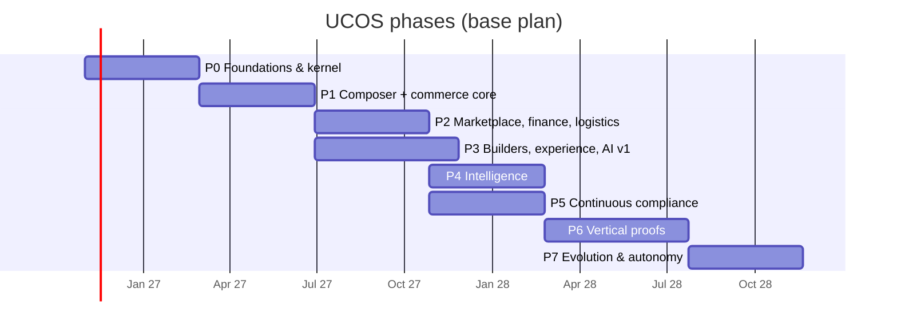

# UCOS — Team, Budget and Roadmap Plan

| Field | Value |
|---|---|
| Version | 0.1 (planning) |
| Date | 2026-10-03 |
| Basis | Master §32 (phases and exit criteria), [COST-MODEL.md](COST-MODEL.md) (assumptions A1–A8), [COMMERCIAL-MODEL.md](COMMERCIAL-MODEL.md) (plans) |
| Status | **Planning estimates.** Headcount and customer numbers are a base scenario, not commitments. |

## 1. Timeline
Phase durations follow master §32.1, starting 1 November 2026. P3 runs in parallel with P2, and P5 in parallel with P4.

| Phase | Window | Exit (master §32.1) | Commercial milestone |
|---|---|---|---|
| P0 | Nov 2026 – Feb 2027 | A sample pack's object type, defined only in `spec/`, is composed, certified and activated; tenant isolation proven; audit chain verified; Temporal triggers work; spikes decided | 5 design partners signed (D2C India and UAE) |
| P1 | Mar – Jun 2027 | `d2c-in-ae` composed from a platform definition with `GAP-000`; real purchases in IN and AE with tax invoices; the second country needed no kernel change | First paying tenants (Starter, Growth); tenant zero billing |
| P2 | Jul – Oct 2027 | Amazon-like reference composition live in 2 countries (marketplace, ledger with P1 replay, payouts) | First marketplace operator; Scale tier launched |
| P3 | Jul – Nov 2027 | A non-engineer builds a new storefront variant end to end in Studio | Pack marketplace opens to partners |
| P4 | Nov 2027 – Feb 2028 | ≥ 1M global products above the quality threshold; agents at L2 with evals at target | Enterprise tier (shared and dedicated cell) |
| P5 | Nov 2027 – Feb 2028 | SOC 2 Type I passes on UCOS-generated evidence | Regulated-industry sales unlocked |
| P6 | Feb – Jul 2028 | Three new verticals certified with zero kernel changes | Vertical solution bundles with partners |
| P7 | Jul – Nov 2028 | Measured MTTR reduction; governed evolution proposals accepted | — |

**Open planning item.** Master §32.1 and the constitutions place a few universes in different phases: U17 Resource is P2 in its constitution but listed with the P6 vertical proofs, and U37 Mobility is P5 in its constitution against P6 in §32.1. The constitution's *Delivery phase* governs scope. §32.1 should be aligned through U02 before P2 planning.

## 2. Team (product and engineering FTE, end of year)
| Team | Y1 (Nov 26–Oct 27) | Y2 | Y3 | Mission |
|---|---|---|---|---|
| Leadership and architecture (CTO, chief architect, principal engineers) | 3 | 4 | 4 | Architecture Board (U01), ADRs, cross-team design |
| Product management and design | 2 | 4 | 7 | Journeys, wireframes, design system, research |
| Kernel (gateway, command bus, object service, outbox, composer, certification) | 8 | 9 | 9 | KERNEL-DESIGN P0 build sequence |
| Foundation universes (meta, identity, geo, temporal, currency, l10n, context, policy) | 6 | 6 | 6 | Phase 0 universes |
| Commerce core (catalog, pricing, offers, cart/checkout, order, payment, tax, inventory, fulfilment) | 7 | 8 | 8 | Phase 1 universes |
| Marketplace and finance (marketplace, ledger, subscription, stored value, risk) | — | 7 | 8 | Phase 2 universes |
| Operations (logistics, field service, rental, procurement) | — | 5 | 6 | P2–P5 operations universes |
| Experience (web renderer, mobile, studio, SEO) | 3 | 7 | 9 | U64, U87, builder studio |
| Intelligence (AI gateway, prompts, agents, search, recommendations, ML) | — | 4 | 8 | U44, U49–U52, U94 |
| Verticals and industry packs | — | — | 8 | U48 packs, P6 proofs |
| SRE and platform operations | 3 | 4 | 6 | Cells, GitOps, DR, on-call |
| Security and compliance engineering | 2 | 3 | 4 | Threat models, controls, evidence, audits |
| Developer experience and docs | — | 1 | 3 | SDKs, developer portal, generators (U59) |
| **Total** | **34** | **62** | **86** | |

Go-to-market and G&A (sales, customer success, partnerships, legal, finance) are budgeted separately under A8. That is about 6 people in Y1, 15 in Y2 and 25 in Y3.

### First ten hires (in order)
1. Chief architect (Architecture Board chair; owns ADRs and the master document)
2. Kernel lead (Go; command bus and object service)
3. Platform/SRE lead (Kubernetes, Postgres, Kafka-API, OpenTofu, Argo CD)
4. Security lead (threat models, supply chain, SOC 2 path)
5. Temporal and workflow engineer (U13, U60; the durable engine)
6. Composition engineer (Datalog, gap engine; runs the P0 engine spike)
7. Identity engineer (U09; Keycloak or Ory spike)
8. Product designer (design system, W1–W40)
9. Commerce lead (checkout, order, payment; India and UAE PSP experience)
10. Tax and compliance engineer (GST e-invoicing, UAE VAT)

## 3. Budget (INR crore; base scenario)
| | Y1 (Nov 26–Oct 27) | Y2 (Nov 27–Oct 28) | Y3 (Nov 28–Oct 29) |
|---|---|---|---|
| Product and engineering team (FTE × ₹45 L) | 15.3 | 27.9 | 38.7 |
| Platform fixed costs (cost model §2) | 4.8 | 8.4 | 12.3 |
| Go-to-market and G&A | 3.0 | 8.0 | 14.0 |
| **Fixed costs** | **23.1** | **44.3** | **65.0** |
| Customers at year end (Starter / Growth / Scale / Enterprise / Marketplace) | 40 / 8 / 0 / 0 / 0 | 400 / 90 / 12 / 2 / 1 | 1,200 / 300 / 50 / 10 / 4 |
| Exit ARR | 1.1 | 22.6 | 86.5 |
| Recognised revenue (average of opening and exit ARR) | 0.6 | 11.8 | 54.5 |
| Cost of revenue (12% variable + 10% support) | 0.1 | 2.6 | 12.0 |
| **Net cash flow** | **−22.7** | **−35.0** | **−22.5** |
| Cumulative | −22.7 | −57.7 | −80.2 |

ARPA assumptions (per month): Starter ₹8,000, Growth ₹45,000, Scale ₹2.4 L, Enterprise ₹20 L, Marketplace operator ₹30 L. Pack revenue share plus services adds ₹0.3, ₹2 and ₹6 Cr in Y1–Y3.

- **Break-even ARR** at Y3 cost levels is about **₹83 Cr** (fixed costs ÷ 78% contribution margin). The base scenario crosses it at the end of Y3 (exit ARR ₹86.5 Cr), so monthly cash flow turns positive in early Y4.
- **Funding requirement:** a cumulative trough of ₹80 Cr, plus a 25% buffer, comes to about **₹100 Cr (≈ $11.4M at ₹88/USD)** over three years. A natural split is a seed/Series A round of about ₹40 Cr before P0 and a Series A/B round of about ₹60 Cr at the P2 exit, with traction from P1 and P2.
- **Downside:** with only 50% of the target customers, Y3 exit ARR is about ₹43 Cr. Break-even then slips by about 18 months, and either more capital (about ₹45 Cr) or a slower hiring ramp is needed. The Y2 hiring plan should be gated on the P1 commercial milestone.

## 4. Governance of the plan
- Phase gates are go/no-go decisions recorded as U01 DecisionRecords: the technical exit criteria (§1) plus the commercial milestone.
- Monthly KPI review: cost per order (A2), gross margin, ARR, NRR, burn, runway, hiring against plan, certification status (W30 coverage dashboard).
- Re-plan when any assumption moves more than 25%.

## 5. Key risks
| Risk | Impact | Mitigation |
|---|---|---|
| Kernel scope overruns (metadata-driven runtime is hard) | P0/P1 slip | Strict P0 build sequence (KERNEL-DESIGN), spikes S-01…S-06 first, golden blueprints as acceptance tests |
| Hiring senior platform engineers in India | Slower ramp | Start with remote-first senior hires; pair with strong mid-level engineers; use the ADRs and specs as onboarding |
| Regulatory change (DPDP Rules, GST e-invoicing thresholds, UAE e-invoicing roll-out) | Rework | Regulations are facts and rules (U67); a regulatory-change feed is part of U76 |
| Design-partner concentration | Revenue risk | At least 5 partners across D2C and B2B before P1 exit |
| AI cost volatility | Margin | U49 budgets, routing to smaller models, caching; AI above credits billed at cost + 20% |
