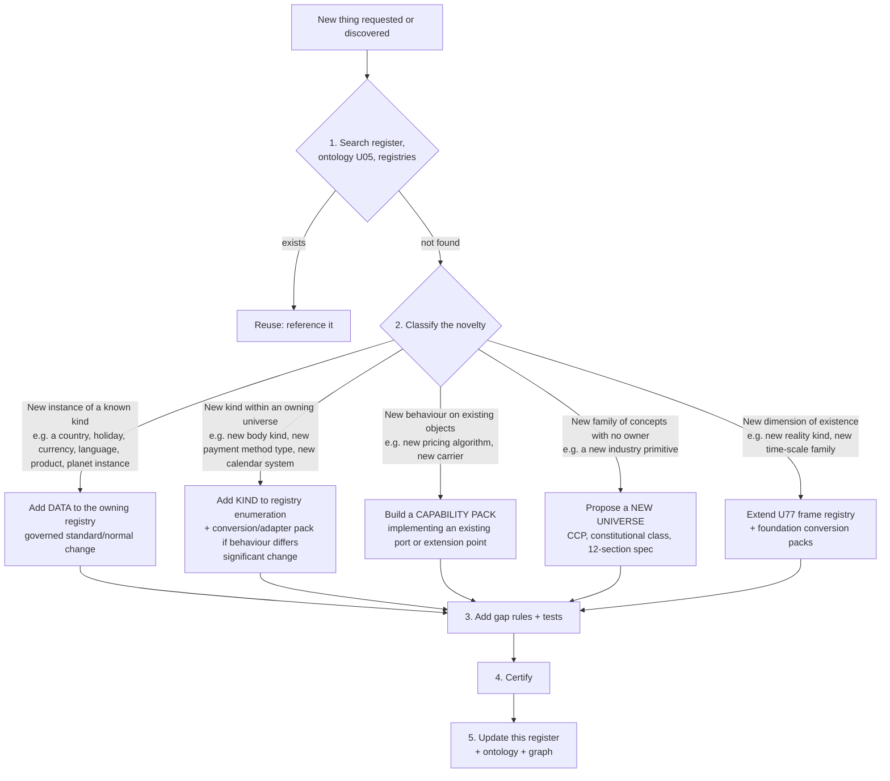

# UCOS Ω∞ — Universal Coverage Register & Extensibility Protocol

| Field | Value |
|---|---|
| Document ID | `UCOS-COVERAGE` |
| Version | 1.0.0 |
| Authority | Constitution-level companion to `UCOS-MASTER-ARCHITECTURE.md` (Law L1 Knowledge Once, L3 Canonical Ownership, L20 Discover the Unknown) |
| Purpose | (1) Assign **every domain, concept and capability** to exactly one canonical home. (2) Define how **anything not yet listed** is added later, for any region, planet, galaxy, reality, language, currency, time system or unit, without re-architecting. |

> **How to read:** each row gives a domain or concept, its canonical home (universe id), the delivery phase, and its spec status. ✅ = universe spec written (v0.1). ⬜ = universe named, spec planned for that phase. 📦 = delivered as an industry or provider **pack** composed from universes (no new primitives). If something is missing from this register, §Z (Extensibility Protocol) says exactly how to add it.

---

## A. Existence, reality and frames of reference
| Concept | Home | Phase | Status |
|---|---|---|---|
| Realities (physical, digital, virtual world/metaverse, augmented, simulated, hypothetical, fictional), multiverse branches | U77 Existence & Reality Frame | P0 | ✅ |
| Celestial and other bodies (universe, galaxy, star system, planet, moon, asteroid, station, spacecraft, habitat, virtual world, indoor or vehicle frames) | U77 | P0 registry / P6+ instances | ✅ |
| Spatial reference frames (EPSG, IAU planetary, local, inertial, virtual) | U77 → used by U12 | P0 | ✅ |
| Time scales (UTC, TAI, TT, TDB, GPS, Mars MTC, Lunar LTC, world/simulation clocks, logical clocks) | U77 → used by U13 | P0 | ✅ |
| Calendar systems (Gregorian, ISO week, Hijri, Hebrew, Indian national, Vikram Samvat, Chinese, Persian, Ethiopic, Buddhist, Japanese, Darian/Mars sol, fiscal, virtual) | U77 + U13 | P0 / packs | ✅ |
| Monetary systems (sovereign fiat, CBDC, stablecoin, crypto, loyalty, in-game, community, off-world) | U77 + U14 | P0 / packs | ✅ |
| Unit systems (SI, UCUM, imperial, US, traditional regional, astronomical, virtual) | U77 + U14 | P0 | ✅ |
| Language systems (natural, sign, constructed, historical, machine-protocol, notation) | U77 + U15 | P0 | ✅ |
| Governing authorities (nation-states, supranational, treaty bodies, space agencies, station operators, virtual-world operators, DAOs, standards bodies) | U77 (+ jurisdictions U12, law U67) | P0 | ✅ |
| Reality isolation and cross-reality bridging (virtual ↔ physical redemption, twins, simulation) | U77 RealityLink + U03 P-004 | P0 | ✅ |
| Context and observer (who, where, when, which reality) | U16 Context | P0 | ✅ |
| Constitution, laws, authority, governance, policy | U01, U02, U03 | P0 | ✅ |
| Meta-model (object types, fields, relationships, lifecycles) | U04 Meta | P0 | ✅ |
| Ontology (meaning), Taxonomy (classification), Reference data (codes) | U05, U06, U08 | P0 | ✅ |
| Knowledge graph, assertions, trust in facts | U07 | P1 | ✅ |

## B. Identity, parties, people
| Concept | Home | Phase | Status |
|---|---|---|---|
| Authentication (passkeys, MFA, OTP, SSO, federation), sessions, tokens | U09 Identity | P0 | ✅ |
| Social login (Google, Apple, Facebook, X, LinkedIn, GitHub, WeChat…) | U09 (App. D) | P1 | ✅ |
| National digital IDs and wallets (Aadhaar e-KYC via partners, DigiLocker, UAE Pass, eIDAS wallet, BankID) | U09 adapters | P2+ | ✅ 📦 |
| Roles, permissions, groups, delegation, just-in-time elevation, separation of duties | U09 + U03 | P0 | ✅ |
| Machine, service, device, robot and agent identities; virtual avatars | U09 (+ U51, U92, U77) | P0–P6 | ✅ |
| KYC/KYB, sanctions/PEP screening of parties | U09 VerificationRecord (+ U90 for goods) | P2 | ✅ |
| Persons, organisations as parties, party roles (buyer, seller, patient, student, driver…), contact points, preferences | U11 Person & Party | P0 | ✅ |
| Customer 360 profile and traits, segments, audiences | U85 CDP | P3 | ✅ |
| Tenants, organisations, org units, brands, stores, workspaces, tenant links | U10 | P0 | ✅ |
| Employees, positions, payroll, attendance, recruiting, performance | U46 Workforce/HRMS | P4 | ⬜ |
| Workforce scheduling (shifts) | U46 + U13 | P4 | ⬜ |
| Teams, projects, tasks, comments, mentions, wiki, timesheets | U96 Work & Collaboration | P5 | ✅ |

## C. Geography and space
| Concept | Home | Phase | Status |
|---|---|---|---|
| Places, hierarchy, addresses, address formats, geocoding | U12 Geography | P0 | ✅ |
| Jurisdictions (national, subnational, municipal, free zones, supranational, treaty, station, virtual-world, DAO) | U12 (+ U77 authorities) | P0 | ✅ |
| Zones, geofences, service areas, delivery areas, territories | U12 | P0 | ✅ |
| Maps, routing, distance matrices, ETA | U36 Logistics (Maps port) | P2 | ⬜ |
| Indoor positioning, site maps, warehouse locations | U12 (local frames) + U34 | P2+ | ✅ |
| Planets and space locations | U12 within U77 frames | P6+ | ✅ |

## D. Time
| Concept | Home | Phase | Status |
|---|---|---|---|
| Instants, ranges, durations, recurrence, calendars (holiday, business, fiscal, settlement, trading) | U13 Temporal | P0 | ✅ |
| Scheduling, appointments, bookings, reservations, slots, availability | U13 | P0 | ✅ |
| SLAs, deadlines, expiry, timers, triggers, cron replacement | U13 | P0 | ✅ |
| Validity of offers, prices, coupons, campaigns | U13 TemporalPolicy (consumed by U22, U23) | P0 | ✅ |
| Forecasting time series | U94 ML / U56 Learning | P4 | ✅ / ⬜ |
| Non-Earth and virtual time | U13 App. D + U77 | P6+ | ✅ |

## E. Money, units and economics
| Concept | Home | Phase | Status |
|---|---|---|---|
| Money value type, currencies, FX rates and rate policies, rounding, allocation | U14 Currency & Unit | P0 | ✅ |
| Units, quantities, dimensions, packaging units, conversions | U14 | P0 | ✅ |
| Ledger, double entry, accounts, journals, settlement, invoices, credit notes, revenue recognition, period close | U30 Ledger & Finance | P2 | ⬜ |
| Accounts payable/receivable, expense management, budgeting/FP&A, treasury, fixed assets | U30 (extension planned) + U79 for asset units | P4 | ⬜ |
| Tax (GST, VAT, sales tax, withholding/TCS, e-invoicing, tax documents) | U31 Tax | P1 | ✅ |
| Customs duties and landed cost | U90 Global Trade | P2 | ✅ |
| Stored value: gift cards, store credit, wallets, prepaid, cashback balances | U84 | P2 | ✅ |
| Loyalty points, rewards, referrals, affiliates, partner commissions | U32 Loyalty & Incentive | P3 | ⬜ |
| Lending, BNPL, EMI, insurance, deposits, investments, brokerage | U100 Financial Products | P6 | ✅ |
| Crypto, stablecoins, CBDC, tokens, NFTs, product passports on-chain | U99 + U77 monetary systems | P6 | ✅ |
| Economic simulation, pricing experiments | U54 Simulation + U72 experiments | P5 | ⬜ / ✅ |

## F. Products and catalogue
| Concept | Home | Phase | Status |
|---|---|---|---|
| Global product master (GPID), models, variants, attributes, brands, manufacturers, identifiers (GTIN/MPN/ISBN), provenance, matching, recalls | U18 Product Intelligence | P1 | ✅ |
| Product relationships (accessories, spare parts, consumables, compatibility/fitment, successors, similar) | U18 App. D (+ U52 computed) | P2 | ✅ |
| Product documents (safety data sheets, certificates, manuals, energy labels), digital product passport | U18 App. D (+ U99, U98) | P2 / P6 | ✅ |
| Product nature: physical, digital download, licence, streaming right, virtual item, tokenised | U18 App. D | P1+ | ✅ |
| Product categories, attribute templates, restricted categories | U06 Taxonomy | P0 | ✅ |
| Tenant listings, SKUs, catalogues, collections, assortments | U21 Catalog | P1 | ✅ |
| Configurable products, options, add-ons, modifiers, personalisation, configure-price-quote, made-to-order, kits/bundles | U78 Product Configuration | P2/P4 | ✅ |
| Serialised units, installed base, ownership, custody, meters, maintenance, enterprise assets | U79 Physical Asset & Installed Base | P3/P5 | ✅ |
| Warranty, product registration, claims, repairs, return-for-repair (RMA), spare parts, maintenance contracts | U80 Warranty & After-sales | P3 | ✅ |
| Rentals and leasing (deposits, condition reports, late fees, damage) | U83 | P5 | ✅ |
| Tickets, events, venues, seat maps, admission, resale | U81 | P6 | ✅ |
| Product reviews, ratings, Q&A | U70 Trust & Reputation (ratings), U88 Social (Q&A) | P2/P5 | ⬜ / ✅ |
| Product content (rich descriptions, A+ content), media | U18/U21 + U43 Asset + U41 Content | P1/P4 | ✅ / ⬜ |
| Product data feeds out (Google Merchant, Meta catalogue, marketplaces) | U62 Integration + U87 SEO feeds | P2 | ⬜ / ✅ |
| Manufacturing: bill of materials, routings, production orders, product lifecycle (PLM) | U47 Manufacturing | P6 | ⬜ |
| Product environmental footprint, eco-claims | U98 ESG | P6 | ✅ |

## G. Services
| Concept | Home | Phase | Status |
|---|---|---|---|
| Global service master (GSID), service plans, SLA templates, credentials required | U19 Service Intelligence | P1 | ✅ |
| Service request catalogue (customer and employee, ITSM requests) | U82 Field Service & Work Mgmt | P5 | ✅ |
| Work orders, dispatch, technicians, proof of service | U82 | P5 | ✅ |
| Appointments and bookings | U13 (+ U19, U17 Resource) | P0/P2 | ✅ / ⬜ |
| Resources (people, vehicles, rooms, machines), capacity, skills | U17 Resource | P2 | ⬜ |
| Subscriptions, memberships, plans, usage metering and rating, dunning | U27 Subscription | P2 | ⬜ |
| Entitlements, licences, feature access, quotas, seats | U28 Entitlement | P0–P2 | ✅ |
| Support cases, tickets, knowledge base, SLAs | U39 Support & Case | P3 | ⬜ |
| Professional services (time & materials), timesheets | U96 + U19 | P5 | ✅ |
| Transport services (rides, deliveries, seats) | U37 Mobility, U36 Logistics, U81 seats | P2–P6 | ⬜ / ✅ |
| Public services (permits, licences, certificates) | U48 Government pack | P6 | 📦 |

## H. Commerce
| Concept | Home | Phase | Status |
|---|---|---|---|
| Cart, checkout, guest checkout, express checkout | U24 Commerce | P1 | ✅ |
| Orders, seller sub-orders, adjustments, cancellations, returns, exchanges | U26 Order | P1 | ✅ |
| Pricing, price lists, B2B/contract prices, fees, dynamic pricing, quotes | U23 Pricing | P1 | ✅ |
| Offers, discounts, promotions, coupons, vouchers, BOGO, tiered, free shipping, flash sales, campaigns, bank offers | U22 Offer | P1 | ✅ |
| Marketplace (sellers, commissions, payouts, seller policies) | U25 Marketplace | P2 | ⬜ |
| Auctions, best-offer, RFQ/tenders, reverse auctions, negotiation (human and agent) | U91 | P5 | ✅ |
| B2B commerce (accounts, approvals, punch-out, credit terms) | U23 + U89 + U45 + U100 | P3+ | ✅ / ⬜ |
| Point of sale (POS), kiosk | U64 channels + U92 devices + core commerce | P5 | ✅ |
| Cross-border commerce | U90 + U31 + U14 | P2 | ✅ |
| Social commerce, live shopping | U88 + U41 | P6 | ✅ / ⬜ |
| Conversational and agentic commerce (chat, WhatsApp, voice, AI agents buying for users) | U64 renderers + U51 Agents + U63 MCP | P4 | ✅ / ⬜ |

## I. Payments
| Concept | Home | Phase | Status |
|---|---|---|---|
| Payment gateways/PSPs (Stripe, Adyen, Razorpay, PayU, Network International, PayPal…), methods (cards, UPI, net banking, wallets, BNPL, bank transfer, COD) | U29 Payment (adapters) | P1 | ✅ |
| Strong customer authentication, tokenisation, mandates/autopay, refunds, reconciliation | U29 | P1 | ✅ |
| Payouts, split payments, chargebacks/disputes | U29 (P2) + U71 Dispute | P2/P3 | ✅ / ⬜ |
| Fraud and risk scoring, AML monitoring | U69 Risk | P2 | ⬜ |

## J. Operations and supply chain
| Concept | Home | Phase | Status |
|---|---|---|---|
| Inventory, stock locations, reservations, lots/serials, cycle counts, transfers | U34 Inventory | P1 | ✅ |
| Warehouse operations (pick, pack, put-away, waves) | U35 + U34 (WMS pack) | P2 | ✅ 📦 |
| Fulfilment, sourcing, delivery promises, pickup, digital delivery | U35 | P1 | ✅ |
| Shipping, carriers, rates, labels, tracking, routing, fleet, last mile | U36 Logistics | P2 | ⬜ |
| Customs, export controls, sanctions screening of goods | U90 | P2 | ✅ |
| Procurement, suppliers, purchase orders, goods receipt, 3-way match | U45 ERP/Procurement | P4 | ⬜ |
| Demand planning, replenishment | U34 + U94 | P4 | ✅ |
| Manufacturing, quality management, production scheduling | U47 | P6 | ⬜ |
| Maintenance (enterprise asset management), predictive maintenance | U79 + U82 + U94 | P5 | ✅ |
| Mobility, dispatch, ride matching | U37 | P5 | ⬜ |
| IoT devices, telemetry, firmware updates, edge, robots | U92 | P5/P6 | ✅ |

## K. Customers, marketing and growth
| Concept | Home | Phase | Status |
|---|---|---|---|
| CRM (leads, opportunities, accounts, pipelines, activities) | U38 CRM | P3 | ⬜ |
| Customer data platform (CDP), identity stitching, traits, segments | U85 | P3 | ✅ |
| Marketing automation, journeys, campaigns, attribution | U86 | P4 | ✅ |
| Email, SMS, push (FCM, APNs, web push), WhatsApp, RCS, Telegram, LINE, WeChat, Viber, Messenger, Instagram, postal, voice notifications, in-app notification centre | U40 Communication (+ adapter packs) | P1–P4 | ✅ |
| Inbound messages and routing (replies, STOP/opt-out, intent to case, order or bot) | U40 Appendix E.3 | P1 | ✅ |
| Real-time chat (presence, typing, receipts; buyer↔seller, rider↔driver, patient↔doctor) | U40 Appendix E.4 (`communication.realtime`) | P3 | ✅ |
| Broadcast and emergency alerts | U40 Appendix E.5 | P4 | ✅ |
| Agent-to-agent messaging protocol | U40 Appendix E.6 (+ U51) | P3 | ✅ |
| Contact centre: voice, IVR, masked calling, live chat, chatbot hand-off, queues and skills routing, call-backs, recordings with consent, supervision | U109 | P3 | ✅ |
| Video sessions (telehealth, classes, sales, video KYC, support) | U109 (`rtc.sessions`) | P3 | ✅ |
| Advertising, sponsored listings, ad auctions | U33 Advertising | P4 | ⬜ |
| SEO, URLs, sitemaps, structured data, redirects, hreflang, AI-crawler policy | U87 Web Presence & SEO | P1 | ✅ |
| Social media: social graph, posts, comments, communities, moderation, publishing to and listening on external networks | U88 Social & Community | P5 | ✅ |
| Reviews, ratings, reputation, seller and customer trust scores | U70 | P2 | ⬜ |
| Surveys, NPS, CSAT, forms, feedback | U97 | P3 | ✅ |
| Personalisation, recommendations, cross-sell, upsell | U52 Recommendation | P4 | ⬜ |
| Search (keyword, semantic, hybrid), merchandising | U44 | P1 | ✅ |
| Experiments, A/B tests, feature flags | U72 | P1 | ✅ |

## L. Content, media and documents
| Concept | Home | Phase | Status |
|---|---|---|---|
| Files, images, video, renditions, rights | U43 Asset | P1 | ✅ |
| CMS pages, blogs, articles, editorial workflow | U41 Content & Media (+ U87 routes) | P4 | ⬜ |
| Video and audio streaming, live streaming, DRM, playlists, OTT | U41 | P4 | ⬜ |
| Documents, templates, generation (invoices, contracts, certificates, labels), versioning | U42 Document | P1 | ✅ |
| E-signature | U42 + U89 (esign port) | P2 | ⬜ / ✅ |
| Contracts, agreements, terms acceptance, obligations, renewals | U89 Contract & Agreement | P2/P4 | ✅ |
| Knowledge base and help centre | U39 + U07 | P3 | ⬜ / ✅ |

## M. Intelligence
| Concept | Home | Phase | Status |
|---|---|---|---|
| LLMs, model registry, providers, routing, guardrails, evaluations | U49 AI/Model | P3 | ⬜ |
| Prompts | U50 | P3 | ⬜ |
| AI agents, tools (MCP), memory, authority, multi-agent | U51 Agent | P3 | ⬜ |
| Classical ML: features, training, serving, drift, fairness | U94 ML Platform | P2/P4 | ✅ |
| Recommendation | U52 | P4 | ⬜ |
| Decisions and rules (decision tables, decision models) | U53 Decision | P1 | ✅ |
| Simulation, what-if | U54 | P5 | ⬜ |
| Digital twins | U55 | P5 | ⬜ |
| Learning signals, insights | U56 | P5 | ⬜ |
| Retrieval over company knowledge (RAG), grounding | U07 + U51 | P1/P3 | ✅ / ⬜ |

## N. Platform and engineering
| Concept | Home | Phase | Status |
|---|---|---|---|
| Capabilities, packs, capability marketplace | U57 | P0 | ✅ |
| Composition, blueprints, platform definitions | U58 | P0 | ✅ |
| Generators (SDKs, docs, infrastructure-as-code, tests, mobile builds) | U59 Generation | P2 | ⬜ |
| Git, repositories, pull requests, CI/CD, artifacts, provenance, definitions-as-code sync | U95 Software Delivery | P0/P3 | ✅ |
| Workflows, human tasks, sagas | U60 | P1 | ✅ |
| Events, topics, data contracts for events, replay | U61 | P0 | ✅ |
| Integrations, connectors, mappings, webhooks, EDI, ETL | U62 Integration | P1–P2 | ✅ |
| APIs (REST, GraphQL, gRPC, MCP), API products, developer portal, rate limits | U63 | P1 | ✅ |
| UI meta-model, renderers, portals, themes, design system | U64 | P1/P3 | ✅ |
| Data catalogue, data products, lineage, data quality, master data, data sharing | U93 | P2 | ✅ |
| Feature flags, experiments, analytics, dashboards, KPIs | U72 | P1 | ✅ |
| Sandboxes, environments, developer workspaces | U73 + U95 | P0 | ✅ |

## O. Trust, security and legal
| Concept | Home | Phase | Status |
|---|---|---|---|
| Security (classification, keys, secrets, encryption, controls, findings, incidents, threat models) | U65 | P0 | ✅ |
| Audit logs, evidence | U68 | P0 | ✅ |
| Certification gates | U74 | P0 | ✅ |
| Gap discovery, completeness | U75 | P0 | ✅ |
| Privacy, consent, data subject requests, retention, cross-border transfers, records of processing, DPIA, cookies | U66 | P1 | ✅ |
| Compliance (regulations, controls, posture, regulatory change) | U67 | P1 | ✅ |
| Risk, fraud, AML transaction monitoring, credit risk signals | U69 Risk | P2 | ⬜ |
| Trust and safety, content moderation | U88 (UGC) + U43 (media) + U69 | P5 | ✅ / ⬜ |
| Disputes, claims, arbitration, chargebacks, appeals | U71 | P3 | ⬜ |
| Contracts and legal agreements | U89 | P2 | ✅ |
| Evolution and change over time (proposals, deprecation, migration) | U76 Evolution | P3 | ⬜ |

## P. Platform operations
| Concept | Home | Phase | Status |
|---|---|---|---|
| Observability (metrics, logs, traces), SLOs, alerting | U72 | P1 | ✅ |
| Infrastructure, cells, placement, deployments, backup and disaster recovery | U73 | P0 | ✅ |
| FinOps and cost attribution | U72 + U73 | P1 | ✅ |
| Sustainability of the platform itself (energy, carbon per workload) | U73 signals → U98 | P1/P6 | ✅ |
| AIOps and self-healing | U72 + U76 + U73 runbooks | P5 | ✅ / ⬜ |

## Q. Experience channels
| Concept | Home | Phase | Status |
|---|---|---|---|
| Web, mobile (iOS/Android), tablet, desktop, PWA | U64 renderers | P1/P3 | ✅ |
| Smart TV, watch, car/infotainment | U64 renderers (packs) | P6 | ✅ 📦 |
| Kiosk, POS, scanners, printers | U64 + U92 | P5 | ✅ |
| Voice assistants, IVR | U64 voice renderer + U40 voice | P4 | ✅ |
| Chat, WhatsApp, Telegram, RCS, in-app chat | U64 chat renderer + U40 | P4 | ✅ |
| AR, VR, XR, spatial computing, metaverse worlds | U64 adapter contract + U77 virtual realities | P6+ | ✅ 📦 |
| Agent UI (AI agents as users) | U64 agent renderer + U63 MCP | P4 | ✅ |
| Brain-computer interfaces and future interfaces | U64 renderer extension point (new ChannelProfile) | Future | ✅ (extension point) |
| Accessibility, localisation, theming, white-label | U64 + U15 | P1 | ✅ |

## R. Industries (composed as packs from the universes above)

> The authoritative, complete industry list is the ISIC-division mapping in `INDUSTRY-PRODUCT-DOMAIN-CATALOGUE.md` §1 (88/88 divisions). The table below is a summary.

| Industry | Pack id | Main universes composed | Phase |
|---|---|---|---|
| Retail, D2C, marketplaces, grocery, quick commerce, fashion, electronics | `retail.*` | U18–U35, U25, U78, U84 | P1–P2 |
| Restaurants and food delivery | `food.*` | U78 (modifiers), U35, U36/U37, U13 | P3 |
| Mobility, ride-hailing, fleet | `mobility.*` | U37, U36, U13, U12, U23 | P5 |
| Travel (flights, rail, bus, stays, packages) | `travel.*` | U81 seats, U13, U83, U90, U100 insurance | P6 |
| Hospitality (hotels, short-term stays) | `hospitality.*` | U13 reservations, U17 resources, U83, U23 rate plans | P6 |
| Media, OTT, music, gaming, live | `media.*` | U41, U27, U28, U52, U88 | P4–P6 |
| Healthcare (clinics, telemedicine, pharmacy, labs) | `health.*` | U19, U13, U11 (patient role), U66 health data rules, FHIR via U05 | P6 |
| Education (LMS, schools, courses, exams) | `education.*` | U19, U27, U41, U97, U96 | P6 |
| Government and public services (permits, citizen services, tax, grievances) | `gov.*` | U82 service requests, U89, U97, U67 | P6 |
| Banking, fintech, insurance, brokerage, wealth | `fin.*` | U100, U30, U99, U69 | P6 |
| Real estate and property (listings, leases, facility management) | `realestate.*` | U21, U83, U89, U79, U82 | P6 |
| Manufacturing and industrial | `mfg.*` | U47, U79, U92, U45, U94 | P6 |
| Energy and utilities (metering, billing, outages) | `utilities.*` | U92 meters, U27 rating, U82, U98 | P6 |
| Telecom (plans, SIMs, number portability, installations) | `telecom.*` | U27, U28, U79, U82 | P6 |
| Agriculture (inputs, mandi/commodity, farm services) | `agri.*` | U18, U91, U82, U92 | P6 |
| Automotive (parts fitment, dealers, service) | `auto.*` | U18 fitment, U79, U80, U82 | P6 |
| Non-profit (donations, campaigns, volunteers) | `nonprofit.*` | U29, U86, U96, U97 | P6 |
| Legal and professional services | `pro-services.*` | U19, U96, U89 | P6 |
| ITSM and enterprise service management | `itsm.*` | U82, U39, U60, U79 | P6 |
| Space commerce and off-world operations | `space.*` | U77 bodies and frames, U90 export controls, U92, U13 light-time | Future |
| Virtual worlds and metaverse economies | `metaverse.*` | U77 realities, U99, U84, U88, U64 XR | Future |

## R2. Domains added by the standards review (A-48…A-58)
| Concept | Home | Phase | Status |
|---|---|---|---|
| Quality management (nonconformance, CAPA, audits, controlled documents), EHS (incidents, hazards, permits to work), environmental permits and monitoring | U101 | P5–P6 | ✅ |
| Strategy, OKRs, scorecards, planning cycles, scenario planning | U102 (+U54) | P5 | ✅ |
| Corporate governance (board, resolutions, statutory filings), cap table, ESOP, dividends, beneficial ownership, investor relations | U103 | P6 | ✅ |
| Legal matters, litigation, legal holds, whistleblowing and ethics, IP portfolio (trademarks, patents, domains), brand protection and takedowns | U104 | P6 | ✅ |
| Workplace and facilities (desk, room and parking booking, visitors, occupancy, moves) | U105 | P6 | ✅ |
| Travel and expense (travel requests, claims, receipts, mileage, per diem, card matching, reimbursement) | U106 | P6 | ✅ |
| Partner programs, channel conflict, deal registration, MDF, rebates, distributors, affiliates, franchise networks and royalties | U107 | P4–P6 | ✅ |
| Innovation, R&D, stage-gate, design items and revisions, engineering BOM and change, labs (ELN, LIMS-lite), product launch | U108 | P6 | ✅ |
| Public relations and media monitoring | U86 + U88 | P4 | ✅ |
| Crisis management and business continuity | U65 incidents + U73 continuity and disaster recovery + U101 drills | P5 | ✅ |
| Grants management (applying for and awarding grants) | `grants.*` pack = U89 + U97 + U60 + U30 + U82 | P6 | 📦 |
| Product natures (living, perishable, energy, real property, data, IP, credits, permits, labour time…) and regulated goods | U18 Appendix E | P1–P6 | ✅ |
| Standards-based completeness (ISIC, CPC, APQC, plus BIAN, eTOM, FHIR, ISA-95, ACORD) | `INDUSTRY-PRODUCT-DOMAIN-CATALOGUE.md` + U08 Appendix D | P0 | ✅ |

## S. Future horizon (absorbed by extension, no re-architecture)
Quantum computing (compute port in U73 + new runtime kind), autonomous vehicles and robots (U92 + U51 + U37), synthetic economies (U77 monetary systems + U54 simulation), digital humans and avatars (U09 identities in U77 realities + U41 media), brain-computer interfaces (U64 channel profile + U66 neural-data class), AGI-class agents (U51 with U01 authority levels; L17 human authority), interplanetary trade (U77 + U90 + U13 light-time), multiverse/hypothetical branches (U77 realities + U54).

---

## Z. Extensibility Protocol: how anything new is added

Every new requirement, whether a new country, planet, currency, language, regulation, industry, product type, channel or reality, follows the **same five-step decision**. None of them requires changing existing universes' code.

**Rules of the protocol**
1. **Search before create.** Duplicate-concept detection (U05 §5.1) blocks near-duplicates automatically.
2. **Prefer the lowest step.** Data is better than a new kind, a new kind better than a pack, a pack better than a new universe. A new universe is a last resort and needs Architecture Board approval.
3. **Frames first for "where, when, what money, what units, what language, which reality".** Anything about a new location system, time system, currency system, unit system, language system or reality starts in U77 and flows to U12, U13, U14, U15 and U16 automatically.
4. **Every addition brings its gap rules.** The platform must be able to say whether the new thing is missing anywhere it is needed.
5. **Every addition is certified** (U74) and **recorded here.** This register is regenerated from the registries and the knowledge graph (`ucos coverage --report`). It is a generated view, so it cannot drift from reality.
6. **Unknown unknowns:** the Discovery questions (U75 §5.2) run weekly. Repeated waivers, zero-result searches in the capability marketplace, unresolved builder intents, and unmapped regulatory or market signals become `OPPORTUNITY` insights for U76 Evolution. This is how things nobody listed get found.

### Z.1 Worked examples
| New requirement | Classification | What changes |
|---|---|---|
| Launch in Kenya | Data | Jurisdiction facts, holiday calendar, KES (already ISO), M-Pesa payment adapter (pack, if not present), KRA tax regime pack, Kenya Data Protection Act regulation pack. Zero code in existing universes. |
| Accept a new national payment method (e.g. Pix, PromptPay) | Pack | Adapter implementing `payment.provider@2` + method type registry entry. |
| Sell in Swahili, or in a constructed language | Data | Locale in U15 (BCP 47 or private-use), translations. |
| Support a Martian colony store | Kind + data + packs | Body `mars` (data), frame `mars-surface` (data), Darian calendar and MTC time scale (packs), colony monetary system (data), governing authority (data), jurisdictions (data), light-time SLA facts (data). Commerce universes are unchanged. |
| Commerce inside a metaverse world | Kind + data | Reality `virtual-world` instance, in-game monetary system, world-operator authority, RealityLink for physical redemption. |
| A brand-new industry primitive (e.g. carbon-credit retirement registry) | Universe or pack | Check U98/U99/U100 first. If no owner, propose a new universe through a constitutional change proposal. |
| A new regulation (e.g. new AI law) | Data | U67 regulation pack + control mappings + applicability rules. Gaps appear automatically for affected tenants. |
| A new interface (e.g. neural interface) | Kind + pack | U64 ChannelProfile + renderer pack + U66 data class `NEURAL` (restricted). |

---
*Register v1.1.0 — 109 universes (U01–U109), 82 specified (v0.1), 27 planned. Industries, products, services and domains are mapped against ISIC, CPC and APQC in `INDUSTRY-PRODUCT-DOMAIN-CATALOGUE.md`.*
