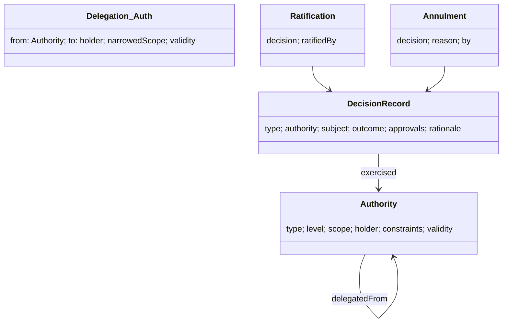

# U01 — Authority Universe Constitution

| Field | Value |
|---|---|
| Universe ID | `U01-authority` |
| Layer | L0 Constitution & Authority |
| Domain | 08 Governance |
| Steward | `ucos:org:architecture-board` |
| Version | 0.1.0 (Draft) |
| Delivery phase | P0 |
| Depends on | U04 Meta, U09 Identity (holders), U13 Temporal (validity), U68 Audit |
| Depended on by | U02 Governance (approvals), U03 Policy (authority-scoped rules), U51 Agent (bounded authority), U74 Certification, every definition lifecycle |
| Master references | §18.1–§18.3, L9, L17 |

> Authority owns **the right to decide**: who (or what) may approve, ratify, certify, waive, delegate or revoke, over which scope, up to which limits, and for how long. It also owns the **record of each decision** (`DecisionRecord`). It does not own the change process (U02 Governance) or the access rules for runtime actions (U03 Policy). Policy answers "may this principal execute this action?". Authority answers "who has the standing to *decide* on this matter?".

---

## 1. Laws

| ID | Law | Enforcement |
|---|---|---|
| AUTH-L1 | Every decision that changes a definition, grants a waiver, certifies, approves a release or authorises an agent references an `Authority` whose scope covers it. | Governance and Certification services reject decisions without a matching authority (`AUTH_SCOPE_MISMATCH`). |
| AUTH-L2 | Authority can only be delegated downward (lower or equal level, narrower or equal scope, shorter or equal validity). | Delegation validator (§5.2). |
| AUTH-L3 | Decisions at level ≥ 4 require multi-party approval (n-of-m) and phishing-resistant step-up. | Decision workflow + Identity ACR check. |
| AUTH-L4 | Revocation takes effect immediately for future decisions; past decisions stay valid unless explicitly annulled by a higher authority. | Validity checks at decision time; annulment is itself a decision. |
| AUTH-L5 | Autonomous authorities (agents, automation) cannot hold level ≥ 3 and cannot delegate. | Validator. |
| AUTH-L6 | Every DecisionRecord is immutable and hash-chained into the audit log. | U68. |

**Bootstrap:** the root authority (level 5, "Constitutional Authority") is created at platform genesis. It is held by an Architecture Board group with at least 3 members using hardware keys (AAL3), and is recorded in a signed genesis record.

---

## 2. Ontology



- **`AuthorityType`** (master §18.2): `foundational`, `governance`, `administrative`, `domain`, `operational`, `autonomous`.
- **Levels:**

  | Level | Meaning | Typical scope |
  |---|---|---|
  | 1 | routine | tenant operational config |
  | 2 | standard | tenant definitions, tenant roles |
  | 3 | significant | universe definitions (minor), tenant-level waivers, release approvals for tenant blueprints |
  | 4 | critical | major definition versions, platform releases, security/compliance exceptions, tz/ref-data upgrades |
  | 5 | constitutional | constitution, laws, meta-types, root delegation |

- **`DecisionType`:** `approval`, `rejection`, `waiver`, `certification`, `ratification`, `annulment`, `policy-change`, `release`, `incident-action`, `break-glass`, `ai-action-approval`, `delegation`, `revocation`.
- **Scope dimensions:** `universes[]`, `capabilities[]`, `tenants[]` (or `platform`), `actions[]` (decision types), `objectTypes[]`, `jurisdictions[]`, `monetaryLimit` (Money), `riskCeiling` (0–100), `dataClasses[]`.

---

## 3. Objects

### 3.1 `ucos.authority.Authority`
| Attribute | Type | Card. | Notes |
|---|---|---|---|
| `id` | UGID (`ucos:authority:`) | 1 | |
| `type` | AuthorityType | 1 | |
| `level` | Integer 1–5 | 1 | |
| `name` | LocalizedText | 1 | e.g. "Bazaar Finance Release Authority" |
| `scope` | AuthorityScope | 1 | §2 scope dimensions; `*` only for level 5 |
| `holder` | Reference→Identity/Group/Role | 1 | a role-held authority follows role grants |
| `quorum` | `{ required: n, of: m, distinctOrgUnits?: bool }` | 0..1 | required when level ≥ 4 |
| `constraints` | `{ requiresAcr: AAL2|AAL3, sod: [rules], maxDecisionsPerDay?, requiresReason: bool }` | 1 | |
| `delegatedFrom` | Reference→Authority | 0..1 | absent only for root |
| `delegation` | `{ allowed: bool, maxDepth: int, mustNarrow: true }` | 1 | |
| `validity` | TimeRange | 1 | |
| `evidence` | Array<EvidenceRef> | 0..N | board resolution, contract clause, appointment letter |
| `status` | `active|suspended|revoked|expired` | 1 | |

### 3.2 `ucos.authority.DecisionRecord`
| Attribute | Type | Card. | Notes |
|---|---|---|---|
| `id` | UGID (`ucos:decision:`) | 1 | |
| `type` | DecisionType | 1 | |
| `subject` | Reference (any definition, gap, blueprint, release, agent action) | 1..N | |
| `authority` | Reference→Authority | 1 | |
| `outcome` | `approved|rejected|granted|denied|annulled` | 1 | |
| `conditions` | Array<Expression or text> | 0..N | e.g. "valid until 2026-10-30" |
| `validity` | TimeRange | 0..1 | for waivers |
| `approvals` | Array<{ by: IdentityRef, at: TimePoint, method: passkey|hardware-key, acr }> | 1..N | count ≥ quorum |
| `rationale` | Text | 1 | required |
| `inputs` | Array<Reference> | 0..N | gap report, impact analysis, simulation run, risk assessment |
| `riskAssessment` | Reference→risk.RiskAssessment | 0..1 | |
| `context` | ContextEnvelope hash | 1 | |
| `auditRef` | AuditRef | 1 | |
| `supersedes` | Reference→DecisionRecord | 0..1 | |

### 3.3 `Ratification`, `Annulment`
Both are DecisionRecords of type `ratification` or `annulment`, referencing the original decision. Ratification is used for emergency (break-glass) decisions, which must be ratified within 24 h; otherwise an incident is raised automatically.

---

## 4. Commands, Queries, Events, APIs

| Command | Preconditions | Events |
|---|---|---|
| `CreateAuthority` | creator holds an authority with level > new level and covering scope (AUTH-L2) | `authority.authority.created` |
| `DelegateAuthority` | `delegation.allowed`, depth, narrowing | `authority.authority.delegated` |
| `SuspendAuthority` / `RevokeAuthority` | issuer chain or higher | `authority.authority.revoked` |
| `RecordDecision` | caller holds authority; quorum satisfied (may be collected asynchronously via `AddApproval`) | `authority.decision.recorded` |
| `AddApproval` | distinct approver, ACR met, SoD | `authority.decision.approval-added` |
| `Ratify` / `Annul` | higher or equal authority | `authority.decision.ratified|annulled` |
| `BreakGlass` | pre-registered break-glass authority; incident id | `authority.break-glass.used` (pages security) |

**Queries:** `FindAuthorities(principal)`, `WhoCanDecide(decisionType, subject)` (used by Governance to route approvals), `CheckAuthority(principal, decisionType, subject)` → `{allowed, authority, missingQuorum}`, `DecisionHistory(subject)`, `AuthorityChain(authority)` (up to the root).

```text
POST /v1/authority/authorities        POST /v1/authority/authorities/{id}:delegate|:suspend|:revoke
GET  /v1/authority/who-can-decide?type=&subject=
POST /v1/authority/decisions          POST /v1/authority/decisions/{id}/approvals
POST /v1/authority/decisions/{id}:ratify|:annul
GET  /v1/authority/decisions?subject=
```
**Errors:** `AUTH_SCOPE_MISMATCH`, `AUTH_LEVEL_INSUFFICIENT`, `AUTH_QUORUM_NOT_MET`, `AUTH_SOD_VIOLATION`, `AUTH_DELEGATION_WIDENS`, `AUTH_EXPIRED`, `AUTH_ACR_INSUFFICIENT`.

---

## 5. Rules & Algorithms

### 5.1 Scope coverage (normative)
```text
covers(authority, decision) :=
  authority.status = active ∧ now ∈ authority.validity
  ∧ decision.type ∈ authority.scope.actions
  ∧ ∀ dim ∈ {universes, capabilities, tenants, objectTypes, jurisdictions, dataClasses}:
        authority.scope[dim] = * ∨ subjectValues(decision, dim) ⊆ authority.scope[dim]
  ∧ (decision.money ≤ authority.scope.monetaryLimit if both present)
  ∧ (decision.risk ≤ authority.scope.riskCeiling if both present)
  ∧ requiredLevel(decision) ≤ authority.level
requiredLevel(decision) := decision table `authority.required-level`
   (inputs: decisionType, subject kind, change class, risk band, blast radius)
```

### 5.2 Delegation validity
A delegated authority `d` from parent `p` is valid only if all of these hold:
- `d.level ≤ p.level`
- `d.scope ⊆ p.scope` (every dimension)
- `d.validity ⊆ p.validity`
- `depth(d) ≤ p.delegation.maxDepth`
- `d.type ≠ autonomous ∨ d.level ≤ 2`

Revoking `p` cascades to all of its descendants.

### 5.3 Quorum collection
A decision is `pending` until the quorum is met. Pending decisions expire (decision table `authority.approval-timeout`, default P7D). Approvers MUST be distinct identities. If `distinctOrgUnits`, they must come from different OrgUnits (e.g. engineering and security).

---

## 6. Security & Compliance
- Approvals require ACR per authority constraints (level ≥ 4 means AAL3, i.e. hardware keys).
- All authority and decision objects are `internal`. Decision rationale can be `confidential`.
- Audit: full, including denied attempts.
- Controls: `ucos.ctrl.segregation-of-duties`, `ucos.ctrl.change-approval` (SOC 2 CC8.1, ISO 27001 A.5.3/A.8.32), `ucos.ctrl.emergency-change-ratification`, and `ucos.ctrl.ai-human-oversight` (EU AI Act Art. 14; ISO 42001).

## 7. Validation & Reuse
- Governance, Certification, Composition (waivers), Agent and Incident universes MUST call `CheckAuthority` and store `DecisionRecord` refs. They never keep their own approver lists.
- Gate `ARCH-AUTH-01`: no definition reaches `Approved` without a DecisionRecord.

## 8. Gaps & Evolution
```prolog
gap(no_authority_for, T, D) :- tenant(T), decision_type_needed(T, D), not exists_authority(T, D).
gap(single_holder_critical, A) :- authority(A), level(A, L), L >= 4, quorum_m(A, M), M < 2.
gap(unratified_break_glass, D) :- decision(D, break-glass), age_hours(D, H), H > 24, not ratified(D).
gap(expiring_authority, A) :- authority(A), expires_in_days(A, N), N < 14, still_needed(A).
```
- **Self-healing:** none automatic. Expiring authorities generate renewal tasks to their issuers.
- **Evolution:** cryptographic authority, where DecisionRecords are signed with holder keys (verifiable credentials) for cross-organisation trust.

## 9. AI
- **AI uses:** routing suggestions ("who should approve this?") and decision-brief drafting (summarising the gap report, impact and risk).
- **Agent tools:** `authority.who_can_decide` (read), `authority.check` (read).
- **Agent limits:** agents may hold `autonomous` authorities of level ≤ 2 only. They can never approve their own proposals.

## 10. Operations
- **Signals:** `decisions_pending{type}`, `decision_latency_hours{type}`, `break_glass_total`, `authorities_expiring_14d`.
- **SLO:** `CheckAuthority` p99 < 5 ms.
- **Twin:** the Organization twin, i.e. the authority graph showing who can approve what and where SoD coverage is missing.

## 11. UI
- **Views:** `authority.graph` (tree from root, filter by scope), `authority.editor`, `authority.my-authorities`, `decision.inbox` (pending approvals; master W11), `decision.detail` (inputs, impact, approvals, chain verification).
- **UX:** the approve button states the authority being exercised ("Approve as Bazaar Finance Release Authority (level 3)") and the quorum progress ("1 of 2 approvals").

## 12. Scale
Small data (thousands of authorities, millions of decisions). Control-plane Postgres plus the graph projection. T0 for `CheckAuthority` (cached in cells), T1 for writes.

## Appendix
- **B. Amendments:** master §18.3 Authority object gains `quorum`. Also add `Ratification` and `Annulment` as DecisionRecord types.
- **C.** 0.1.0.
