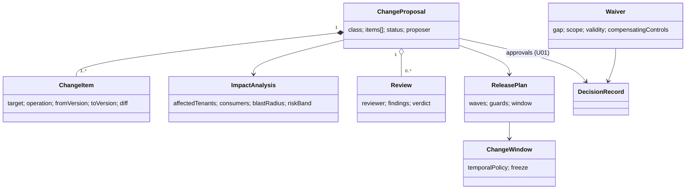
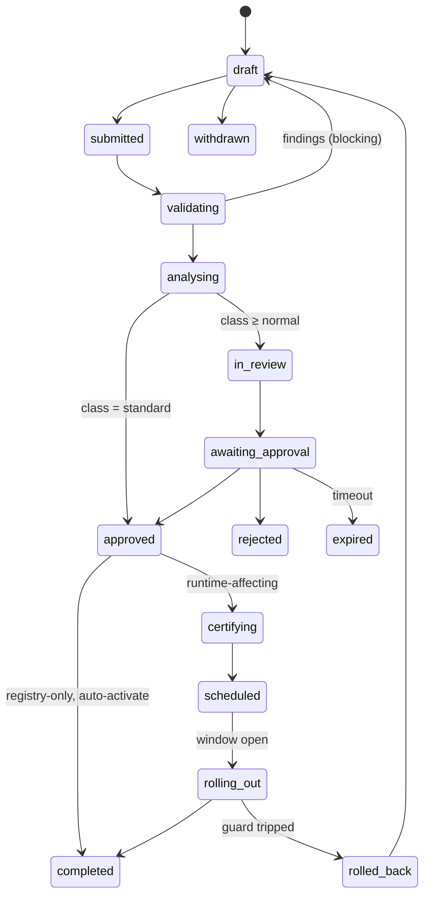

# U02 — Governance Universe Constitution

| Field | Value |
|---|---|
| Universe ID | `U02-governance` |
| Layer | L0 Constitution & Authority |
| Domain | 08 Governance |
| Steward | `ucos:org:governance-office` |
| Version | 0.1.0 (Draft) |
| Delivery phase | P0 |
| Depends on | U01 Authority, U04 Meta, U58 Composition (impact analysis), U54 Simulation (P5; stubbed in P0), U74 Certification, U60 Workflow (human tasks), U68 Audit, U13 Temporal (see TEMPORAL-BINDING-MATRIX) |
| Depended on by | all definition-owning universes (lifecycle transitions), U75 Gap (waivers), U76 Evolution (proposals) |
| Master references | §18.4 (change control), §7.5 (definition lifecycle), L9 |

> Governance owns **the process by which anything in UCOS changes**: change proposals, change classes, reviews, impact analysis, approvals routing, waivers, release windows and progressive activation decisions. Authority (U01) decides *who* can approve; Governance runs *how* the change moves from idea to activation.

---

## 1. Laws

| ID | Law | Enforcement |
|---|---|---|
| GOV-L1 | Every change to a definition, blueprint, policy, authority or global registry is a `ChangeProposal`. There is no direct write path. | Registries accept writes only from the Governance service with a proposal id. |
| GOV-L2 | Change class is computed, not chosen. A proposer cannot lower it. | Classifier (§5.1). |
| GOV-L3 | Impact analysis runs before approval for Normal or higher classes. | Workflow guard. |
| GOV-L4 | Waivers are time-boxed, scoped to specific gaps, and approved by an authority. A mandatory gap can be waived only by level ≥ 4 with a documented compensating control. | Waiver validator. |
| GOV-L5 | Activation is progressive with automatic rollback guards for any runtime-affecting change. | Release plan required for activation. |
| GOV-L6 | Emergency changes must be ratified within 24 h. | U01 AUTH gap rule + incident. |

---

## 2. Ontology



- **Change classes** (master §18.4):

  | Class | Criteria (computed) | Path |
  |---|---|---|
  | `standard` | matches a pre-approved `ChangeTemplate` (e.g. create offer, add holiday entry, add translation) | auto-approve after validation |
  | `normal` | single universe, non-breaking, blast radius ≤ 1 tenant or ≤ 5% traffic | one approval (level per U01 table) |
  | `significant` | breaking, multi-universe, blast radius > 1 tenant, security/compliance-relevant, or new pack | multi-party, simulation required |
  | `constitutional` | touches master doc, laws, meta-types, root authority | Architecture Board, minimum 7-day review period |
  | `emergency` | incident-linked, break-glass | execute now, ratify ≤ 24 h |

- **Proposal statuses:** `draft`, `submitted`, `validating`, `analysing`, `in-review`, `awaiting-approval`, `approved`, `certifying`, `scheduled`, `rolling-out`, `completed`, `rolled-back`, `rejected`, `withdrawn`, `expired`.

---

## 3. Objects

### 3.1 `ucos.governance.ChangeProposal`
| Attribute | Type | Card. | Notes |
|---|---|---|---|
| `id` | UGID (`ucos:ccp:`) + human number `CCP-219` | 1 | |
| `title`, `description` | Text | 1 | |
| `proposer` | IdentityRef (human or agent) | 1 | |
| `tenant` | TenantRef or `platform` | 1 | |
| `items` | Composition→ChangeItem | 1..N | atomic set |
| `class` | ChangeClass | 1 | computed |
| `links` | `{ incident?, evolutionProposal?, gaps?: [GapRef], tickets? }` | 0..1 | |
| `impact` | Reference→ImpactAnalysis | 0..1 | |
| `simulation` | Reference→simulation.SimulationRun | 0..1 | required for significant |
| `reviews` | Array<Review> | 0..N | |
| `decision` | Reference→authority.DecisionRecord | 0..1 | |
| `certification` | Reference→certification.Certification | 0..1 | |
| `releasePlan` | ReleasePlan | 0..1 | |
| `status` | ProposalStatus | 1 | |

### 3.2 `ChangeItem`
`{ target: DefinitionRef (type@version or registry entry), operation: create|update|deprecate|retire|activate|deactivate|grant|revoke, fromVersion?, toVersion?, payloadRef (content-addressed), diff (computed, human-readable + JSON patch), breaking: bool (from U04 compat check) }`

### 3.3 `ImpactAnalysis`
`{ affectedTenants: n + list, affectedBlueprints, consumers: [capability/type refs from graph], trafficShareEstimate, dataMigrations: [..], securityRelevant: bool, complianceRelevant: [controls], riskBand: low|medium|high|critical, blastRadiusScore 0–100, computedAt: TimePoint, snapshot }`

### 3.4 `Waiver`
`{ id, gaps: [GapRef], scope: { tenant, blueprint }, reason, compensatingControls: [ControlRef or text], validity: TimeRange (max P90D for recommended, P30D for mandatory), decision: DecisionRecordRef, status: requested|active|expired|revoked, renewalCount (max 2 without escalation) }`

### 3.5 `ReleasePlan` & `ChangeWindow`
```yaml
ReleasePlan:
  strategy: canary-cohorts
  waves:
    - { name: canary, target: { tenants: [ucos:tenant:internal-dogfood] }, hold: PT30M }
    - { name: wave-1, target: { trafficPercent: 5 }, hold: PT2H }
    - { name: wave-2, target: { trafficPercent: 50 }, hold: PT6H }
    - { name: all }
  guards:
    - { signal: error_rate_ratio, threshold: "> baseline*1.5", action: rollback }
    - { signal: slo_burn_rate_1h, threshold: "> 14.4", action: rollback }
    - { signal: business.checkout_success_ratio, threshold: "< baseline-0.5pp", action: pause }
  window: ucos:tmp:change-window-weekdays-0900-1700-IST
ChangeWindow: { id, tenant|platform, allowed: TemporalPolicyRef, freezes: [TemporalPolicyRef] }   # e.g. Diwali sale freeze
```

### 3.6 `ChangeTemplate` (pre-approved standard changes)
`{ id, operation, targetType, constraints: CEL (e.g. "offer.discountPercent <= 50"), approvedBy: DecisionRecordRef, validity: TimeRange }`

---

## 4. Commands, Queries, Events, APIs

| Command | Effect / Events |
|---|---|
| `CreateProposal` / `AddItem` / `Submit` | → validating → `governance.proposal.submitted` |
| `RunValidation` (auto) | U04 lint + compat, U03 policy analysis, U75 gap scan of the target set → findings |
| `RunImpactAnalysis` (auto) | graph queries → ImpactAnalysis → class recomputed → `governance.proposal.analysed` |
| `RequestReview`, `SubmitReview` | reviewers routed by universe/expertise |
| `RequestApproval` | routes to `WhoCanDecide` (U01) → decision inbox |
| `Approve` / `Reject` (via U01 RecordDecision) | `governance.proposal.approved|rejected` |
| `Schedule` | validates ReleasePlan and ChangeWindow → `scheduled` |
| `Activate` (executor) | executes waves; watches guards → `governance.proposal.rolling-out|completed|rolled-back` |
| `RequestWaiver` / `GrantWaiver` / `RevokeWaiver` | `governance.waiver.granted|expired|revoked` |
| `Withdraw` | |

**Queries:** `ProposalTimeline(id)`, `PendingForMe()`, `ChangeCalendar(range)` (all scheduled changes and freezes on a calendar), `WaiversExpiring(days)`.

```text
POST /v1/governance/proposals            POST /v1/governance/proposals/{id}/items
POST /v1/governance/proposals/{id}:submit|:schedule|:activate|:withdraw
GET  /v1/governance/proposals/{id}/impact
POST /v1/governance/waivers              POST /v1/governance/waivers/{id}:revoke
GET  /v1/governance/change-calendar?from=&to=
```
**Errors:** `GOV_DIRECT_WRITE_FORBIDDEN`, `GOV_VALIDATION_FAILED`, `GOV_OUTSIDE_CHANGE_WINDOW`, `GOV_FREEZE_ACTIVE`, `GOV_WAIVER_NOT_ALLOWED` (mandatory gap without level ≥ 4), `GOV_SIMULATION_REQUIRED`.

---

## 5. Workflows & Rules

### 5.1 Classification (normative)
```text
class(p) :=
  if any item.target ∈ {constitution, law, meta-type, root-authority} → constitutional
  elif p.links.incident ∧ p.emergency → emergency
  elif all items match an active ChangeTemplate → standard
  elif any item.breaking ∨ |universes(p)| > 1 ∨ impact.affectedTenants > 1
       ∨ impact.securityRelevant ∨ impact.complianceRelevant ≠ ∅ ∨ any item creates a pack
       ∨ impact.riskBand ∈ {high, critical} → significant
  else → normal
```

### 5.2 Proposal state machine


### 5.3 Decision tables
- `governance.reviewers-by-universe`
- `governance.approval-timeout`
- `governance.waiver-max-duration`
- `governance.default-release-plan` (by change class × tier)

---

## 6. Security & Compliance
Proposers cannot approve their own proposals (SoD from U01). Proposals touching `restricted` data classes require a security reviewer. Audit is full. Controls: change management (SOC 2 CC8.1, ISO 27001 A.8.32, PCI DSS 6.5.1), emergency change, and segregation of environments (ISO A.8.31). Evidence packs per proposal are exported for auditors.

## 7. Validation & Reuse
- Every definition-owning universe exposes `validate(item)` and `apply(item)` hooks. Governance orchestrates them; universes never self-activate definitions.
- Tenant builders use the same pipeline. The Studio "Publish" button creates a proposal, so most tenant changes are `standard` or `normal` and feel instant.

## 8. Gaps & Evolution
```prolog
gap(waiver_expiring, W) :- waiver(W), active(W), expires_in_days(W, N), N < 7.
gap(stale_proposal, P)  :- proposal(P), status(P, awaiting-approval), age_days(P, D), D > 14.
gap(no_change_window, T):- tenant(T), tier(T, t0_or_t1), not change_window(T, _).
```
- **Self-healing:** automatic rollback on guard breach. A stuck rollout (no wave progress within 2× hold) pages the release owner.
- **Evolution:** risk-scored auto-approval (L2 autonomy) for normal changes with low blast radius and a clean history. It requires an approved ChangeTemplate policy first.

## 9. AI
- **AI uses:** proposal summaries, impact narrative, reviewer suggestions, and detecting that a "normal" proposal is semantically risky.
- **Agents** can create and submit proposals (e.g. the Evolution agent) but cannot approve or activate.

## 10. Operations
- **Signals:** `proposals_by_status`, `lead_time_hours{class}` (submit → completed), `change_failure_rate` (rolled-back/completed, a DORA metric), `waivers_active{severity}`, `rollouts_in_flight`.
- **SLOs:** standard change completed in < 5 min p95; a guard-triggered rollback starts in < 2 min.

## 11. UI
- **Views:** `governance.proposal.composer` (from Studio diff), `governance.proposal.detail` (master W11: items, diff, impact, simulation, reviews, approvals, certification, rollout progress), `governance.change-calendar`, `governance.waiver.request` (master W6 inline form), `governance.waiver.register`.
- **UX:** show the computed class and why ("Significant because it affects 38 tenants and adds a pack"), and always show the rollback plan.

## 12. Scale
Thousands of proposals per day across tenants (most standard). Control plane, T1. The rollout executor is T0 because it must be able to roll back during incidents.

## Appendix
- **B. Amendments:** add `ChangeTemplate` and `ChangeWindow` to U02 "owns" in master §6.2.
- **C.** 0.1.0.

## Appendix P1 — Phase 1 behaviour without later-phase dependencies
- **U54 Simulation (Phase 5):** in Phases 0–4, the `simulation` requirement for significant changes is met by (a) a dry-run composition with the golden-PD regression suite (U58) and (b) a canary activation in the internal dogfood tenant. The full simulation cell replaces (b) in Phase 5. Change classes and approvals are unchanged.
