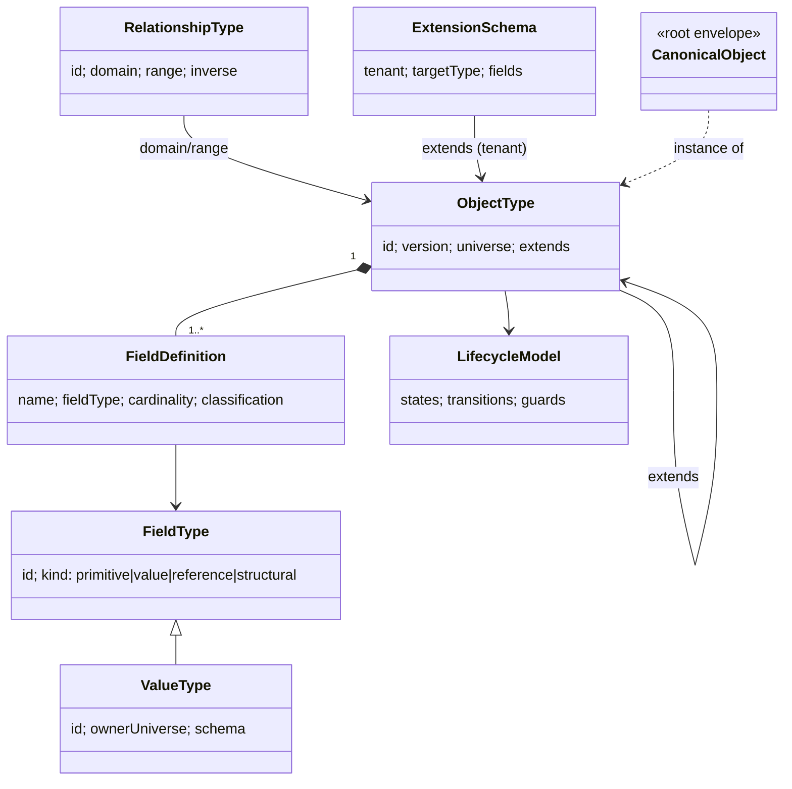
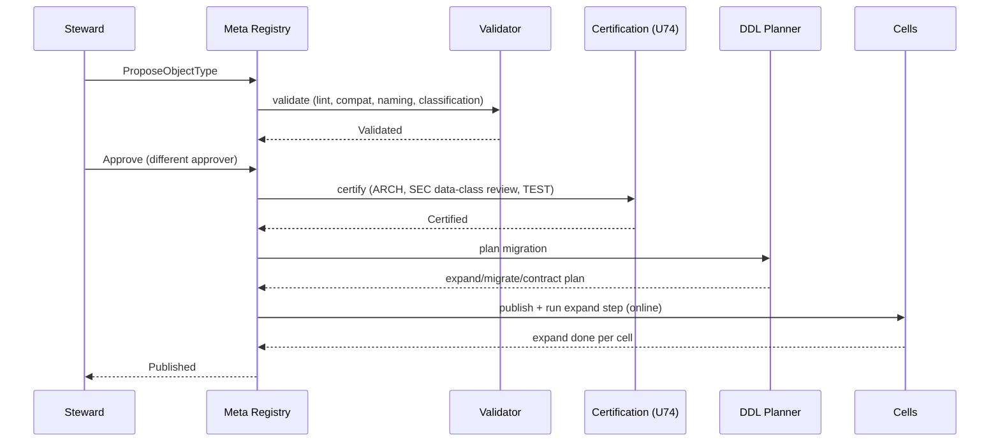

# U04 — Meta Universe Constitution

| Field | Value |
|---|---|
| Universe ID | `U04-meta` |
| Layer | L1 Meta-Model |
| Domain | 12 Architecture |
| Steward | `ucos:org:platform-kernel-registry` |
| Version | 0.1.0 (Draft) |
| Delivery phase | P0 |
| Depends on | U01 Authority, U02 Governance (definition lifecycle approvals) |
| Depended on by | **every universe** |
| Master references | §7 (meta-model), §8 (capability genome), §14.2 (physical model), §29.4 (evolution) |

> The Meta universe owns the **language in which everything else is defined**: object types, field types, value types, relationship types and lifecycle models. It does not own any business data. Any object type in any universe exists only because a Meta `ObjectType` definition says so.

---

## 1. Constitution, Authority, Principles & Laws

### 1.1 Mandate
**Owns:** `ObjectType`, `FieldType`, `ValueType`, `RelationshipType`, `LifecycleModel`, `ExtensionSchema` (tenant custom fields), `NamingRule`, the root `CanonicalObject` envelope.
**Does not own:** concepts and meaning (U05 Ontology), classifications (U06 Taxonomy), code lists (U08 Reference Data), capability packaging (U57 Capability), event types (U61 Event).

### 1.2 Universe laws

| ID | Law | Enforcement |
|---|---|---|
| META-L1 | Every persisted object conforms to exactly one published `ObjectType` version. | Object Service rejects writes with unknown or unpublished `type`. |
| META-L2 | Every `ObjectType` belongs to exactly one universe and is `provided` by exactly one capability. | Registry unique constraint `(objectTypeId)` → `(universe, providerCapability)`. |
| META-L3 | Time, money, quantity, location and language fields MUST use the owning value types (`TemporalRef`, `Money`, `Quantity`, `GeoRef`, `LocalizedText`). | Schema linter rule `META-LINT-001`. Names matching `*_date`, `*_at` (string), `start*`, `end*`, `price` (number), `country` (string) are rejected outside the owning universe. |
| META-L4 | Definitions are immutable once `Published`; change = new version. | Registry write guard. |
| META-L5 | Breaking changes require a new major version and a `Migration`. | Compatibility checker (§7.3). |
| META-L6 | Tenant extensions never alter canonical fields; they live under `customAttributes`. | Extension schemas are validated to be disjoint from the canonical schema. |
| META-L7 | Every field declares a data classification (inherited default allowed). | Linter `META-LINT-004`. |

### 1.3 Authorities

| Action | Authority level | Holder |
|---|---|---|
| Create/modify meta types (`FieldType`, `ValueType`, `RelationshipType`) | 5 (constitutional) | Architecture Board |
| Publish `ObjectType` major version | 4 | Universe steward + Architecture reviewer |
| Publish `ObjectType` minor/patch | 3 | Universe steward |
| Create tenant `ExtensionSchema` | 2 | Tenant admin (within quotas) |

---

## 2. Ontology & Taxonomy

### 2.1 Concept map



### 2.2 Enumerations owned

- `FieldKind`: `primitive`, `value`, `reference`, `composition`, `structural`, `computed`, `extension`.
- `Cardinality`: `1`, `0..1`, `1..N`, `0..N`.
- `CardinalityModifier`: `conditional(expr)`, `inherited`, `derived(expr)`, `computed(expr)`, `generated(strategy)`.
- `DefinitionStatus`: `Proposed, Draft, Validated, Approved, Certified, Published, Operational, Deprecated, Retired, Archived, Rejected` (master §7.5).
- `StorageStrategy`: `physical-table`, `jsonb-extension`, `generic-objects`, `graph-only`, `event-sourced`.

### 2.3 Standards mapping
JSON Schema 2020-12 (validation), OpenAPI 3.1 (API projection), CloudEvents 1.0 (event projection), SemVer 2.0.0 (versioning), ULID spec (ids), RDF/OWL (export of type graph to U05 Ontology).

---

## 3. Registry Model, Canonical Objects, Schemas & Relationships

### 3.1 Registries
| Registry | Scope | Store |
|---|---|---|
| Type Registry (`ObjectType`, `LifecycleModel`) | global (control plane), replicated read-only to cells | Postgres (`meta` schema) + Neo4j projection |
| Meta-type Registry (`FieldType`, `ValueType`, `RelationshipType`) | global | same |
| Extension Registry (`ExtensionSchema`) | tenant | cell Postgres |

### 3.2 Root envelope — `ucos.meta.CanonicalObject`
Normative definition is in master §7.1. Physical columns common to every `physical-table` type:

| Column | Type | Notes |
|---|---|---|
| `id` | `text` (UGID) PK | `ucos:<kind>:<ulid>` |
| `tenant_id` | `text` NOT NULL | RLS key; `global` for shared registries |
| `type` | `text` NOT NULL | `<objectTypeId>@<major>` |
| `status` | `text` NOT NULL | lifecycle state |
| `version` | `bigint` NOT NULL | optimistic concurrency |
| `owner_id` | `text` NOT NULL | PartyRef |
| `attributes` | typed columns per type | |
| `custom_attributes` | `jsonb` DEFAULT `'{}'` | tenant extensions |
| `classification` | `jsonb` | |
| `valid_from`, `valid_to` | `timestamptz` | valid time |
| `recorded_at`, `superseded_at` | `timestamptz` | transaction time |
| `provenance` | `jsonb` | |
| `created_by`, `created_at`, `updated_by`, `updated_at` | | |
| `context_hash` | `bytea` | hash of ContextEnvelope at write |

### 3.3 Object types owned

**`ucos.meta.ObjectType`**

| Attribute | Type | Card. | Constraints |
|---|---|---|---|
| `id` | String | 1 | `^[a-z][a-z0-9-]*(\.[a-z][a-z0-9-]*)+\.[A-Z][A-Za-z0-9]*$` e.g. `commerce.order.Order` |
| `version` | SemVer | 1 | |
| `universe` | Reference→U-registry | 1 | |
| `providedBy` | Reference→Capability | 1 | META-L2 |
| `extends` | Reference→ObjectType | 0..1 | default `ucos.meta.CanonicalObject`; max depth 4 |
| `abstract` | Boolean | 1 | abstract types cannot be instantiated |
| `fields` | Composition→FieldDefinition | 1..N | unique `name` |
| `indexes` | Array<IndexDef> | 0..N | |
| `uniqueConstraints` | Array<FieldPath[]> | 0..N | always prefixed by `tenant` unless `scope=global` |
| `lifecycle` | Reference→LifecycleModel | 0..1 | |
| `storage` | StorageStrategy | 1 | |
| `classificationDefault` | Classification | 1 | |
| `retentionRule` | Reference→RetentionRule (U66) | 0..1 | |
| `scope` | Enum `tenant|global|both` | 1 | |
| `events`, `commands` | Array<Ref> | 0..N | projections registered in U61 / U63 |
| `uiModels` | Array<Ref> | 0..N | |
| `searchProjection` | SearchSpec | 0..1 | |
| `extensible` | Boolean | 1 | tenants may add custom fields |
| `status` | DefinitionStatus | 1 | |

**`ucos.meta.FieldDefinition`** (composition part of ObjectType)

| Attribute | Type | Card. | Notes |
|---|---|---|---|
| `name` | String | 1 | lowerCamelCase |
| `fieldType` | Reference→FieldType | 1 | |
| `target` | Reference→ObjectType | 0..1 | for Reference/Composition |
| `cardinality` | Cardinality | 1 | |
| `modifier` | CardinalityModifier | 0..1 | |
| `required` | Boolean | 1 | |
| `default` | Json | 0..1 | |
| `constraints` | Array<Expression> | 0..N | CEL expressions |
| `classification` | Classification | 0..1 | overrides type default |
| `purpose` | Array<PurposeRef> | 0..N | U66; required when class ∋ PII |
| `encrypted` | Boolean | 1 | → `Encrypted<T>` |
| `localized` | Boolean | 1 | |
| `searchable`, `facet`, `sortable` | Boolean | 1 | |
| `deprecated` | { since, replacement } | 0..1 | |
| `description` | LocalizedText | 1 | |

**`ucos.meta.FieldType`** — seed set (master §7.4): `String, Text, LocalizedText, Integer, Decimal, Number, Boolean, Enumeration, Json, Binary, Array, Object, Map, Reference, Composition, Extension, Computed, Encrypted`.

**`ucos.meta.ValueType`** — owner-registered structured types:

| ValueType | Owner universe |
|---|---|
| `TimePoint`, `LocalDateTime`, `TimeRange`, `Duration`, `Recurrence`, `TemporalRef` | U13 Temporal |
| `Money`, `Quantity`, `Percentage`, `ExchangeRateRef` | U14 Currency & Unit |
| `GeoRef`, `Coordinate`, `GeoShape`, `AddressRef` | U12 Geography |
| `LocalizedText`, `LocaleRef` | U15 Localization |
| `PartyRef` | U11 Person |
| `AssetRef`, `Media` | U43 Asset |
| `PolicyRef`, `RuleRef` | U03 Policy |
| `WorkflowRef` | U60 Workflow |
| `ModelRef` | U49 AI |
| `Classification` | U65 Security |

**`ucos.meta.RelationshipType`**

| Attribute | Type | Notes |
|---|---|---|
| `id` | String | e.g. `owns`, `dependsOn` |
| `category` | Enum | structural, ownership, dependency, operational, commercial, social |
| `domain`, `range` | Array<ObjectTypeRef or `*`> | |
| `inverse` | RelationshipTypeRef | |
| `cardinality` | `{source, target}` | |
| `transitive`, `symmetric`, `reflexive` | Boolean | |
| `materialised` | Boolean | stored on the object for hot reads |
| `temporal` | Boolean | has validity range |

**`ucos.meta.LifecycleModel`**

```yaml
id: commerce.order.OrderLifecycle
version: 1.0.0
initial: placed
states: [placed, confirmed, shipped, delivered, completed, cancelling, cancelled, payment_failed, exception, return_in_progress]
final: [completed, cancelled]
transitions:
  - { from: placed, to: confirmed, on: PaymentAuthorized }
  - { from: [placed, confirmed], to: cancelling, on: Cancel, guard: "!anyShipmentDispatched" }
```

**`ucos.meta.ExtensionSchema`**

| Attribute | Type | Notes |
|---|---|---|
| `tenant` | TenantRef | |
| `targetType` | ObjectTypeRef (major) | type must be `extensible: true` |
| `fields` | Array<FieldDefinition> | names prefixed `x_` are not required; names must not collide with canonical names |
| `indexes` | Array<IndexDef> | within quota (default 5 per type) |
| `status` | DefinitionStatus | |

### 3.4 Identifier generation (normative)

```text
UGID      = "ucos:" kind ":" ULID              ; kind = [a-z][a-z0-9-]{1,31}
NaturalID = "ucos:" kind ":" namespace "/" key ; reference data only
ULID      = 26 Crockford base32 chars, monotonic within a process
```
Kinds are registered in this universe (`KindRegistry`) with the owning ObjectType. Unregistered kinds are rejected.

---

## 4. Commands, Queries, Events, APIs & Runtime Contracts

### 4.1 Commands

| Command | Input | Preconditions | Effects / events |
|---|---|---|---|
| `ProposeObjectType` | ObjectType draft | caller has authority ≥ 3 for universe | status `Proposed`; `meta.object-type.proposed` |
| `ValidateObjectType` | id@version | Draft | runs §7.1 rules; `Validated` or findings; `meta.object-type.validated` |
| `ApproveObjectType` | id@version, decision | Validated; approver ≠ proposer | `Approved`; `meta.object-type.approved` |
| `PublishObjectType` | id@version | Certified (U74) | `Published`; DDL migration job queued; `meta.object-type.published` |
| `DeprecateObjectType` | id@version, successor, sunset | Published | `meta.object-type.deprecated` |
| `RegisterValueType` / `RegisterRelationshipType` | def | authority 5 | `meta.value-type.registered` |
| `CreateExtensionSchema` | tenant, targetType, fields | quotas | `meta.extension.created` (Draft → Published after validation; tenant-level, no certification needed beyond automated checks) |
| `RegisterKind` | kind, objectType | | |

### 4.2 Queries
`GetObjectType(id, version?)`, `ListObjectTypes(universe?, status?)`, `ResolveSchema(type@major, tenant)` → merged JSON Schema (canonical + tenant extension), `CheckCompatibility(old, new)`, `ListDependents(typeId)` (graph).

### 4.3 Events
`meta.object-type.proposed|validated|approved|published|deprecated|retired`, `meta.extension.created|published|retired`, `meta.value-type.registered`, `meta.relationship-type.registered`. Classification: `internal`.

### 4.4 REST

```text
GET    /v1/meta/types                       ?universe=&status=
GET    /v1/meta/types/{typeId}              ?version=
POST   /v1/meta/types                       (ProposeObjectType)
POST   /v1/meta/types/{typeId}@{v}:validate | :approve | :publish | :deprecate
GET    /v1/meta/types/{typeId}/schema       ?tenant=   (resolved JSON Schema)
POST   /v1/meta/compatibility:check
GET    /v1/meta/value-types | /relationship-types | /lifecycles
POST   /v1/meta/extensions                  (tenant)
```

### 4.5 Runtime contracts offered
- **Schema Resolver** (in-process library in every cell): `resolve(type@major, tenant) → CompiledValidator` with an LRU cache. Invalidated on `meta.*.published` events.
- **DDL Planner:** `plan(oldType, newType) → MigrationPlan(expand[], migrate[], contract[])`.

### 4.6 Error codes
`META_UNKNOWN_TYPE`, `META_TYPE_NOT_PUBLISHED`, `META_SCHEMA_VIOLATION`, `META_BREAKING_CHANGE_MINOR`, `META_FIELD_NAME_COLLISION`, `META_RESERVED_NAME`, `META_VALUE_TYPE_REQUIRED` (META-L3), `META_EXTENSION_QUOTA`.

---

## 5. Workflows, State Machines & Rules

### 5.1 Definition lifecycle
The definition lifecycle in master §7.5 applies to `ObjectType`, `LifecycleModel`, `ValueType` and `RelationshipType`. `ExtensionSchema` uses a short path: `Draft → Validated → Published → Retired`.

### 5.2 Publish workflow (normative)



### 5.3 Compatibility algorithm (normative)

```text
breaking(old, new) is TRUE if any:
  - field removed or renamed (without alias)
  - field type changed (except widening: Integer→Decimal, String maxLength increase)
  - cardinality narrowed (0..N→1..N, 0..1→1)
  - required: false → true without default
  - enumeration value removed
  - constraint tightened on existing data (unless backfill proven)
  - lifecycle state removed or transition removed
non-breaking: add optional field, add enum value, add state with transitions, widen constraints
Rule: breaking ⇒ major bump required, else META_BREAKING_CHANGE_MINOR
```

---

## 6. Policies, Security, Encryption, Audit & Compliance

```cedar
permit (principal in Role::"universe-steward", action == Action::"meta:ProposeObjectType", resource)
when { resource.universe in principal.stewardOf };

forbid (principal, action == Action::"meta:ApproveObjectType", resource)
when { resource.proposedBy == principal };

permit (principal in Role::"tenant-admin", action == Action::"meta:CreateExtensionSchema", resource)
when { resource.tenant == principal.tenant && resource.targetType.extensible };
```

- Classification: definitions are `internal`. Extension schemas are `confidential`, because they can reveal tenant business details.
- Audit: every definition state change, at full level.
- Compliance: supports `ucos.ctrl.data-inventory` (records of processing are generated from field classification and purposes) and `ucos.ctrl.change-management` (SOC 2 CC8.1, ISO 27001 A.8.32).

---

## 7. Validation, Certification, Versioning, Dependency & Reuse

### 7.1 Validation rules (linter `META-LINT-*`)
| Rule | Check |
|---|---|
| 001 | META-L3 value-type usage |
| 002 | naming (types PascalCase, fields lowerCamelCase, no abbreviations in the deny-list) |
| 003 | every Reference target exists and is Published (or in same proposal set) |
| 004 | classification declared; PII fields have `purpose` |
| 005 | no duplicate concept: ontology similarity check against U05 (name + description embedding similarity > 0.9 → warning requiring justification) |
| 006 | unique constraints include `tenant` unless scope global |
| 007 | inheritance depth ≤ 4; no diamond |
| 008 | lifecycle: every non-final state reachable and has an exit |
| 009 | indexes ≤ 12 per type; JSONB extension indexes ≤ quota |

### 7.2 Certification criteria
`ARCH-META-01` all lint rules pass; `ARCH-META-02` migration plan tested on a production-size snapshot; `SEC-META-01` the data-class review is signed off by the security steward when a field is classified `restricted`.

### 7.3 Versioning
SemVer. Instances store `type@major`. Minor/patch upgrades apply transparently. A major upgrade requires a `Migration` (U76) with per-tenant progress.

### 7.4 / 7.5 Dependency & reuse
- Every universe MUST define objects only through this registry.
- Cross-universe references use `Reference` fields that point at the other universe's published type. They never copy its fields.

---

## 8. Discovery, Gap Detection, Self-Healing & Evolution

```prolog
gap(object_type_unpublished, T) :- required_object_type(T), not published(T).
gap(missing_lifecycle, T)       :- object_type(T), stateful(T), not has_lifecycle(T).
gap(missing_purpose, T, F)      :- field(T, F), classified(F, pii), not has_purpose(F).
gap(orphan_type, T)             :- published(T), not provided_by(T, _).
gap(unused_type, T)             :- published(T), age_days(T, D), D > 180, instance_count(T, 0), not referenced(T).
```

- **Self-healing:** if the Schema Resolver cache is corrupt or stale (hash mismatch with the registry), it reloads from the control plane. Cells keep serving the last good schemas.
- **Evolution:** usage telemetry on extension fields that many tenants share (the same name and type in at least 20 tenants) creates an EvolutionProposal to promote the field into the canonical type.

## 9. AI & Agent Governance
- **AI uses:** schema drafting from natural language in the Studio Object Designer, duplicate-concept detection, and classification suggestions.
- **Agent tools:** `meta.get_type`, `meta.resolve_schema` (read), `meta.propose_type` (proposal only).
- **Prohibited for agents:** approve, publish, deprecate.

## 10. Digital Twin, Analytics, Monitoring & Operations
- **Signals:** `meta_types_published_total`, `schema_resolve_latency_ms`, `schema_cache_hit_ratio`, `migration_step_duration_s`, `extension_fields_per_tenant`.
- **SLOs:** schema resolve p99 < 1 ms (cached) and < 20 ms (miss); publish-to-cells propagation p99 < 60 s.
- **Twin:** the type graph is part of the Platform Twin.
- **Runbooks:** stuck migration, cache divergence, rollback of the expand step.

## 11. UI, UX, Accessibility & Localisation
- **Views:** `meta.type.designer` (master W7), `meta.type.diff`, `meta.type.dependents-graph`, `meta.extension.editor` (tenant admin).
- **UX:** show every lint finding inline with its rule id; an "Impact" panel lists dependents before publishing.
- **Localisation:** `description` and labels are `LocalizedText`, and English is required.

## 12. Scale, Performance, DR, HA
- **Volumetrics:** about 5,000 object types and about 500k tenant extension fields.
- **HA/DR:** the registry is tier T0, because the runtime cannot validate without it. Cells cache schemas and can run 24 h with the control plane down.
- **Replication:** the control plane is the writer. Cells pull on event or every 60 s and verify a signed hash.

## Appendix
- **A. Open questions:** whether expressions use CEL or a JSON-logic subset (recommendation: CEL).
- **B. Amendments:** register `Classification` as a ValueType owned by U65.
- **C. Change log:** 0.1.0 initial draft.
