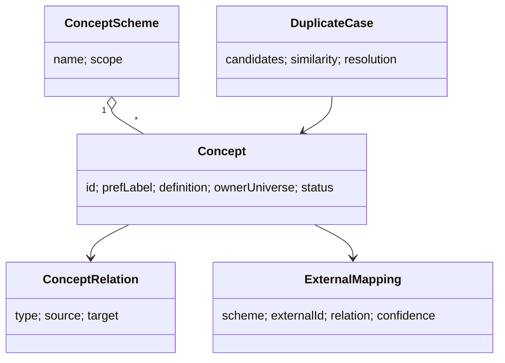

# U05 — Ontology Universe Constitution

| Field | Value |
|---|---|
| Universe ID | `U05-ontology` |
| Layer | L3 Knowledge & Registry |
| Domain | 02 Knowledge |
| Steward | `ucos:org:knowledge-ontology` |
| Version | 0.1.0 (Draft) |
| Delivery phase | P0 (core), P1 (UKG integration) |
| Depends on | U04 Meta, U02 Governance, U08 Reference Data |
| Depended on by | U06 Taxonomy, U07 Knowledge Graph, U18/U19 Product & Service Intelligence, U58 Composition (concept-level reasoning), U75 Gap (duplicate detection), U21 Search/AI (semantic grounding) |
| Master references | §6.1, §7 (meta vs meaning), L1 Knowledge Once, L4 Zero Overlap |

> Ontology owns **meaning**: the concepts UCOS knows about, their definitions, and how they relate (is-a, part-of, equivalent-to, related-to), across every universe and in mapping to external vocabularies. Meta (U04) says *how* something is structured. Ontology says *what it means* and *whether two things are the same idea*. That makes it the engine of the Knowledge Once and Zero Overlap laws.

---

## 1. Laws

| ID | Law | Enforcement |
|---|---|---|
| ONT-L1 | Every published ObjectType, capability, event type, decision and attribute is linked to exactly one primary `Concept`. | U04 validation `META-LINT-005` requires `concept`; gate `ARCH-ONT-01`. |
| ONT-L2 | A concept has exactly one owning universe; other universes may reference or specialise it, never redefine it. | Concept registry uniqueness + `ownerUniverse`. |
| ONT-L3 | Two concepts that are judged equivalent are merged or linked `sameAs`. Two definitions of the same concept cannot both be active. | Duplicate detection workflow (§5.1). |
| ONT-L4 | Mappings to external vocabularies (schema.org, GS1, FIBO, FHIR, UNSPSC…) are explicit with relation type and confidence. | Mapping objects; no implicit equivalence. |
| ONT-L5 | Concept definitions are written for humans (plain language) and machines (formal relations). | Both required. |

---

## 2. Ontology of the Ontology



- **Relation types** (SKOS/OWL aligned): `broader`, `narrower`, `isA` (subclass), `partOf`, `hasPart`, `sameAs` (owl:equivalentClass), `closeMatch`, `relatedTo`, `disjointWith`, `specialises` (in another universe), `implementedBy` (concept → ObjectType/Capability), `measuredBy` (concept → Attribute/Signal).
- **Concept schemes:** `ucos-core` (platform concepts such as Party, Offer, Reservation), one per universe, `industry/<x>` (industry vocabularies), and `tenant/<t>` (tenant-specific business terms, mapped to core).
- **External schemes:** schema.org, GS1 Web Vocabulary, FIBO (finance), FHIR (health), HL7, IFRS taxonomy, Dublin Core, ISO 19115 (geo), TM Forum SID (telecom), BIAN (banking service domains), ACORD (insurance), IEEE/LOM (learning).

---

## 3. Objects

### 3.1 `ucos.ontology.Concept`
| Attribute | Type | Card. | Notes |
|---|---|---|---|
| `id` | NaturalID `ucos:concept:<scheme>/<slug>` | 1 | e.g. `ucos:concept:core/reservation` |
| `scheme` | Reference→ConceptScheme | 1 | |
| `prefLabel` | LocalizedText | 1 | |
| `altLabels` | Array<LocalizedText> | 0..N | synonyms ("booking", "hold") |
| `definition` | LocalizedText | 1 | ≤ 500 chars, plain language |
| `examples` | Array<Text> | 0..N | |
| `ownerUniverse` | UniverseRef | 1 | |
| `relations` | Array<ConceptRelation> | 0..N | |
| `externalMappings` | Array<ExternalMapping> | 0..N | |
| `implementedBy` | Array<ObjectTypeRef|CapabilityRef|EventTypeRef|AttributeRef> | 0..N | maintained by registry hooks |
| `embedding` | Vector (internal) | 1 | label+definition embedding for similarity |
| `status` | DefinitionStatus | 1 | |
| `steward` | PartyRef | 1 | |

### 3.2 `ExternalMapping`
`{ scheme, externalId, externalLabel, relation: exactMatch|closeMatch|broadMatch|narrowMatch|relatedMatch, confidence: 0..1, source: manual|ai|import, reviewedBy? }`

### 3.3 `DuplicateCase`
`{ id, candidates: [ConceptRef|definition being proposed], similarity: { lexical, embedding, structural }, status: open|merged|distinct|specialised, resolution: DecisionRecordRef, notes }`

---

## 4. Commands, Queries, Events, APIs

| Command | Effect / Events |
|---|---|
| `ProposeConcept` (via Governance) | similarity check → may open DuplicateCase → `ontology.concept.proposed` |
| `RelateConcepts`, `MapExternal` | `ontology.relation.added`, `ontology.mapping.added` |
| `ResolveDuplicate(case, outcome: merge|distinct|specialise)` | merge = alias + redirect implementers → `ontology.concept.merged` |
| `ImportScheme(external vocabulary)` | staged; mappings proposed |

**Queries:** `FindSimilar(text|definition, k)`, `Ancestors(concept)`, `Descendants`, `Implementers(concept)`, `MapToExternal(concept, scheme)`, `ResolveTerm(term, locale)` (synonyms to concept), `ExportRDF(scheme)`.

```text
GET  /v1/ontology/concepts?q=&scheme=     GET /v1/ontology/concepts/{id}
POST /v1/ontology/concepts:similar        POST /v1/ontology/terms:resolve
GET  /v1/ontology/schemes/{id}/export?format=ttl|jsonld
```
**Errors:** `ONT_DUPLICATE_SUSPECTED`, `ONT_OWNER_CONFLICT`, `ONT_CYCLE` (isA cycle), `ONT_UNMAPPED_REQUIRED`.

---

## 5. Rules & Algorithms

### 5.1 Duplicate detection (normative)
```text
on ProposeConcept(c) or ProposeObjectType(t with concept c):
  candidates ← top-20 by cosine(embedding(c), embedding(*)) ∪ lexical matches on labels/altLabels (all locales)
  score(x) = 0.5·embedding + 0.3·lexical + 0.2·structural(attribute overlap of implementers)
  if max score ≥ 0.90 → BLOCK: DuplicateCase(open), proposer must resolve (merge / distinct with justification / specialise)
  if 0.75 ≤ score < 0.90 → WARN: reviewer must acknowledge
```
"Distinct" requires a `disjointWith` or differentiating definition, recorded in the DecisionRecord.

### 5.2 Reasoning
Ontology checks run in the composer's Datalog engine: transitive `isA` and `partOf`, consistency (no concept is both `isA X` and `disjointWith X`), and `implementedBy` coverage (concept required but not implemented creates a capability gap). OWL-DL reasoning is not required at runtime. An offline consistency job uses an OWL reasoner on export.

---

## 6. Security & Compliance
Core concepts are `public`. Tenant schemes are `confidential`. Writes go through Governance. External scheme licences are respected (FIBO is MIT, SNOMED needs a licence, schema.org is CC-BY-SA).

## 7. Validation & Reuse
- Every universe spec's Section 2 concepts are registered here.
- Search, AI grounding and Product Intelligence use `ResolveTerm` and mappings, not private synonym lists.

## 8. Gaps & Evolution
```prolog
gap(unimplemented_concept, C) :- concept(C), required_by_template(_, C), not implemented_by(C, _).
gap(orphan_artifact, A)       :- published_artifact(A), not concept_of(A, _).
gap(duplicate_open, Case)     :- duplicate_case(Case), status(Case, open), age_days(Case, D), D > 7.
gap(unmapped_standard, C, S)  :- concept(C), industry_requires_mapping(C, S), not external_mapping(C, S).
```
**Evolution:** tenant-scheme concepts used by many tenants, with consistent mappings, are proposed for promotion into `ucos-core`.

## 9. AI
- **AI uses:** embedding-based similarity, definition drafting, external-mapping proposals with confidence, and term resolution for search and agents.
- **Agents** propose only. Merges need human stewards.

## 10. Operations
- **Signals:** `concepts_total{scheme}`, `duplicate_cases_open`, `orphan_artifacts_total`, `similarity_check_latency_ms`.
- **SLO:** similarity check p95 < 300 ms (vector index).

## 11. UI
- **Views:** `ontology.browser` (tree + graph), `ontology.concept.detail` (definition, synonyms, relations, implementers, mappings), `ontology.duplicate.resolve` (side-by-side), `ontology.mapping.editor`.
- **UX:** when a builder creates any object type, field or capability, the Studio shows "Similar concepts already exist" before they continue.

## 12. Scale
About 100k core and industry concepts, plus tenant schemes. Neo4j (graph) plus a vector index (Qdrant/pgvector) on the control plane, with read replicas in cells for term resolution. T1.

## Appendix
- **C.** 0.1.0.
