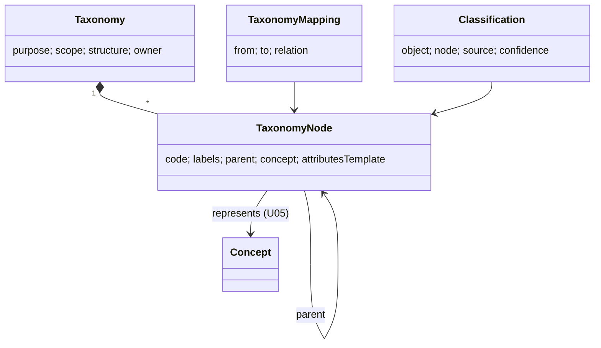

# U06 — Taxonomy Universe Constitution

| Field | Value |
|---|---|
| Universe ID | `U06-taxonomy` |
| Layer | L3 Knowledge & Registry |
| Domain | 02 Knowledge |
| Steward | `ucos:org:knowledge-taxonomy` |
| Version | 0.1.0 (Draft) |
| Delivery phase | P0 |
| Depends on | U05 Ontology, U04 Meta, U08 Reference Data, U15 Localization |
| Depended on by | U18 Product (categories), U19 Service, U20 Industry, U21 Catalog (navigation), U22 Offer (targeting), U31 Tax (tax categories map), U39 Support (case categories), U44 Search (facets), every `Enumeration` field that is business-configurable |
| Master references | §7.4 (Enumeration taxonomy-backed), §10.2 (classification), L2 |

> Taxonomy owns **classification schemes**: hierarchical or flat sets of categories used to classify objects (product categories, service types, case reasons, risk categories, industries, content genres), tenant-configurable enumerations, and the *classifications* (object ↔ node assignments). It differs from Reference Data (U08), which holds externally standardised code lists that tenants cannot change, and from Ontology (U05), which holds meaning. A taxonomy node usually points to an ontology concept.

---

## 1. Laws

| ID | Law | Enforcement |
|---|---|---|
| TAX-L1 | Business enumerations (statuses excepted, since lifecycle states are U04) are taxonomy-backed, never hard-coded lists in packs. | META `Enumeration(source: taxonomy:<id>)`; lint. |
| TAX-L2 | Each taxonomy has one owner and a declared purpose; parallel taxonomies for the same purpose in the same tenant are not allowed. | Registry check by `(tenant, purpose)`. |
| TAX-L3 | Tenant taxonomies that classify global objects (products) MUST be mapped to the UCOS global taxonomy for that purpose. | Gap rule; mapping coverage ≥ 95% to publish. |
| TAX-L4 | Node ids are stable; renames and moves never change ids; deletions are deprecations with `replacedBy`. | Write guard. |
| TAX-L5 | Classification changes on objects are audited, and bulk reclassification goes through Governance. | Bulk command → proposal. |

---

## 2. Ontology



- **Purposes** (registry, extensible): `product-category`, `service-category`, `industry`, `content-genre`, `case-reason`, `return-reason`, `cancellation-reason`, `risk-category`, `document-type`, `expense-category`, `skill`, `tag`, `audience-segment`, `item-condition`, `color-family`, `custom`.
- **Structures:** `tree` (single parent), `poly-hierarchy` (multiple parents, a DAG), `flat`, `faceted` (orthogonal dimensions, e.g. material × style × occasion).
- **Global taxonomies (UCOS-maintained):** `ucos.product-category` (about 6k nodes, mapped to GS1 GPC, UNSPSC and the Google product taxonomy), `ucos.service-category`, `ucos.industry` (mapped to ISIC/NAICS via U08), `ucos.case-reason`, `ucos.return-reason`, `ucos.item-condition`.

---

## 3. Objects

### 3.1 `ucos.taxonomy.Taxonomy`
`{ id, tenant|global, purpose, structure, name: LocalizedText, owner, version, rootNodes, maxDepth (default 8), mappedTo: [TaxonomyRef] (required for tenant taxonomies whose purpose has a global taxonomy), status }`

### 3.2 `TaxonomyNode`
| Attribute | Type | Card. | Notes |
|---|---|---|---|
| `id` | NaturalID `ucos:taxnode:<taxonomy>/<code>` | 1 | stable |
| `code` | String | 1 | `electronics/phones/smartphones` or opaque |
| `labels` | LocalizedText | 1 | |
| `parents` | Array<Reference→TaxonomyNode> | 0..N | 1 for tree |
| `concept` | Reference→ontology.Concept | 0..1 | |
| `attributesTemplate` | Array<{ attribute: AttributeRef (U18), required: bool, facet: bool, order }> | 0..N | inherited down the tree; drives product forms and search facets |
| `policies` | `{ restricted: bool, ageMin?: int, requiresLicence?: CapabilityRef, prohibitedIn?: [JurisdictionRef] }` | 0..1 | e.g. alcohol, pharma; consumed by Compliance/Catalog |
| `taxCategoryHint` | Reference→tax.TaxCategory | 0..1 | default for listings |
| `sort` | Integer | 1 | |
| `validity` | TimeRange | 1 | |
| `status` | `active|deprecated` + `replacedBy` | 1 | |

### 3.3 `TaxonomyMapping`
`{ from: NodeRef, to: NodeRef, relation: exact|broader|narrower|related, confidence, source }`

### 3.4 `Classification`
`{ object: Reference, taxonomy, node, primary: bool, source: manual|rule|ai|import, confidence, classifiedBy, at: TimePoint }`. Stored in the owning universe's table as a field when it is the primary category (`category: TaxonomyNodeRef`). Secondary and multi-classifications go in a classification table.

---

## 4. Commands, Queries, Events, APIs

| Command | Effect / Events |
|---|---|
| `CreateTaxonomy`, `AddNode`, `MoveNode`, `RenameNode`, `DeprecateNode(replacedBy)` | node ids stable → `taxonomy.node.changed` |
| `MapNodes` | `taxonomy.mapping.changed` |
| `Classify(object, node)` / `Reclassify` | owning universe updates field; `taxonomy.classification.changed` |
| `BulkReclassify(rule)` | creates a Governance proposal; executed in batches |
| `ImportTaxonomy(file|scheme)` | staged with diff |

**Queries:** `Tree(taxonomy, locale, depth)`, `Path(node)`, `EffectiveAttributes(node)` (inherited template), `Map(node, toTaxonomy)`, `Suggest(objectText|attributes, taxonomy, k)` (AI classifier), `NodesWithPolicy(restricted=true)`.

```text
GET  /v1/taxonomy/taxonomies?purpose=        GET /v1/taxonomy/taxonomies/{id}/tree?locale=&depth=
POST /v1/taxonomy/taxonomies/{id}/nodes      POST /v1/taxonomy/nodes/{id}:move|:deprecate
POST /v1/taxonomy/mappings                   POST /v1/taxonomy/suggest
GET  /v1/taxonomy/nodes/{id}/attributes
```
**Errors:** `TAX_DUPLICATE_PURPOSE`, `TAX_CYCLE`, `TAX_DEPTH_EXCEEDED`, `TAX_NODE_DEPRECATED`, `TAX_UNMAPPED`.

---

## 5. Rules
- **Attribute template inheritance:** effective = merge(ancestors root→leaf). A child may tighten `required` or reorder, but may not remove an inherited required attribute unless that node is `poly-hierarchy` with an explicit override decision.
- **Deprecation:** objects classified to a deprecated node get a `DATA` gap with the suggested `replacedBy`. Auto-migration needs a bulk reclassify proposal.
- **Decision tables:** `taxonomy.auto-classify-threshold` (confidence above which AI classification is applied without review, default 0.95; regulated nodes never auto-apply).

---

## 6. Security & Compliance
Global taxonomies are `public`. Tenant taxonomies are `internal`. Node `policies` feed compliance: restricted categories (alcohol, tobacco, pharmacy, weapons, adult) enforce age gates and licence checks through Catalog and Policy obligations. Every change to the `policies` field is a significant change (security- and compliance-relevant).

## 7. Validation & Reuse
- Packs declare enumerations as taxonomy purposes, and tenants pick or extend the taxonomy.
- Search facets come from `attributesTemplate.facet`.
- Product forms come from `EffectiveAttributes`.

## 8. Gaps & Evolution
```prolog
gap(tenant_taxonomy_unmapped, T, X) :- tenant_taxonomy(T, X), purpose_has_global(X), mapping_coverage(X, C), C < 0.95.
gap(missing_taxonomy, T, P)         :- tenant(T), capability_needs_purpose(T, P), not taxonomy_for(T, P).
gap(restricted_without_policy, N)   :- node(N), concept_is_regulated(N), not node_policy(N, restricted).
```
**Evolution:** frequent tenant-added nodes with consistent mappings are proposed for the global taxonomy.

## 9. AI
- **AI uses:** classification suggestion (catalog-enrichment agent, master §21.4), mapping suggestions, and synonym generation for nodes (search).
- **Agent limits:** may classify within the auto-apply threshold except regulated nodes, and may never edit trees.

## 10. Operations
- **Signals:** `classification_ai_acceptance_ratio`, `unclassified_objects_total{type}`, `deprecated_node_references_total`, `mapping_coverage_ratio{taxonomy}`.
- **SLO:** tree fetch p95 < 50 ms (cached, ETag).

## 11. UI
- **Views:** `taxonomy.tree.editor` (drag-and-drop with move-impact preview: "1,204 listings will move"), `taxonomy.node.detail` (attribute template, policies, mappings), `taxonomy.mapping.matrix`, `taxonomy.picker` (searchable tree component used in forms), `taxonomy.mega-menu` (storefront navigation).
- **Accessibility:** the tree picker follows the WAI-ARIA tree pattern with type-ahead.

## 12. Scale
Global product taxonomy has about 6k nodes. Tenant taxonomies stay under 50k nodes each. Billions of classifications live in their owning universes' tables. T1, cached in the SDK.

## Appendix
- **C.** 0.1.0.
