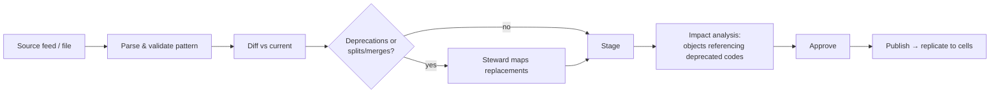

# U08 — Reference Data Universe Constitution

| Field | Value |
|---|---|
| Universe ID | `U08-refdata` |
| Layer | L3 Knowledge & Registry |
| Domain | 02 Knowledge |
| Steward | `ucos:org:knowledge-reference-data` |
| Version | 0.1.0 (Draft) |
| Delivery phase | P0 |
| Depends on | U04 Meta, U02 Governance |
| Depended on by | U12 Geography, U13 Temporal, U14 Currency & Unit, U15 Localization, U67 Compliance, most L5 universes |
| Master references | §6.2, §14.3 (global registries replicate to cells), §L1 Knowledge Once |

> Reference Data owns **externally standardised, slowly changing code lists**: countries, subdivisions, currencies, languages, scripts, time-zone identifiers, units of measure, UN/LOCODE locations, calling codes and industry codes. It is the single source for these codes. It does **not** own the behaviour around them. For example, FX rates belong to U14, timezone rules to U13, and tax rules to U31.

---

## 1. Constitution, Authority, Principles & Laws

### 1.1 Mandate
**Owns:** `CodeList`, `CodeValue`, `CodeMapping` (crosswalk between code lists), `CodeListRelease`.
**Does not own:** any value that changes with time on a business cadence (rates, prices), or tenant-specific enumerations (those are U06 Taxonomy).

### 1.2 Laws
| ID | Law | Enforcement |
|---|---|---|
| REF-L1 | No module may embed a standard code list in code or config. | Linter: banned literal sets (e.g. arrays of ISO 3166 alpha-2 codes) in `packs/`, `kernel/`. |
| REF-L2 | Code values are never deleted; they are deprecated with `validTo` and optional `replacedBy`. | Registry write guard. |
| REF-L3 | Every code list cites its authority source and release. | Required fields. |
| REF-L4 | Releases are versioned and pinned in each blueprint snapshot. | Composer snapshot includes `refdata.releaseIds`. |

### 1.3 Authorities
Importing a new release of an existing list needs level 3 (Reference Data steward). Adding a new code list needs level 4. A tenant-local *alias* (display override) needs level 2 (tenant admin).

---

## 2. Ontology & Taxonomy

### 2.1 Seed code lists (P0)

| CodeList id | Standard / source | Key format | Notes |
|---|---|---|---|
| `iso3166-1` | ISO 3166-1 | alpha-2 (`IN`) + alpha-3, numeric | countries |
| `iso3166-2` | ISO 3166-2 | `IN-MH` | subdivisions |
| `iso4217` | ISO 4217 | `INR` | minorUnit attribute |
| `iso639` | ISO 639-1/3 | `hi`, `hin` | languages |
| `iso15924` | ISO 15924 | `Deva` | scripts |
| `bcp47-region` | BCP 47 / CLDR | `en-IN` | locale identifiers (validation only; U15 owns Locale) |
| `iana-tz` | IANA tz database | `Asia/Kolkata` | identifiers only; rules in U13 |
| `ucum` / `unece-rec20` | UCUM, UN/ECE Rec 20 | `kg`, `KGM` | units; conversion in U14 |
| `un-locode` | UN/LOCODE | `INBOM` | trade & transport locations |
| `itu-e164-cc` | ITU-T E.164 | `+91` | calling codes |
| `isic` / `naics` / `nace` | UN ISIC, NAICS, NACE | | industry codes (mapped by U20) |
| `hs` | WCO HS | `8517.13` | customs (detail national extensions as separate lists) |
| `gs1-gpc`, `unspsc` | GS1 GPC, UNSPSC | | product classification (used by U18) |
| `iso9362` | BIC | | bank identifiers (validation pattern only) |
| `iso17442` | LEI | | legal entity identifiers (format only) |

### 2.2 Concepts
`CodeList` 1─N `CodeValue`. `CodeValue` N─N `CodeValue` via `CodeMapping` (for example alpha-2↔numeric, HS↔UNSPSC, or old↔new codes when a country splits). `CodeListRelease` snapshots a list.

---

## 3. Registry Model & Objects

### 3.1 `ucos.refdata.CodeList`
| Attribute | Type | Card. | Notes |
|---|---|---|---|
| `id` | String | 1 | e.g. `iso3166-1` |
| `name` | LocalizedText | 1 | |
| `authority` | String | 1 | e.g. "ISO 3166 Maintenance Agency" |
| `sourceUrl` | String | 1 | |
| `licence` | String | 1 | redistribution terms |
| `keyPattern` | String (regex) | 1 | |
| `attributesSchema` | JSON Schema | 0..1 | e.g. `minorUnit` for currencies |
| `hierarchical` | Boolean | 1 | |
| `currentRelease` | Reference→CodeListRelease | 1 | |
| `steward` | PartyRef | 1 | |

### 3.2 `ucos.refdata.CodeValue`
| Attribute | Type | Card. | Notes |
|---|---|---|---|
| `id` | NaturalID | 1 | `ucos:code:iso3166-1/IN` |
| `list` | Reference→CodeList | 1 | |
| `code` | String | 1 | matches `keyPattern` |
| `labels` | LocalizedText | 1 | CLDR names where available |
| `parent` | Reference→CodeValue | 0..1 | |
| `attributes` | Object | 1 | validated by `attributesSchema` |
| `validity` | TemporalRef(TimeRange) | 1 | `validTo` set on deprecation |
| `replacedBy` | Array<Reference→CodeValue> | 0..N | |
| `status` | Enum `active|deprecated|reserved` | 1 | |

### 3.3 `ucos.refdata.CodeMapping`
`{ from: CodeValueRef, to: CodeValueRef, relation: exact|broader|narrower|related, validity: TimeRange, source }`

### 3.4 `ucos.refdata.CodeListRelease`
`{ id, list, version (source version or date), importedAt, diff: {added[], deprecated[], changed[]}, checksum, status: staged|published }`

---

## 4. Commands, Queries, Events, APIs

| Command | Effect |
|---|---|
| `StageRelease(list, file|feed)` | parse, validate, compute diff → `staged` |
| `PublishRelease(releaseId)` | apply diff; emits `refdata.release.published` with diff summary |
| `CreateCodeList(def)` | authority 4 |
| `SetTenantAlias(code, tenant, label)` | display override only |

**Queries:** `GetCode(listId, code, asOf?)`, `ListCodes(listId, parent?, status?, asOf?)`, `MapCode(from, toList)`, `ValidateCode(listId, code)`.
**Events:** `refdata.release.staged`, `refdata.release.published`, `refdata.code.deprecated`.

```text
GET  /v1/refdata/lists
GET  /v1/refdata/lists/{listId}/codes?parent=&status=&asOf=&q=
GET  /v1/refdata/lists/{listId}/codes/{code}
GET  /v1/refdata/map?from=iso3166-1/IN&to=iso3166-1-alpha3
POST /v1/refdata/lists/{listId}/releases          (stage)
POST /v1/refdata/releases/{id}:publish
```

**Runtime contract:** an in-process `RefData` client with a full in-memory snapshot per cell (lists are small) and O(1) lookup.
**Errors:** `REFDATA_UNKNOWN_LIST`, `REFDATA_UNKNOWN_CODE`, `REFDATA_CODE_DEPRECATED` (warning header, not failure, unless strict), `REFDATA_RELEASE_CONFLICT`.

---

## 5. Workflows & Rules



When a code is deprecated, every object that references it gets a `DATA` gap in the owning universe with a suggested `replacedBy` migration. Data is never rewritten silently.

---

## 6. Policies, Security, Audit & Compliance
Read access: any authenticated principal. Writes: the Reference Data steward role only. Classification: `public`. Audit: releases and aliases. Licence compliance: `licence` is checked before a list is exposed through public APIs. Some lists, such as UNSPSC and parts of GS1, have redistribution limits and are served only to tenants that hold a licence entitlement (U28).

## 7. Validation, Versioning, Reuse
- Each release is validated against `keyPattern`, uniqueness and parent existence.
- Any universe with a field that holds a standard code MUST type it as `Enumeration(source: refdata:<listId>)`. The linter enforces this.
- Blueprints pin releases. Upgrading a release is a standard change with automatic impact analysis.

## 8. Gap & Evolution
```prolog
gap(deprecated_code_in_use, Obj, Code) :- references(Obj, Code), deprecated(Code).
gap(stale_release, L) :- code_list(L), release_age_days(L, D), max_age(L, M), D > M.
```
A scheduled job checks source feeds monthly (ISO, IANA weekly) and stages releases automatically.

## 9. AI
- **AI uses:** fuzzy matching of free text to codes (e.g. "UAE", "Emirates" → `AE`) for imports.
- **Agent tools:** `refdata.lookup` and `refdata.match` (read-only).
- **Prohibited for agents:** publish.

## 10. Operations
- **Signals:** `refdata_lookup_total`, `deprecated_code_hits`, `release_age_days`.
- **SLO:** lookup p99 < 0.2 ms in-process.

## 11. UI
- **Views:** `refdata.list.browser`, `refdata.release.diff` (side-by-side with an impact count), `refdata.alias.editor`.
- **UX:** labels come from CLDR in every supported locale.

## 12. Scale & DR
About 60 lists and about 2M codes. HS national extensions and UN/LOCODE dominate. The full snapshot (about 150 MB) is held in memory per cell, while large lists such as UN/LOCODE are loaded lazily.

Tier T0 for reads (cached), T2 for writes.

## Appendix
- **A.** Licensing for GS1 GPC and UNSPSC distribution must be confirmed by legal.
- **C.** 0.1.0 initial draft.

## Appendix D — Completeness reference vocabularies (amendment A-55)
These code lists are added so that coverage of industries, products, services and business processes can be **measured against international standards**, not asserted.

| CodeList id | Standard / source | Granularity | Used for |
|---|---|---|---|
| `isic4` | UN ISIC Rev.4 (and Rev.5 when adopted) | 21 sections → 88 divisions → 238 groups → 419 classes | Industry coverage; U20 industries; organisation classification |
| `naics` | NAICS 2022 | 20 sectors → ~1,000 national industries | US/Canada/Mexico mapping |
| `nace2` | NACE Rev.2 | aligned with ISIC | EU mapping |
| `nic2008` | National Industrial Classification (India) | aligned with ISIC | India mapping (GST and MCA registrations) |
| `cpc21` | UN Central Product Classification v2.1 | 10 sections → 71 divisions → ~2,900 subclasses | **All goods and services**: exhaustive product and service coverage |
| `hs` (existing) | WCO HS 2022 | ~5,600 subheadings | Traded goods (customs) |
| `gs1-gpc` (existing), `unspsc` (existing) | GS1, UNSPSC | consumer and B2B goods and services | Product taxonomy mappings |
| `sac` | India Services Accounting Codes | services | GST for services (mapped to CPC) |
| `apqc-pcf` | APQC Process Classification Framework, cross-industry v7.x (attribution required, licence-free use with credit; verify terms before redistribution) | 13 categories → process groups → processes → activities | **Business-domain and process coverage** |
| `bian` | BIAN service landscape | banking service domains | Financial-industry process coverage |
| `tmf-etom` | TM Forum eTOM | telecom processes | Telecom pack coverage |
| `iso-20022-domains` | ISO 20022 business areas | payments, securities messaging | Financial messaging coverage |
| `icd-11`, `snomed-ct` (licensed), `loinc` | WHO ICD-11, SNOMED CT, LOINC | clinical concepts | Health-pack coverage (stored only where licensed) |
| `isco08` | ILO ISCO-08 | occupations | Skills and credential coverage (U19, U46, U82) |
| `isced` | UNESCO ISCED | education levels and fields | Education-pack coverage |
| `nice` / `ipc` / `locarno` | WIPO classifications | trademarks, patents, designs | U104 IP |

**Mappings** (`CodeMapping`): ISIC↔NAICS↔NACE↔NIC, CPC↔HS, CPC↔UNSPSC, CPC↔SAC, GS1 GPC↔UCOS product taxonomy↔CPC. These mappings make the coverage computation in `INDUSTRY-PRODUCT-DOMAIN-CATALOGUE.md` repeatable.
