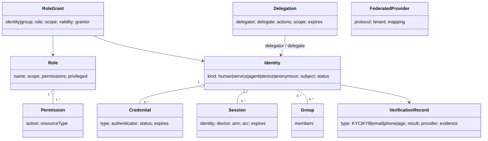
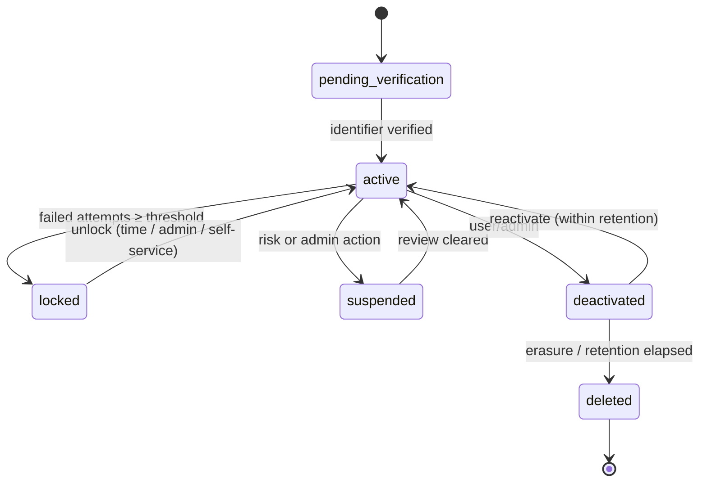

# U09 — Identity Universe Constitution

| Field | Value |
|---|---|
| Universe ID | `U09-identity` |
| Layer | L4 Foundation |
| Domain | 01 Foundation |
| Steward | `ucos:org:foundation-identity` |
| Version | 0.1.0 (Draft) |
| Delivery phase | P0 (core), P2 (KYC/KYB pack) |
| Depends on | U04 Meta, U01 Authority, U03 Policy, U10 Org & Tenant, U11 Person, U13 Temporal (expiry), U65 Security (keys) |
| Depended on by | every universe (principals, actors, ownership) |
| Master references | §19.2 (principal types), §18.5 (policy), §21.5 (agent identity), §7.2 (ids) |

> Identity owns **who or what is acting and how that is proven**: identities of humans, services, agents and devices; credentials and authenticators; sessions and tokens; roles, permissions and groups; federation with external identity providers; and identity verification (KYC/KYB) results. It does not own *who a person is in the business sense* (U11 Person), organisational structure (U10), or authorisation decisions (U03 Policy and the PDP, which consume roles and attributes from here).

---

## 1. Laws

| ID | Law | Enforcement |
|---|---|---|
| ID-L1 | Every action has an authenticated principal (human, service, agent or device). Anonymous access is modelled as an `anonymous` principal with its own policies. | Gateway rejects requests without a resolved principal. |
| ID-L2 | Identity ≠ Person. One Person may have many Identities (logins); one Identity represents exactly one subject. | Model constraint. |
| ID-L3 | Business users (anyone with a non-customer role) MUST use phishing-resistant MFA (passkey / FIDO2) or TOTP, as set by policy tier. | Login flow enforcement + gate `SEC-ID-01`. |
| ID-L4 | No shared credentials; no long-lived static secrets for workloads (workload identity only). | Secret scanning + SPIFFE. |
| ID-L5 | Agents act under their own identity, and on behalf of a human only through a scoped, expiring delegation. | Token claims `act` / `may_act` (RFC 8693). |
| ID-L6 | Passwords (if enabled) are never stored reversibly; Argon2id hashing with tenant-scoped pepper. | Implementation + test. |
| ID-L7 | Role grants have scope, grantor and validity; standing privileged access is avoided (just-in-time elevation). | Grant schema; PAM workflow. |

**Authorities:** platform IdP configuration is level 4. Tenant IdP federation is level 3 (tenant security admin). Role definitions are level 3 (tenant admin with SoD review). Role grants are level 2, and level 3 for privileged roles. Break-glass accounts are level 5 (multi-party).

---

## 2. Ontology



- **Credential types:** `passkey` (WebAuthn), `totp`, `hardware-key` (FIDO2 roaming), `password`, `otp-sms` (low assurance, fallback only), `otp-email`, `magic-link`, `oidc-federated`, `saml-federated`, `x509` (device/workload), `spiffe-svid`, `api-client` (OAuth2 client credentials), `api-key` (low risk, read-only).
- **Assurance levels** (NIST 800-63B aligned): `AAL1`, `AAL2`, `AAL3`. Identity assurance: `IAL1–3`.
- **Identity status:** `pending-verification`, `active`, `locked`, `suspended`, `deactivated`, `deleted` (pseudonymised tombstone).

---

## 3. Objects

### 3.1 `ucos.identity.Identity`
| Attribute | Type | Card. | Notes |
|---|---|---|---|
| `id` | UGID (`ucos:identity:`) | 1 | |
| `kind` | Enum | 1 | human, service, agent, device, anonymous |
| `subject` | Reference→person.Person / capability / agent.Agent / device | 1 | |
| `tenant` | TenantRef | 1 | platform staff use tenant `platform` |
| `identifiers` | Array<{type: email|phone|username|external, value, verified, primary}> | 0..N | unique per tenant per type when verified; `PII` |
| `status` | IdentityStatus | 1 | |
| `assurance` | `{ ial, lastVerifiedAt: TimePoint }` | 1 | |
| `riskProfile` | `{ score, signals[] }` | 0..1 | from U69 Risk |
| `lastLogin` | TimePoint | 0..1 | |

### 3.2 `Credential`
`{ id, identity, type, publicKey|secretHash|externalSubject, authenticatorMeta: {aaguid?, transports?, backupEligible?}, createdAt, lastUsedAt, expires?: TimePoint, status: active|revoked|compromised }` — secret material is stored only as a hash or public key. TOTP seeds are encrypted with a per-tenant KEK.

### 3.3 `Session`
`{ id, identity, device: DeviceRef, amr: [pwd|otp|hwk|swk|fed], acr: AAL1-3, createdAt: TimePoint, lastSeen: TimePoint, idleTimeout: Duration, absoluteTimeout: Duration, ip, geo: GeoRef (coarse), risk, status }`. Timeouts come from decision `identity.session-timeouts` (by role tier and channel).

### 3.4 `Role`, `Permission`, `Group`, `RoleGrant`
```yaml
Role:
  id: ucos:role:bazaar/seller-admin
  tenant: bazaar
  name: LocalizedText
  permissions: [catalog:*Listing, order:Read*, payout:Read]   # actions from capability manifests
  scopeType: organization | store | tenant | platform
  privileged: false
  sodConflicts: [ucos:role:bazaar/payout-approver]
  maxGrantDuration: P365D
RoleGrant:
  id, principal: IdentityRef|GroupRef, role, scope: { organization?, store?, ... },
  validity: TimeRange, grantor: IdentityRef, justification, approvals: [DecisionRef]
```
Permission strings are `<universe>:<Command|Query>` taken from manifests, with wildcard suffixes allowed only in role templates.

### 3.5 `Delegation` (on-behalf-of)
`{ id, delegator: IdentityRef, delegate: IdentityRef (often agent), actions: [permission], resourceScope: CEL, constraints: {maxAmount?: Money, count?, requiresConfirmation: bool}, validity: TimeRange (default ≤ PT1H for agents), status }`

### 3.6 `FederatedProvider`
`{ id, tenant, protocol: oidc|saml, issuer, clientId, secretRef (vault), claimMapping: {email, name, groups→roles}, jitProvisioning: bool, enforcedDomains: [..], status }`

### 3.7 `VerificationRecord`
`{ id, identity|organization, type: email|phone|kyc-individual|kyb-business|age|address|sanctions-screen|pep-screen, provider (adapter), result: pass|fail|review|expired, level, evidence: EvidenceRef (documents in Asset, encrypted), validity: TimeRange, jurisdiction }` — detailed KYC/KYB flows belong to the `identity.kyc` / `identity.kyb` capability packs (P2).

---

## 4. Commands, Queries, Events, APIs

| Command | Notes | Events |
|---|---|---|
| `RegisterIdentity` | with identifier; triggers verification | `identity.identity.registered` |
| `VerifyIdentifier` | OTP / link | `identity.identifier.verified` |
| `EnrollCredential` / `RevokeCredential` | passkey ceremony via WebAuthn | `identity.credential.enrolled|revoked` |
| `Authenticate` (flow) | returns tokens; risk-based step-up | `identity.session.started`, `identity.auth.failed` |
| `StepUp` | raise ACR for sensitive operation (policy obligation `stepUpAuth`) | `identity.session.stepped-up` |
| `EndSession` / `RevokeAllSessions` | | `identity.session.ended` |
| `DefineRole`, `GrantRole`, `RevokeRole` | SoD check; privileged grants need approval workflow | `identity.role.granted|revoked` |
| `ElevateJIT` | time-boxed privileged grant with approval | `identity.elevation.granted|expired` |
| `CreateDelegation` / `RevokeDelegation` | | `identity.delegation.created|revoked` |
| `ConfigureFederation` | | `identity.federation.changed` |
| `Suspend` / `Reactivate` / `Deactivate` / `Erase` | erase = pseudonymise, keep audit linkage | `identity.identity.suspended|deleted` |

**Queries:** `WhoAmI`, `GetEffectiveRoles(identity, scope)`, `GetPrincipalAttributes(identity)` (for the PDP), `ListSessions`, `IntrospectToken`.

**Token model:** OIDC access tokens are JWTs signed with ES256 and live 5–15 min. Audience is bound to the tenant API. Claims: `sub`, `tid` (tenant), `org`, `roles` (compact) or `ver` (fetch from cache), `acr`, `amr`, `act` (delegation actor), `cnf` (DPoP key binding for public clients). Refresh tokens rotate and use reuse detection.

```text
/.well-known/openid-configuration        (per tenant issuer: https://id.{tenant-domain})
POST /v1/identity/identities             POST /v1/identity/credentials:enroll
POST /v1/identity/sessions               DELETE /v1/identity/sessions/{id}
POST /v1/identity/roles                  POST /v1/identity/role-grants   POST /v1/identity/role-grants/{id}:revoke
POST /v1/identity/delegations            POST /v1/identity/elevations
GET  /v1/identity/me
```
**Ports:** `IdPPort` (Keycloak/Ory reference), `OtpDeliveryPort` (via U40 Communication), `KycProviderPort` (Onfido, Digio, Jumio, IDfy, UAE Pass, …), `SanctionsScreeningPort`.
**Errors:** `ID_INVALID_CREDENTIALS` (generic — no user enumeration), `ID_MFA_REQUIRED`, `ID_STEP_UP_REQUIRED`, `ID_ACCOUNT_LOCKED`, `ID_SOD_CONFLICT`, `ID_DELEGATION_EXCEEDED`, `ID_IDENTIFIER_TAKEN`.

---

## 5. State Machines & Rules

### 5.1 Identity lifecycle


### 5.2 Authentication flow (risk-based)
```mermaid
flowchart LR
  A[Identifier entered] --> R[Risk signals:<br/>device, IP rep, velocity, geo]
  R --> M{Required AAL<br/>(role tier × risk × action)}
  M -- AAL1 --> P1[passkey or OTP]
  M -- AAL2 --> P2[passkey / password+TOTP]
  M -- AAL3 --> P3[hardware key]
  P1 & P2 & P3 --> S[Session + tokens]
  S --> O{Later sensitive action?}
  O -- yes --> SU[Step-up to required ACR]
```
- **Decision tables:** `identity.required-aal` (inputs: role tier, risk band, channel, action class), `identity.lockout` (threshold, cool-down with exponential backoff), and `identity.session-timeouts`.
- **SoD check (normative):** before a grant, if `effectiveRoles(principal) ∪ {newRole}` contains any `sodConflicts` pair, deny with `ID_SOD_CONFLICT` unless a waiver Decision exists (U02).

---

## 6. Security & Compliance
- **Classification:** identifiers are `PII`; credentials are `CREDENTIAL` / `restricted`; verification evidence is `SPI` / `restricted`.
- **Encryption:** TOTP seeds and federation secrets use a per-tenant KEK through KMS. Verification documents are field-level encrypted.
- **Audit:** every auth success and failure, grant, elevation, delegation and federation change, with no secrets in logs.
- **Protections:** credential-stuffing defence (rate limits, breached-password check for password logins, bot detection) and impossible-travel detection.
- **Compliance controls:**
  - `ucos.ctrl.mfa-business-users` (PCI DSS 8.4, SOC 2 CC6.1, ISO A.5.17)
  - `ucos.ctrl.access-review` (quarterly recertification workflow)
  - `ucos.ctrl.least-privilege`
  - `ucos.ctrl.privileged-access-jit`
  - KYC/KYB packs map to PMLA (IN), the UAE AML law, and EU AMLD.

## 7. Validation & Reuse
- Other universes reference `IdentityRef` only for *actors* (`createdBy`, `approvedBy`). Business ownership uses `PartyRef` (U11).
- Permissions are declared in capability manifests and never invented in Identity.
- Packs MUST NOT implement login, OTP or session logic.

## 8. Gaps & Evolution
```prolog
gap(mfa_not_enforced, T, R)   :- tenant(T), role(T, R), business_role(R), not mfa_policy(T, R).
gap(sod_unconfigured, T, A, B):- tenant(T), sensitive_pair(A, B), roles_exist(T, A, B), not sod_conflict(A, B).
gap(no_access_review, T)      :- tenant(T), has_privileged_roles(T), not schedule(T, access-review).
gap(kyc_required, T, J)       :- in_scope(T, J), capability(T, marketplace.core), kyb_required(J), not capability(T, identity.kyb).
```
- **Self-healing:** IdP node failure is absorbed by stateless token validation (JWKS cached), and new logins fail over to standby. Signals of a compromised credential trigger an automatic revoke of sessions and a forced re-enrollment (L3 runbook).
- **Evolution:** verifiable credentials (W3C VC / DID) for cross-organisation trust, and wallet-based eIDAS 2.0 / UAE Pass / DigiLocker federation.

## 9. AI & Agents
- **Agent identities:** `kind=agent`, created with the Agent object (U51). They have no credentials of type password or OTP. Workload identity plus signed delegation tokens only.
- **AI uses:** login risk scoring (ML), and anomaly detection on grants.
- **Prohibited for agents:** granting roles, creating delegations for themselves, reading credential material.

## 10. Operations
- **Signals:** `auth_success_ratio{channel}`, `auth_latency_ms`, `mfa_adoption_ratio{tier}`, `lockouts_total`, `step_up_total`, `privileged_grants_active`, `delegations_active{agent}`.
- **SLOs:** token validation p99 < 2 ms (local JWKS); login API p95 < 400 ms (excluding user interaction); availability T0 at 99.99%.
- **Runbooks:** IdP failover, signing-key rotation (every 90 days with overlap), mass session revocation.

## 11. UI
- **Views:** `identity.login` (passkey-first, identifier-first), `identity.enroll-passkey`, `identity.account.security` (devices, sessions, passkeys), `identity.roles.matrix`, `identity.grant.request` (JIT with justification), `identity.access-review` campaign, `identity.federation.setup` wizard.
- **UX:** never reveal whether an account exists. Explain step-up prompts ("Confirm it's you to approve payouts"). The full flow is accessible to screen readers, and OTP inputs use `autocomplete="one-time-code"`.

## 12. Scale & DR
Hundreds of millions of identities across tenants. Peak 50k logins/s across cells. Sessions are stored in Redis with a Postgres audit trail. Per-tenant issuer keys are held in KMS. T0 with active-active per cell, and cross-region standby for the control-plane IdP.

## Appendix
- **A. Open questions:** whether Keycloak or Ory is the reference IdP (decide after a load spike in P0).
- **B. Amendments:** add `RoleGrant`, `Delegation`, `FederatedProvider` and `VerificationRecord` to the U09 "owns" list in master §6.2.
- **C.** 0.1.0.

## Appendix D — Completeness extensions (amendment A-33)
- **Social login:** `FederatedProvider.protocol` also supports social IdPs (Google, Apple, Facebook, X, LinkedIn, GitHub, Microsoft, WeChat, LINE, Kakao) through OIDC or OAuth adapters, with account-linking rules and verified-email requirements. Social-network *content and graph* belong to **U88**.
- **National digital identities and wallets:** Aadhaar-based e-KYC (through licensed KUA partners), DigiLocker, UAE Pass, Singpass, eIDAS 2.0 EUDI wallets, BankID, and others are federation or verification adapters, all as data and packs.
- **Non-human, non-Earth and virtual identities:** `Identity.kind` is extensible (registry) to cover robots, vehicles, spacecraft systems and virtual-world avatars (bound to a U77 Reality). An avatar identity in a virtual reality cannot act in physical reality without a RealityLink and a delegation.
