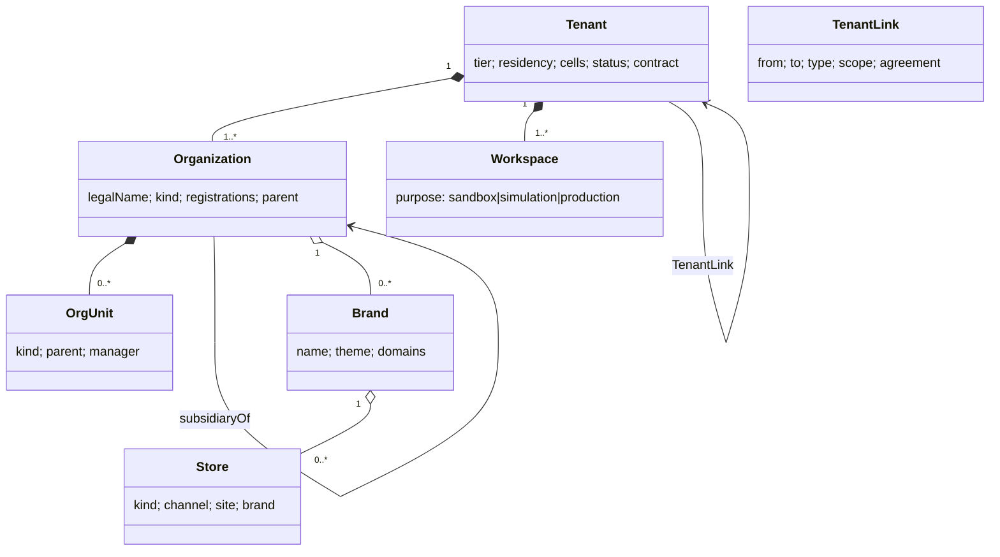
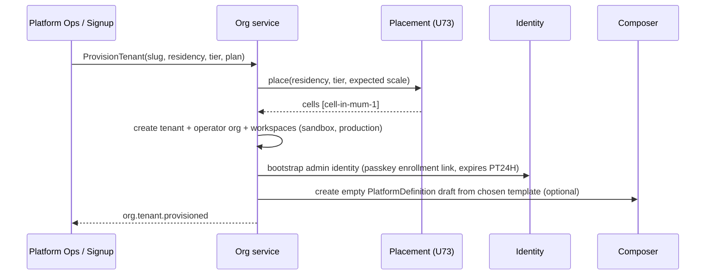

# U10 — Organization & Tenant Universe Constitution

| Field | Value |
|---|---|
| Universe ID | `U10-org` |
| Layer | L4 Foundation |
| Domain | 01 Foundation |
| Steward | `ucos:org:foundation-org` |
| Version | 0.1.0 (Draft) |
| Delivery phase | P0 |
| Depends on | U04 Meta, U09 Identity (admins), U11 Person/Party, U12 Geography (registered address, sites), U73 Infrastructure (cells), U28 Entitlement (plans, P2), U13 Temporal (see TEMPORAL-BINDING-MATRIX) |
| Depended on by | every universe (`tenant` on every object; org scoping of roles and data) |
| Master references | §13.5 (multi-tenancy tiers), §14.3 (residency, cells), §11.2 (PlatformDefinition belongs to a tenant) |

> This universe owns the **containers and structure of who operates on UCOS**. A **Tenant** is the isolation and contract boundary: a customer of the UCOS platform. Inside it are **Organizations** (legal entities), **OrgUnits** (departments, teams, cost centres), **Workspaces** (environments for builders), **Brands** and **Stores** (customer-facing operating units). In a marketplace, sellers are also Organizations inside the marketplace operator's tenant.

---

## 1. Laws

| ID | Law | Enforcement |
|---|---|---|
| ORG-L1 | Every object belongs to exactly one tenant (or `global`). Tenant never changes for an object. | Envelope constraint; RLS. |
| ORG-L2 | Cross-tenant data access is impossible by default. Only explicit, contracted `TenantLink`s (e.g. franchise networks, data-sharing agreements) allow scoped access, enforced by policy. | RLS + PDP + link object. |
| ORG-L3 | Tenant isolation tier and residency are declared and enforced by placement (cells). | Composer rule + infrastructure check. |
| ORG-L4 | Organization legal identity (registration numbers, tax IDs) is verified before activities that require it (payouts, invoicing). | Gap rule + VerificationRecord (U09). |
| ORG-L5 | Tenant deletion is a governed workflow (export → retention holds → crypto-shred), never a `DELETE`. | Workflow only. |

**Authorities:** tenant creation and tier change are level 4 (Platform operations, contract-backed). Organization creation is level 2 (tenant admin); marketplaces allow seller self-signup governed by policy. Store and brand are level 2.

---

## 2. Ontology



- `OrganizationKind`: `operator` (owns the platform instance), `seller`, `supplier`, `partner`, `customer-business` (B2B buyer), `carrier`, `franchisee`, `government-body`, `ngo`, `other`.
- `OrgUnitKind`: `department`, `team`, `cost-centre`, `profit-centre`, `region`, `branch`, `warehouse-ops`, `custom`.
- `StoreKind`: `online`, `physical`, `dark-store`, `kiosk`, `pop-up`, `marketplace-shop` (seller storefront), `app`.
- `IsolationTier`: `pooled`, `schema`, `dedicated`, `dedicated-cell`.

---

## 3. Objects

### 3.1 `ucos.org.Tenant`
| Attribute | Type | Card. | Notes |
|---|---|---|---|
| `id` | UGID (`ucos:tenant:`) + `slug` (unique, DNS-safe) | 1 | |
| `displayName` | LocalizedText | 1 | |
| `contractRef` | Reference→contract.Agreement (U42/U30) | 1 | UCOS commercial contract |
| `plan` | Reference→entitlement.Plan | 1 | UCOS platform plan |
| `isolationTier` | IsolationTier | 1 | |
| `residency` | Array<Reference→geo.Jurisdiction(data-residency-region)> | 1..N | |
| `cells` | Array<Reference→infra.Cell> | 1..N | assigned by placement |
| `primaryOrganization` | Reference→Organization | 1 | the operator |
| `domains` | Array<{host, verified, tls: managed|byo}> | 0..N | |
| `defaults` | `{ locale, currency, timezone, calendar }` | 1 | seeds Context |
| `securityProfile` | Reference→security profile | 1 | |
| `status` | `provisioning|active|suspended|offboarding|deleted` | 1 | |
| `limits` | `{ rps, storageGb, objects, extensionFields, agents }` | 1 | from plan |

### 3.2 `ucos.org.Organization`
| Attribute | Type | Card. | Notes |
|---|---|---|---|
| `id` | UGID (`ucos:org:`) | 1 | |
| `tenant` | TenantRef | 1 | |
| `party` | Reference→person.Party | 1 | an Organization **is** a Party (U11) |
| `kind` | OrganizationKind | 1 | |
| `legalName` | String | 1 | |
| `tradeNames` | Array<LocalizedText> | 0..N | |
| `registrations` | Array<{scheme: (gstin|pan|cin|trn|vat|ein|lei|duns|cr), value, jurisdiction, verified: VerificationRecordRef?}> | 0..N | scheme list from refdata; `confidential` |
| `registeredAddress` | AddressRef | 0..1 | |
| `placesOfBusiness` | Array<AddressRef> | 0..N | tax nexus input |
| `parent` | Reference→Organization | 0..1 | group structures |
| `standing` | `good|watch|restricted|suspended` | 1 | used by policies |
| `fiscalCalendar` | Reference→temporal.Calendar(fiscal) | 0..1 | |
| `functionalCurrency` | iso4217 | 0..1 | Ledger |
| `status` | lifecycle | 1 | |

### 3.3 `OrgUnit`, `Workspace`, `Brand`, `Store`, `TenantLink`
```yaml
OrgUnit:   { id, organization, kind, name, parent?, manager?: PartyRef, costCentreCode?, validity: TimeRange }
Workspace: { id, tenant, name, purpose: sandbox|simulation|staging|production, blueprint?: BlueprintRef, dataSeed: none|synthetic|masked-copy, expires?: TimePoint }
Brand:     { id, organization, name: LocalizedText, theme: ui.ThemeRef, assets: [AssetRef], domains: [host], voiceGlossary?: l10n.GlossaryRef }
Store:     { id, brand, organization, kind, name, site?: geo.PlaceRef(kind=site), address?: AddressRef,
             channels: [ChannelRef], openingHours?: temporal.TemporalPolicyRef, serviceAreas?: [geo.ServiceAreaRef],
             currency, locale, status: draft|open|temporarily-closed|closed }
TenantLink:{ id, from: TenantRef, to: TenantRef, type: franchise|data-sharing|reseller|parent-child,
             scope: { universes: [..], actions: [..], dataClasses: [..] }, agreement: AgreementRef, validity, status }
```

---

## 4. Commands, Queries, Events, APIs

| Command | Effect | Events |
|---|---|---|
| `ProvisionTenant` (platform ops) | create tenant; placement (cells by residency × tier); create operator org; bootstrap admin identity; default workspaces | `org.tenant.provisioned` |
| `ChangeIsolationTier` | online migration workflow (§5.2) | `org.tenant.tier-changed` |
| `SuspendTenant` / `ResumeTenant` | gateway blocks except admin & data export | `org.tenant.suspended` |
| `OffboardTenant` | §5.3 workflow | `org.tenant.offboarded` |
| `CreateOrganization` / `UpdateOrganization` | registrations → verification jobs | `org.organization.created|updated` |
| `SetOrganizationStanding` | policy-relevant | `org.organization.standing-changed` |
| `CreateOrgUnit`, `CreateWorkspace`, `CreateBrand`, `CreateStore`, `ChangeStoreStatus` | | `org.*.created|changed` |
| `VerifyDomain` | DNS TXT challenge; managed TLS | `org.domain.verified` |
| `CreateTenantLink` / `RevokeTenantLink` | both tenants' authorities approve | `org.tenant-link.created|revoked` |

**Queries:** `GetTenant`, `ResolveTenantByHost(host)` (gateway hot path), `OrgTree(org)`, `StoresNear(geo, kinds)`, `OrganizationsByRegistration(scheme, value)`.

```text
POST /v1/org/tenants                (platform)        GET /v1/org/tenants/{id}
POST /v1/org/tenants/{id}:suspend|:resume|:offboard|:change-tier
POST /v1/org/organizations          GET /v1/org/organizations/{id}/tree
POST /v1/org/stores                 POST /v1/org/stores/{id}:open|:close-temporarily|:close
POST /v1/org/domains                POST /v1/org/domains/{host}:verify
POST /v1/org/workspaces             POST /v1/org/tenant-links
```
**Errors:** `ORG_SLUG_TAKEN`, `ORG_RESIDENCY_UNSATISFIABLE`, `ORG_DOMAIN_UNVERIFIED`, `ORG_REGISTRATION_INVALID`, `ORG_TENANT_SUSPENDED` (403 on all non-admin calls), `ORG_LINK_SCOPE_DENIED`.

---

## 5. Workflows & Rules

### 5.1 Tenant provisioning


### 5.2 Tier change (online)
expand (create the target schema or DB) → logical replication → dual-read verification on samples → cutover window (Temporal policy agreed with the tenant) → write freeze < 60 s → switch routing → contract (drop the old copy after a 7-day hold).

### 5.3 Offboarding (normative)
notice period (contract) → data export package offered (all objects, documents, ledger in open formats) → retention holds evaluated (U66; tax and financial records kept per law) → non-held data crypto-shredded (destroy tenant DEKs) → held data re-encrypted under an escrow key with legal-hold metadata → `deleted` status with a tombstone. Evidence is produced at each step.

### 5.4 Decision tables
- `org.seller.auto-approve` (marketplace self-signup: inputs are KYB result, category risk and country; outputs are approve, review or reject).
- `org.store.default-hours`.

---

## 6. Security & Compliance
```cedar
permit (principal in Role::"tenant-admin", action in [Action::"org:CreateOrganization", Action::"org:CreateStore", Action::"org:CreateBrand"], resource)
when { resource.tenant == principal.tenant };
permit (principal in Role::"seller-admin", action == Action::"org:UpdateOrganization", resource is Org::Organization)
when { resource == principal.organization } ;
forbid (principal, action, resource)
when { resource has tenant && resource.tenant != principal.tenant && !(context.tenantLink has scope && context.tenantLink.scope.actions.contains(action)) };
```
- **Classification:** registrations and tax IDs are `confidential`. Tenant contract and limits are `internal`.
- **Audit:** tenant lifecycle (full), organization standing changes, links.
- **Compliance:** tenant isolation evidence (`ucos.ctrl.tenant-isolation`: RLS tests, penetration results), data-processing agreements (DPA) referenced through `contractRef`, and offboarding evidence for GDPR Art. 28(3)(g).

## 7. Validation & Reuse
- Every object carries `tenant`.
- Organizational scoping of data uses `organization` / `store` reference fields, plus policies.
- Seller, supplier and carrier are Organizations of a given `kind`. Universes MUST NOT create parallel "Seller" master records; U25 Marketplace adds a `SellerAgreement` and settings that point at the Organization.

## 8. Gaps & Evolution
```prolog
gap(unverified_registration, O) :- organization(O), receives_payouts(O), not verified_registration(O, tax_id).
gap(missing_fiscal_calendar, O) :- organization(O), uses_capability(O, ledger.core), not fiscal_calendar(O, _).
gap(store_without_hours, S)     :- store(S), kind(S, physical), not opening_hours(S, _).
gap(residency_violation, T)     :- tenant(T), cell(T, C), residency(T, J), not cell_in_jurisdiction(C, J).
gap(domain_unverified, T, H)    :- tenant_domain(T, H), not verified(H).
```
- **Self-healing:** host → tenant routing cache rebuilds from the registry. If a cell is lost, the tenant is routed to its DR cell (U73 runbook).
- **Evolution:** DAO/consortium organization kinds and cross-tenant federated marketplaces arrive as `TenantLink` types.

## 9. AI
- **AI uses:** organization data enrichment from public registries (proposals), and seller-risk signals for `standing` (proposal only).
- **Agent tools:** `org.get_store`, `org.stores_near`.
- **Prohibited for agents:** standing changes, tenant lifecycle actions, links.

## 10. Operations
- **Signals:** `tenants_active{tier}`, `provisioning_duration_s`, `tier_migration_progress`, `host_resolution_latency_ms`, `organizations_by_standing`.
- **SLOs:** host → tenant resolve p99 < 1 ms (edge cache); provisioning p95 < 5 min (excluding human steps).

## 11. UI
- **Views:**
  - Platform Console: `org.tenant.list`, `org.tenant.detail` (tier, cells, limits, usage, health), `org.tenant.provision` wizard.
  - Tenant Admin: `org.org-tree`, `org.store.list` (with map), `org.store.editor` (hours via Temporal policy picker), `org.brand.editor`, `org.domain.setup`.
- **UX:** domain setup shows the exact DNS records with copy buttons, and live verification status.

## 12. Scale & DR
10k+ tenants and millions of organizations (sellers). The host map is replicated to the edge. Tenant registry is T0 (control plane, cached in cells). Organizations are T1, in cell Postgres.

## Appendix
- **A. Open questions:** whether to support one tenant spanning multiple residency regions with per-organization residency (current design: yes, via multiple cells; needs a P2 spike).
- **B. Amendments:** add `TenantLink` to the U10 "owns" list. Organization ↔ Party relationship is defined in U11.
- **C.** 0.1.0.

## Appendix P1 — Phase 1 behaviour without later-phase dependencies
- **U28 Entitlement:** specified for Phase 1. `Tenant.plan` is a U28 Plan and `Tenant.limits` are U28 quotas (`platform.*`).
