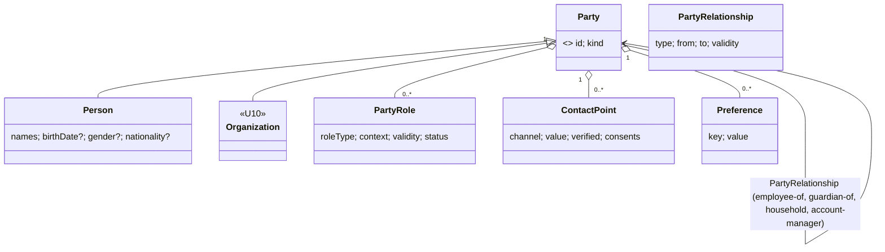

# U11 — Person & Party Universe Constitution

| Field | Value |
|---|---|
| Universe ID | `U11-person` |
| Layer | L4 Foundation |
| Domain | 01 Foundation |
| Steward | `ucos:org:foundation-party` |
| Version | 0.1.0 (Draft) |
| Delivery phase | P0 |
| Depends on | U04 Meta, U12 Geography (addresses), U15 Localization (names, preferences), U66 Privacy & Consent |
| Depended on by | Identity (subject), Org (Organization is a Party), CRM, Commerce (buyer/seller roles), Communication (contact points), Support, HRMS, Healthcare packs |
| Master references | §7.2 (CID → party-role ruling), §6.3, §20 (privacy) |

> This universe owns **the parties UCOS deals with and the roles they play**: `Party` (abstract: Person or Organization), `Person` (a natural person's profile), `PartyRole` (buyer, seller, patient, student, driver, employee, guarantor…), `ContactPoint` (email, phone, messaging handles) and `Preference`. It is the single home for personal data of natural persons, which makes privacy rights enforceable in one place.

---

## 1. Laws

| ID | Law | Enforcement |
|---|---|---|
| PTY-L1 | Business roles are `PartyRole`s, not separate master records. There are no parallel Customer, Patient or Driver tables holding personal data. | META registry rejects types in other universes that hold `PII` name/contact fields without referencing a Party (lint `PTY-LINT-001`). |
| PTY-L2 | Personal data fields are minimised and purpose-tagged. Every read of `restricted` personal data needs a declared purpose. | META-L7 + PDP obligations. |
| PTY-L3 | One natural person should resolve to one Person per tenant. Duplicates are merged through governed entity resolution, never by silent overwrite. | Merge workflow with survivorship and an audit trail. |
| PTY-L4 | Contact points carry verification status and consent per channel and purpose. Communication uses only consented, verified points. | U40 checks `ContactPoint.consents`. |
| PTY-L5 | Erasure and access requests are fulfilled from this universe's graph of references (who points at the Party). | DSR workflow (U66) uses `ListReferences(party)`. |

---

## 2. Ontology



- **`PartyRoleType` registry** (extensible as data): `buyer`, `seller`, `supplier`, `partner`, `employee`, `contractor`, `driver`, `rider`, `host`, `guest`, `patient`, `practitioner`, `student`, `instructor`, `subscriber`, `member`, `beneficiary`, `guarantor`, `legal-representative`, `guardian`, `support-agent`, `delivery-agent`, `lead` (pre-customer). Each role type is owned (provided) by a universe, e.g. `patient` by the healthcare pack. It may define a **role profile schema** for role-specific, non-identity attributes (e.g. driver licence number for `driver`, defined in Mobility).
- **`ContactChannel`:** `email`, `phone` (E.164), `whatsapp`, `telegram`, `push-token` (device-bound), `postal` (AddressRef), `social-handle`.

---

## 3. Objects

### 3.1 `ucos.party.Person`
| Attribute | Type | Card. | Class | Notes |
|---|---|---|---|---|
| `id` | UGID (`ucos:person:`) | 1 | — | |
| `tenant` | TenantRef | 1 | — | |
| `names` | Array<PersonName> | 1..N | PII | `PersonName { given, family?, middle?, prefix?, suffix?, display, script, locale, use: legal|preferred|alias }` |
| `birthDate` | LocalDate | 0..1 | SPI | purpose-tagged (age verification, healthcare) |
| `ageBand` | Enum | 0..1 | PII | for minimisation where exact DOB not needed |
| `gender` | Enumeration(taxonomy) | 0..1 | SPI | optional, self-declared |
| `nationalities` | Array<iso3166> | 0..N | PII | |
| `nationalIds` | Array<{scheme, value: Encrypted<String>, jurisdiction, verified?}> | 0..N | SPI/restricted | e.g. Aadhaar is never stored raw — reference tokens only (decision `party.national-id.storage-mode`) |
| `addresses` | Array<AddressRef + use> | 0..N | PII | |
| `preferredLocale` | LocaleRef | 0..1 | — | |
| `timezone` | iana-tz | 0..1 | — | |
| `isMinor` | Boolean (computed) | 1 | — | from birthDate × jurisdiction age of majority |
| `status` | `active|merged|erased` | 1 | — | `merged` keeps `mergedInto` |
| `mergedInto` | Reference→Person | 0..1 | — | |

### 3.2 `PartyRole`
`{ id, party: PartyRef, roleType, context: { tenant, organization?, store?, marketplace? }, profile: Object (validated by role profile schema), validity: TimeRange, status: prospective|active|suspended|ended, source }`
Example: the same Person is `buyer` on the storefront, `seller` (via their sole-proprietor Organization) and `support-agent` as staff. These are three roles on one Party.

### 3.3 `ContactPoint`
`{ id, party, channel, value (normalised: lower-case email, E.164 phone), label, primary: bool, verification: {status, at: TimePoint, method}, consents: [ { purpose: PurposeRef (U66), status: granted|denied|withdrawn, at: TimePoint, source, noticeVersion } ], doNotContact: bool, bounceState?: {hard, soft, at: TimePoint} }`

### 3.4 `Preference`
`{ party, key (namespaced, e.g. comm.frequency, ui.theme, diet.vegetarian), value, source: explicit|inferred, inferredConfidence? }`. Inferred preferences are `PII` and need a purpose. They are excluded when the user objects to profiling.

### 3.5 `PartyRelationship`
`{ id, type: employee-of|guardian-of|household-member|account-manager-for|referred-by|authorised-signatory, from, to, validity: TimeRange, evidence? }`

---

## 4. Commands, Queries, Events, APIs

| Command | Notes | Events |
|---|---|---|
| `CreatePerson` | dedupe check (§5.1) returns candidates | `party.person.created` |
| `UpdatePerson` | field-level purpose checks | `party.person.updated` (changed field names only, no values) |
| `AssignRole` / `EndRole` | role profile validated by role-type owner schema | `party.role.assigned|ended` |
| `AddContactPoint` / `VerifyContactPoint` / `RecordConsent` | consent from U66 notices | `party.contact.verified`, `party.consent.changed` |
| `MergeParties` | survivorship rules; references re-pointed; audit | `party.person.merged` |
| `ErasePerson` | via DSR workflow only: pseudonymise, retain legally required minimum | `party.person.erased` |
| `LinkIdentity` | Identity.subject → Person | `party.identity.linked` |

**Queries:** `GetPerson(id, fields, purpose)`, `FindCandidates(matchInput)`, `ListRoles(party)`, `ListReferences(party)` (graph: every object referencing this party, for DSR), `ContactFor(party, purpose, channelPreference)` (returns only a consented, verified point).

```text
POST /v1/party/persons                  GET /v1/party/persons/{id}?fields=&purpose=
POST /v1/party/persons:match            POST /v1/party/persons:merge
POST /v1/party/roles                    POST /v1/party/roles/{id}:end
POST /v1/party/contact-points           POST /v1/party/contact-points/{id}:verify
POST /v1/party/contact-points/{id}/consents
GET  /v1/party/parties/{id}/references   (privacy officers / DSR)
```
**Errors:** `PTY_PURPOSE_REQUIRED`, `PTY_DUPLICATE_SUSPECTED` (409 with candidates), `PTY_ROLE_PROFILE_INVALID`, `PTY_NO_CONSENTED_CONTACT`, `PTY_ERASED`.

---

## 5. Rules & Algorithms

### 5.1 Entity resolution
Blocking keys are normalised email, E.164 phone, name phonetic key (per script) + birthDate, and national-ID token. The match score is a weighted rule set (decision table `party.match-weights`), with an ML model as an optional pack.

| Score | Action |
|---|---|
| ≥ 0.95 | auto-link, if the tenant allows it |
| 0.75–0.95 | steward review queue |
| < 0.75 | new Person |

Merge survivorship per field: verified beats unverified, then newest verified, then source priority. All references are re-pointed asynchronously; the losing id stays as an alias.

### 5.2 Minor protection
`isMinor` (age of majority comes from the jurisdiction decision table `party.age-of-majority`) triggers child-data rules in U66. These include parental consent, no profiling or ads, and restricted contact.

### 5.3 Erasure (normative outline)
`ListReferences(party)` → for each reference: the owning universe applies its retention rule (keep / minimise / delete). The Person record is reduced to a tombstone `{id, status: erased, erasedAt: TimePoint}`. Names and contacts are removed, and DEK-encrypted fields are crypto-shredded. The audit log keeps the hashed id only.

---

## 6. Security & Compliance
```cedar
permit (principal, action == Action::"party:GetPerson", resource is Party::Person)
when { resource == principal.person };     // self
permit (principal in Role::"support-agent", action == Action::"party:GetPerson", resource is Party::Person)
when { context.purpose == "customer-support" && context.case.subject == resource };
// obligation: mask(nationalIds, birthDate) for support agents
forbid (principal, action == Action::"party:ReadNationalId", resource)
unless { principal has role && principal.role == "kyc-officer" && context.stepUp == true };
```
- Field-level encryption for `nationalIds` and any `SPI` field.
- Masking obligations for phones and emails in operational UIs (e.g. `+91 98•••••210`). Calls and messages go through masked proxy numbers, provided by U40.
- **Audit:** every read of SPI or restricted fields (purpose logged) and every write.
- **Compliance:** GDPR/DPDP/CCPA data-subject rights, consent (DPDP §6), children's data (DPDP §9, COPPA), PDPL (UAE), and HIPAA when the patient role is used (PHI linkage through the role profile).

## 7. Validation & Reuse
- Other universes reference parties via `PartyRef` / `PartyRoleRef`.
- Orders store `buyer: PartyRoleRef` plus a **snapshot** of the shipping recipient name and phone on the shipment only, because it is a delivery label fact with its own retention.
- CRM `Contact` (U38) is a PartyRole `lead` / `contact` plus CRM-specific attributes. It does not duplicate names.

## 8. Gaps & Evolution
```prolog
gap(no_consent_notice, T, P) :- tenant(T), purpose_in_use(T, P), not consent_notice(T, P).
gap(minor_rules_missing, T)  :- tenant(T), audience_may_include_minors(T), not capability(T, privacy.children).
gap(role_without_owner, R)   :- role_type(R), not provided_by(R, _).
gap(duplicate_backlog, T, N) :- tenant(T), review_queue_size(T, party-match, N), N > 1000.
```
**Evolution:** decentralised identity wallets let a person present verified attributes (age ≥ 18) without UCOS storing DOB. These are modelled as verifiable-credential `VerificationRecord`s (U09).

## 9. AI
- **AI uses:** entity-resolution assistance, name transliteration across scripts, and preference inference (opt-out respected).
- **Agent tools:** `party.contact_for` (returns a channel handle token, not the raw value, unless the policy allows it), `party.get_person` (purpose required; masked by default).
- **Prohibited for agents:** merge, erase, reading national IDs.

## 10. Operations
- **Signals:** `persons_total`, `duplicate_rate`, `merge_queue_size`, `consent_withdrawals_total{purpose}`, `spi_reads_total{purpose}`, `dsr_reference_lookup_ms`.
- **SLOs:** `GetPerson` p99 < 20 ms; `ListReferences` p95 < 5 s for 10k references.

## 11. UI
- **Views:** `party.person.profile` (customer 360 header, with masked fields that reveal on purpose with audit), `party.merge.review` (side-by-side with survivorship preview), `party.consent.center` (end-user privacy centre: purposes, channels, history), `party.contact.manage`.
- **UX:** name input adapts to locale (family-name-first locales, single-name cultures, script choice). Never require a family name or gender.

## 12. Scale
Billions of persons across tenants, partitioned by tenant. The match index sits in OpenSearch per cell, and the references graph is in the cell graph store. Tier T1.

## Appendix
- **B. Amendments:**
  - rename U11 to "Person & Party" and add `Party`, `PartyRole`, `PartyRelationship` and `PartyRoleType` to its "owns" list in master §6.2;
  - clarify in master §7.2 that CID is a PartyRole.
- **C.** 0.1.0.
