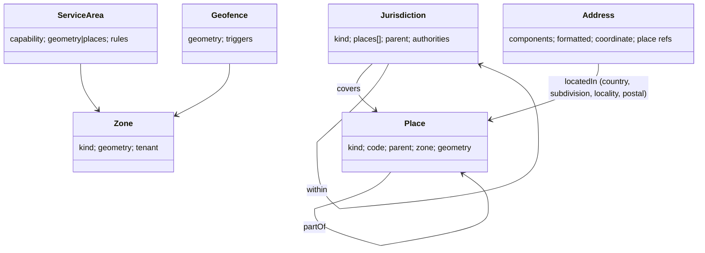

# U12 — Geography Universe Constitution

| Field | Value |
|---|---|
| Universe ID | `U12-geo` |
| Layer | L4 Foundation |
| Domain | 01 Foundation |
| Steward | `ucos:org:foundation-geo` |
| Version | 0.1.0 (Draft) |
| Delivery phase | P0 |
| Depends on | U04 Meta, U08 Reference Data (`iso3166-1/2`, `un-locode`, `iana-tz`, `itu-e164-cc`) |
| Depended on by | U13 Temporal (zone of place, holiday jurisdiction), U16 Context, U31 Tax, U67 Compliance, U36 Logistics, U37 Mobility, U34 Inventory, U10 Org (store locations), U11 Person (addresses), U14 Currency (country → currency) |
| Master references | §6.3 (address/jurisdiction ruling), §11.3 (jurisdiction facts), §14.3 (residency) |

> Geography is the only owner of **where**: places and their hierarchy, addresses, jurisdictions (legal applicability), zones, geofences, service areas, coordinates and shapes. It does not own legal rules. Regulations live in U67 and taxes in U31; both *attach to* Geography's `Jurisdiction`.

---

## 1. Constitution, Authority, Principles & Laws

### 1.1 Mandate
**Owns:** `Place`, `Address`, `Jurisdiction`, `Zone`, `Geofence`, `ServiceArea`, `AddressFormat`, `GeocodeResult`.
**Value types:** `Coordinate`, `GeoShape`, `GeoRef`, `AddressRef`.
**Does not own:** routing and distance-matrix computation (U36 Logistics, via the Maps port), tax rates (U31), regulations (U67).

### 1.2 Laws
| ID | Law | Enforcement |
|---|---|---|
| GEO-L1 | No object stores free-text country, state, city or postcode fields; it references an `Address` or a `Place`. | META-LINT-001. |
| GEO-L2 | Legal applicability is always derived from `Jurisdiction` objects, never inferred from country codes in pack code. | REF-L1 + code review rule. |
| GEO-L3 | Coordinates are WGS 84 (EPSG:4326) at rest; projections only at computation time. | Value type schema. |
| GEO-L4 | Addresses are validated against the country's `AddressFormat` and kept in structured form with the original input preserved. | Validator on `CreateAddress`. |
| GEO-L5 | Raw location telemetry of persons is `PII:LOCATION`, retention-bound and never used outside a declared purpose. | Classification + purpose obligations. |

### 1.3 Authorities
Global places, jurisdictions and address formats are level 3 (Geo steward). Tenant zones, geofences and service areas are level 2 (tenant ops admin). Addresses are written by their owning party, or by systems acting for it.

---

## 2. Ontology & Taxonomy



- `PlaceKind`: `planet`, `continent`, `country`, `subdivision-1` (state/emirate/province), `subdivision-2` (district/county), `locality` (city/town/village), `sublocality`, `postal-area`, `un-locode-location`, `site` (store, warehouse, hub; tenant-scoped), `building`, `custom`.
- `JurisdictionKind`: `national`, `subnational`, `municipal`, `economic-zone` (SEZ/free zone, e.g. DIFC, DMCC), `supranational` (EU, GCC), `customs-union`, `tax-region`, `data-residency-region`.
- `ZoneKind`: `delivery`, `pricing`, `surge`, `tax-override`, `sales-territory`, `restricted`, `custom`.
- **Standards:** ISO 3166, UN/LOCODE, WGS 84, GeoJSON (RFC 7946), Google libaddressinput / CLDR address formats, What3Words and Plus Codes as optional identifiers.

---

## 3. Objects & Value Types

### 3.1 Value types
| Type | JSON | Rules |
|---|---|---|
| `Coordinate` | `{"lat":19.0760,"lng":72.8777,"accuracyM":12}` | lat ∈ [-90,90], lng ∈ [-180,180] |
| `GeoShape` | GeoJSON geometry (`Polygon`, `MultiPolygon`, `LineString`, `Point`) | ≤ 10k vertices; valid (no self-intersection) |
| `GeoRef` | `{"place":PlaceRef}` or `{"address":AddressRef}` or `{"coordinate":Coordinate}` | union |

### 3.2 `ucos.geo.Place`
| Attribute | Type | Card. | Notes |
|---|---|---|---|
| `id` | UGID / NaturalID | 1 | `ucos:place:iso3166-2/IN-MH` |
| `kind` | PlaceKind | 1 | |
| `names` | LocalizedText | 1 | official + alternates |
| `codes` | Array<{scheme, value}> | 0..N | ISO, LOCODE, postal, GeoNames |
| `parent` | Reference→Place | 0..1 | |
| `timezone` | Enumeration(refdata:iana-tz) | 0..1 | inherited if absent |
| `centroid` | Coordinate | 0..1 | |
| `geometry` | GeoShape | 0..1 | boundaries (licensed sources) |
| `scope` | `global|tenant` | 1 | `site` kind is tenant |
| `validity` | TimeRange | 1 | boundary changes over time |

### 3.3 `ucos.geo.Jurisdiction`
| Attribute | Type | Card. | Notes |
|---|---|---|---|
| `id` | NaturalID | 1 | `ucos:jur:IN`, `ucos:jur:IN-KA`, `ucos:jur:AE-DIFC`, `ucos:jur:EU` |
| `kind` | JurisdictionKind | 1 | |
| `covers` | Array<Reference→Place> | 1..N | |
| `within` | Array<Reference→Jurisdiction> | 0..N | e.g. IN-KA within IN; DE within EU |
| `excludes` | Array<Reference→Place> | 0..N | free zones carved out |
| `defaultCurrency` | Enumeration(refdata:iso4217) | 0..1 | consumed by U14 |
| `officialLanguages` | Array<Enumeration(refdata:iso639)> | 0..N | consumed by U15 |
| `holidayCalendar` | Reference→temporal.Calendar | 0..1 | |
| `residencyRegion` | Reference→Jurisdiction(kind=data-residency-region) | 0..1 | |
| `validity` | TimeRange | 1 | |

### 3.4 `ucos.geo.Address`
| Attribute | Type | Card. | Notes |
|---|---|---|---|
| `id` | UGID | 1 | |
| `owner` | PartyRef | 1 | |
| `country` | Reference→Place(country) | 1 | |
| `components` | Object | 1 | keys per `AddressFormat`: `recipient`, `organization`, `line1..3`, `dependentLocality`, `locality`, `subdivision`, `postalCode`, `sortingCode`, `landmark` |
| `places` | Array<Reference→Place> | 0..N | resolved hierarchy |
| `coordinate` | Coordinate | 0..1 | geocoded or pinned |
| `geocode` | `{ provider, confidence, precision: rooftop|street|postal|locality }` | 0..1 | |
| `formatted` | LocalizedText | 1 | generated per locale |
| `originalInput` | Text | 0..1 | as typed |
| `verification` | `{ status: unverified|validated|verified-delivery, at: TimePoint }` | 1 | |
| `labels` | Array<String> | 0..N | home, work |
| `classification` | | | `confidential`, `PII:LOCATION` |

### 3.5 `ucos.geo.AddressFormat`
`{ country, requiredFields[], fieldOrder (per locale), labels (LocalizedText per field), postalCodePattern (regex), subdivisionList: CodeListRef, uppercaseFields[], examples[] }` — seeded from CLDR/libaddressinput.

### 3.6 `ucos.geo.Zone`, `Geofence`, `ServiceArea`
```yaml
Zone:        { id, tenant, kind: ZoneKind, name, geometry: GeoShape | places: [PlaceRef], postalCodes?: [pattern], h3Cells?: [string], validity: TimeRange, priority }
Geofence:    { id, tenant, zone: ZoneRef, dwell?: Duration, events: [enter, exit, dwell], subjects: [typeRef] }
ServiceArea: { id, tenant, capability: CapabilityRef, zones: [ZoneRef], rules: DecisionRef?, temporalPolicy?: TemporalPolicyRef }   # e.g. same-day delivery in Mumbai 07:00–21:00
```

### 3.7 Spatial index
Every geometry is also indexed as H3 cells at resolutions 7–9 for fast point-in-zone tests. PostGIS is used for exact checks.

---

## 4. Commands, Queries, Events, APIs

| Command | Effect | Events |
|---|---|---|
| `CreateAddress` / `UpdateAddress` | validate (format, postcode), geocode via Maps port, resolve places | `geo.address.created|updated` |
| `VerifyAddress` | mark verified (e.g. after successful delivery) | `geo.address.verified` |
| `UpsertPlace`, `UpsertJurisdiction` (steward) | | `geo.place.changed`, `geo.jurisdiction.changed` |
| `DefineZone`, `DefineGeofence`, `DefineServiceArea` | | `geo.zone.changed` |

| Query | Notes |
|---|---|
| `ResolveJurisdictions(geoRef, asOf)` → ordered list (most specific first) | used by Context, Tax, Compliance |
| `PointInZones(coordinate, tenant, kinds?)` | H3 prefilter + exact |
| `IsServiceable(geoRef, capability, at)` | ServiceArea + Temporal |
| `Geocode(text, country?)` / `ReverseGeocode(coordinate)` | Maps port |
| `ValidateAddress(components, country)` | format + postcode |
| `FormatAddress(address, locale, style: postal|single-line|label)` | |
| `TimezoneAt(geoRef)` | |
| `Distance(a, b, mode: great-circle)` | road distance is U36 |

**Events:** `geo.address.*`, `geo.zone.changed`, `geo.geofence.entered|exited|dwelled` (stream from location telemetry; subject ref, zone, at), `geo.jurisdiction.changed`.

```text
POST /v1/geo/addresses           POST /v1/geo/addresses:validate     POST /v1/geo/addresses/{id}:verify
GET  /v1/geo/places?parent=&kind=&q=                GET /v1/geo/places/{id}
POST /v1/geo/jurisdictions:resolve                  POST /v1/geo/zones:point-in
POST /v1/geo/serviceability:check                   POST /v1/geo/geocode | /v1/geo/reverse-geocode
```

**Ports:** `MapsPort` (geocode, reverse geocode, autocomplete, static map). Adapters: Google Maps Platform, Mapbox, HERE, OSM/Nominatim (self-hosted).
**Errors:** `GEO_INVALID_POSTCODE`, `GEO_MISSING_REQUIRED_COMPONENT`, `GEO_UNKNOWN_PLACE`, `GEO_NOT_SERVICEABLE`, `GEO_GEOCODE_LOW_CONFIDENCE` (warning), `GEO_INVALID_GEOMETRY`.

---

## 5. Rules & Algorithms

### 5.1 Jurisdiction resolution (normative)
```text
resolveJurisdictions(geoRef, asOf):
  places ← placeHierarchy(geoRef)            # site → locality → subdivision → country
  J ← { j | j.validity ∋ asOf ∧ (j.covers ∩ places ≠ ∅) ∧ (j.excludes ∩ places = ∅) }
  add transitive `within` parents of each j
  order by specificity: municipal < economic-zone < subnational < national < supranational
  return J
```
**Context use (U16):** a transaction's jurisdictions are the union over its relevant parties: seller place of business, buyer delivery address, data storage cell, and payment acquirer location. Each consumer decision (tax, privacy, consumer law) states **which role** decides. Tax supply rules are in U31. Privacy uses the data subject's location and the processing location.

### 5.2 Address capture flow
Autocomplete (Maps port) → structured components → format validation → postcode/locality consistency check → geocode → optional pin adjust → save with confidence. Low confidence asks the user to confirm on the map. Delivery success later sets `verified-delivery`.

### 5.3 Decision tables
- `geo.address.required-precision` (by capability: same-day delivery needs `rooftop|street`).
- `geo.serviceability-overrides` (temporary closures such as floods or curfews, combined with Temporal blackouts).

---

## 6. Security & Compliance
```cedar
permit (principal, action in [Action::"geo:CreateAddress", Action::"geo:UpdateAddress"], resource is Geo::Address)
when { resource.owner == principal.party || principal.delegations.contains(resource.owner) };
permit (principal in Role::"fulfillment-agent", action == Action::"geo:ReadAddress", resource is Geo::Address)
when { context.purpose == "delivery" && resource in principal.assignedShipments.addresses };
```
- **Field-level controls:** a delivery agent sees only formatted address, landmark and coordinate. Masked-phone obligations come from U11.
- **Location telemetry** (geofence streams) is kept for 30 days by default (decision `geo.location.retention`), aggregated after that, and covered by consent for consumer tracking.
- **Compliance:** data minimisation (DPDP, GDPR); residency regions feed the cell placement rules (master §11.3).

## 7. Validation & Reuse
- Every universe that needs a location uses `AddressRef`, `PlaceRef` or `GeoRef`.
- Tax and compliance consumers MUST call `ResolveJurisdictions` and never derive from `country` codes.
- Boundary changes are versioned with validity. Historic transactions keep the jurisdictions as they were then, via `asOf`.

## 8. Gaps & Evolution
```prolog
gap(missing_address_format, C) :- in_scope_country(C), not address_format(C).
gap(missing_holiday_link, J)   :- in_scope(J), jurisdiction_kind(J, national), not holiday_calendar(J, _).
gap(no_service_area, T, C)     :- tenant(T), uses_capability(T, C), needs_service_area(C), not service_area(T, C, _).
gap(missing_maps_adapter, J)   :- in_scope(J), needs_geocoding(J), not maps_adapter_for(J, _).
```
- **Self-healing:** if the geocode provider fails, fall back to the secondary adapter, then to postal-area centroid precision with a flag.
- **Evolution:** indoor positioning, What3Words and drone landing zones arrive as new identifier schemes and `ZoneKind`s.

## 9. AI
- **AI uses:** address normalisation from messy text (proposals with confidence), landmark extraction (Indian addresses), and service-area optimisation suggestions.
- **Agent tools:** `geo.validate_address`, `geo.is_serviceable`, `geo.resolve_jurisdictions` (read).
- **Prohibited for agents:** editing jurisdictions, and reading a person's location history.

## 10. Operations
- **Signals:** `geocode_requests_total{provider}`, `geocode_low_confidence_ratio`, `address_validation_fail_ratio{country}`, `point_in_zone_latency_ms`, `delivery_address_correction_ratio`.
- **SLOs:** point-in-zone p99 < 5 ms; jurisdiction resolve p99 < 3 ms (cached).
- **Twin:** service-area coverage maps for the supply-chain twin.

## 11. UI
- **Views:** `geo.address.form` (country-adaptive field order and labels), `geo.address.autocomplete`, `geo.map.pin-adjust`, `geo.zone.editor` (polygon drawing, postal-code list, H3 paint), `geo.serviceability.checker`, `geo.jurisdiction.browser`.
- **UX:** the address form adapts to `AddressFormat` with the right labels (PIN code, ZIP, Emirate). Country is detected from context and can be changed. Map interactions always have a keyboard and list alternative.

## 12. Scale & DR
About 5M global places and about 2k jurisdictions. Tenant addresses run into billions over time, partitioned by tenant. PostGIS with H3 is used in each cell. Global places are replicated read-only. Tier: T1 for reads, T2 for steward writes. Maps provider outages degrade gracefully, as described under self-healing.

## Appendix
- **A. Open questions:** boundary data licensing (OSM ODbL vs commercial).
- **B. Amendments:** add `AddressFormat` and `GeocodeResult` to the U12 "owns" list in master §6.2.
- **C. Change log:** 0.1.0.

## Appendix D — Frame extensibility (amendment A-23, from U77)
- `Place`, `Coordinate`, `GeoShape`, `Zone` and `Geofence` gain an optional `frame: FrameRef`. If absent, the Context frame is used (default `earth-physical`: WGS 84 / EPSG:4326 on `ucos:body:earth`).
- Every `Place` belongs to a `Body` (U77). The place hierarchy extends upward through Body parents (Earth → Solar System → Milky Way → observable universe) and sideways into other realities (a virtual world's regions and venues).
- `PlaceKind` gains `body-surface-region`, `orbital-slot`, `station-module`, `virtual-region` and `virtual-venue`.
- `Jurisdiction.kind` gains `treaty-regime` (e.g. the Outer Space Treaty), `station-governance`, `virtual-world-governance` and `dao-governance`. Its authority is a U77 `GoverningAuthority`.
- `AddressFormat` is keyed by `(body, country-or-authority)`. Non-Earth or virtual addresses (habitat module, world coordinates, in-world plot) use registered formats, with no code change.
- Distance and point-in-zone calculations use the frame's spatial model (ellipsoid, local Cartesian, or virtual metric) through `FrameConversion` packs. H3 indexing applies to Earth geodetic frames only. Other frames register their own spatial index strategy.
- Gap rule: `gap(address_format_missing, B, A) :- in_scope_body_authority(B, A), not address_format(B, A).`
