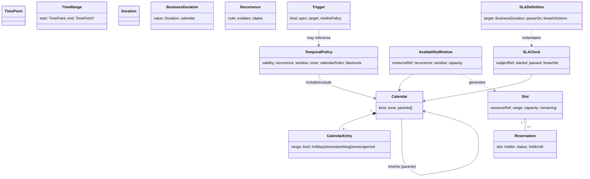
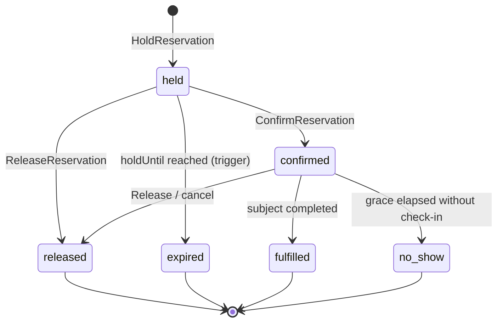

# U13 — Temporal Universe Constitution

| Field | Value |
|---|---|
| Universe ID | `U13-temporal` |
| Layer | L4 Foundation |
| Domain | 01 Foundation |
| Steward | `ucos:org:foundation-temporal` |
| Version | 0.1.0 (Draft) |
| Delivery phase | P0 |
| Depends on | U04 Meta, U08 Reference Data (`iana-tz`), U12 Geography (place → timezone, holiday jurisdictions), U03 Policy |
| Depended on by | Offer, Pricing, Subscription, Order, Fulfillment, Logistics, Ledger, Tax, Workforce, Support (SLA), AI, Security (expiry), Compliance (retention), Workflow (timers) |
| Master references | §9 (full rationale), §6.3 (ownership ruling), ADR-004 |

> Temporal is the **only** owner of time semantics in UCOS: instants, ranges, durations, recurrence, calendars (business, holiday, fiscal, settlement, trading), availability, slots, reservations, SLA clocks, triggers and reusable temporal policies. Every other universe stores **references** to temporal objects or embeds Temporal value types. None implements its own date arithmetic, recurrence or scheduling.

---

## 1. Constitution, Authority, Principles & Laws

### 1.1 Mandate
**Owns (object types):** `Calendar`, `CalendarEntry`, `TemporalPolicy`, `AvailabilityWindow`, `Slot`, `Reservation`, `SLADefinition`, `SLAClock`, `Trigger`, `Schedule`, `TimezoneRelease` (pinned tz data).
**Owns (value types):** `TimePoint`, `LocalDateTime`, `LocalDate`, `LocalTime`, `TimeRange`, `LocalTimeWindow`, `Duration`, `BusinessDuration`, `Recurrence`, `TemporalRef`.
**Does not own:** the meaning of the things being scheduled (owned by their universes), resource capacity semantics (U17 Resource), forecasts (U56 Learning / AI; stored as time series referencing Temporal ranges).

### 1.2 Laws

| ID | Law | Enforcement |
|---|---|---|
| TMP-L1 | No object outside U13 has `start/end/valid_from/valid_to/expiry/*_date` fields; use `TemporalRef` or Temporal value types. | META-LINT-001. |
| TMP-L2 | Instants are stored in UTC with the original IANA zone; wall-clock intents are stored as `LocalDateTime` + zone and resolved at evaluation time. | Value type schema. |
| TMP-L3 | All recurrence uses RFC 5545 RRULE semantics, evaluated by the Temporal engine only. | Packs have no RRULE library dependency (dependency linter). |
| TMP-L4 | All timers and scheduled executions go through the Trigger Engine; packs MUST NOT run their own cron or sleep loops. | Pack certification `ARCH-TMP-01` (static scan for scheduler libraries). |
| TMP-L5 | Business-time arithmetic (SLA, settlement T+N, working days) always names its calendar. | `BusinessDuration.calendar` is required. |
| TMP-L6 | Timezone database version is pinned per platform release; upgrades are governed changes. | `TimezoneRelease` registry; snapshot pin. |
| TMP-L7 | Every temporal evaluation is reproducible given `(inputs, asOf, tzRelease, calendarVersions)`. | Evaluation API is a pure function; results log those inputs. |

### 1.3 Authorities
| Action | Level | Holder |
|---|---|---|
| Upgrade tz release | 4 | Temporal steward + Architecture |
| Publish country holiday calendar | 3 | Temporal steward (per country delegate) |
| Publish fiscal calendar for an org | 3 | Tenant finance controller |
| Create tenant business-hours / holiday calendars | 2 | Tenant admin |
| Create TemporalPolicy, AvailabilityWindow | 2 | Tenant roles with `temporal:write` |
| Create Trigger | 2 | owning capability (system) or tenant automation role |

---

## 2. Ontology & Taxonomy

### 2.1 Concept map



### 2.2 Enumerations
- `CalendarKind`: `gregorian-base`, `holiday`, `business-hours`, `fiscal`, `settlement`, `trading-session`, `resource`, `academic`, `custom`.
- `CalendarEntryKind`: `holiday`, `closure`, `working-override`, `session`, `fiscal-period`, `blackout`, `event`.
- `FiscalPattern`: `calendar-month`, `4-4-5`, `4-5-4`, `5-4-4`, `13-period`, `custom`.
- `TriggerKind`: `at`, `recurrence`, `relative`, `inactivity`, `event`, `condition`, `geo-temporal`, `hybrid`, `deadline`.
- `MisfirePolicy`: `fire-once` (fire once late), `skip` (drop missed), `catch-up` (fire each missed occurrence, bounded by `maxCatchUp`).
- `ReservationStatus`: `held`, `confirmed`, `released`, `expired`, `cancelled`, `no-show`, `fulfilled`.
- `SLAClockState`: `running`, `paused`, `met`, `breached`, `cancelled`.
- `DayCountConvention` (finance): `ACT/365F`, `ACT/360`, `30/360`, `ACT/ACT-ISDA`.

### 2.3 Standards
RFC 3339 / ISO 8601 (instants, durations), RFC 5545 (recurrence, EXDATE/RDATE), IANA tz database, CLDR (week start, calendar display), ISO 8601 week dates, ISDA day-count conventions.

---

## 3. Value Types & Object Types

### 3.1 Value types (normative JSON forms)

| Value type | JSON form | Rules |
|---|---|---|
| `TimePoint` | `{"utc":"2026-10-02T09:15:22.481Z","tz":"Asia/Kolkata"}` | `utc` RFC 3339 with `Z`; `tz` optional IANA id (display & local reasoning) |
| `LocalDate` | `"2026-10-02"` | |
| `LocalTime` | `"10:00"` or `"10:00:30"` | |
| `LocalDateTime` | `{"local":"2026-10-03T10:00","tz":"Asia/Kolkata"}` | resolved per §5.4 DST rules |
| `TimeRange` | `{"start":TimePoint,"end":TimePoint|null}` | half-open `[start,end)`; `end=null` → open-ended; `end > start` |
| `LocalTimeWindow` | `{"start":"10:00","end":"22:00"}` | `end < start` ⇒ crosses midnight |
| `Duration` | `"PT2H"`, `"P3D"`, `"P1M"` | ISO 8601; calendar units (`P1M`) are nominal and resolved against a zone |
| `BusinessDuration` | `{"value":"P2D","calendar":"ucos:cal:in-business"}` | counts only working time of calendar |
| `Recurrence` | `{"rrule":"FREQ=WEEKLY;BYDAY=SA,SU","dtstart":LocalDateTime,"exdates":[...],"rdates":[...],"until":LocalDateTime?,"count":int?}` | RFC 5545 subset §5.2 |
| `TemporalRef` | `{"policy":"ucos:tmp:TMP-001"}` or `{"range":TimeRange}` or `{"point":TimePoint}` or `{"duration":Duration}` | union; consumers declare allowed kinds |

### 3.2 `ucos.temporal.Calendar`
| Attribute | Type | Card. | Constraints |
|---|---|---|---|
| `id` | UGID (`ucos:cal:…`) | 1 | natural ids allowed for global: `ucos:cal:holiday/IN/2026` |
| `scope` | `global|tenant` | 1 | |
| `kind` | CalendarKind | 1 | |
| `name` | LocalizedText | 1 | |
| `zone` | Enumeration(refdata:iana-tz) | 1 | |
| `jurisdiction` | Reference→geo.Jurisdiction | 0..1 | holiday calendars |
| `parents` | Array<Reference→Calendar> | 0..N | effective = union of parents' non-working + own overrides; max depth 5 |
| `workingHours` | Map<Weekday, Array<LocalTimeWindow>> | 0..1 | business-hours kind |
| `fiscal` | `{ pattern: FiscalPattern, yearStart: LocalDate rule, periods: [...]}` | 0..1 | fiscal kind |
| `entries` | Composition→CalendarEntry | 0..N | |
| `version` | Integer | 1 | incremented on entry change |
| `owner` | PartyRef | 1 | |

### 3.3 `ucos.temporal.CalendarEntry`
`{ id, calendar, kind: CalendarEntryKind, name: LocalizedText, range: TimeRange | dates: LocalDate[], recurrence?: Recurrence, workingWindows?: LocalTimeWindow[] (for working-override), tags: string[] (e.g. "festival", "national"), source: SourceRef }`

### 3.4 `ucos.temporal.TemporalPolicy`
| Attribute | Type | Card. | Notes |
|---|---|---|---|
| `id` | UGID (`ucos:tmp:`) | 1 | |
| `name` | LocalizedText | 1 | |
| `validity` | TimeRange | 1 | outer bounds |
| `zone` | iana-tz | 1 | evaluation zone (unless `zoneFrom` set) |
| `zoneFrom` | Enum `policy|context|subject` | 1 | default `policy`; `context` = viewer/buyer zone; `subject` = store/resource zone |
| `recurrence` | Recurrence | 0..1 | absent = continuous within validity |
| `windows` | Array<LocalTimeWindow> | 0..N | daily windows within recurring days; absent = whole day |
| `include` | Array<CalendarRef or Tag> | 0..N | e.g. `tag:festival` on holiday calendar → active only on festivals |
| `exclude` | Array<CalendarRef or Tag> | 0..N | |
| `blackouts` | Array<TimeRange> | 0..N | |
| `precedence` | Integer | 1 | for conflict resolution when composing |
| `usedBy` | derived count | — | from graph |

### 3.5 `ucos.temporal.AvailabilityWindow`
`{ id, resource: Reference→resource.Resource | org.Store | any 'schedulable' type, policy: TemporalPolicyRef, slotting: { length: Duration, step: Duration, buffer: { before: Duration, after: Duration }, leadTime: Duration (min notice), horizon: Duration (max advance) }, capacity: Integer (per slot), overbookPercent: Percentage, priority }`

### 3.6 `ucos.temporal.Slot`
Materialised for a rolling horizon. `{ id, resource, range: TimeRange, capacity, reserved, remaining (computed), source: AvailabilityWindowRef, status: open|closed|blocked, version }`. Unique `(tenant, resource, range.start)`.

### 3.7 `ucos.temporal.Reservation`
| Attribute | Type | Card. | Notes |
|---|---|---|---|
| `id` | UGID | 1 | |
| `slot` | Reference→Slot | 0..1 | absent for free-range reservations (e.g. rentals) |
| `resource` | Reference | 1 | |
| `range` | TimeRange | 1 | |
| `quantity` | Integer | 1 | default 1 |
| `holder` | PartyRef | 1 | |
| `purposeRef` | Reference (any) | 1 | e.g. `order`, `booking`, `appointment` in its own universe |
| `status` | ReservationStatus | 1 | |
| `holdUntil` | TimePoint | 0..1 | required when `held` |
| `idempotencyKey` | String | 1 | |

### 3.8 `ucos.temporal.SLADefinition` and `SLAClock`
```yaml
SLADefinition:
  id: ucos:sla:support-p1-response
  target: { value: PT4H, calendar: ucos:cal:tenant-support-hours }   # BusinessDuration
  start: { onEvent: support.case.created }
  pauseOn: { states: [awaiting-customer] }            # subject lifecycle states
  stopOn: { events: [support.case.first-responded] }
  warnings: [ { atElapsedPercent: "75", emit: temporal.sla.warning }, { atElapsedPercent: "90", emit: temporal.sla.warning } ]
  breach: { emit: temporal.sla.breached, actions: [ workflowSignal: escalate ] }
SLAClock:
  id, definition, subject: Reference, state: SLAClockState,
  startedAt: TimePoint, elapsedBusiness: Duration, pausedIntervals: [TimeRange],
  dueAt: TimePoint (computed), breachedAt?: TimePoint, version
```

### 3.9 `ucos.temporal.Trigger`
| Attribute | Type | Notes |
|---|---|---|
| `id` | UGID (`ucos:trg:`) | |
| `kind` | TriggerKind | |
| `spec` | Object | per kind, §3.10 |
| `target` | `{event: EventType}` or `{command: CommandRef, payload}` or `{workflowSignal: {workflowId, signal}}` | |
| `owner` | CapabilityRef or PartyRef | |
| `subject` | Reference | 0..1 — for relative/inactivity triggers |
| `misfirePolicy` | MisfirePolicy | default `fire-once` |
| `maxCatchUp` | Integer | default 10 |
| `idempotencyKeyTemplate` | String | default `{triggerId}:{scheduledFor}` |
| `status` | `active|paused|completed|cancelled` | |
| `nextFireAt` | TimePoint | computed |

### 3.10 Trigger spec per kind
```yaml
at:          { at: TimePoint | LocalDateTime }
recurrence:  { policy: TemporalPolicyRef } | { recurrence: Recurrence, window?: LocalTimeWindow, zone }
relative:    { anchorEvent: "payment.payment-intent.captured", subjectPath: "data.orderId", offset: "PT2H", calendar?: CalendarRef }
inactivity:  { resetOn: ["commerce.cart.line-added", ...], subjectPath, idle: "PT2H" }
event:       { on: "fulfillment.shipment.dispatched", filter: CEL }
condition:   { stream: "inventory.stock-level", where: "level < 10", for: "PT5M"?, reArmAfter: "PT1H" }
geo-temporal:{ geofence: GeoRef, enter|exit, window: TemporalPolicyRef }
hybrid:      { all|any: [TriggerSpec...] }
deadline:    { before: TemporalRef(point), offset: "-P3D" }   # e.g. 3 days before expiry
```

### 3.10a `ucos.temporal.Schedule`
A named, versioned group of triggers that share a lifecycle and owner. Examples: a seller payout schedule, a dunning schedule, a payroll calendar run.
`{ id, name, owner, subject?, triggers: Array<Reference→Trigger>, status: active|paused|completed, pauseCascade: true }`. Pausing a Schedule pauses all its triggers atomically.

### 3.11 Relationships
| Relationship | Source → Target | Card. | Materialised |
|---|---|---|---|
| `inheritsFrom` | Calendar → Calendar | N:N | yes |
| `governsTimeOf` | TemporalPolicy → any | 1:N | graph-only (reverse lookup "used by") |
| `generates` | AvailabilityWindow → Slot | 1:N | yes |
| `reserves` | Reservation → Slot | N:1 | yes |
| `measures` | SLAClock → subject | 1:1 | yes |

---

## 4. Commands, Queries, Events, APIs & Contracts

### 4.1 Commands
| Command | Key input | Preconditions | Effects | Events |
|---|---|---|---|---|
| `CreateCalendar` | Calendar | parents exist, no cycle | | `temporal.calendar.created` |
| `UpsertCalendarEntries` | calendarId, entries[] | | version+1; affected policies re-evaluated | `temporal.calendar.changed` (with changed ranges) |
| `CreateTemporalPolicy` / `UpdateTemporalPolicy` | policy | validation §7.1 | new version; impact computed | `temporal.policy.changed` |
| `DefineAvailability` | AvailabilityWindow | resource exists & schedulable | slot materialisation job | `temporal.availability.changed` |
| `HoldReservation` | resource, range/slot, qty, holder, hold duration, idempotencyKey | capacity available (atomic) | `held`; expiry trigger | `temporal.reservation.held` |
| `ConfirmReservation` | reservationId | `held` & not expired | `confirmed` | `temporal.reservation.confirmed` |
| `ReleaseReservation` | reservationId, reason | held/confirmed | capacity returned | `temporal.reservation.released` |
| `RescheduleReservation` | reservationId, newSlot | new capacity | atomic swap | `temporal.reservation.rescheduled` |
| `StartSLAClock` / `PauseSLAClock` / `ResumeSLAClock` / `StopSLAClock` | subject, definition | | | `temporal.sla.started|paused|resumed|met` |
| `CreateTrigger` / `PauseTrigger` / `CancelTrigger` | Trigger | owner authority | scheduled | `temporal.trigger.created|cancelled` |
| `UpgradeTimezoneRelease` | tzRelease | governance approval | re-resolve future LocalDateTimes; report shifts | `temporal.tz.upgraded` |

All commands require `Idempotency-Key`.

### 4.2 Queries (pure evaluation functions)
| Query | Signature | Notes |
|---|---|---|
| `EvaluatePolicy` | `(policy, at: TimePoint, ctx) → {active, activeWindow?, nextChange}` | |
| `ExpandPolicy` | `(policy, range, ctx) → TimeRange[]` | max 10k intervals |
| `IsWorkingTime` | `(calendar, at) → bool` | |
| `AddBusinessDuration` | `(start, BusinessDuration) → TimePoint` | §5.3 |
| `BusinessDurationBetween` | `(a, b, calendar) → Duration` | |
| `QueryAvailability` | `(resources[], range, duration, ctx) → Slot[]` | |
| `NextOccurrences` | `(recurrence | policy, from, n) → TimePoint[]` | |
| `FiscalPeriodOf` | `(fiscalCalendar, at) → {year, quarter, period: TimeRange, range: TimeRange}` | |
| `SettlementDate` | `(tradeDate, "T+N", settlementCalendar) → LocalDate` | |
| `Timeline` | `(subject) → [{at: TimePoint, kind: past|scheduled, event}]` | merges events + triggers + SLA |

### 4.3 Events
| Event | Emitted when | Payload (summary) |
|---|---|---|
| `temporal.trigger.fired` | trigger fires | triggerId, scheduledFor, firedAt, subject, target |
| `temporal.trigger.misfired` | fired late beyond tolerance | lateness |
| `temporal.policy.changed` | new version | policyId, version, impactCount |
| `temporal.policy.activated` / `.deactivated` | policy boundary crossing (only for policies with `emitBoundaries: true`) | policyId, window |
| `temporal.calendar.changed` | entries changed | calendarId, ranges |
| `temporal.reservation.held/confirmed/released/expired/rescheduled` | | reservationId, resource, range, holder (PII ref) |
| `temporal.sla.started/paused/resumed/warning/breached/met` | | clockId, subject, dueAt, elapsed |
| `temporal.tz.upgraded` | | release, affectedCount |

### 4.4 REST
```text
POST /v1/temporal/calendars                         GET /v1/temporal/calendars/{id}?asOf=
POST /v1/temporal/calendars/{id}/entries:upsert
POST /v1/temporal/policies                          GET /v1/temporal/policies/{id}
POST /v1/temporal/policies/{id}:evaluate            POST /v1/temporal/policies/{id}:expand
POST /v1/temporal/availability                      POST /v1/temporal/availability:query
POST /v1/temporal/reservations                      POST /v1/temporal/reservations/{id}:confirm|:release|:reschedule
POST /v1/temporal/sla-clocks                        POST /v1/temporal/sla-clocks/{id}:pause|:resume|:stop
POST /v1/temporal/triggers                          POST /v1/temporal/triggers/{id}:pause|:cancel
POST /v1/temporal/calc:add-business-duration        POST /v1/temporal/calc:settlement-date
GET  /v1/temporal/timeline/{subjectId}
```

### 4.5 Contracts offered
- **Temporal SDK** (in every pack SDK): value types, local pure evaluation for `EvaluatePolicy`, `IsWorkingTime` and `AddBusinessDuration` using cached calendars. This is identical code to the service, so results match.
- **Trigger Engine port:** `schedule(Trigger) → id`, idempotent by `(owner, idempotencyKey)`.
- **Reservation port:** used by Booking, Fulfillment (delivery slots) and Workforce (shifts).

### 4.6 Errors
`TMP_INVALID_RANGE`, `TMP_INVALID_RRULE`, `TMP_UNSUPPORTED_RRULE_PART`, `TMP_CALENDAR_CYCLE`, `TMP_CAPACITY_EXHAUSTED` (409), `TMP_HOLD_EXPIRED` (410), `TMP_OUTSIDE_HORIZON`, `TMP_LEAD_TIME_VIOLATION`, `TMP_EXPANSION_TOO_LARGE`, `TMP_NONEXISTENT_LOCAL_TIME` (warning), `TMP_AMBIGUOUS_LOCAL_TIME` (warning).

---

## 5. State Machines & Algorithms

### 5.1 Reservation lifecycle


### 5.2 Supported RRULE subset
`FREQ` (SECONDLY excluded; MINUTELY needs `INTERVAL ≥ 5`), `INTERVAL`, `COUNT`, `UNTIL`, `BYDAY` (with ordinals, e.g. `-1FR`), `BYMONTHDAY`, `BYMONTH`, `BYYEARDAY`, `BYWEEKNO`, `BYHOUR`, `BYMINUTE`, `BYSETPOS`, `WKST`, and `EXDATE`/`RDATE`. Expansion is capped at 10,000 occurrences per call. UCOS extension: `X-UCOS-CALENDAR=<calId>;X-UCOS-SHIFT=next-working|prev-working|skip` moves occurrences that land on non-working days.

### 5.3 Business-duration addition (normative)
```text
addBusiness(start, d, cal):
  t ← start; remaining ← d
  if d is day-based (P{n}D): 
      count n working days: step day by day in cal.zone, skipping non-working days;
      result = same local time on the n-th working day (or end of working window if beyond)
  else (time-based):
      while remaining > 0:
          w ← nextWorkingWindow(cal, t)        # [ws, we) in zone, respecting entries & parents
          if t < w.start: t ← w.start
          avail ← w.end - t
          if remaining ≤ avail: return t + remaining
          remaining ← remaining - avail; t ← w.end
  guard: if no working window within 3 years → error TMP_NO_WORKING_TIME
```

### 5.4 Local time resolution (DST)
- **Nonexistent local time** (spring forward gap): shift forward by the gap length (`02:30` → `03:30`) and flag `TMP_NONEXISTENT_LOCAL_TIME`.
- **Ambiguous local time** (fall back): use the earlier offset unless `LocalDateTime.fold = 1`.
- **Recurrence across DST:** keep wall-clock time stable (10:00 local stays 10:00 local). The UTC instant changes.

### 5.5 TemporalPolicy evaluation (normative)
```text
active(policy, at, ctx):
  z ← zoneFor(policy, ctx)
  if at ∉ policy.validity: return false
  if any blackout contains at: return false
  L ← toLocal(at, z)
  if policy.recurrence and not occursOnDay(policy.recurrence, L.date, z): return false
  if policy.include non-empty and not matchesAny(policy.include, L.date): return false
  if matchesAny(policy.exclude, L.date): return false
  if policy.windows non-empty and not anyWindowContains(policy.windows, L.time): return false
  return true
nextChange = earliest boundary > at among: validity end, window edges, day transitions (expanded ≤ 400 days)
```

### 5.6 Reservation atomicity
Reservations decrement `Slot.remaining` in the same transaction with `UPDATE slot SET reserved = reserved + q, version = version+1 WHERE id=$1 AND capacity*(1+overbook) - reserved >= q AND version=$v`. Zero rows means `TMP_CAPACITY_EXHAUSTED`. Hot slots, such as flash-sale delivery windows, use a sharded counter (N sub-slots) to reduce contention.

### 5.7 Trigger Engine architecture
- **Durable timers:** the workflow engine's timer service. Recurrence triggers materialise the next occurrence only, then re-arm after firing.
- **Condition triggers:** Flink jobs subscribed to declared streams. They fire on a rising edge and re-arm after `reArmAfter`.
- **Sharding:** by `hash(triggerId)` across scheduler shards in each cell.
- **Delivery:** at-least-once. Consumers deduplicate on `idempotencyKey`.
- **Precision target:** fire within 1 s of `scheduledFor` (p99), or within 30 s under declared degraded mode.

### 5.8 Decision tables exposed
- `temporal.reservation.hold-duration` — inputs: purpose type, channel → output: hold `Duration` (default `PT10M`).
- `temporal.no-show-grace` — inputs: resource type → `Duration` (default `PT15M`).
- `temporal.misfire-tolerance` — inputs: trigger kind → `Duration` (default `PT1M`).

---

## 6. Policies, Security, Audit & Compliance

```cedar
permit (principal, action in [Action::"temporal:EvaluatePolicy", Action::"temporal:QueryAvailability"], resource)
when { resource.tenant == principal.tenant || resource.scope == "global" };

permit (principal in Role::"tenant-admin", action in [Action::"temporal:CreateCalendar", Action::"temporal:UpsertCalendarEntries"], resource is Temporal::Calendar)
when { resource.tenant == principal.tenant && resource.kind != "fiscal" };

permit (principal in Role::"finance-controller", action == Action::"temporal:UpsertCalendarEntries", resource is Temporal::Calendar)
when { resource.kind == "fiscal" && resource.tenant == principal.tenant };

// Customers can hold/release their own reservations only
permit (principal in Role::"customer", action in [Action::"temporal:HoldReservation", Action::"temporal:ReleaseReservation"], resource is Temporal::Reservation)
when { resource.holder == principal.party };
```

- **Classification:** calendars and policies are `internal`. Reservations are `confidential` because they contain a holder party ref, and their location and time can be sensitive (e.g. clinic appointments inherit `PHI` from `purposeRef`).
- **Audit:** every change to calendars, policies, reservations, SLA clocks and triggers. Policy evaluations are not audited individually; a sampled 1% is kept for reproducibility checks.
- **Compliance:** provides the timing substrate for controls with deadlines, such as DSR response windows, incident-notification clocks (GDPR 72 h, CERT-In 6 h) and retention. Fiscal calendars support SOX period-close controls.

---

## 7. Validation, Certification, Versioning, Reuse

### 7.1 Validation
- `TimeRange.end > start`; `validity` must not exceed 20 years unless `perpetual: true` (and then `end=null`).
- RRULE must parse, stay within the subset, and expand to at least one occurrence within validity. Otherwise a warning is raised: "policy never active".
- Calendar parent graph must be acyclic with depth ≤ 5.
- A TemporalPolicy whose include and exclude sets cancel out completely produces a validation error.
- AvailabilityWindow: `slotting.length ≥ PT5M` and `horizon ≤ P400D`.

### 7.2 Certification (`ARCH-TMP-*`)
| Gate | Check |
|---|---|
| ARCH-TMP-01 | Packs contain no scheduler, cron or RRULE libraries, and no raw date-pair fields |
| ARCH-TMP-02 | Golden test suite passes: DST transitions in 12 zones, leap years, 4-4-5 fiscal, T+N across holidays, midnight-crossing windows |
| ARCH-TMP-03 | SDK and service evaluation parity: 1M randomized cases with identical results |

### 7.3 Versioning
Calendars and policies are versioned. Every evaluation records `{policyVersion, calendarVersions, tzRelease}`. Updating a policy never rewrites the history of what was active. Past evaluations can be reproduced with `asOf`.

### 7.4 / 7.5 Reuse rules
| Consumer need | MUST use |
|---|---|
| "Valid from/to" on any object | `temporalPolicy: TemporalPolicyRef` or `validity: TimeRange` (value type) |
| Delivery slots, appointments, rentals, room or vehicle booking | `AvailabilityWindow` + `Reservation` |
| Expiry (coupon, token, certificate, session) | `TimePoint` field + `deadline` Trigger |
| Renewal / billing cycle | `Recurrence` on the subscription + recurrence Trigger |
| Response or resolution SLA | `SLADefinition` + `SLAClock` |
| Working days / T+N | `AddBusinessDuration`, `SettlementDate` |
| Fiscal reporting periods | `FiscalPeriodOf` |

---

## 8. Gap Detection, Self-Healing & Evolution

```prolog
gap(missing_holiday_calendar, J, Y) :- in_scope(J), year_in_horizon(Y), not published_calendar(holiday, J, Y).
gap(missing_business_calendar, T)   :- tenant(T), uses_capability(T, C), needs_business_time(C), not tenant_calendar(T, business-hours).
gap(policy_never_active, P)         :- temporal_policy(P), referenced(P), expansion_empty(P).
gap(sla_without_breach_action, S)   :- sla_definition(S), not breach_action(S, _).
gap(stale_tz_release, R)            :- current_tz_release(R), release_age_days(R, D), D > 90.
```

**Self-healing:**
- Missed triggers after an outage are handled by each trigger's misfire policy. A summary event reports how many were caught up.
- Slot counters that drift (reserved ≠ count of active reservations) are reconciled nightly, and the correction is audited.
- Calendar cache divergence is fixed by a hash check and reload.

**Evolution:** lunar and other non-Gregorian calendars (Hijri, Hebrew, Indian national) are implemented as conversion functions over the Gregorian base, plus calendar entries. Display uses CLDR. Arithmetic stays on Gregorian instants.

---

## 9. AI & Agent Governance
- **AI uses:** natural language to TemporalPolicy (W10), holiday calendar extraction from official gazettes (proposals only, with steward review), forecasting inputs (demand by slot), and schedule optimisation. Optimisation proposes AvailabilityWindows and never changes reservations.
- **Agent tools:** `temporal.query_availability`, `temporal.hold_reservation` (needs the holder's delegation, and the obligation is confirmation by the human), `temporal.evaluate_policy`, `temporal.next_occurrences`.
- **Prohibited for agents:** publishing holiday or fiscal calendars, tz upgrades, cancelling confirmed reservations without the holder's confirmation.

## 10. Twin, Analytics, Operations
- **Signals:** `trigger_fire_lag_seconds` (histogram), `triggers_active`, `misfires_total`, `reservation_hold_conversion_ratio`, `slot_utilisation_ratio{resourceType}`, `sla_breach_ratio{definition}`, `policy_eval_latency_ms`, `capacity_conflicts_total`.
- **SLOs:**

  | SLO | Target |
  |---|---|
  | Trigger fire lag | p99 < 1 s |
  | Reservation hold latency | p99 < 80 ms |
  | Availability query (≤ 50 resources, 7-day range) | p95 < 150 ms |
  | Evaluation (SDK, local) | p99 < 50 µs |
- **Twin:** temporal twin questions per master §9.6, answered from Timeline, scheduled triggers and simulation runs.
- **Runbooks:** trigger backlog, slot hot-spot contention, tz upgrade rollback, holiday calendar correction after publication (re-evaluates affected SLAs and payouts).

## 11. UI, UX, Accessibility, Localisation
- **Views:** `temporal.policy.editor` (W10), `temporal.calendar.month|week|day|agenda|resource-grid`, `temporal.availability.editor`, `temporal.slot-picker` (storefront delivery and appointment picker), `temporal.sla.badge`, `temporal.timeline`.
- **UX rules:**
  - Always show times in the viewer's zone, with the subject's zone on hover when they differ.
  - Recurrences are shown in plain language ("Every Sat and Sun, 10:00–22:00, except national holidays").
  - The policy editor shows an "Impact" count and next activations.
- **Accessibility:** the slot picker is keyboard-navigable as a grid (`role="grid"`), and each slot is announced with its date, time and remaining capacity.
- **Localisation:** CLDR week start, 12/24-hour time and calendar display (including Hijri display where configured). RTL calendar mirroring.

## 12. Scale, Performance, DR
- **Volumetrics (per cell):** about 5M active triggers; about 50M slots in the rolling horizon; about 200k reservation holds per minute at peak (flash-sale delivery slots); 10k calendars.
- **Storage:** Postgres for calendars, policies, slots and reservations, with slots partitioned by `(tenant, month)`. Timers are in the workflow engine. Condition triggers run in Flink state.
- **HA/DR:** Trigger Engine and Reservations are T0. Policies and calendars are T1, served from the SDK cache. After DR failover, triggers resume with their misfire policies.
- **Replication:** global holiday calendars and tz releases go from the control plane to every cell.

## Appendix
- **A. Open questions:** whether reservation counters use Redis or Postgres for extreme peaks (recommendation: Postgres with sharded sub-slots first, then measure).
- **B. Amendments:**
  - add `LocalDate`, `LocalTime`, `LocalTimeWindow` and `BusinessDuration` to master §9.1;
  - add `SLADefinition` and `Schedule` to the U13 "owns" list in master §6.2.
- **C. Change log:** 0.1.0 initial draft.

## Appendix D — Frame extensibility (amendment A-24, from U77)
- `TimePoint` gains optional `scale` (default `UTC`; others `TAI`, `TT`, `TDB`, `MTC`, `LTC`, `world-clock:<world>`, `simulation-clock:<run>`). Storage stays a normalised instant on TAI plus the original scale. Display converts through `FrameConversion` packs.
- `Calendar` gains `calendarSystem` (default `gregorian`). "Day", "week", "month" and "year" are defined by the CalendarSystem (e.g. a Mars `sol` of 88,775.244 s). `Duration` nominal units (`P1D`, `P1M`) resolve against the calendar system of the evaluating frame. Exact units (`PT…S`) are frame-independent.
- RRULE evaluation is delegated to the CalendarSystem's recurrence adapter. The Gregorian/ISO adapter is built in; other systems (Hijri, Hebrew, Vikram Samvat, Darian…) are packs. The RFC 5545 subset in §5.2 stays the canonical syntax, with `X-UCOS-CALSYS=<id>`.
- **Light-time and latency facts:** a `Duration` fact between Bodies (e.g. Earth↔Mars 3–22 min one way) can be referenced by SLA definitions (`pauseOn: in-transit-light-time`) and Trigger tolerances.
- Virtual-world and simulation clocks may run faster, slower or paused. Triggers in those realities fire on the reality's clock, and never cause physical side effects (FRM-L4).
- Gate `ARCH-TMP-04`: the golden suite also runs under a synthetic calendar system (e.g. a 25-hour day and a 10-day week) to prove there are no Earth assumptions.

## Appendix E — Calendar & scheduling completeness (amendment A-45)

### E.1 New objects
| Object | Purpose | Key fields |
|---|---|---|
| `CalendarFeed` | Publish any calendar or subject timeline as iCalendar (RFC 5545) for subscription | `{ id, source: Calendar or query (e.g. "my appointments", "store holidays", "offer calendar"), audience, tokenised URL (revocable), privacy: busy-only or details }` |
| `ExternalCalendarLink` | Two-way sync with personal and enterprise calendars | `{ party or resource, provider: google, microsoft-graph, caldav, icloud (connector U62), direction: import-busy, export-events or bidirectional, scope, lastSync: TimePoint, conflictPolicy }` |
| `Invitation` | Send and track calendar invites (ICS over email, provider-native) | `{ event or reservation, attendees (PartyRefs, external emails), rsvp status, method: REQUEST, CANCEL or UPDATE }` |
| `Waitlist` | Ordered queue for full capacity (slots, sessions, rentals, restock appointments) | `{ target: Slot, Session, Resource or AvailabilityWindow, entries: [{party, requested range, priority, joinedAt: TimePoint, expiresAt: TimePoint}], promotionPolicy: auto-hold, notify or manual }` |
| `QueueToken` | Walk-in and virtual queues (store, clinic, service counter, events) | `{ queue, number, party?, issuedAt: TimePoint, estimatedWait: Duration, status: waiting, called, serving, done or no-show }` |
| `Reminder` | A relative Trigger and a Communication template | `{ subject, offsets: [Duration] (e.g. -P1D, -PT1H), channelPreference, template }` |
| `TimeOff` | Resource or person unavailability (leave, maintenance, holiday override) | Stored as a `CalendarEntry kind=closure` on the resource calendar, with approval through U46 or U60 |

### E.2 New queries and commands
- `FindCommonAvailability(participants: [party or resource], duration, range, constraints: {workingHoursOf, buffers, timezone fairness, required vs optional attendees})` returns ranked candidate slots. It respects each party's calendars, external busy times and TimeOff.
- `JoinWaitlist`, `PromoteFromWaitlist` (auto-hold with expiry), `IssueQueueToken`, `CallNext`, `EstimateWait`.
- `PublishFeed`, `RevokeFeed`, `LinkExternalCalendar`, `SyncNow`, `SendInvitation`.
- Events: `temporal.waitlist.promoted`, `temporal.queue.called`, `temporal.sync.conflict`, `temporal.invitation.responded`.

### E.3 Canonical field naming (normative; applies to all specs, existing and future)
Shorthand field names used anywhere in UCOS specs carry these types. The linter (META-LINT-001 plus TMP-LINT-002) enforces them in machine-readable definitions.

| Field name pattern | Canonical type |
|---|---|
| `*At` (createdAt, placedAt, issuedAt, startedAt, completedAt, receivedAt, readyAt, launchedAt, discontinuedAt, manufacturedAt, observedAt, lastRotated, lastTestAt, reviewedAt) | `TimePoint` |
| `expires`, `expiresAt`, `expiry`, `holdUntil`, `dueAt`, `dueBy`, `deadline`, `breachAt`, `nextReview`, `sunset`, `validUntil`, `effectiveFrom`, `lastmod`, `lastSync`, `lastSeen`, `lastRotated`, `at` | `TimePoint`, plus an implicit deadline Trigger when the owner declares an action |
| `validity`, `validFrom/validTo` (pair), `period`, `range`, `term`, `coverage period` | `TimeRange` (pairs are collapsed into one `TimeRange`) |
| `window`, `openingHours`, `availabilityPolicy`, `onSale/offSale`, `quietHours`, `changeWindow`, `freeze` | `TemporalPolicyRef` (or `LocalTimeWindow` for a daily window inside a policy) |
| `ttl`, `timeout`, `leadTime`, `processingTime`, `hold`, `grace`, `retention duration`, `interval`, `offset` | `Duration` or `BusinessDuration` (business time always names its calendar) |
| `schedule`, `cadence`, `frequency` (as recurrence), `refresh`, `renewal cycle`, `billing cycle` | `Recurrence` or `ScheduleRef` (backed by Triggers) |
| `sla`, `slaClock`, `turnaround target` | `SLADefinitionRef` / `SLAClockRef` |
| `retention` (as a rule) | `RetentionRuleRef` (U66), which uses `Duration` and an anchor event |

**Reserved names:** names ending in `At`, and the names listed above, MUST NOT be used for non-time fields. Examples of renames made under this rule: `compareAt` became `compareAtPrice` (U23), the unit-conversion `offset` became `additiveOffset` (U14), and the SLA warning `at` became `atElapsedPercent` (U13).

### E.4 Dependency kinds
- **Value-type use** (`TimePoint`, `TimeRange`, `Duration` and so on from the kernel SDK) is allowed for **every** universe, including those layered below Temporal (U04, U05, U06, U08, U12, U77). It creates no service dependency and no cycle.
- **Service use** (calendars, policies, triggers, reservations, SLA clocks, feeds, waitlists) requires `U13 Temporal` in the universe's *Depends on* list.
- Gate `ARCH-TMP-05` fails a universe that uses Temporal services without declaring the dependency, or that declares a schedule, expiry, SLA or reminder implemented by anything other than U13 services.
- **T. Attribute definitions (A-74).** `TimezoneRelease { id, version: string (IANA tzdata, e.g. 2026c), sourceDigest: string, effectiveFrom: TimePoint, pinnedBy: UGID (governance proposal), affectedZones: [string], shiftReport?: UGID, status: proposed|pinned|superseded }`
