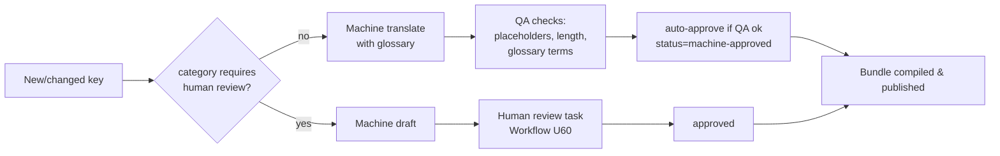

# U15 — Language & Localization Universe Constitution

| Field | Value |
|---|---|
| Universe ID | `U15-l10n` |
| Layer | L4 Foundation |
| Domain | 01 Foundation |
| Steward | `ucos:org:foundation-l10n` |
| Version | 0.1.0 (Draft) |
| Delivery phase | P0 |
| Depends on | U04 Meta, U08 Reference Data (`iso639`, `iso15924`, `bcp47-region`), U12 Geography (official languages), U13/U14 (format delegation) |
| Depended on by | every universe with user-facing text; U64 UI; U40 Communication; U42 Document; U18 Product (localised content) |
| Master references | §23.4, §7.4 (`LocalizedText`), L2 (no hard-coded language) |

> Localization owns **how anything is said and shown in a given language and region**: locales, message bundles and keys, translations and their workflow, `LocalizedText`, pluralisation and gender rules (ICU), and format profiles (numbers, dates, names, addresses, layout direction). It does not own the content itself (product descriptions belong to Product, templates to Communication). It owns the *mechanism* for their translated variants.

---

## 1. Laws

| ID | Law | Enforcement |
|---|---|---|
| L10N-L1 | No user-facing string literal in code, views, templates or documents. Text comes from message keys or `LocalizedText`. | Linter (`i18n/no-literal`) across `packs/`, `experience/`, `spec/ui`; pseudo-locale CI run. |
| L10N-L2 | Messages use ICU MessageFormat; string concatenation for sentences is forbidden. | Linter. |
| L10N-L3 | Every locale enabled for a tenant has 100% coverage of keys in the tenant's active views, or a declared fallback chain plus an open `UI` gap. | Gap rule §8. |
| L10N-L4 | Regulated or legal text (terms, consent notices, invoices, safety warnings) requires human-reviewed translation. | Translation workflow: `requiresHumanReview` flag driven by key category. |
| L10N-L5 | Formatting of numbers, money, dates, names and addresses always goes through format profiles (CLDR). | SDK formatters only. |

**Authorities:** platform message bundles are level 3 (L10n steward). Tenant overrides and tenant content translations are level 2 (tenant content managers). Legal-text translations need level 3 approval by a tenant legal approver.

---

## 2. Ontology
- **Concepts:** `Locale` (BCP 47: language-script-region-extensions, e.g. `ar-AE`, `hi-Latn-IN`, `en-IN-u-nu-latn`), `MessageKey` (namespaced id), `MessageBundle` (keys per namespace, version), `Translation` (key × locale × value × status), `LocalizedText` (inline multi-locale value on objects), `FallbackChain`, `FormatProfile`, `Glossary` (term base), `TranslationJob`.
- **Key categories:** `ui`, `notification`, `legal`, `marketing`, `error`, `document`, `product-content`, `system`.
- **Translation status:** `missing`, `machine`, `in-review`, `approved`, `stale` (source changed after approval).

---

## 3. Objects & Value Types

### 3.1 `LocalizedText` (value type)
```json
{ "default": "en", "values": { "en": "Add to cart", "hi": "कार्ट में डालें", "ar": "أضف إلى السلة" },
  "status": { "hi": "approved", "ar": "machine" } }
```
Resolution uses the requested locale, then the FallbackChain, then `default`. A value served with `status: machine` in a legal category is never displayed. A `L10N_UNREVIEWED_LEGAL` error is raised instead.

### 3.2 `ucos.l10n.Locale`
`{ tag (BCP 47), language: iso639, script?: iso15924, region?: iso3166, direction: ltr|rtl, numberingSystem, calendarDisplay: gregorian|islamic-umalqura|indian|..., pluralRules (CLDR), enabledScope: global|tenant }`

### 3.3 `MessageKey` / `MessageBundle` / `Translation`
```yaml
MessageKey:
  id: commerce.cart.add-button
  namespace: commerce.cart
  category: ui
  source: "Add to cart"                  # in source locale (en)
  description: "Primary CTA on product card and PDP"   # context for translators
  placeholders: { count: number, name: string }
  maxLength: { default: 24, mobile: 18 }
  requiresHumanReview: false              # true for legal/regulated categories
  screenshots: [AssetRef]
MessageBundle: { id: commerce.cart, version: 2.3.0, keys: [MessageKeyRef], providedBy: commerce.cart }
Translation:   { key, locale, value (ICU), status, translatedBy: party|mt-engine, reviewedBy?, sourceHash, tenantOverride?: TenantRef }
```

### 3.4 `FormatProfile`
`{ locale, number: {grouping (e.g. Indian 3;2), decimal, percent}, currency: {pattern, accounting}, date: {short, medium, long}, time: {12h|24h}, firstDayOfWeek, personName: {order: given-family|family-given, honorifics}, addressFormatRef: geo.AddressFormat, measurementSystem: metric|us|uk }` — seeded from CLDR, overridable per tenant.

### 3.5 `Glossary`
`{ tenant|global, terms: [{ term: TimeRange, locale, translation, doNotTranslate: bool, notes }] }` — brand names, product lines, regulated terms.

---

## 4. Commands, Queries, Events, APIs

| Command | Effect / Events |
|---|---|
| `RegisterBundle` (on pack publish) | new or changed keys → existing translations of changed source become `stale` → `l10n.bundle.registered` |
| `RequestTranslation(keys|content refs, locales, mode: machine|human|machine+review)` | creates a `TranslationJob` → `l10n.job.created` |
| `SubmitTranslation`, `ApproveTranslation`, `RejectTranslation` | `l10n.translation.approved` |
| `SetTenantOverride(key, locale, value)` | tenant brand voice |
| `EnableLocale(tenant, locale)` | coverage computed → gap if < 100% |

**Queries:** `Resolve(key, locale, params)`, `GetBundle(namespace, locale, version)` (compiled for renderers, CDN-cacheable), `Coverage(tenant, locale, scope)`, `Format(value, type, locale)`.
**Events:** `l10n.bundle.registered`, `l10n.translation.stale`, `l10n.translation.approved`, `l10n.locale.enabled`, `l10n.coverage.changed`.

```text
GET  /v1/l10n/locales                      GET /v1/l10n/bundles/{ns}/{locale}?v=   (immutable, cache 1y by hash)
POST /v1/l10n/jobs                         POST /v1/l10n/translations/{id}:approve
GET  /v1/l10n/coverage?tenant=&locale=     POST /v1/l10n/format
```
**Ports:** `MachineTranslationPort` (adapters: AI gateway with LLM translation and glossary constraints, DeepL, Google Translate), `TMSPort` (export to and import from external translation management systems via XLIFF 2.1).
**Errors:** `L10N_MISSING_KEY`, `L10N_UNREVIEWED_LEGAL`, `L10N_PLACEHOLDER_MISMATCH`, `L10N_MAXLENGTH_EXCEEDED` (warning), `L10N_LOCALE_NOT_ENABLED`.

---

## 5. Rules & Workflow

### 5.1 Fallback (normative)
`ar-AE → ar → default(en)` and `hi-Latn-IN → hi-IN → hi → en`. A tenant may define an explicit chain (e.g. `en-AE → en-GB → en`). The resolver never falls back across scripts for legal keys.

### 5.2 Translation workflow

Mandatory QA checks: placeholder parity, ICU syntax validity, max length, glossary compliance, no untranslated `doNotTranslate` violations, and bidi-safe isolation for RTL with embedded LTR content.

---

## 6. Security & Compliance
Bundles are `public` once published. Tenant overrides are `internal` until published. Legal-category approvals are audited with the approver identity. Supports accessibility law (EN 301 549 language-of-page), consumer-protection language requirements per jurisdiction (decision `l10n.mandatory-languages` — e.g. Arabic required for UAE consumer contracts, Hindi or regional languages under some Indian rules), and DPDP notice languages.

## 7. Validation & Reuse
- Every view and template references keys.
- Every object field holding human text is typed `LocalizedText` when it is user-facing.
- Packs ship `i18n/` bundles in the source locale. Translations live in the registry, not in the pack, which keeps packs immutable.
- Certification `A11Y-L10N-01`: pseudo-locale run with no clipped text; RTL snapshot review for top journeys.

## 8. Gaps & Evolution
```prolog
gap(locale_coverage, T, L, N) :- tenant_locale(T, L), missing_keys(T, L, N), N > 0.
gap(legal_unreviewed, T, K, L) :- tenant_locale(T, L), active_key(T, K), category(K, legal), not approved(K, L).
gap(mandatory_language, T, J, L) :- in_scope(T, J), mandatory_language(J, L), not tenant_locale(T, L).
```
- **Self-healing:** if a bundle CDN miss or corrupt hash is detected, renderers fetch the previous version.
- **Evolution:** voice locales (TTS voices, pronunciation lexicons) and sign-language video variants are added as new `LocalizedText` media variants.

## 9. AI
- **AI uses:** LLM translation constrained by glossary and context screenshots (via the AI gateway); tone adaptation per brand voice; translation QA scoring.
- **Agent tools:** `l10n.propose_translation`.
- **Prohibited for agents:** approving `legal` category translations.

## 10. Operations
- **Signals:** `l10n_missing_key_renders_total{locale}` (must be 0 in prod), `coverage_ratio{tenant,locale}`, `translation_turnaround_hours`, `bundle_bytes{ns,locale}`.
- **SLOs:** bundle fetch p95 < 50 ms from the CDN; a published translation visible within 5 min.

## 11. UI
- **Views:** `l10n.coverage.dashboard`, `l10n.translation.editor` (side-by-side with screenshot context, placeholder chips, length meter), `l10n.glossary.editor`, `l10n.locale.switcher` (end-user component).
- **UX:** the locale switcher shows each language in its own name ("हिन्दी", "العربية"). Locale is never inferred from IP alone; the order is user preference, then account, then Accept-Language, then tenant default.

## 12. Scale
About 200k platform keys, up to 100 locales, and millions of tenant content translations. Compiled bundles are served from the CDN, split per namespace for lazy loading. Tier: T1 (bundles are cached and immutable).

## Appendix
- **C.** 0.1.0.

## Appendix D — Frame extensibility (amendment A-26, from U77)
- `Locale` belongs to a U77 `LanguageSystem`. Unregistered languages (constructed, community, in-world, or newly documented) use BCP 47 private-use tags (`x-…`), registered in the Locale registry with script, direction, plural rules and fallback chain, all as data.
- Sign languages (`sgn-*`) are supported for media variants (video renditions) and accessibility.
- Machine/protocol languages (for agent-to-agent interfaces) are a `LanguageSystem` of kind `machine-protocol`, used by Communication's agent channel.
- Calendar and number display are driven by the frame's CalendarSystem and locale numbering system. Formats for new systems are packs.
