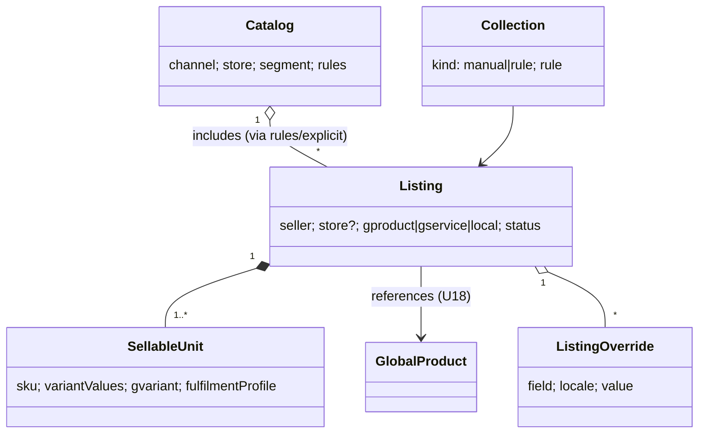
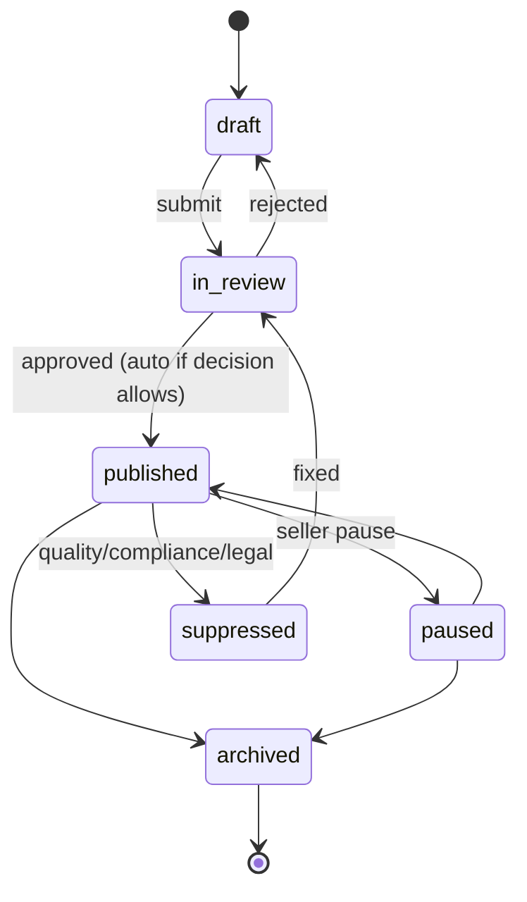

# U21 — Catalog Universe Constitution

| Field | Value |
|---|---|
| Universe ID | `U21-catalog` |
| Layer | L5 Business Capability |
| Domain | 04 Commerce |
| Steward | `ucos:org:commerce-catalog` |
| Version | 0.1.0 (Draft) |
| Delivery phase | P1 |
| Depends on | U18 Product Intelligence (GPID), U19 Service Intelligence (GSID), U06 Taxonomy, U10 Org (seller/store), U43 Asset, U15 Localization, U13 Temporal, U67 Compliance (restricted categories) |
| Depended on by | U22 Offer, U23 Pricing, U24 Cart, U26 Order, U34 Inventory, U44 Search, U52 Recommendation, U25 Marketplace |
| Master references | §6.3 (Catalog vs Product), §10.1 (master vs listing), ADR-008 |

> Catalog owns **what a tenant offers for sale and how it is organised**: `Listing` (a tenant or seller's sellable representation of a global product or service, or a tenant-only item), `SellableUnit` (the purchasable variant/SKU), `Catalog` (a named assortment for a channel, store or segment), `Collection` (curated or rule-based groups) and `Assortment` rules. It does **not** own global product facts (U18), prices (U23), stock (U34) or discounts (U22).

---

## 1. Laws

| ID | Law | Enforcement |
|---|---|---|
| CAT-L1 | A Listing references a GPID/GSID when a matching global item exists. Tenant-only items (custom, handmade, services unique to the tenant) are allowed but flagged `local` and remain matchable later. | Match step on create (U18 `Match`); quality gate. |
| CAT-L2 | Listings never store price, stock, tax rate or discount. | META lint (no `Money` fields except `compareAtReference` display hint is forbidden too — use Pricing). |
| CAT-L3 | Global facts are inherited by reference; tenants may only **override presentation** (title, description, media order) and add tenant attributes. Overrides never alter the global record. | Field-level `overridable` flags from U18 attribute registry. |
| CAT-L4 | Listings in restricted categories cannot be published unless the seller/store holds the required licence and policies (age gate, prohibited jurisdictions) are attached. | Publish guard + taxonomy node `policies` (U06). |
| CAT-L5 | A SellableUnit is uniquely identified within tenant by `sku`, and each SellableUnit maps to exactly one global variant (or `local`). | Unique constraint. |

---

## 2. Ontology



- **Listing types:** `product`, `service`, `digital`, `bundle` (composition of SellableUnits; pricing per U23), `gift-card`, `subscription-plan` (reference to U27 plan, P2), `rental`, `experience` (time-slotted via U13).
- **Listing status:** `draft`, `in-review`, `published`, `suppressed` (quality/compliance), `paused` (seller), `archived`.
- **Condition:** taxonomy `ucos.item-condition` (new, refurbished-A/B/C, used-like-new, used-good…).

---

## 3. Objects

### 3.1 `ucos.catalog.Listing`
| Attribute | Type | Card. | Notes |
|---|---|---|---|
| `id` | UGID (`ucos:listing:`) | 1 | |
| `tenant` | TenantRef | 1 | |
| `seller` | Reference→org.Organization | 1 | operator org for single-brand |
| `store` | Reference→org.Store | 0..N | which stores carry it (default: all of seller) |
| `type` | ListingType | 1 | |
| `source` | `{ gproduct?: GPID, gservice?: GSID, local: bool }` | 1 | exactly one |
| `category` | TaxonomyNodeRef (tenant taxonomy, mapped) | 1 | |
| `title`, `description` | LocalizedText | 1 | override of global, else inherited |
| `attributes` | Map<AttributeRef, value> | 0..N | tenant-level additions validated by node template |
| `media` | Array<AssetRef> | 0..N | override order/additions |
| `condition` | Enumeration(taxonomy:item-condition) | 1 | default new |
| `fulfilmentProfile` | Reference→fulfillment.Profile | 1 | ship / pickup / digital / service-visit |
| `availabilityPolicy` | TemporalPolicyRef | 0..1 | when sellable (e.g. breakfast menu) |
| `compliance` | `{ ageMin?, licenceRef?, prohibitedIn: [JurisdictionRef], hazmat? }` | 1 | derived from taxonomy + global facts, read-only |
| `qualityScore` | 0–100 (computed) | 1 | completeness, media, attribute coverage |
| `status` | ListingStatus | 1 | |
| `customAttributes` | Extension | | |

### 3.2 `SellableUnit`
`{ id, listing, sku (tenant-unique), gvariant?: GPID-variant, variantValues: Map<axis, value>, identifiers: [GTIN…], packaging: PackagingUnitRef?, weight: Quantity, dimensions: Dimensions, taxCategory: TaxCategoryRef (default from taxonomy hint, overridable by tax admin), status }`

### 3.3 `Catalog`
`{ id, tenant, name, scope: { channels: [..], stores: [..], segments: [..], jurisdictions: [..] }, includeRules: CEL over Listing (e.g. "listing.category in ['electronics/*'] && listing.seller.standing == 'good'"), explicit: [ListingRef], exclude: [ListingRef], priceList?: PriceListRef (default resolution in U23), status }`

### 3.4 `Collection`
`{ id, tenant, name, kind: manual|rule, rule?: CEL, items?: [ListingRef], sort: manual|bestselling|newest|price-asc|price-desc|relevance, temporalPolicy?: TemporalPolicyRef (seasonal), media: AssetRef }`

---

## 4. Commands, Queries, Events, APIs

| Command | Notes | Events |
|---|---|---|
| `CreateListing(source…)` | runs U18 `Match` if `local`; suggests GPID | `catalog.listing.created` |
| `UpdateListing` | overrides validated | `catalog.listing.updated` |
| `SubmitForReview` / `ApproveListing` / `RejectListing` | quality gate + compliance | `catalog.listing.approved|rejected` |
| `PublishListing` / `PauseListing` / `SuppressListing(reason)` / `ArchiveListing` | | `catalog.listing.published|paused|suppressed|unpublished` |
| `AddSellableUnit` / `UpdateSellableUnit` | | `catalog.unit.changed` |
| `BulkImport(file|feed, mapping)` | async job; per-row results | `catalog.import.completed` |
| `DefineCatalog`, `DefineCollection` | | `catalog.catalog.changed` |

**Queries:** `GetListing(id, ctx)` (merged view: global facts + overrides + localisation; price/stock NOT included — composed at BFF), `ResolveCatalog(ctx)` (which catalog applies for channel/store/segment), `ListingsInCatalog(catalog, filters)`, `QualityReport(seller)`.

```text
POST /v1/catalog/listings                 GET /v1/catalog/listings/{id}?locale=
POST /v1/catalog/listings/{id}:submit|:approve|:reject|:publish|:pause|:suppress|:archive
POST /v1/catalog/listings/{id}/units
POST /v1/catalog/imports                  GET /v1/catalog/imports/{id}
POST /v1/catalog/catalogs                 POST /v1/catalog/collections
```
**Errors:** `CAT_RESTRICTED_CATEGORY`, `CAT_LICENCE_REQUIRED`, `CAT_QUALITY_BELOW_THRESHOLD`, `CAT_SKU_TAKEN`, `CAT_SOURCE_INVALID`, `CAT_OVERRIDE_NOT_ALLOWED`.

---

## 5. Rules & Workflows

### 5.1 Listing lifecycle


### 5.2 Decision tables
- `catalog.auto-approve` (inputs: seller standing, category risk, qualityScore, matched GPID → approve | review).
- `catalog.quality-weights`.
- `catalog.suppression-rules` (e.g. missing mandatory attributes for category, image policy violations, recall on GPID).

### 5.3 Global change propagation
When U18 publishes a correction (e.g. spec fix, recall flag), affected Listings get `catalog.listing.updated` (derived) and, for recalls/regulatory flags, automatic `SuppressListing` with reason `global-recall`.

---

## 6. Security & Compliance
Sellers edit only their listings (policy `catalog.seller-own`), operators moderate all. Restricted category checks (alcohol, pharmacy, weapons) enforce licence and age gates; prohibited-in-jurisdiction listings are excluded at catalog resolution by context jurisdiction (`buyer-delivery`). Consumer-protection mandatory info per jurisdiction (e.g. India Legal Metrology: MRP, net quantity, country of origin, manufacturer details; EU: GPSR responsible person) are attribute requirements contributed by compliance rule modules → listing cannot publish without them.

## 7. Reuse
PDP/PLP pages compose Listing + Price (U23) + Offer badges (U22) + Availability (U34) + Delivery promise (U35/U13) + Ratings (U70) at the BFF. No universe copies another's data.

## 8. Gaps
```prolog
gap(listing_missing_mandatory_info, L, A) :- listing(L), in_scope_jur(L, J), mandatory_attribute(J, category(L), A), not has_attribute(L, A).
gap(unmatched_listings_backlog, T, N)     :- tenant(T), local_unreviewed(T, N), N > 500.
gap(no_catalog_for_channel, T, C)          :- tenant(T), channel(T, C), not catalog_scope(T, C).
```

## 9. AI
Catalog-enrichment agent (master §21.4): GPID matching, classification, attribute extraction, title/description generation (marked AI, seller confirms), translation proposals. Image moderation (policy violations) via vision models. Agents never publish.

## 10. Operations
Signals: `listings_published_total`, `listing_quality_avg{seller}`, `suppressions_total{reason}`, `import_rows_failed_ratio`, `time_to_publish_hours`. SLO: `GetListing` p99 < 30 ms (cached merged view).

## 11. UI
Views: `catalog.listing.edit` (master §22.2 example), `catalog.listing.list` (seller, bulk actions), `catalog.import.wizard` (column mapping with AI suggestions, dry-run), `catalog.moderation.queue`, `catalog.collection.builder` (rule builder with live preview), storefront `catalog.plp` / `catalog.pdp` (composed views).

## 12. Scale
10⁸–10⁹ listings platform-wide (marketplaces), 10⁷ per large tenant; listings partitioned by tenant; merged views cached (Redis) and projected to Search. T1.

## Appendix
- **C.** 0.1.0.

## Appendix D — Completeness extensions (amendment A-29)
Listing types now each delegate to their owning universe:

| Listing type | Owning universe |
|---|---|
| `product`, `digital` | U21 + U18 |
| `configurable` | **U78** Product Configuration |
| `bundle`, `kit` | U78 KitDefinition (stock from components) |
| `gift-card` | **U84** Stored Value |
| `subscription-plan` | U27 Subscription |
| `rental` | **U83** Rental & Leasing |
| `ticket` / `event-admission` | **U81** Ticketing & Events |
| `service` | U19 + U82 Field Service / U13 booking |
| `experience` | U13 slots or U81 sessions |
| `financial-product` | **U100** (distribution only, with licence checks) |
| `virtual-item` | U77 reality-bound; redemption across realities via RealityLink |
| `tokenised` | **U99** |
| `extended-warranty` / `protection-plan` | **U80** (+ U100 when it is regulated insurance) |
| `auction-lot` | **U91** Auction |

Cross-sell and upsell placements are owned by U52 Recommendation and use U18 relationships plus behaviour. Catalog only exposes `relatedListings` composed at the BFF.
