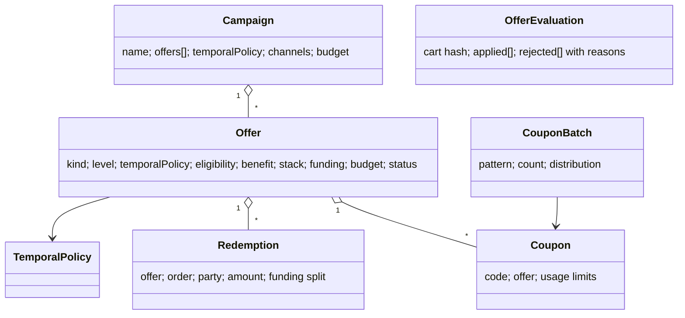

# U22 — Offer Universe Constitution

| Field | Value |
|---|---|
| Universe ID | `U22-offer` |
| Layer | L5 Business Capability |
| Domain | 04 Commerce |
| Steward | `ucos:org:commerce-promotions` |
| Version | 0.1.0 (Draft) |
| Delivery phase | P1 |
| Depends on | **U13 Temporal** (all validity/scheduling), U23 Pricing (application point), U53 Decision (eligibility/stacking), U21 Catalog (targets), U11 Party (segments, eligibility), U14 Currency, U02 Governance (approval for high-impact offers) |
| Depended on by | U24 Cart/Checkout, U23 Pricing, U26 Order (adjustments), U30 Ledger (P2: funding allocation), U32 Loyalty (P3), U44 Search (badges) |
| Master references | §9.2 (TemporalPolicy reuse, TMP-001), §6.3 (offer owns discounts, never time), master chat temporal section |

> Offer owns **incentives that change what a buyer pays or receives**: discounts, promotions, coupons, vouchers, cashback, bundle deals, BOGO, free shipping, gifts-with-purchase, campaigns, flash sales and seller-funded/marketplace-funded incentives — their eligibility, stacking, budget and redemption. It **never owns time** (always `TemporalPolicyRef`) and never owns the base price (U23).

---

## 1. Laws

| ID | Law | Enforcement |
|---|---|---|
| OFR-L1 | Every Offer references a TemporalPolicy (or `{range: TimeRange}`) for validity; no date fields on offers. | META lint; schema. |
| OFR-L2 | Offer evaluation is deterministic given (cart, context, offer set versions, asOf). | Engine is a pure function; results carry `evaluationId` + versions. |
| OFR-L3 | Stacking and exclusivity are explicit (stack groups + priority); undefined interactions are rejected at publish. | Publish validation: pairwise interaction check within overlapping scope. |
| OFR-L4 | Every monetary offer declares a funder (operator, seller, brand, payment partner) and budget/caps; redemptions decrement budgets atomically. | Schema + atomic budget counter. |
| OFR-L5 | Offers with estimated impact above thresholds require Governance approval and simulation. | Decision `offer.approval-threshold`; U02 classification. |
| OFR-L6 | Consumer-law display rules (e.g. reference price must be genuine prior price for N days) are enforced via Pricing history, not trust. | Rule using U23 price history (`lowest price in last 30 days` EU Omnibus). |

---

## 2. Ontology
- **Offer kinds:** `percent-off`, `amount-off`, `fixed-price`, `bxgy` (buy X get Y), `tiered` (spend thresholds), `bundle-price`, `free-shipping`, `gift`, `cashback` (post-purchase credit → wallet/loyalty), `payment-method` (bank/card offers), `first-order`, `referral`, `price-match`.
- **Application level:** `line`, `order`, `shipping`, `payment`, `post-purchase`.
- **Trigger mode:** `automatic`, `coupon-code`, `link` (URL token), `targeted` (assigned to party/segment), `agent-negotiated` (bounded; P4).
- **Funding:** `{ funder: OrgRef, sharePercent }[]` — e.g. 60% seller / 40% marketplace.



---

## 3. Objects

### 3.1 `ucos.offer.Offer`
| Attribute | Type | Card. | Notes |
|---|---|---|---|
| `id` | UGID (`ucos:offer:`) | 1 | |
| `tenant` | TenantRef | 1 | |
| `owner` | OrgRef | 1 | operator or seller |
| `kind`, `level`, `triggerMode` | Enums | 1 | |
| `name`, `terms` | LocalizedText | 1 | terms required for consumer display |
| `temporalPolicy` | TemporalPolicyRef | 1 | OFR-L1 |
| `scope` | `{ catalogs?, stores?, channels?, jurisdictions?, currencies? }` | 1 | |
| `targets` | `{ include: CEL over line (listing/category/brand/seller/sku), exclude: CEL }` | 0..1 | |
| `eligibility` | `{ decision?: DecisionRef, segments?: [SegmentRef], firstOrderOnly?, minCartValue?: Money, paymentMethods?: [..], partyRule?: CEL }` | 1 | |
| `benefit` | kind-specific: `{percent: "15.00", cap: Money}` / `{amount: Money}` / `{buy: {qty, targets}, get: {qty, targets, percentOff}}` / `{tiers: [{threshold: Money, percent}]}` | 1 | |
| `stack` | `{ group: string, exclusive: bool, priority: int, combinableWith: [group] }` | 1 | |
| `limits` | `{ perParty?: int, perOrder?: int, total?: int }` | 0..1 | |
| `budget` | `{ amount: Money, consumed: Money (computed), onExhaust: stop|notify }` | 0..1 | required for funded offers |
| `funding` | Array<{funder: OrgRef, sharePercent}> | 1..N | Σ = 100 |
| `display` | `{ badge: LocalizedText, priority, showOnPLP: bool, countdown: bool }` | 0..1 | countdown uses TemporalPolicy nextChange |
| `simulation` | SimulationRunRef | 0..1 | required above threshold |
| `status` | `draft|scheduled|active|paused|exhausted|ended|cancelled` | 1 | `active` derived from TemporalPolicy × status |

### 3.2 `Campaign`, `Coupon`, `CouponBatch`, `Redemption`
```yaml
Campaign:    { id, name, temporalPolicy, offers: [OfferRef], channels, budget?, goals: {kpi, target}, owner }
Coupon:      { code (case-insensitive, unique per tenant), offer, assignedTo?: PartyRef, maxUses, used (computed), temporalPolicy? (narrower than offer) }
CouponBatch: { id, offer, pattern: "DIWALI-{A9}{A9}{A9}{A9}", count, distribution: export|communication-campaign|partner }
Redemption:  { id, offer, coupon?, order, party, lineRefs, discount: Money, fundingSplit: [{funder, amount: Money}], status: reserved|confirmed|reversed, at }
```
`Redemption` reserved at checkout, confirmed on order confirmation, reversed on cancellation/return (pro-rated via `Allocate`).

---

## 4. Commands, Queries, Events, APIs

| Command | Events |
|---|---|
| `CreateOffer`, `UpdateOffer` (new version), `PublishOffer` (→ scheduled/active per policy), `PauseOffer`, `CancelOffer` | `offer.offer.created|published|paused|cancelled` |
| `CreateCampaign`, `GenerateCoupons(batch)` | `offer.coupons.generated` |
| `ReserveRedemption`, `ConfirmRedemption`, `ReverseRedemption` (called by Checkout/Order) | `offer.redemption.reserved|confirmed|reversed` |
| `Simulate(offer, scenario)` | `offer.simulation.completed` |

Temporal-driven: `temporal.policy.activated/deactivated` (boundaries) → `offer.offer.activated|expired` (derived events for display caches, campaigns).

**Engine contract (consumed by Pricing/Checkout):**
```text
EvaluateOffers(cartSnapshot, ctx, codes[], asOf?) →
  { applied: [{offer, version, lines: [{line, discount: Money}], orderDiscount?, shippingDiscount?, funding}],
    rejected: [{offer|code, reason: NOT_ELIGIBLE|EXPIRED|LIMIT_REACHED|BUDGET_EXHAUSTED|NOT_COMBINABLE|MIN_NOT_MET, hint}],
    nextBestOffer?: {offer, gap: Money} ,   # "add ₹200 more for free delivery"
    evaluationId, versions }
```
**Queries:** `ActiveOffersFor(listing|category, ctx)` (badges), `CouponStatus(code, ctx)`, `CampaignPerformance(campaign)`.

```text
POST /v1/offer/offers           POST /v1/offer/offers/{id}:publish|:pause|:cancel|:simulate
POST /v1/offer/campaigns        POST /v1/offer/coupon-batches
POST /v1/offer/evaluate         GET  /v1/offer/badges?listing=&ctx
```
**Errors:** `OFR_STACK_UNDEFINED`, `OFR_FUNDING_INVALID`, `OFR_APPROVAL_REQUIRED`, `OFR_CODE_INVALID`, `OFR_BUDGET_EXHAUSTED`, `OFR_REFERENCE_PRICE_INVALID`.

---

## 5. Evaluation Algorithm (normative)

```text
evaluate(cart, ctx, codes):
  O ← offers where status ∈ {scheduled,active} ∧ temporal.active(offer.temporalPolicy, ctx.time, ctx) ∧ scope matches ctx
       ∪ offers(codes) validated (code exists, assigned party matches, coupon policy active)
  O ← filter eligibility (Decision engine with cart + party + ctx) and limits/budget (read counters)
  for each offer compute candidate benefit on its targets (line-level first, then order, shipping, payment)
  resolve stacking:
     partition by stack.group; within exclusive groups choose max-benefit offer (tie → higher priority → older id)
     combine groups allowed by combinableWith; across non-combinable groups choose the combination maximizing buyer benefit
        (bounded search; |groups| ≤ 8 → exhaustive; else greedy by priority — tenant can set strategy 'priority-first')
  allocate order-level discounts to lines via Allocate (U14) proportional to eligible line totals
  floor: no line below zero; no order below zero; shipping discount ≤ shipping charge
  return applied, rejected (with reasons), nextBestOffer
```
Decision tables: `offer.approval-threshold` (estimated cost/impact), `offer.stacking-strategy`, `offer.reference-price-rule` (per jurisdiction).

---

## 6. Security & Compliance
Fraud controls: coupon brute-force rate limits, per-device/party redemption velocity (U69 risk), abuse detection (multi-account). Seller-funded offers can only target the seller's listings (policy). Consumer law: genuine reference pricing (EU Omnibus Directive 30-day lowest price; India CCPA dark-pattern guidelines — no false urgency: countdowns must reflect real TemporalPolicy end), clear terms display. Audit: publish, budget changes, manual redemption overrides.

## 7. Reuse
Checkout and Pricing call `EvaluateOffers`; no other universe computes discounts. Loyalty (P3) uses Offer kinds `cashback`/`points-multiplier` with Ledger funding.

## 8. Gaps
```prolog
gap(offer_without_terms, O)        :- offer(O), active(O), not localized_terms(O, ctx_locales).
gap(unfunded_offer, O)             :- offer(O), monetary(O), not funding_complete(O).
gap(stacking_undefined, O1, O2)    :- overlapping_scope(O1, O2), not stack_relation_defined(O1, O2).
gap(countdown_without_end, O)      :- offer(O), display_countdown(O), open_ended(O).
```

## 9. AI
Offer design assistant (propose targeting/benefit from goals), uplift forecasting for simulation (U54/U56), personalised next-best-offer selection (P4, bounded to approved offers). Agents never create funded offers without approval.

## 10. Operations
Signals: `offer_evaluations_total`, `offer_eval_latency_ms` (SLO p99 < 25 ms for 50 lines, 200 candidate offers), `redemptions_total{offer}`, `budget_consumed_ratio{offer}`, `coupon_invalid_attempts_total`. Hot counters for budgets/limits: sharded counters with reconciliation (like U13 slots).

## 11. UI
Views: `offer.builder` (kind-specific forms, target rule builder, Temporal policy picker W10, funding split, stacking matrix, simulation result), `offer.calendar` (all campaigns on Temporal calendar), `offer.coupon.batch`, storefront `offer.badge`, `offer.cart-hint` ("Add ₹200 for free delivery"), `offer.terms.modal`.

## 12. Scale
Up to 10⁵ active offers per large marketplace tenant; evaluation index by target (category/seller/sku) pre-filtered in memory per cell; flash sale peaks 50k evaluations/s per cell. T1 (checkout path T0 behaviour: on engine failure, checkout proceeds without offers only if decision `offer.fail-mode` = open; default closed for code-entered offers).

## Appendix
- **C.** 0.1.0.

## Appendix D — Completeness extensions (amendment A-29)
- **Coverage confirmation:** discounts, promotions, coupons, vouchers, cashback, bundle deals, BOGO, tiered, free shipping, gifts, first-order, referral, payment-method offers, price-match, flash sales and campaigns are all Offer kinds here.
- **Monetary-value vouchers and gift cards** (stored value) are owned by **U84**. Offer only references them when used as an incentive (e.g. "₹500 gift card with purchase").
- **Loyalty points multipliers and earn/burn** are owned by U32 (Phase 3) and are expressed as Offer kinds `points-multiplier` / `points-earn`.
- **Affiliate and partner commissions** are owned by U32 (affiliate/referral/partner programs) with U30 Ledger payouts. Offer covers only the buyer-side incentive.
- **Marketing orchestration** (who gets which offer, when, through which channel) is owned by **U86**. Audiences come from **U85**.
