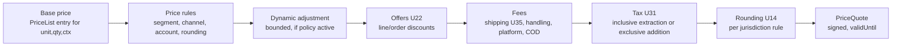

# U23 — Pricing Universe Constitution

| Field | Value |
|---|---|
| Universe ID | `U23-pricing` |
| Layer | L5 Business Capability |
| Domain | 04 Commerce |
| Steward | `ucos:org:commerce-pricing` |
| Version | 0.1.0 (Draft) |
| Delivery phase | P1 (price lists, waterfall, quotes), P4 (dynamic pricing AI) |
| Depends on | U14 Currency (Money, FX, rounding), U13 Temporal (price validity, history), U21 Catalog (SellableUnit), U22 Offer (adjustments), U31 Tax (inclusive/exclusive), U53 Decision (rules), U11 Party (segments, B2B accounts) |
| Depended on by | U24 Cart/Checkout, U26 Order, U44 Search (price facets), U27 Subscription (P2), U37 Mobility (surge), U45 ERP (purchase prices) |
| Master references | §6.3 (price ruling), §16.2, §30.2 (surge example) |

> Pricing owns **what something costs before incentives**: price lists, price entries per SellableUnit, price rules (tiered, volume, customer-specific, channel, cost-plus, dynamic), the price **waterfall** (base → rules → offers → fees → tax), price history (for reference-price laws), quotes and negotiated prices. Offers (U22) are applied *by* Pricing's waterfall but defined in U22; tax amounts come from U31.

---

## 1. Laws

| ID | Law | Enforcement |
|---|---|---|
| PRC-L1 | Price = output of the waterfall for (unit, quantity, ctx, asOf); no other component computes prices. | Single `PriceQuote` API; lint against Money arithmetic on prices outside Pricing/Offer/Tax. |
| PRC-L2 | Every price entry has temporal validity; history is retained (bitemporal) for at least the longest reference-price law window + audit retention. | Schema; retention. |
| PRC-L3 | Prices shown to a buyer are honoured for a declared hold period (quote TTL), or re-priced with explicit notice at checkout. | `PriceQuote.validUntil`; checkout re-price + `price-changed` UI notice. |
| PRC-L4 | Dynamic/algorithmic price changes are bounded by guardrails (min/max, max change rate, regulatory caps) and logged with inputs. | Guardrail evaluation before publish; audit. |
| PRC-L5 | Tax inclusivity is a property of the price list per jurisdiction, never assumed. | `taxMode` required. |

---

## 2. Ontology
- **PriceList** (scope: tenant/store/channel/segment/account/currency/jurisdiction; `taxMode: inclusive|exclusive`) contains **PriceEntries** (unit × price × validity × quantity breaks).
- **PriceRule** (decision-backed adjustments: segment discount, channel markup, cost-plus, rounding to price points e.g. ₹x99).
- **Fee** (handling, convenience, platform fee, COD fee, packaging) — fee definitions here; legal requirement to show up-front (drip-pricing laws).
- **PriceQuote** (result of waterfall; signed, time-bound).
- **NegotiatedPrice / Quote (B2B)** — RFQ → quote → acceptance; contract prices (U42 documents).
- **DynamicPricingPolicy** (P4) — model + guardrails + temporal windows (e.g. surge).



---

## 3. Objects

### 3.1 `PriceList`
`{ id, tenant, name, currency, taxMode, scope: { stores?, channels?, segments?, accounts?, jurisdictions? }, priority, parent?: PriceListRef (inherit + override), roundingRule: RoundingRuleRef, temporalPolicy?: TemporalPolicyRef, status }`

### 3.2 `PriceEntry`
| Attribute | Type | Notes |
|---|---|---|
| `priceList` | Ref | |
| `unit` | SellableUnitRef | |
| `amount` | Money | in list currency |
| `breaks` | Array<{minQty, amount: Money}> | volume tiers |
| `validity` | TimeRange (or TemporalPolicyRef) | PRC-L2 |
| `compareAtPrice` | Money | 0..1 — only if justified by history (validated by `pricing.reference-price-rule`) |
| `cost` | Money | 0..1 confidential; for margin rules |
| `source` | `manual|import|rule|dynamic` | |

### 3.3 `PriceRule`
`{ id, scope, kind: percent|amount|set|cost-plus|round-to-price-point|min-margin-guard, decision: DecisionRef (inputs: unit attributes, party segment, channel, qty), priority, validity: TimeRange }`

### 3.4 `Fee`
`{ id, kind, amount: Money | percent, appliesWhen: CEL, displayRule: always-upfront|at-checkout (validated per jurisdiction), taxCategory, funder? }`

### 3.5 `PriceQuote`
`{ id, ctxHash, lines: [{unit, qty, base, rulesApplied[], dynamic?, offers[], fees[], tax: {mode, amount, breakdown ref}, unitNet, lineTotal}], orderFees, totals: {subtotal, discounts, fees, tax, grandTotal}, currency, displayConversion?: ConvertedMoney, validUntil: TimePoint, versions: {priceLists, rules, offers, taxRules}, signature }`

### 3.6 B2B `Quote`
`{ id, account: PartyRoleRef(customer-business), lines, terms, validity: TemporalPolicyRef, status: draft|sent|negotiating|accepted|expired|rejected, acceptedPriceList?: PriceListRef (account-scoped) }`

---

## 4. Commands, Queries, Events, APIs

| Command | Events |
|---|---|
| `UpsertPriceEntries` (bulk) / `SchedulePriceChange(validity)` | `pricing.price.changed` (per unit, batched) |
| `DefinePriceList`, `DefinePriceRule`, `DefineFee` | `pricing.pricelist.changed` |
| `PublishDynamicPolicy` (P4, governed) | `pricing.dynamic-policy.published` |
| `CreateQuote` / `SendQuote` / `AcceptQuote` | `pricing.quote.*` |

**Queries:** `Quote(lines, ctx, codes?, asOf?) → PriceQuote` (full waterfall), `DisplayPrice(unit, ctx)` (base+rules+automatic offers, cached for PLP), `PriceHistory(unit, priceList, range)`, `LowestPrice(unit, window)` (reference-price law), `ResolvePriceList(ctx)`.

```text
POST /v1/pricing/quote                  GET /v1/pricing/display?units=&ctx
POST /v1/pricing/price-lists            POST /v1/pricing/price-lists/{id}/entries:upsert
GET  /v1/pricing/history?unit=&from=&to=
POST /v1/pricing/b2b-quotes             POST /v1/pricing/b2b-quotes/{id}:send|:accept
```
**Errors:** `PRC_NO_PRICE` (unit not priced in resolved list), `PRC_QUOTE_EXPIRED`, `PRC_GUARDRAIL_VIOLATION`, `PRC_COMPARE_AT_PRICE_UNJUSTIFIED`, `PRC_CURRENCY_UNSUPPORTED`.

---

## 5. Rules
- **Price list resolution:** most specific scope match (account > segment > store > channel > tenant), then priority; multi-currency: list in ctx currency if exists, else convert from base list via `RatePolicy(pricing)` with rounding to price points.
- **Guardrails (dynamic):** `min ≤ price ≤ max`, `|Δ| ≤ maxChangePercent per window`, `≥ cost × (1+minMargin)`, regulatory caps (e.g. ride fare caps, essential commodities during declared emergencies — compliance facts), no personalised pricing on protected attributes (policy forbids using SPI in pricing decisions).
- Decision tables: `pricing.segment-discounts`, `pricing.price-points` (rounding endings by currency), `pricing.quote-ttl` (default PT15M web, P30D B2B), `pricing.reference-price-rule`.

## 6. Security & Compliance
`cost` and margin fields `confidential` (mask for non-finance roles). Price changes audited with source; bulk changes > threshold → Governance proposal. Laws: drip-pricing/fee display (EU, UK DMCC Act, US FTC junk-fee rules, India CCPA), reference price rules, anti-price-gouging caps, MRP (India: selling price ≤ MRP — rule `in.mrp-cap`).

## 7. Reuse
Cart, Checkout, Order, Subscription, B2B, Mobility all obtain prices from `Quote`. Search indexes `DisplayPrice` projections. Order stores the accepted PriceQuote snapshot (immutable).

## 8. Gaps
```prolog
gap(unpriced_published_units, T, N) :- tenant(T), published_units_without_price(T, N), N > 0.
gap(tax_mode_missing, PL)           :- price_list(PL), not tax_mode(PL, _).
gap(mrp_missing, U)                 :- unit(U), sold_in(U, jur:IN), packaged_goods(U), not attribute(U, mrp).
gap(fee_not_upfront, F, J)          :- fee(F), display_at_checkout(F), in_scope(J), drip_pricing_law(J).
```

## 9. AI
P4 dynamic pricing (demand/competitor/inventory-aware) as `DynamicPricingPolicy` executing at autonomy L4 within guardrails; price-change explanations; competitor price monitoring (U10 §10.4 knowledge objects). All AI price outputs logged with inputs.

## 10. Operations
Signals: `quote_latency_ms` (SLO p99 < 60 ms, 50 lines), `no_price_errors_total`, `price_changes_total{source}`, `guardrail_blocks_total`, `quote_expiry_reprice_ratio`. Display price cache invalidated by `pricing.price.changed` and temporal boundaries.

## 11. UI
Views: `pricing.pricelist.grid` (spreadsheet-like editor, bulk paste, scheduled changes), `pricing.rule.editor`, `pricing.history.chart`, `pricing.waterfall.inspector` (debug a quote: each step), `pricing.b2b.quote.builder`, storefront `price.display` (with compare-at only if justified, unit price per kg/l where legally required).

## 12. Scale
10⁹ price entries platform-wide; partitioned by tenant/price list; display prices projected to cache/search; quote engine stateless, in-memory indexes per cell. T0 on checkout path.

## Appendix
- **D. Attribute definitions (A-74).** `B2BQuote { id, buyer: UGID, seller: UGID, lines: [{unit, quantity, unitPrice: Money, discount: Percentage}], priceList: UGID, terms: {paymentTerms, incoterms, deliverySchedule}, total: Money, validUntil: TimePoint, approval?: UGID, status: draft|sent|accepted|rejected|expired|converted, acceptedAt?: TimePoint }`
- **C.** 0.1.0.
