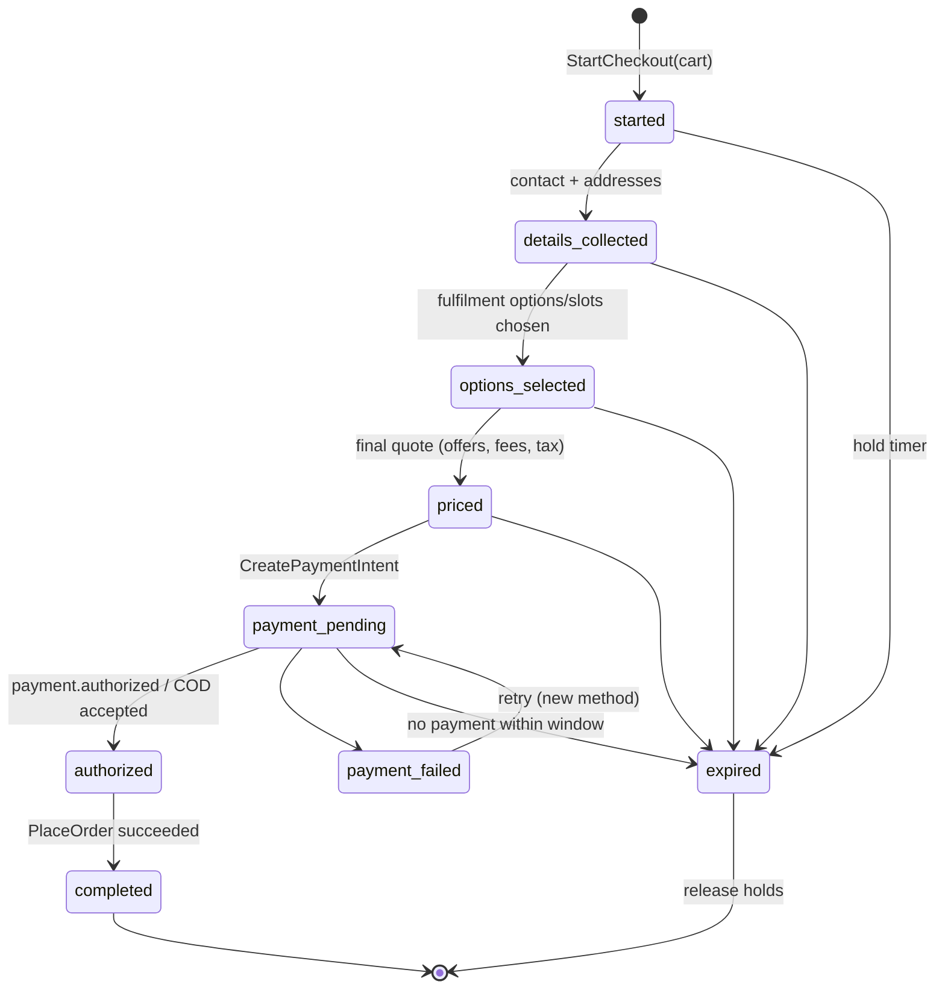

# U24 — Commerce (Cart & Checkout) Universe Constitution

| Field | Value |
|---|---|
| Universe ID | `U24-commerce` |
| Layer | L5 Business Capability |
| Domain | 04 Commerce |
| Steward | `ucos:org:commerce-core` |
| Version | 0.1.0 (Draft) |
| Delivery phase | P1 |
| Depends on | U21 Catalog, U23 Pricing, U22 Offer, U31 Tax, U34 Inventory (availability/reservation), U35 Fulfillment (options, promise), U13 Temporal (slots, abandonment), U12 Geography (address), U29 Payment, U11 Party, U66 Consent, U69 Risk (P2) |
| Depended on by | U26 Order (checkout → order), U40 Communication (abandonment), U72 Analytics (funnel) |
| Master references | §8.2 (cart manifest example), §13.2 (request lifecycle example), §24.5 (buyer journey), W12 |

> Commerce owns **the buying session**: `Cart` (intent to buy, multi-seller), and `Checkout` (the orchestration that turns a cart into a priced, fulfilment-planned, paid commitment, handing off to Order). It owns no prices, stock, tax or payment logic — it orchestrates the universes that do and guarantees a consistent, honest final total.

---

## 1. Laws

| ID | Law | Enforcement |
|---|---|---|
| COM-L1 | The amount charged equals the amount shown on the final review step (a signed PriceQuote); any change requires explicit re-confirmation. | Checkout confirm compares quote signature/hash; mismatch → `COM_PRICE_CHANGED`. |
| COM-L2 | Inventory and slot reservations are held only during checkout with expiry; abandoned checkouts release holds automatically. | Temporal hold triggers. |
| COM-L3 | Checkout is idempotent end-to-end: one checkout → at most one order and one successful payment. | Idempotency keys chained (checkout id) across Payment and Order. |
| COM-L4 | No dark patterns: no pre-ticked paid add-ons, no hidden fees, no fake urgency. | UI policy lint on checkout views; compliance rules by jurisdiction. |
| COM-L5 | Guest checkout, if enabled, collects only data required for fulfilment, payment and legal invoicing. | View definitions + purpose tags. |

---

## 2. Ontology & Objects

### 2.1 `ucos.commerce.Cart`
| Attribute | Type | Notes |
|---|---|---|
| `id` | UGID | |
| `tenant`, `store?`, `channel` | refs | |
| `buyer` | PartyRoleRef(buyer) or `anonymous` (device/session token) | |
| `currency` | iso4217 | from context |
| `lines` | Composition→CartLine | ≤ decision `commerce.cart.max-lines` (default 100) |
| `codes` | Array<String> | coupon codes entered |
| `shipTo` | AddressRef | 0..1 (for estimates) |
| `lastQuote` | PriceQuoteRef | 0..1 cached estimate |
| `status` | `active|merged|converted|abandoned|expired` | |
| `ttl` | Duration | default P30D (config) |
| `version` | int | |

`CartLine { id, unit: SellableUnitRef, listing, seller, qty, addedAt: TimePoint, note?, giftWrap?, bundleRef?, savedForLater: bool }`

### 2.2 `ucos.commerce.Checkout`
| Attribute | Type | Notes |
|---|---|---|
| `id` | UGID | idempotency root |
| `cart` | CartRef (snapshot hash) | |
| `buyer` | PartyRoleRef | guest creates a lightweight Person + buyer role |
| `contact` | `{ email?: ContactPointRef, phone?: ContactPointRef }` | |
| `shipments` | Array<{ seller, lines, shipTo: AddressRef, option: FulfilmentOptionRef, slot?: ReservationRef }> | per seller/fulfilment node split (U35) |
| `billing` | `{ address?: AddressRef, taxId?: {scheme, value} (B2B invoice) }` | |
| `quote` | PriceQuoteRef (signed) | final |
| `holds` | `{ inventory: [StockReservationRef], slots: [ReservationRef], offers: [RedemptionRef] }` | |
| `payment` | PaymentIntentRef | |
| `consents` | Array<ConsentRef> | marketing opt-in (unticked by default), terms acceptance version |
| `risk` | RiskAssessmentRef | 0..1 (P2) |
| `status` | §3 | |
| `expiresAt` | TimePoint | hold expiry (decision `commerce.checkout.hold`, default PT15M) |
| `order` | OrderRef | after success |

---

## 3. Checkout State Machine & Orchestration



Orchestration (workflow `commerce.checkout@1`, durable):
1. `StartCheckout` → snapshot cart; validate listings still published & sellable in ctx jurisdiction; check restricted items (age gate obligations).
2. Collect contact/addresses → `geo.ValidateAddress`; serviceability per line (`IsServiceable`).
3. Fulfilment planning (U35 `PlanFulfilment`) → options per shipment with promise dates (Temporal slots); reserve stock (U34 `Reserve`, TTL = hold) and slot holds (U13).
4. Final `Pricing.Quote(lines, ctx, codes)` incl. offers, fees (shipping from option), tax (with ship-to/bill-to) → signed quote; reserve redemptions (U22).
5. `Payment.CreateIntent(amount = quote.grandTotal, idempotencyKey = checkout.id)`; handle SCA/3DS/UPI collect; COD path if eligible (decision `commerce.cod-eligibility`).
6. On authorization: `Order.PlaceOrder(checkout)` (idempotent on checkout id) → confirms holds conversion; on failure after authorization → automatic void/refund (saga compensation).
7. Expiry/abandonment: release stock, slots, redemptions; emit `commerce.checkout.expired`; Cart stays `active` for re-entry.

Compensation table (saga):

| Step failed | Compensations |
|---|---|
| Stock reserve partial | release partial; propose alternatives (other seller/node) |
| Payment failed | keep holds until expiry; allow retry |
| PlaceOrder failed after auth | void authorization (or refund if captured), release holds, alert |

---

## 4. Commands, Queries, Events, APIs

Cart commands from master §8.2 manifest: `CreateCart, AddLine, UpdateLineQuantity, RemoveLine, ApplyCoupon, RemoveCoupon, MergeCarts, SaveForLater, MoveToCart, EstimateCart`.
Checkout commands: `StartCheckout, SetContact, SetShippingAddress, SetBillingDetails, SelectFulfilmentOption, SelectSlot, ApplyCode, ConfirmAndPay, RetryPayment, CancelCheckout`.

Events: `commerce.cart.created|line-added|line-removed|coupon-applied|abandoned|converted|merged`, `commerce.checkout.started|priced|payment-pending|completed|expired|failed`.

```text
POST /v1/commerce/carts                      GET /v1/commerce/carts/{id}
POST /v1/commerce/carts/{id}:addLine|:updateLine|:removeLine|:applyCoupon|:merge|:estimate
POST /v1/commerce/checkouts                  GET /v1/commerce/checkouts/{id}
POST /v1/commerce/checkouts/{id}:setContact|:setShipping|:selectOption|:selectSlot|:applyCode|:confirmAndPay|:cancel
```
Errors: `COM_LISTING_UNAVAILABLE`, `COM_OUT_OF_STOCK` (with alternatives), `COM_NOT_SERVICEABLE`, `COM_PRICE_CHANGED` (with old/new quote), `COM_HOLD_EXPIRED`, `COM_AGE_VERIFICATION_REQUIRED`, `COM_MAX_LINES`, `COM_CHECKOUT_COMPLETED` (idempotent replay returns order).

---

## 5. Decision tables
`commerce.cart.max-lines`, `commerce.cart.abandonment-rule` (idle duration → event; default PT2H), `commerce.checkout.hold` (PT15M), `commerce.cod-eligibility` (inputs: amount, pincode/zone, buyer history risk, category), `commerce.guest-checkout` (allowed by channel/category), `commerce.min-order-value` (by store/zone).

## 6. Security & Compliance
Policies: buyer owns cart/checkout; agents need delegation `cart:write` and `checkout:confirm` requires human confirmation obligation (master §21.5). Bot protection on checkout; velocity checks; payment page isolation (PSP-hosted fields → PCI SAQ-A). Consent: terms version accepted recorded; marketing opt-in unticked by default (GDPR/DPDP). Consumer law: total price incl. mandatory fees before confirmation; cancellation/withdrawal info (EU 14-day right) displayed per jurisdiction rule; India e-commerce rules (seller details, return policy display).

## 7. Reuse
Checkout is the **only** entry to Order for interactive purchases; other order sources (POS, B2B quote acceptance, subscription renewal, agent API) use `Order.PlaceOrder` with their own source type but the same pricing/tax/payment calls.

## 8. Gaps
```prolog
gap(no_payment_method_for, T, J) :- tenant(T), in_scope(T, J), not payment_methods_available(T, J).
gap(checkout_without_terms, T)    :- tenant(T), not terms_document(T, current).
gap(cod_without_reconciliation, T):- tenant(T), cod_enabled(T), not capability(T, payment.cod-reconciliation).
```

## 9. AI
Conversational cart (chat/WhatsApp renderer); agent checkout via MCP tools with explicit user confirmation step; abandonment recovery message drafting (Communication); checkout anomaly detection.

## 10. Operations
Signals: funnel `checkout_step_conversion{step}`, `checkout_success_ratio` (SLO ≥ 99.5% excl. user abandonment & payment declines), `price_changed_at_confirm_ratio`, `hold_expiry_total`, `add_line_latency_ms` (p99 < 150 ms). Business guard for releases: checkout success ratio.

## 11. UI
Views (W12): `cart.mini`, `cart.drawer`, `cart.page`, `checkout.onepage` (web) / `checkout.steps` (mobile), `checkout.address`, `checkout.slot-picker` (U13), `checkout.payment` (PSP components), `checkout.review` (itemised, honest totals), `checkout.confirmation`. UX: preserve progress; inline errors; express checkout (wallet pay) skips steps when data present; accessible error summary.

## 12. Scale
Peak 3k–10k checkouts/min per large tenant (flash sales); carts in Postgres with Redis cache for anonymous carts; checkout workflows durable (Temporal.io-class). T0.

## Appendix
- **C.** 0.1.0.

## Appendix P1 — Phase 1 behaviour without later-phase dependencies
- **U69 Risk (Phase 2):** checkout uses the `unknown` risk band, `commerce.cod-eligibility` without a risk input (amount, zone and buyer-history counts only), bot protection at the edge, and PSP fraud tools.
- **U30 Ledger (Phase 2):** see U29 Appendix P1.
