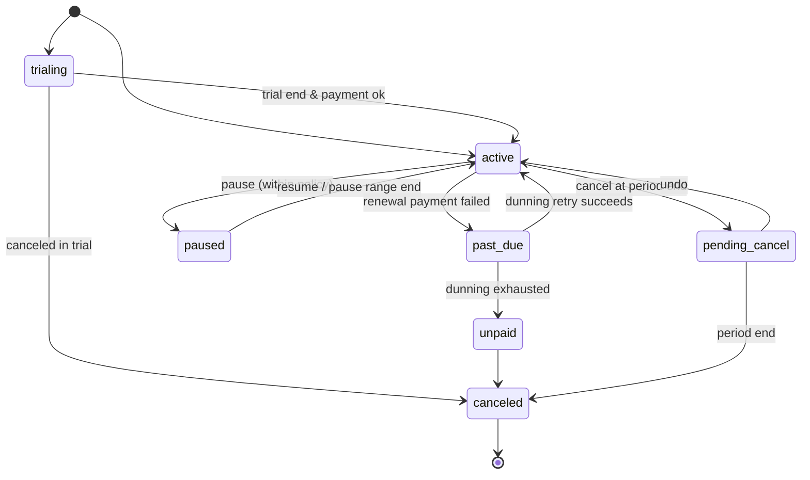

# U27 — Subscription & Billing Universe Constitution

| Field | Value |
|---|---|
| Universe ID | `U27-subscription` |
| Layer | L5 Business Capability |
| Domain | 04 Commerce |
| Steward | `ucos:org:commerce-subscriptions` |
| Version | 0.1.0 (Draft) |
| Delivery phase | P2 |
| Depends on | U13 Temporal (billing cycles, trials, renewals, grace, dunning schedules, proration), U23 Pricing (plan prices, usage rates), U28 Entitlement (grants), U29 Payment (mandates, recurring charges), U30 Ledger (revenue schedules), U31 Tax, U42 Document (invoices), U40 Communication (renewal notices), U53 Decision, U14 Currency (proration/allocation) |
| Depended on by | Media/OTT, SaaS vendors, memberships, subscribe-and-save commerce, telecom/utilities packs (usage rating), U80 (service contracts), U93 (data product subscriptions) |
| Master references | §9.4 (temporal consumers), §30.3 (OTT) |

> Subscription owns **recurring commercial relationships and usage billing**: plans (price, cycle, trial, add-ons), subscriptions and their lifecycle, renewals, upgrades/downgrades with proration, pauses, cancellations, **usage metering and rating** (events → rated charges), invoicing runs, **dunning**, and recurring payment mandates (UPI AutoPay, card-on-file with network tokens, SEPA/ACH). Entitlements granted by subscriptions are in U28; books in U30.

## 1. Laws
| ID | Law | Enforcement |
|---|---|---|
| SUB-L1 | Cycles, trials, renewal dates and grace periods are Temporal recurrences/ranges; no ad-hoc date math. | Temporal SDK only (TMP-L1/L3). |
| SUB-L2 | Customers receive legally required pre-renewal notices and easy cancellation (click-to-cancel parity); free-trial conversions are disclosed. | Notice triggers (U13 + U40) per jurisdiction decision `subscription.renewal-notice`; cancellation available in same channel. |
| SUB-L3 | Recurring debits follow mandate rules (RBI e-mandate AFA thresholds and pre-debit notifications, SCA MIT exemptions, SEPA mandates). | Mandate objects + pre-debit notification triggers. |
| SUB-L4 | Proration and credits use `Allocate` and are explained line-by-line on the invoice. | Pricing/Currency SDK. |
| SUB-L5 | Usage is rated from immutable usage events with idempotency; re-rating creates adjustments, never edits. | Rating engine + U30 adjustments. |

## 2. Objects
`SubscriptionPlan { id, product (U21 listing or GSID), price (U23), cycle: Recurrence (monthly/annual/custom), trial: Duration?, addOns, usageComponents [{meter, unit (U14), tiers/rates, includedQuantity}], commitment: TimeRange?, cancellationPolicy, entitlements (U28 plan) }` · `Subscription { id, customer (party role), plan@version, status, currentPeriod: TimeRange, startedAt: TimePoint, trialEnd?: TimePoint, renewalAt: TimePoint, cancelAt?: TimePoint, pausedRange?: TimeRange, mandate: PaymentMethodRef/MandateRef, items, quantity/seats }` · `UsageRecord { subscription, meter, quantity: Quantity, at: TimePoint, idempotencyKey, source }` · `RatedCharge { subscription, meter, period: TimeRange, quantity, amount: Money }` · `BillingRun { schedule (Temporal), period, subscriptions, invoices, status }` · `DunningPlan { steps [{after: Duration, action: retry-payment|notify|restrict-entitlements|cancel}], smart retry windows }`.

## 3. Lifecycle


## 4. Commands, Queries, Events, APIs
Commands: `CreatePlan`, `Subscribe`, `StartTrial`, `ChangePlan` (proration preview first), `UpdateQuantity`, `Pause`, `Resume`, `Cancel(now|periodEnd)`, `ReportUsage`, `RunBilling`, `RetryPayment`, `ApplyCredit`.
Queries: `PreviewChange`, `UpcomingInvoice`, `UsageSummary(range)`, `MRR/ARR reports` (via U72 metric layer).
Events: `subscription.subscription.created|activated|renewed|past-due|paused|canceled|plan-changed`, `subscription.usage.rated`, `subscription.invoice.issued`, `subscription.dunning.step`.
```text
POST /v1/subscription/plans   POST /v1/subscription/subscriptions   POST /v1/subscription/subscriptions/{id}:change|:pause|:resume|:cancel
POST /v1/subscription/usage   GET /v1/subscription/subscriptions/{id}/upcoming-invoice
```

## 5. Gaps, AI, Ops, UI
```prolog
gap(no_renewal_notice_rule, T, J) :- tenant(T), in_scope(T, J), capability(T, subscription.core), renewal_notice_required(J), not notice_trigger(T, J).
gap(mandate_rules_missing, T)     :- tenant(T), in_scope(T, jur:IN), recurring_card_or_upi(T), not capability(T, payment.mandates-in).
gap(usage_meter_unrated, M)       :- meter(M), used_by_plan(M, _), not rating_rule(M).
```
AI: churn prediction (U94) → retention offers (U22/U86), dunning send-time optimisation. Signals: `mrr`, `churn_rate`, `dunning_recovery_rate`, `involuntary_churn`. Views: plan builder, customer subscription management (self-service change/cancel), billing run cockpit, dunning editor, usage explorer. T1.

## Appendix
- **C.** 0.1.0.
