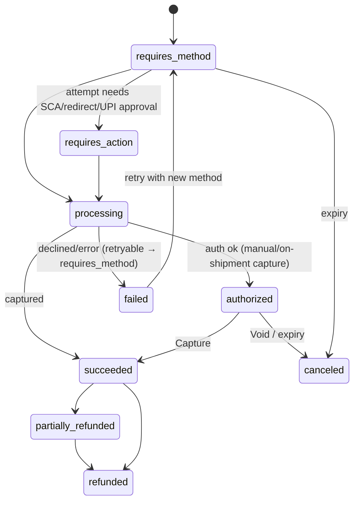

# U29 — Payment Universe Constitution

| Field | Value |
|---|---|
| Universe ID | `U29-payment` |
| Layer | L5 Business Capability |
| Domain | 04 Commerce |
| Steward | `ucos:org:payments` |
| Version | 0.1.0 (Draft) |
| Delivery phase | P1 (pay-in, refunds, COD), P2 (payouts, disputes, split payments, ledger integration) |
| Depends on | U14 Currency, U57 Capability (payment.provider abstract + adapters), U58 Composition (adapter selection), U65 Security (tokenisation, PCI scope), U13 Temporal (expiry, retries, reconciliation schedules), U09 Identity (SCA), U69 Risk (P2), U30 Ledger (P2) |
| Depended on by | U24 Checkout, U26 Order, U27 Subscription, U25 Marketplace (payouts), U30 Ledger, U71 Dispute |
| Master references | §8.4 (abstract payment.provider), §11.3 (adapter rules), §19.5 (tokenisation, PCI SAQ-A), §17.2 (reconciliation) |

> Payment owns **moving money in and out through external providers**: `PaymentIntent` (one attempt-set to collect an amount), `PaymentAttempt`, `PaymentMethod` (tokenised, never raw card data), `Refund`, `Payout` (P2), `Dispute`/chargeback records (P2, with U71), provider reconciliation, and COD collection. It is provider-agnostic via the `payment.provider` port. It does not hold balances (Ledger U30).

---

## 1. Laws

| ID | Law | Enforcement |
|---|---|---|
| PAY-L1 | UCOS never receives, stores or logs raw PAN/CVV; card entry uses provider-hosted fields/SDKs; only provider or network tokens are stored. | Architecture (PSP iframes/SDK), DLP blocking, PCI scope review; gate `SEC-PAY-01`. |
| PAY-L2 | Every money movement call carries an idempotency key and is reconciled against provider reports. | SDK + daily reconciliation job; mismatches → cases. |
| PAY-L3 | Provider selection is by context rules (U58 adapters), never hard-coded. | CAP-L5. |
| PAY-L4 | Strong customer authentication follows jurisdiction rules (PSD2 SCA, RBI AFA, 3DS2) as resolved by decision tables, with exemptions recorded. | Decision `payment.sca-requirement`. |
| PAY-L5 | Refunds never exceed captured minus refunded; payouts never exceed ledger available balance (P2). | Guards. |
| PAY-L6 | Webhooks are verified and deduplicated; state changes only via verified webhook or authenticated provider API response. | Adapter `ParseWebhook` + verification. |

---

## 2. Objects

### 2.1 `ucos.payment.PaymentIntent`
| Attribute | Type | Notes |
|---|---|---|
| `id` | UGID | |
| `tenant`, `merchantOfRecord` | refs | operator or seller (marketplace models) |
| `purpose` | `{ kind: order|subscription|invoice|wallet-topup|deposit|fee, ref }` | |
| `amount` | Money | |
| `captureMode` | `automatic|manual|on-shipment` | |
| `methodsAllowed` | Array<MethodType> | from `payment.method-availability` decision |
| `provider` | AdapterRef + account | selected at creation |
| `attempts` | Composition→PaymentAttempt | |
| `status` | §3 | |
| `amounts` | `{ authorized, captured, refunded, disputed }` | |
| `expiresAt` | TimePoint | |
| `idempotencyKey` | String | checkout id etc. |
| `split` | Array<{ beneficiary: OrgRef, amount: Money }> | P2 (marketplace route/transfer if provider supports) |
| `riskAssessment` | Ref | P2 |

### 2.2 `PaymentAttempt`
`{ id, intent, method: {type, tokenRef?, instrumentSummary: {brand, last4, expiry: TimePoint, bankName, vpaMasked}}, providerRef, status, sca: {required, method: 3ds2|otp|upi-pin|biometric, exemption?}, failure?: {code (normalised), providerCode, retryable, message key}, startedAt, completedAt }`

### 2.3 `PaymentMethod` (saved)
`{ id, party, type: card|upi-mandate|bank-account|wallet|bnpl|network-token, providerToken (encrypted), networkToken?, fingerprint (dedupe), summary, consent: {mandate id, limits, validity: TimeRange}, status }`

### 2.4 `Refund`, `Payout`, `Dispute`
```yaml
Refund:  { id, intent, amount: Money, reason, initiatedBy, adjustment: OrderAdjustmentRef?, status: pending|succeeded|failed, providerRef, method: original|store-credit|bank-transfer }
Payout:  { id, beneficiary: OrgRef, bankAccount: PaymentMethodRef(bank-account, verified), amount, schedule: ScheduleRef (U13), ledgerBatch: Ref, status }   # P2
Dispute: { id, intent, reason, amount, deadline: TimePoint, evidence: [AssetRef], status: needs-response|under-review|won|lost, case: CaseRef }   # P2, with U71
```

### 2.5 Method types (registry, extensible as data)
`card`, `upi` (collect / intent / QR / autopay mandate), `netbanking`, `wallet` (Apple Pay, Google Pay, Paytm…), `bank-transfer` (SEPA, ACH, IMPS/NEFT), `bnpl`, `cod`, `gift-card`, `store-credit`, `crypto` (future/optional), `invoice-terms` (B2B net-30).

---

## 3. State Machine



COD: intent with method `cod` → `authorized` on order confirmation (no money) → `succeeded` when delivery agent collection is recorded (U35 event) and reconciled with carrier remittance.

---

## 4. Commands, Queries, Events, APIs, Port

Commands: `CreateIntent`, `ConfirmIntent(method)`, `HandleAction(result)`, `Capture(amount?)`, `Void`, `Refund(amount, reason)`, `SaveMethod`, `RemoveMethod`, `CreateMandate`, `RecordCodCollection`, `Reconcile(provider, date)`; P2: `SchedulePayout`, `SubmitDisputeEvidence`.

Events: `payment.payment-intent.created|requires-action|authorized|captured|failed|canceled`, `payment.refund.issued|failed`, `payment.method.saved`, `payment.reconciliation.mismatch`, P2 `payment.payout.paid|failed`, `payment.dispute.opened|closed`.

Port (`payment.provider@2`, master §U57 example): `CreateIntent, Authorize, Capture, Void, Refund, GetStatus, ParseWebhook, ListMethods`, + P2 `CreatePayout, SubmitDisputeEvidence, Split`. Normalised failure codes: `INSUFFICIENT_FUNDS, DO_NOT_HONOR, EXPIRED_CARD, AUTH_FAILED, LIMIT_EXCEEDED, RISK_DECLINED, PROVIDER_UNAVAILABLE, TIMEOUT, USER_CANCELLED, INVALID_VPA, UNKNOWN`.

```text
POST /v1/payment/intents                 POST /v1/payment/intents/{id}:confirm|:capture|:void
POST /v1/payment/intents/{id}/refunds    GET  /v1/payment/intents/{id}
POST /v1/payment/methods                 DELETE /v1/payment/methods/{id}
POST /hooks/payment/{provider}           (webhook ingress, verified)
GET  /v1/payment/reconciliation?provider=&date=
```

---

## 5. Rules
- Provider routing: composer selects adapters by context (`adapter_for(payment.provider, J, method, Impl)`); runtime **smart routing** (P2) chooses among configured providers by success-rate/cost/health within policy (`payment.routing` decision), with failover on `PROVIDER_UNAVAILABLE` (only before any auth — never double-charge).
- Retries: user-driven retries create new attempts; automatic retries only for subscription renewals per dunning schedule (U27, Temporal).
- Reconciliation: daily (Temporal trigger per provider settlement calendar) compare UCOS captured/refunded vs provider settlement reports; mismatches → `Case` (U39) + gap if aged > 3 days.
- Decision tables: `payment.method-availability` (jurisdiction × currency × amount × channel × category), `payment.sca-requirement`, `payment.capture-mode` (by fulfilment type), `payment.cod-limits`, `payment.refund-approval-threshold`.

## 6. Security & Compliance
PCI DSS scope minimisation (SAQ-A/A-EP target; tokens only); webhook HMAC/signature verification; encryption of provider tokens (restricted); SoD on manual refunds above threshold; payout bank account changes require step-up + cooling period (fraud). Regulations: RBI (tokenisation, AFA, payment aggregator guidelines, data localisation → India card data processed by India-located providers/cells), PSD2/SCA, UAE CBUAE rules, NACHA (ACH), card network rules. Controls mapped in U67.

## 7. Reuse
All money collection (checkout, subscriptions, invoices, wallet top-ups) goes through PaymentIntent; Ledger (P2) posts from payment events; Marketplace payouts through `Payout`.

## 8. Gaps
```prolog
gap(no_provider_for_method, T, J, M) :- tenant(T), in_scope(T, J), method_required(T, J, M), not adapter_for(payment.provider, J, M, _).
gap(reconciliation_missing, T, P)     :- tenant(T), uses_provider(T, P), not schedule(T, reconcile(P)).
gap(card_localisation, T)             :- tenant(T), in_scope(T, jur:IN), card_payments(T), not provider_localised(T, jur:IN).
gap(unreconciled_aged, T, N)          :- tenant(T), mismatches_older_than_days(T, 3, N), N > 0.
```

## 9. AI
Payment failure explanation & next-best method suggestion; fraud scoring (P2, ML in U69); dispute evidence assembly (P2). Agents: may create intents only with user confirmation obligation; never refund above agent limit; never touch payout accounts.

## 10. Operations
Signals: `payment_success_ratio{provider,method}`, `auth_latency_ms{provider}`, `provider_error_ratio`, `refund_latency_hours`, `reconciliation_mismatch_total`, `cod_unremitted_amount`. SLO: payment auth p95 < 3 s (excl. user action) — master W14 example. Runbook: PSP outage → routing failover; webhook backlog.

## 11. UI
Views: `checkout.payment` (provider components per method, localised method ordering), `payment.methods.manage`, `payment.intent.detail` (ops: attempts, provider refs, webhooks), `payment.refund.dialog` (approval if above threshold), `payment.reconciliation.board`, P2 `payout.schedule`, `dispute.respond`.

## 12. Scale
Peak 5k payment intents/min per large tenant; idempotency store with 30-day retention; webhooks ingress autoscaled. T0. Residency: payment data in jurisdiction cells (card localisation).

## Appendix
- **C.** 0.1.0.

## Appendix P1 — Phase 1 behaviour without later-phase dependencies
- **U30 Ledger (Phase 2):** Phase 1 keeps no balances. Payment, refund and COD events are retained (topic retention ≥ 400 days, plus lakehouse copies) and replayed into the Ledger when U30 activates (A-19). Daily reconciliation in Phase 1 compares provider settlement reports with UCOS payment records only.
- **U69 Risk (Phase 2):** Phase 1 relies on provider-side fraud tools (PSP risk engines, 3DS) plus the static decision table `payment.velocity-limits` (per party, device, card fingerprint and day). Context risk is `unknown`. Migration: U69 scores become an input to `payment.sca-requirement` and `commerce.cod-eligibility` without changing interfaces.
