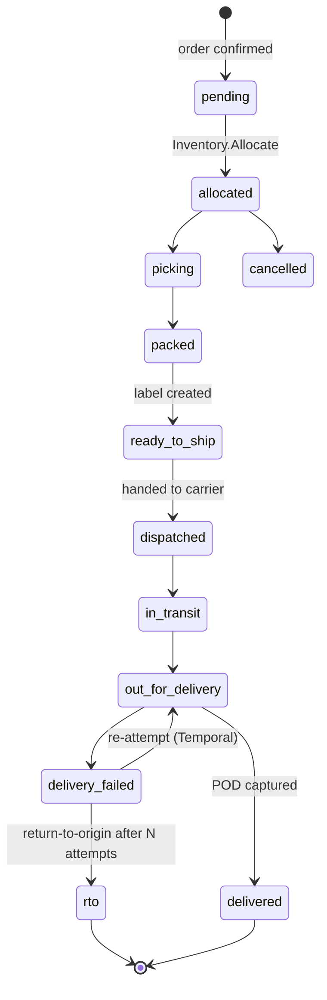

# U35 — Fulfillment Universe Constitution

| Field | Value |
|---|---|
| Universe ID | `U35-fulfillment` |
| Layer | L5 Business Capability |
| Domain | 05 Operations |
| Steward | `ucos:org:ops-fulfillment` |
| Version | 0.1.0 (Draft) |
| Delivery phase | P1 (ship/pickup/digital fulfilment, single carrier per country), P2 (multi-carrier via U36 Logistics, returns logistics, split shipments), P5 (service-visit fulfilment with Resource) |
| Depends on | U26 Order, U34 Inventory, U36 Logistics (carriers/rates/tracking, P2; in P1 via a minimal carrier adapter), U13 Temporal (slots, cut-offs, promise dates), U12 Geography (serviceability), U40 Communication (notifications), U43 Asset (labels, proof of delivery) |
| Depended on by | U24 Checkout (options & promise), U26 Order (status), U29 Payment (capture-on-shipment, COD collection), U39 Support |
| Master references | §16.1 (createFulfillmentOrders, shipments), §9.4 (temporal consumers: slots, cut-offs) |

> Fulfillment owns **getting what was ordered to the buyer**: fulfilment profiles and options, sourcing (which node fulfils which lines), `FulfillmentOrder`s, pick/pack/ship execution states, `Shipment`s and packages, pickup-in-store, digital delivery (licence keys, downloads), delivery promise computation, proof of delivery, and return (reverse) fulfilment. Carrier networks, routing and tracking feeds are U36 Logistics (P2); P1 uses a minimal carrier adapter through the same port.

---

## 1. Laws

| ID | Law | Enforcement |
|---|---|---|
| FUL-L1 | Delivery promises shown to buyers are computed (cut-off, processing time, transit time, slot availability, calendars) and stored with the order; promise misses are measured. | Promise engine + `promised` vs `actual` signals. |
| FUL-L2 | Sourcing decisions are explainable (which node, why) and reproducible from inputs. | Sourcing result stores scored candidates. |
| FUL-L3 | A shipment can only include allocated stock from one origin node and one seller (unless consolidation is explicitly configured). | Validation. |
| FUL-L4 | Delivery proof (signature/photo/OTP/geo) is captured according to policy (value, category, COD). | Decision `fulfillment.pod-requirement`. |
| FUL-L5 | Buyer address details exposed to carriers/agents are minimised (label data only) and purpose-bound. | Field-level obligations; masked phone via Communication. |

---

## 2. Objects
- **`FulfilmentProfile`** `{ id, kinds: [ship, pickup, digital, local-delivery, service-visit], processingTime: BusinessDuration, cutOff: LocalTime per calendar, packaging rules, hazmat, requiresAgeCheck }` (referenced by Listing).
- **`FulfilmentOption`** (computed per checkout shipment) `{ id, kind, carrierService?, origin: StockLocationRef, price: Money (to Pricing as fee input), promise: {earliest, latest: TimePoint} | slot: SlotRef, codAvailable, label (LocalizedText) }`
- **`FulfillmentOrder`** `{ id, sellerOrder, origin: StockLocationRef, lines: [{orderLine, qty, allocation}], kind, promise, status, slaClock: SLAClockRef (dispatch SLA) }`
- **`Shipment`** `{ id, fulfillmentOrders, carrier: AdapterRef, service, trackingNumber, packages: [{weight: Quantity, dims: Dimensions, items}], label: AssetRef, shipTo: {formatted, coordinate, contactToken}, events: [TrackingEvent], status, pod?: {type, assetRef, at: TimePoint, geo}, cod?: {amount: Money, collected: bool} }`
- **`PickupOrder`** (BOPIS) `{ store, readyAt: TimePoint, pickupCode (hashed), expiresAt (Temporal), status }`
- **`DigitalDelivery`** `{ entitlement/licenceKey (encrypted), downloadLinks (signed, expiring), status }`
- **`ReturnShipment`** `{ returnRequest, method: pickup|drop-off, carrier, label, status, receivedAt, inspection: {condition, disposition} }`

---

## 3. Sourcing & Promise

### 3.1 Sourcing (normative)
```text
source(sellerOrderLines, shipTo, ctx):
  candidates ← nodes with ATP for lines (Inventory) ∧ serviceable(shipTo) ∧ node active per calendar
  score(node) = w1·promiseEarliest + w2·shippingCost + w3·splitPenalty(#shipments) + w4·nodeLoad + w5·distance
                (weights from decision fulfillment.sourcing-weights per tenant/channel)
  choose assignment minimizing Σ score subject to: minimize splits first (lexicographic if configured)
  return assignment + ranked alternatives (explainability)
```
### 3.2 Promise
`promise = cutOffAdjusted(now, node.calendar) + processingTime(BusinessDuration) + transitTime(carrier service, lane; P1 static matrix, P2 carrier API) → range`, or for slotted delivery the chosen Temporal Slot. Holidays/working days via node and carrier calendars (U13).

---

## 4. Lifecycle


Pickup: `pending → allocated → ready_for_pickup (notify) → picked_up | expired (release & refund/cancel)`. Digital: `pending → delivered` immediately on payment.

---

## 5. Commands, Queries, Events, APIs
Commands: `PlanFulfilment(checkoutShipments)` (options + promises), `CreateFulfillmentOrders(order)`, `StartPick`, `ConfirmPack(packages)`, `CreateLabel` (carrier port), `Dispatch`, `RecordTrackingEvent` (from carrier webhook), `RecordDelivery(pod)`, `RecordDeliveryFailure(reason)`, `ScheduleReattempt(slot)`, `InitiateRTO`, `CreatePickupOrder`, `ConfirmPickup(code)`, `CreateReturnShipment`, `ReceiveReturn`.
Events: `fulfillment.order.created|allocated|packed`, `fulfillment.shipment.created|dispatched|in-transit|out-for-delivery|delivered|failed|rto`, `fulfillment.pickup.ready|completed|expired`, `fulfillment.digital.delivered`, `fulfillment.return.received`.
Port `logistics.carrier@1` (P1 minimal; U36 full): `Rates, CreateShipment, CancelShipment, Label, Track, ParseWebhook, SchedulePickup`.
```text
POST /v1/fulfillment/plan               POST /v1/fulfillment/orders/{id}:pick|:pack|:label|:dispatch
POST /v1/fulfillment/shipments/{id}:deliver|:fail|:reattempt|:rto
GET  /v1/fulfillment/shipments/{id}/tracking    POST /hooks/carrier/{provider}
POST /v1/fulfillment/pickups/{id}:confirm
```
Errors: `FUL_NOT_SERVICEABLE`, `FUL_NO_SOURCE`, `FUL_LABEL_FAILED`, `FUL_PICKUP_CODE_INVALID`, `FUL_POD_REQUIRED`.

## 6. Decision tables
`fulfillment.sourcing-weights`, `fulfillment.pod-requirement`, `fulfillment.reattempt-policy` (max attempts, slots), `fulfillment.pickup-hold-duration`, `fulfillment.dispatch-sla` (BusinessDuration per seller tier), `fulfillment.packaging-rules`.

## 7. Security & Compliance
Delivery agents see only assigned shipments, masked contacts, OTP verification for high-value/COD; POD photos are personal data (retention short); e-way bill/customs documents via Logistics/Tax (P2); hazmat and age-restricted delivery checks (ID check on delivery obligation).

## 8. Gaps
```prolog
gap(no_carrier_for_zone, T, Z)   :- tenant(T), delivery_zone(T, Z), not carrier_service_for(T, Z).
gap(no_node_calendar, N)         :- stock_location(N), not calendar(N, _).
gap(promise_accuracy_low, T)     :- tenant(T), promise_hit_ratio(T, R), R < 0.9.
gap(cod_without_pod_policy, T)   :- tenant(T), cod_enabled(T), not pod_policy(T, cod).
```

## 9. AI
Promise prediction (ML transit times, P4), sourcing optimisation, delivery-failure prediction, address-quality warnings before dispatch. Agents may reschedule deliveries with buyer confirmation.

## 10. Operations
Signals: `promise_hit_ratio`, `dispatch_sla_breach_ratio{seller}`, `delivery_attempts_avg`, `rto_ratio`, `label_failure_total{carrier}`, `tracking_webhook_lag_s`. SLO: `PlanFulfilment` p95 < 300 ms.

## 11. UI
Views: storefront `delivery.promise` (PDP & checkout), `order.tracking` (map + timeline), seller `fulfillment.queue` (pick lists, batch labels), warehouse mobile `pick.scan`, `pack.station`, delivery-agent app `delivery.run` (route list, OTP/POD capture, COD collection), `return.receive`.

## 12. Scale
Shipments ≈ orders × 1.2; tracking events ×10; webhook ingress autoscaled; promise computations cached per (node, zone, service) for 5 min. T1 (T0 for PlanFulfilment in checkout).

## Appendix
- **C.** 0.1.0.

## Appendix P1 — Phase 1 behaviour without later-phase dependencies
- **U36 Logistics (Phase 2):** Phase 1 uses one carrier adapter per country through the `logistics.carrier@1` port, hosted by the U62 connector runtime. Transit times come from a static decision table `fulfillment.transit-matrix` (origin zone × destination zone × service), and tracking comes from carrier webhooks. There is no multi-carrier rate shopping, routing or own fleet. Migration: U36 takes over the port and the transit matrix becomes its fallback.
