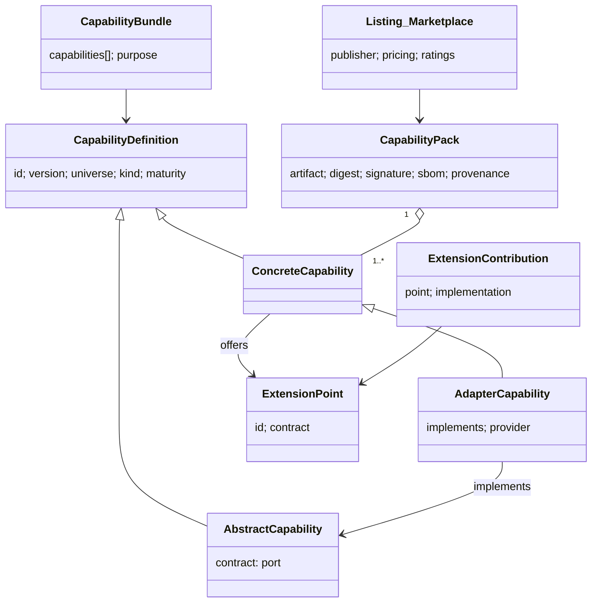

# U57 — Capability Universe Constitution

| Field | Value |
|---|---|
| Universe ID | `U57-capability` |
| Layer | L7 Composition & Generation |
| Domain | 09 Platform |
| Steward | `ucos:org:platform-kernel-registry` |
| Version | 0.1.0 (Draft) |
| Delivery phase | P0 (registry, packaging, runtime contract), P1 (marketplace storefront), P2 (third-party publishers, billing) |
| Depends on | U04 Meta, U05 Ontology, U61 Event, U03 Policy, U65 Security (signing, SBOM), U74 Certification, U02 Governance, U13 Temporal (see TEMPORAL-BINDING-MATRIX) |
| Depended on by | U58 Composition (resolves capabilities), U59 Generation, U73 Infrastructure (deploys packs), U72 Observability, all business universes (delivered as packs) |
| Master references | §8 (genome, manifest, packaging, dependencies, marketplace), §13.4 (pack runtime contract), ADR-009 |

> Capability owns **the unit of reusable behaviour**: capability definitions (the genome), abstract capabilities (interfaces), concrete implementations and adapters, extension points, Capability Packs (signed artifacts), bundles, the Capability Registry and the Capability Marketplace. It also defines the **Pack Runtime Contract** every pack must satisfy. It does not decide which capabilities a platform needs (U58 Composition) or certify them (U74).

---

## 1. Laws

| ID | Law | Enforcement |
|---|---|---|
| CAP-L1 | Business behaviour exists only inside certified packs. | Repo policy; runtime loads only registry-signed packs. |
| CAP-L2 | A capability's manifest is complete and valid before build (master §8.2). | `ucos lint` manifest schema; build fails otherwise. |
| CAP-L3 | Each object type, command and event type has exactly one providing capability. | Publish-time collision check against the registry (L4). |
| CAP-L4 | Packs talk to each other only through commands, queries, events and extension points. They never touch another pack's storage or internals. | Network policy + SDK has no cross-pack DB access + static import rule. |
| CAP-L5 | Vendor-specific code lives only in adapter packs implementing an abstract capability (port). | Dependency linter (`packs/*` cannot import vendor SDKs; `packs/adapters/*` can). |
| CAP-L6 | Every pack artifact is signed, has an SBOM and SLSA provenance, and is verified at deploy. | Admission policy (OPA) in cells. |
| CAP-L7 | A revoked pack version stops serving across all cells within the revocation SLA (≤ 30 min for security revocations). | Kill-switch propagation; cells poll and receive push. |

---

## 2. Ontology



- **Capability kinds:** `abstract` (port/interface, no runtime), `core` (business behaviour), `adapter` (implements an abstract capability for a provider), `extension` (contributes to extension points only, usually WASM), `ui-pack` (views and widgets only), `data-pack` (reference/taxonomy/compliance content, no code), `industry-pack` (bundle plus industry objects).
- **Maturity:** `experimental` (sandbox only), `beta` (opt-in, production allowed with waiver), `certified`, `deprecated`, `revoked`.
- **Runtime forms:** `service` (container implementing gRPC pack contract), `wasm` (sandboxed module for extension points: validators, computed fields, mappers), `none` (data/ui packs).

---

## 3. Objects

### 3.1 `ucos.capability.CapabilityDefinition`
The full manifest schema is master §8.2. Registry-level fields:

| Attribute | Type | Notes |
|---|---|---|
| `id` | String `<slug>.<name>` | `commerce.cart`, `payment.provider.razorpay` |
| `version` | SemVer | |
| `kind` | CapabilityKind | |
| `universe` | UniverseRef | |
| `concept` | ConceptRef | |
| `implements` | Array<AbstractCapabilityRef@range> | adapters |
| `manifest` | content-addressed ref | full genome |
| `provides` | `{objectTypes, commands, queries, events}` | indexed for collision check |
| `requires`, `optional`, `conflicts` | dependency specs | master §8.4 |
| `extensionPoints` | Array<ExtensionPoint> | |
| `selectionRules` | Array<RuleRef> | for adapters: Datalog facts (e.g. `adapter_for(payment.provider, jur:IN, method:UPI, …)`) |
| `maturity` | Maturity | |
| `publisher` | Reference→Organization | `ucos` or verified third party |
| `certification` | CertificationRef | |
| `status` | DefinitionStatus | |

### 3.2 `AbstractCapability` (port) example
```yaml
id: payment.provider
kind: abstract
version: 2.0.0
contract:
  grpc: proto/payment_provider_v2.proto
  operations: [CreateIntent, Authorize, Capture, Void, Refund, GetStatus, ParseWebhook, ListMethods]
  conformance: tests/conformance/payment-provider-v2/   # every adapter must pass
  simulator: payment.provider.simulator                # required for simulation context (CTX-L4)
selection:
  inputs: [jurisdiction(seller|buyer), currency, method, amount, merchantCategory, tenantPreference]
```

### 3.3 `ExtensionPoint` and `ExtensionContribution`
```yaml
ExtensionPoint: { id: commerce.cart.line-validators, contract: ucos.ext.Validator@1, cardinality: many, ordering: priority, timeoutMs: 20, failure: fail-closed|fail-open }
ExtensionContribution: { point, capability, implementation: wasm://sha256:… | service-op, priority, config schema }
```
WASM host functions are limited to: read input, read config, log, return result. No network, clock (except via a provided `now`) or randomness unless declared.

### 3.4 `CapabilityPack`
`{ id, version, capabilities: [CapabilityRef], artifact: oci://registry/ucos/packs/<id>@sha256:…, signature (cosign bundle), sbom (CycloneDX ref), provenance (SLSA v1 in-toto), runtime: {form, image, resources: {cpu, mem}, scaling: {min, max, metric}, ports}, migrations: [..], i18nBundles: [..], publishedAt, revoked?: {at: TimePoint, reason, decision} }`

### 3.5 `CapabilityBundle`
`{ id, name, purpose (e.g. "Marketplace Starter"), capabilities: [ref@range], defaultsConfig, industryTemplates: [..] }`

### 3.6 `MarketplaceListing`
`{ pack, publisher, summary, docsRef, pricing: { model: free|per-tenant|usage|revenue-share, plan: entitlement.PlanRef }, supportTier, ratings (U70), adoption (derived), securityScore (derived), complianceCoverage (derived from controls), screenshots }`

---

## 4. Commands, Queries, Events, APIs

| Command | Effect / Events |
|---|---|
| `RegisterCapability` (proposal) | manifest validation, collision check, ontology link → `capability.definition.proposed` |
| `PublishPack` | verify signature, SBOM, provenance → certification run (U74) → `capability.pack.published` |
| `RevokePackVersion` | level ≥ 3 (security: level 4 fast path) → kill switch → `capability.pack.revoked` |
| `DeprecateCapability(successor, sunset)` | `capability.definition.deprecated` |
| `CreateBundle`, `ListOnMarketplace`, `UpdateListing` | |
| `InstallCapability(tenant, capability)` | Studio action: adds to PlatformDefinition → recomposition (U58) |

**Queries:** `GetCapability(id, version)`, `ResolveRange(id, range)`, `Implementations(abstract, filters)`, `Providers(objectType|command|event)`, `Dependents(capability)`, `SearchMarketplace(q, filters)`, `ConformanceReport(adapter)`.

```text
GET  /v1/capabilities?q=&universe=&kind=&maturity=     GET /v1/capabilities/{id}?version=
POST /v1/capabilities            (register proposal)   POST /v1/packs  (publish)
POST /v1/packs/{id}@{v}:revoke                         GET  /v1/capabilities/{id}/implementations
GET  /v1/marketplace/listings?q=&industry=&compliance=
```
**Errors:** `CAP_MANIFEST_INVALID`, `CAP_PROVIDES_COLLISION`, `CAP_UNSIGNED`, `CAP_PROVENANCE_INVALID`, `CAP_CONFORMANCE_FAILED`, `CAP_REVOKED`, `CAP_DEPENDENCY_UNRESOLVABLE`.

---

## 5. Runtime Contract & Rules

### 5.1 Pack Runtime Contract v1 (normative; extends master §13.4)
```proto
service PackRuntime {
  rpc Describe(Empty) returns (PackDescriptor);                 // manifest hash, version, ops
  rpc Handle(CommandEnvelope) returns (ResultEnvelope);         // commands
  rpc Query(QueryEnvelope) returns (QueryResult);               // queries
  rpc OnEvent(EventEnvelope) returns (Ack);                     // push mode (or SDK pull)
  rpc Invoke(ExtensionCall) returns (ExtensionResult);          // extension points (service form)
  rpc Health(Empty) returns (HealthStatus);                     // liveness/readiness + dependency health
}
message CommandEnvelope { string command = 1; bytes payload = 2; string idempotency_key = 3;
                          bytes context = 4; string expected_version = 5; repeated Obligation obligations = 6; }
```
Requirements:
- Respond within the deadline the bus sets (default 2 s for commands).
- Handlers are deterministic with respect to inputs and state; random or time values come from the SDK (`ctx.Now()`, `sdk.ULID()`).
- No in-memory state across requests except caches.
- Graceful shutdown ≤ 30 s.

### 5.2 Version resolution
SemVer ranges are resolved to the highest certified version satisfying all constraints in the blueprint (a SAT solver over the dependency graph, like modern package managers). Ties prefer the version already deployed, which minimises churn. Determinism comes from the registry snapshot pin.

### 5.3 Adapter conformance
Every adapter passes the abstract capability's conformance suite against the provider sandbox, and the simulator passes the same suite. Results are recorded as evidence. A provider API change detected in nightly runs creates a gap on all blueprints using that adapter.

### 5.4 Decision tables
- `capability.auto-upgrade-policy` (per tenant: patch auto, minor opt-in, major planned).
- `capability.revocation-sla`.

---

## 6. Security & Compliance
- Supply-chain controls: SLSA L3 build, cosign keyless signing (Fulcio/Rekor), CycloneDX SBOM, and vulnerability scanning on publish and continuously (new CVE → gap on affected blueprints, with severity-based SLA).
- Third-party publisher onboarding needs KYB (U09), a security questionnaire and a pen-test report for T0/T1 packs.
- Packs run in sandboxes (gVisor optional for third-party), with egress allow-lists from manifest adapters.
- Controls: secure SDLC (ISO 27001 A.8.25–A.8.28), PCI DSS 6.3, SOC 2 CC7.1, and SBOM obligations from customers and regulators (EO 14028-style).

## 7. Validation & Reuse
- Before creating a capability, the Studio and CLI search the registry and ontology for existing providers.
- Extension points are preferred over forking. A tenant need that an extension point can satisfy MUST NOT become a new capability.
- Certification `ARCH-CAP-01`: manifest completeness, no undeclared operations at runtime (`Describe` matches manifest), and conformance passed.

## 8. Gaps & Evolution
```prolog
gap(missing_capability, C)        :- required_capability(C), not available(C).
gap(no_adapter, Abs, J)           :- required_capability(Abs), abstract(Abs), in_scope(J), needs_adapter(Abs, J), not adapter_for(Abs, J, _).
gap(adapter_without_simulator, A) :- adapter(A), not simulator_for(A).
gap(vulnerable_pack, P, Sev)      :- in_blueprint(P), vulnerability(P, Sev), Sev in [critical, high], age_days_open(P, D), sla_days(Sev, S), D > S.
gap(deprecated_in_use, C)         :- in_blueprint(C), deprecated(C), sunset_within_days(C, 90).
```
- **Self-healing:** a pack with crash loops or health failures is rolled back to the previous version in that cell (U73 runbook). Revocation forces a blueprint recomposition to an alternative version or implementation, or puts the affected feature in degraded mode.
- **Evolution:** frequently installed third-party packs can be adopted into `ucos` stewardship by an EvolutionProposal.

## 9. AI
- **AI uses:** marketplace semantic search ("I need COD reconciliation for India"), manifest drafting from code (proposals), and conformance-failure explanations.
- **Agent tools:** `capability.search`, `capability.describe` (read).
- **Prohibited for agents:** publishing or revoking packs.

## 10. Operations
- **Signals:** `packs_published_total`, `pack_health{pack,cell}`, `pack_cold_start_ms`, `revocation_propagation_seconds`, `conformance_pass_ratio{abstract}`, `cves_open{severity}`.
- **SLOs:** revocation propagated to all cells in ≤ 30 min (security) and ≤ 24 h (normal); publish-to-available p95 < 2 h including certification for minor versions.

## 11. UI
- **Views:** master W4 (marketplace browse and detail), `capability.registry.graph` (dependency graph, providers), `capability.pack.detail` (SBOM, signature verification, CVEs, conformance), `capability.publish.wizard` (developer portal), `capability.revocation.console`.
- **UX:** an install action always shows the dependencies that will be added and the cost delta before confirming.

## 12. Scale
About 1,000 capabilities and about 20k pack versions. The OCI registry is replicated per region. Pack images are pre-pulled to cells by blueprint usage. Registry T1. Kill-switch path T0.

## Appendix
- **A.** gVisor for all third-party packs: decided in ADR-025.
- **S. Sample pack for the Phase 0 exit test (A-74).** `sample.notes` exists only to prove the kernel end to end: an object type defined only in `spec/` is composed, certified, activated, written through the command bus, audited, and its reminder fires through the Temporal trigger engine. It has no business purpose and is never offered to tenants (maturity `experimental`, excluded from every industry template).
  `Note { title: LocalizedText, body: string, status: draft|published|archived, author: UGID, remindAt?: TimePoint, publishedAt?: TimePoint, tags: [string] }`
  Commands `CreateNote`, `EditNote`, `PublishNote`, `ArchiveNote`, `ScheduleNoteReminder`; queries `GetNote`, `ListNotes`; events `sample.note.created|published|archived|reminded`. Lifecycle `draft → published → archived`. Policy: authors edit their own drafts; publishing needs the `sample-editor` role.
- **B. Amendments:** master §8.3 gains capability kinds `data-pack` and `ui-pack`, and the formal `PackRuntime` gRPC contract.
- **C.** 0.1.0.
