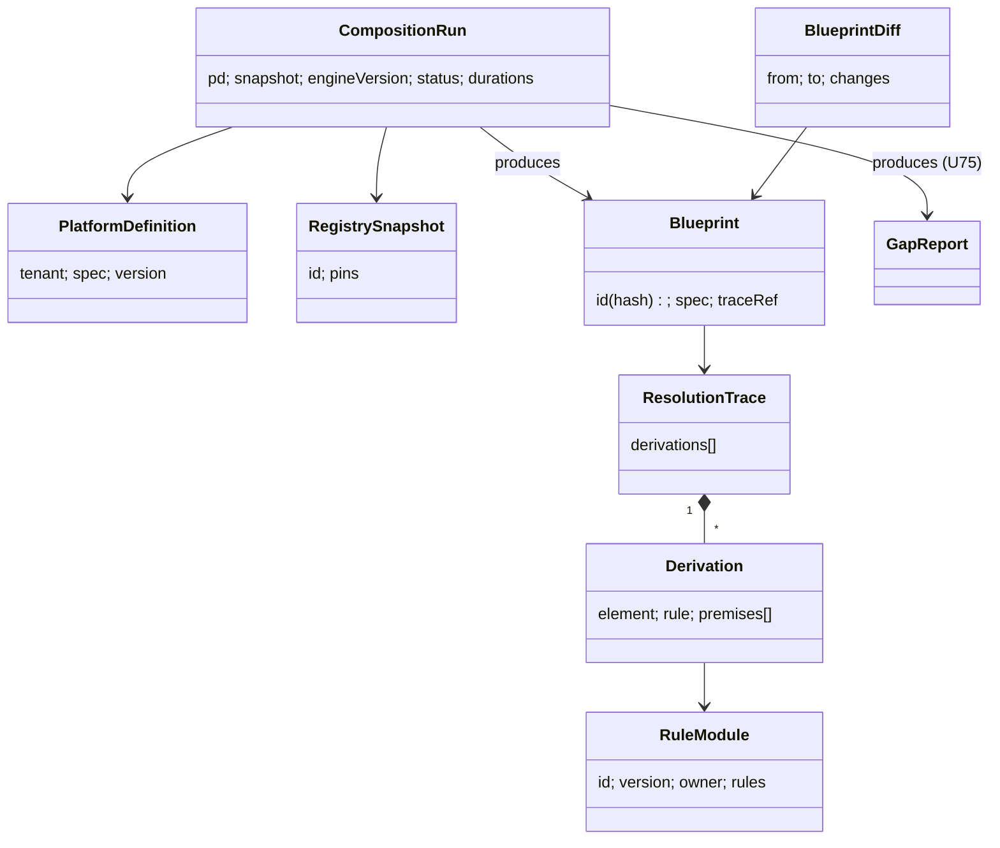

# U58 — Composition Universe Constitution

| Field | Value |
|---|---|
| Universe ID | `U58-composition` |
| Layer | L7 Composition & Generation |
| Domain | 09 Platform |
| Steward | `ucos:org:platform-kernel-composer` |
| Version | 0.1.0 (Draft) |
| Delivery phase | P0 (engine, rules, blueprint store), P1 (gap UX, incremental), P3 (intent analysis with AI) |
| Depends on | U57 Capability, U05 Ontology, U06 Taxonomy, U08 Reference Data, U12 Geography, U16 Context, U03 Policy, U67 Compliance (facts), U75 Gap (rule library), U73 Infrastructure (placement), U02 Governance, U13 Temporal (see TEMPORAL-BINDING-MATRIX) |
| Depended on by | U59 Generation, U74 Certification, U73 Infrastructure (activation), Builder Studio, U54 Simulation |
| Master references | §11 (whole section), §12.3, ADR-006, L10, L18 |

> Composition owns **turning intent into a complete, explainable, deterministic platform blueprint**: the `PlatformDefinition` (input), the composition engine and its rule base, the `Blueprint` (output), the `ResolutionTrace` (why each element exists), and composition diffs. Gap *rules* are contributed by every universe and their execution and reporting is shared with U75. This universe owns running them as part of composition.

---

## 1. Laws

| ID | Law | Enforcement |
|---|---|---|
| CMP-L1 | `compose(PD, snapshot, composerVersion)` is a pure function: identical inputs give a byte-identical blueprint. | CI reproducibility test; blueprint id = content hash. |
| CMP-L2 | Every blueprint element has a resolution trace to the PD input or rule(s) that required it. | Engine records derivations; validation fails on untraced elements. |
| CMP-L3 | Composition logic lives in rules (data). The engine contains no domain knowledge (no country, industry or vendor names). | Lint on engine code (banned-literal rule); code review. |
| CMP-L4 | A blueprint is only activatable when L10 holds (no mandatory gaps, recommended resolved or waived, certification passed). | Activation guard in U73. |
| CMP-L5 | Rule changes are definitions under Governance with regression tests over reference PDs. | Rule PRs run the golden-PD suite. |

---

## 2. Ontology



---

## 3. Objects

### 3.1 `PlatformDefinition` (PD)
The schema is master §11.2. Additional normative rules:
- `spec.capabilities.include` / `exclude` accept ids, globs (`loyalty.*`) and bundle refs.
- `?` suffix on a business-model or capability means "exploring": it generates recommendations only, never requirements.
- `overrides` section allows explicit adapter choice (`payment.provider@IN: payu`), which wins over selection rules but must still satisfy conformance and compliance.
- The PD is versioned (SemVer) and changed only through Governance (standard or normal class for tenants).

### 3.2 `RegistrySnapshot`
`{ id: ucos:snapshot:<timestamp>, pins: { capabilities: hash, objectTypes: hash, ruleModules: hash, refdata: [releaseIds], tzRelease, policiesBaseline: hash, complianceLibrary: hash }, createdAt }`. Snapshots are immutable and created hourly plus on demand.

### 3.3 `RuleModule`
```yaml
id: rules.compliance.india-payments
version: 1.4.0
owner: U67-compliance (steward: compliance-in)
language: datalog-ucos-v1
imports: [rules.core.closure, rules.geo.jurisdiction]
facts: |
  regulation_applies(reg:RBI-PA-Guidelines, jur:IN) :- required_capability(payment.core).
  requires_control(reg:RBI-PA-Guidelines, ctrl:card-tokenization).
  control_implemented_by(ctrl:card-tokenization, payment.tokenization.network).
tests: [tests/india-payments/*.yaml]     # PD fixture → expected requirements/gaps
```
Rule modules are contributed by universes (Compliance, Tax, Geography, Capability selection, Security baselines, Observability defaults, UI and locale rules, and Infrastructure placement). The core module (`rules.core.*`) holds the generic closure rules from master §11.3.

### 3.4 `Blueprint`
The schema is master §11.4. Normative additions:
- `spec.config`: resolved configuration per capability (tenant config merged with defaults).
- `spec.decisions`: decision table versions pinned.
- `spec.policies.sets`: policy-set versions (U03).
- `spec.placement`: cells per jurisdiction and data shard (from placement rules).
- `spec.adapters`: a map of `(abstract, scope) → implementation`.
- Status values: `candidate`, `certified`, `active`, `superseded`, `rolled-back`.

### 3.5 `ResolutionTrace` and `Derivation`
`Derivation { element: (kind, id), rule: RuleRef@version, bindings: {var: value}, premises: [DerivationRef | PD path | fact id] }`. It is stored compactly (deduplicated DAG) and queryable via "why" APIs.

### 3.6 `BlueprintDiff`
`{ from, to, capabilities: {added, removed, upgraded}, objectTypes, policies, controls, ui, adapters, placement, migrations: [..], riskHints }`

---

## 4. Commands, Queries, APIs

| Command | Effect / Events |
|---|---|
| `Compose(pdRef|pdDraft, snapshot?, mode: simulate|candidate)` | CompositionRun → blueprint candidate + GapReport + cost estimate → `composition.run.completed` |
| `Recompose(blueprint, trigger)` | on PD change, pack revocation, rule change, new regulation fact, refdata release → `composition.recompose.required` |
| `PromoteCandidate(blueprint)` | hands over to Generation (U59) and Certification (U74) via a Governance proposal |
| `ApplyFix(gapId, fixId)` | edits PD (or config) per fix → recompose |
| `CreateSnapshot` | |

**Queries:** `Why(blueprint, element)` → derivation chain in plain language, `WhyNot(blueprint, capability)` (e.g. "Loyalty excluded by PD exclude rule"), `Diff(a, b)`, `EstimateCost(blueprint)` (from capability cost models × PD scale), `WhatIf(pd, change)` (compose a delta in simulate mode).

```text
POST /v1/composition/runs                  GET /v1/composition/runs/{id}
GET  /v1/composition/blueprints/{id}       GET /v1/composition/blueprints/{id}/why?element=
GET  /v1/composition/blueprints/{a}/diff/{b}
POST /v1/composition/blueprints/{id}:promote
POST /v1/composition/gaps/{gapId}/fixes/{fixId}:apply
```
**Errors:** `CMP_PD_INVALID`, `CMP_UNSATISFIABLE` (version or conflict; returns the minimal unsatisfiable core), `CMP_RULE_ERROR` (with rule id and line), `CMP_TIMEOUT` (> 120 s), `CMP_SNAPSHOT_UNKNOWN`.

---

## 5. Algorithm (normative)

```text
compose(PD, S, V):
  facts ← load(S)                                       # registry facts as Datalog EDB
  facts += encode(PD)                                    # requested(C), in_scope(J), channel(X), scale(...), overrides
  facts += geo.resolveJurisdictions(PD.geography)        # in_scope(J) for all levels
  rules ← ruleModules(S) (stratified; negation only on lower strata)
  M ← evaluate(rules, facts)                             # semi-naive, deterministic order
  required ← { c | required_capability(c) ∈ M }
  versions ← solveVersions(required, S)                  # SAT; minimise churn vs current blueprint
  if UNSAT → return error with unsat core
  adapters ← select(abstracts(required), M, PD.overrides)
  config ← merge(defaults(versions), PD.config, tenant overrides)
  policies, controls, ui, signals, placement ← derived relations in M
  gaps ← { g | gap(...) ∈ M } ∪ checks(config schema validation, quotas, residency)
  blueprint ← canonicalize(versions, adapters, config, policies, controls, ui, signals, placement)
  id ← sha256(blueprint)
  return (blueprint, trace(M), GapReport(gaps), cost(blueprint, PD.scale))
```

- **Engine:** an embedded Datalog engine (Soufflé-compiled or a Rust engine). Inputs and outputs are sorted, and there is no reliance on hash-map iteration order. Stratified negation is allowed. Aggregates are limited to count, min and max.
- **Performance targets:** < 60 s cold for 100 capabilities and 40 jurisdictions; < 5 s incremental (the engine caches the EDB for the snapshot and evaluates deltas).
- **Golden PD suite:** at least 12 reference PDs (master §30 compositions × 2–3 geographies). Expected blueprints and gap reports are checked in, and every rule or engine change runs the suite. A diff fails CI unless explicitly approved.

---

## 6. Security & Compliance
- PDs and blueprints are `confidential` (they reveal tenant strategy). Rule modules are `internal`.
- Simulate-mode compositions never activate anything.
- Audit: every composition run (inputs hash, outputs hash, duration), promotions, and applied fixes.
- Controls: configuration management baseline (ISO A.8.9). The blueprint is the evidence of the configured state.

## 7. Validation & Reuse
- Any universe needing "if X then require Y" logic contributes a RuleModule. It never adds code to the composer.
- Studio, CLI (`ucos compose`) and CI share the same engine build.

## 8. Gaps & Evolution
The gap rule library lives in U75. This universe adds:
```prolog
gap(rule_module_untested, R) :- rule_module(R), active(R), not has_tests(R).
gap(blueprint_drift, B)      :- active_blueprint(B), runtime_hash(B, H), H != blueprint_hash(B).
gap(stale_blueprint, B)      :- active_blueprint(B), recompose_required(B, Reason), age_days_since(Reason, D), D > 14.
```
- **Self-healing:** if drift is detected between running config and the blueprint, the runtime is reconciled to the blueprint (GitOps).
- **Evolution:** optimisation objectives (minimise cost, latency or vendor count) over valid blueprints in P5, using an optimisation layer over the same facts.

## 9. AI
- **AI uses (P3):** intent analysis (natural language to PD draft; master W2), fix suggestions, and plain-language "why" explanations. The AI never emits blueprints. It only edits PD drafts, which then go through the deterministic engine.
- **Agent tools:** `composition.compose_simulate`, `composition.why`, `composition.diff`.

## 10. Operations
- **Signals:** `composition_duration_seconds{mode}`, `composition_unsat_total`, `gaps_by_kind{severity}`, `golden_suite_pass` (must be 1), `recompose_backlog`.
- **SLO:** simulate composition p95 < 15 s for typical PDs (≤ 60 capabilities).
- **Twin:** the blueprint is the declared state in the Platform Twin. Drift is measured against it.

## 11. UI
- **Views:** master W2/W3 (intent, geography, capabilities), W5 (composition canvas, why, diff), W6 (gap report and fixes), `composition.run.history`, `composition.cost.breakdown`.
- **UX:** every auto-added element has a "why" popover. An unsatisfiable composition shows the minimal conflicting set with suggested resolutions.

## 12. Scale
Thousands of compositions per day (mostly simulate). Stateless workers autoscale. Snapshots are cached in memory per worker (about 2 GB). Control plane, T1.

## Appendix
- **A.** Datalog engine choice: Soufflé (C++, compiled) vs a Rust embeddable engine (e.g. Crepe/Ascent). Decide in the P0 spike, weighing incremental evaluation support.
- **B. Amendments:** master §11.4 blueprint gains `config`, `decisions`, `placement` and `adapters` sections, and `PlatformDefinition` gains `overrides`.
- **C.** 0.1.0.
