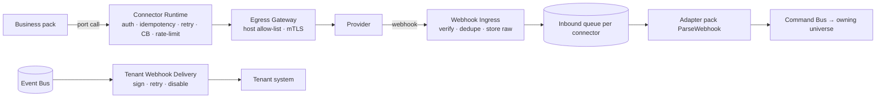

# U62 — Integration Universe Constitution

| Field | Value |
|---|---|
| Universe ID | `U62-integration` |
| Layer | L9 Integration |
| Domain | 09 Platform |
| Steward | `ucos:org:platform-integration` |
| Version | 0.1.0 (Draft) |
| Delivery phase | **P1** (connector runtime, inbound webhook ingress, outbound call resilience, credentials, provider sandboxes/simulators, tenant outbound webhooks), P2 (mapping studio, CDC/ETL, EDI, file exchange, product feeds out), P3+ (iPaaS-style flows, calendar sync connectors) |
| Depends on | U57 Capability (adapters implement ports), U61 Event, U65 Security (secrets, HMAC keys, mTLS), U03 Policy, U16 Context (reality/simulation), U13 Temporal (polling, reconciliation schedules, retries), U68 Audit, U72 Observability, U93 Data (data contracts for external flows) |
| Depended on by | U29 Payment, U35 Fulfillment/U36 Logistics, U31 Tax (e-invoice portals), U40 Communication, U09 Identity (IdPs, KYC), U12 Geography (maps), U14 Currency (FX feeds), U63 API (tenant webhooks), U87 (feeds), U95 (SCM) |
| Master references | §17 (integration universe), §15.1 (webhooks), CAP-L5 |

> Integration owns **everything that crosses the UCOS boundary to external systems**: the **connector runtime** that hosts adapter packs, **connector instances** (a tenant's configured connection with credentials), inbound **webhook ingress** (verification, dedupe, routing to the owning adapter), outbound call **resilience** (timeouts, retries, circuit breakers, rate limits, idempotency), **sandbox and simulator** management, **tenant outbound webhooks** (events delivered to tenants' systems), declarative **mappings**, and sync/reconciliation jobs. Business semantics stay in the owning universe's port (e.g. `payment.provider@2`); Integration provides the plumbing so no pack hand-rolls it.

## 1. Laws
| ID | Law | Enforcement |
|---|---|---|
| INT-L1 | All external I/O goes through the connector runtime (egress proxy with allow-lists per connector); packs cannot open arbitrary network connections. | Network policy: pack pods have no internet egress; runtime egress gateway enforces per-connector host allow-lists. |
| INT-L2 | Every inbound webhook is authenticated (signature/mTLS/IP allow-list as provider supports), deduplicated by provider event id, and stored raw (encrypted) before processing. | Ingress pipeline order is fixed; replay possible from raw store. |
| INT-L3 | Every outbound mutating call carries an idempotency key and is retried only per provider-declared semantics. | Connector manifest declares idempotency support; runtime enforces. |
| INT-L4 | Credentials live only in the secret store; connector instances reference secrets; rotation never requires code changes. | U65 SecretRef; workload identity. |
| INT-L5 | In non-physical realities (simulation/sandbox, U77), connectors resolve to simulators or provider sandboxes; production credentials are never usable there. | Context frame check in runtime; separate credential scopes. |
| INT-L6 | Tenant outbound webhooks are signed (HMAC-SHA256 + timestamp), retried with backoff for up to 72h, and auto-disabled after sustained failure with notification. | Delivery service. |

## 2. Objects
- `Connector` (definition, shipped in an adapter pack) `{ id, implements: [port@version], provider, auth: api-key|oauth2|mtls|basic|custom, operations: [{name, idempotency: key-header|natural|none, timeoutMs, retry: {max, backoff, retryOn}, rateLimit}], webhooks: {path, verification: hmac-sha256|rsa|mtls|ip-allowlist, eventIdPath, signatureHeader}, egressHosts: [..], sandbox: {baseUrl, credentialsKind}, simulator: packRef, regions: [jurisdictions], certification }`
- `ConnectorInstance { id, tenant, connector@version, environment: sandbox|production, credentials: SecretRef, config (merchant ids, account ids), scope: {jurisdictions, stores, currencies}, status: draft|verifying|active|degraded|disabled, health }`
- `InboundWebhook { id, connectorInstance, providerEventId, receivedAt: TimePoint, verified: bool, rawRef (encrypted), status: received|processed|duplicate|failed, attempts }`
- `OutboundCall` (log) `{ instance, operation, idempotencyKey, request/response hashes, status, latencyMs, at: TimePoint }`
- `Mapping` (P2) `{ id, from schema, to schema, language: jsonata, tests }`
- `SyncJob` `{ instance, kind: poll|reconcile|backfill, schedule: Recurrence, cursor, lastRunAt: TimePoint, status }`
- `TenantWebhookSubscription { tenant, url, events: [eventType], secret: SecretRef, filter: CEL, status, failureCount, disabledAt?: TimePoint }`
- `TenantWebhookDelivery { subscription, event id, attempts [{at: TimePoint, status, latency}], status }`

## 3. Runtime architecture

Resilience defaults: connect timeout 2 s, request timeout per operation (≤ 30 s), retries exponential with full jitter, circuit breaker opens at 50% failure over 20 calls/30 s, half-open probe after 30 s; bulkhead per connector instance.

## 4. Commands, Queries, Events, APIs
Commands: `CreateConnectorInstance`, `VerifyConnectorInstance` (provider handshake/test call), `RotateCredentials`, `DisableInstance`, `ReplayInboundWebhook`, `RunSyncJob`, `SubscribeTenantWebhook`, `RotateWebhookSecret`, `RedeliverWebhook`.
Queries: `InstanceHealth`, `CallLog(instance, filters)`, `WebhookLog`.
Events: `integration.instance.activated|degraded|disabled`, `integration.webhook.received|failed`, `integration.tenant-webhook.disabled`.
```text
POST /hooks/{connector}/{instanceToken}         (public ingress)
POST /v1/integration/instances                  POST /v1/integration/instances/{id}:verify|:rotate|:disable
GET  /v1/integration/instances/{id}/calls       POST /v1/integration/webhooks/{id}:replay
POST /v1/integration/tenant-webhooks            POST /v1/integration/tenant-webhooks/{id}:rotate-secret|:redeliver
```

## 5. Phase 1 connector set (adapter packs)
Payments: Razorpay (IN), Network International/N-Genius (AE). Carriers: one IN aggregator (e.g. Shiprocket/Delhivery), one AE carrier (e.g. Aramex). Messaging: email (SES/SendGrid), SMS IN (DLT-compliant provider), WhatsApp BSP. Tax: India e-invoice via GSP/IRP connector. Maps: Google Maps or Mapbox. FX: one reference-rate feed. Identity: Google/Apple social login. Each with sandbox config + simulator.

## 6. Gaps, Security, Ops, UI
```prolog
gap(connector_without_simulator, C) :- connector(C), not simulator(C).
gap(instance_unverified, I)        :- connector_instance(I), environment(I, production), not verified(I).
gap(webhook_verification_none, C)  :- connector(C), has_webhooks(C), verification(C, none).
```
Security: raw payloads encrypted (may contain PII/PCI-adjacent data — card data must never arrive; adapters reject payloads containing PAN patterns), egress allow-lists, SSRF protection (no user-supplied URLs except tenant webhooks, which are validated: https only, no private IP ranges). Signals: `connector_call_latency_ms{connector,op}`, `connector_error_ratio`, `circuit_state`, `webhook_ingress_total{verified}`, `tenant_webhook_failure_ratio`. Views: `integration.instances` (status, health, last calls), `integration.instance.setup` wizard (credentials, test connection), `integration.call.log`, `integration.webhooks` (tenant subscriptions, delivery log, redeliver). T0 (payment and webhook paths).

## Appendix
- **C.** 0.1.0.
