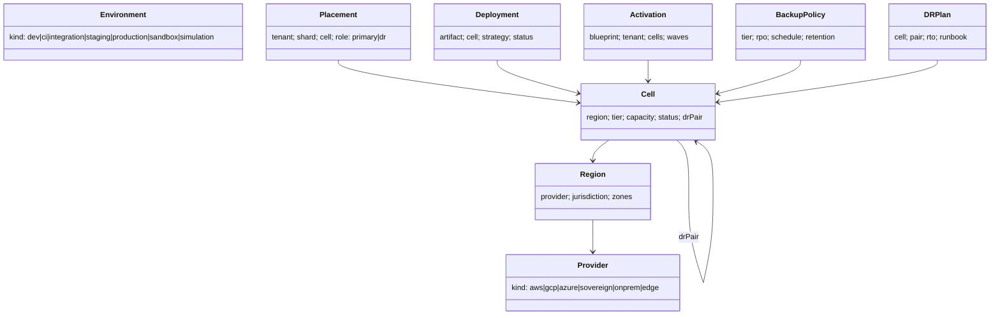

# U73 — Infrastructure & Deployment Universe Constitution

| Field | Value |
|---|---|
| Universe ID | `U73-infra` |
| Layer | L11 Operations & Infrastructure |
| Domain | 12 Architecture |
| Steward | `ucos:org:platform-sre` |
| Version | 0.1.0 (Draft) |
| Delivery phase | P0 |
| Depends on | U65 Security (keys, admission), U57 Capability (pack artifacts), U58 Composition (blueprints, placement rules), U02 Governance (release plans), U12 Geography (jurisdiction of regions), U13 Temporal (see TEMPORAL-BINDING-MATRIX) |
| Depended on by | U10 Org (tenant placement), every runtime component, U74 Certification (DR/PERF evidence), U72 Observability |
| Master references | §5.4, §13.5, §14.3, §26.2, §27, ADR-002 |

> This universe owns **where and how UCOS runs**: providers and regions, cells (isolated data-plane stacks), environments, placement of tenants and data shards, deployments of packs and kernel releases, blueprint activation in cells, scaling policies, backups and disaster recovery, and the infrastructure-as-code that realises them. Observability signals belong to U72. Security baselines are U65, enforced here through admission.

---

## 1. Laws

| ID | Law | Enforcement |
|---|---|---|
| INF-L1 | All infrastructure is declared as code (OpenTofu, Crossplane, Helm) and reconciled by GitOps. Manual changes are drift and are reverted. | Argo CD self-heal; drift alerts; console access read-only except break-glass. |
| INF-L2 | A cell is pinned to one jurisdiction; tenant data shards are placed only in cells that satisfy residency. | Placement rules in composer; admission check in cell. |
| INF-L3 | Every workload is admitted only if signed, scanned and policy-compliant. | OPA Gatekeeper/Kyverno + cosign verify. |
| INF-L4 | Every tier has tested backup and restore. A restore test older than its SLA is a gap. | Scheduled restore drills with evidence (U68). |
| INF-L5 | Cloud-provider-specific services are used only behind infrastructure ports with a portable alternative. | Architecture review gate `ARCH-INF-01`. |
| INF-L6 | Deployments are progressive with automatic rollback guards (U02 ReleasePlan). | Argo Rollouts analysis templates. |

---

## 2. Ontology



- **Cell profiles:** `standard` (pooled and schema tenants), `dedicated` (one tenant), `sovereign` (in-country provider, local HSM), `edge` (store, warehouse or factory node, reduced data plane), `simulation` (no external egress).
- **Cell components (reference stack):** Kubernetes (3 AZs), Envoy gateway, kernel services, pack runtimes, Postgres (HA, PITR), Kafka (3 brokers or more), OpenSearch, Redis, Flink, workflow engine, OTel collectors, Vault agent, object storage bucket set, and scheduler shards.

---

## 3. Objects

### 3.1 `ucos.infra.Cell`
| Attribute | Type | Notes |
|---|---|---|
| `id` | String `cell-<jur>-<city>-<n>` | `cell-in-mum-1` |
| `region` | RegionRef | |
| `jurisdiction` | JurisdictionRef | INF-L2 |
| `profile` | CellProfile | |
| `tierSupport` | Array<T0..T3> | |
| `capacity` | `{ tenants, rpsReads, ordersPerMin, eventsPerSec, storageTb }` | reference sizing |
| `utilisation` | derived | |
| `drPair` | CellRef | must share residency |
| `version` | `{ kernel, platformBundle }` | |
| `status` | `provisioning|active|draining|maintenance|failed-over|retired` | |
| `iac` | git ref | |

### 3.2 `Placement`
`{ tenant, shard: { kind: all|organization|dataClass|jurisdiction, key }, cell, role: primary|dr|read-replica, since, migration?: MigrationRef }`. Example: a tenant operating in IN and AE has `shard(jurisdiction=IN) → cell-in-mum-1` and `shard(jurisdiction=AE) → cell-ae-dxb-1`. Global (non-personal) catalog data is replicated to both.

### 3.3 `Deployment` (kernel or pack)
`{ id, artifact: oci digest, kind: kernel|pack|config, cells: [..], strategy: ReleasePlanRef, status: pending|progressing|paused|completed|rolled-back, startedAt: TimePoint, guardsTripped: [..], proposal: ChangeProposalRef }`

### 3.4 `Activation` (blueprint into cells)
`{ id, blueprint, tenant, previous: BlueprintRef?, cells, waves (tenant cohorts / traffic %), migrations: [data migrations to run], status, proposal, certification }`. Activation means: ensure pack versions are deployed in the cells, install policy and decision bundles, run expand migrations, switch the tenant's routing to the new blueprint per wave, monitor guards, then run contract migrations after a hold.

### 3.5 `BackupPolicy`, `DRPlan`
```yaml
BackupPolicy:
  tier: T1
  postgres: { pitr: true, walArchive: continuous, fullBackup: "FREQ=DAILY", retention: P35D, crossRegionCopy: true (same residency) }
  kafka:    { tieredStorage: true, mirrorTo: drPair, rpo: PT1M }
  objectStore: { versioning: true, replication: drPair }
  restoreTest: { schedule: "FREQ=WEEKLY", scope: random-tenant-sample, evidence: ec.restore-test }
DRPlan:
  cell: cell-in-mum-1
  pair: cell-in-hyd-1
  rto: PT30M
  rpo: PT5M
  mode: warm-standby
  runbook: runbooks/dr-failover-cell.md
  drill: "FREQ=QUARTERLY"
```

### 3.6 `Environment`
`{ id, kind, cells, dataPolicy: none|synthetic|masked-production (masking via U65 handling matrix), ttl?: Duration, owner }` — ephemeral CI environments are created per PR with TTL PT8H.

---

## 4. Commands, Queries, APIs

| Command | Notes / Events |
|---|---|
| `ProvisionCell(region, profile)` | IaC apply (Crossplane claim) → conformance tests → `infra.cell.provisioned` |
| `PlaceTenant(tenant, shards)` | solver §5.1 → `infra.placement.assigned` |
| `MigrateShard(shard, toCell)` | online migration (logical replication) → `infra.placement.migrated` |
| `Deploy(artifact, cells, releasePlan)` | from approved proposal → `infra.deployment.*` |
| `ActivateBlueprint(blueprint, tenant)` | from certified + approved proposal → `infra.activation.*` |
| `RollbackActivation(id)` | to previous blueprint; contract migrations are never run before the hold expires, so rollback stays possible |
| `FailoverCell(cell)` | DR runbook; level 4 or L3 automation on pre-approved conditions → `infra.cell.failed-over` |
| `DrainCell`, `RetireCell` | tenants migrated first |
| `RunRestoreTest(scope)` | evidence |

**Queries:** `CellsFor(jurisdiction, profile)`, `TenantPlacement(tenant)`, `CapacityForecast(cell, horizon)`, `DriftReport(cell)`, `WhatRunsWhere(blueprint)`.

```text
POST /v1/infra/cells                     GET /v1/infra/cells/{id}
POST /v1/infra/placements:solve          POST /v1/infra/placements/{id}:migrate
POST /v1/infra/deployments               POST /v1/infra/activations   POST /v1/infra/activations/{id}:rollback
POST /v1/infra/cells/{id}:failover|:drain
GET  /v1/infra/drift?cell=
```
**Errors:** `INF_NO_COMPLIANT_CELL`, `INF_CAPACITY_EXHAUSTED`, `INF_ADMISSION_DENIED`, `INF_GUARD_TRIPPED`, `INF_ROLLBACK_WINDOW_CLOSED`, `INF_RESTORE_TEST_FAILED`.

---

## 5. Rules & Algorithms

### 5.1 Placement (normative; runs as composer rule module `rules.infra.placement` + solver)
```text
candidates(shard) = { cell | cell.status = active
                         ∧ cell.jurisdiction satisfies residency(tenant, shard)
                         ∧ cell.profile ≥ required(tenant.securityProfile, tenant.isolationTier)
                         ∧ tier(shard) ∈ cell.tierSupport }
choose argmin over candidates of: projectedUtilisation(cell + shard.load) with headroom ≥ 30%,
       tie-break: lowest latency to tenant's primary user geography, then lowest cost
no candidate → gap(INF_NO_COMPLIANT_CELL) → triggers ProvisionCell proposal
```

### 5.2 Activation guards (defaults)
Error-rate ratio, SLO burn rate (multi-window: 1 h at 14.4× and 6 h at 6×), p99 latency regression > 20%, business KPI guard per blueprint (from U72, e.g. checkout success), and a policy deny-ratio spike (U03).

### 5.3 Upgrade policy
- Kernel N and N-1 are supported concurrently.
- Cells are upgraded by waves: internal → low-tier → T1 → T0.
- Pack versions per tenant follow `capability.auto-upgrade-policy` (U57).

---

## 6. Security & Compliance
- Admission policies: signed images only, no root, read-only filesystem, resource limits, network policies, no host mounts, seccomp, pinned digests.
- CSPM/KSPM scans feed U65 findings.
- Break-glass console access is time-boxed and recorded.
- Controls: ISO A.8.9 (configuration), A.8.13 (backup), A.5.30 (ICT readiness for business continuity), SOC 2 A1.2/A1.3, PCI DSS 12.10, DORA (ICT resilience testing, third-party concentration risk via provider diversity).

## 7. Validation & Reuse
- Packs declare runtime needs (resources, scaling, ports) in manifests; IaC is generated from those (master §12.1).
- No pack provisions its own infrastructure.
- Gate `DR-*`: backup policy present, restore test passed within SLA, and a DR drill within a quarter for T0/T1.

## 8. Gaps & Evolution
```prolog
gap(residency_unsatisfied, T, J) :- tenant_shard(T, J), not placement_in(T, J, _).
gap(restore_test_stale, C)        :- cell(C), tier_max(C, Tier), Tier in [t0, t1], last_restore_test_days(C, D), D > 7.
gap(dr_drill_stale, C)            :- cell(C), tier_max(C, Tier), Tier in [t0, t1], last_drill_days(C, D), D > 92.
gap(capacity_risk, C)             :- cell(C), forecast_utilisation(C, P30D, U), U > 0.75.
gap(drift, C)                     :- cell(C), drift_items(C, N), N > 0, age_hours(drift, H), H > 1.
gap(single_provider_concentration, T) :- tenant(T), tier(T, t0), providers_used(T, 1), dora_applies(T).
```
- **Self-healing:** node and AZ failures handled by Kubernetes and multi-AZ. Cell-level failure triggers the DR failover runbook (L3 auto if the region health signal is red for > 10 min and the pre-approved condition holds; otherwise page). Capacity risk triggers scale-out or a new-cell proposal.
- **Evolution:** an edge-cell profile for offline-first stores (P6); a GPU pool cell profile for self-hosted models (P4).

## 9. AI
- **AI uses (AIOps):** capacity forecasting, anomaly detection on infrastructure signals, rollout guard tuning suggestions, and incident RCA over the dependency graph.
- **Agents** may execute pre-approved L3 runbooks (scale, restart, failover under conditions). They may not provision or retire cells, or change placement.

## 10. Operations
- **Signals:** `cell_utilisation{resource}`, `deployments_in_progress`, `rollback_total`, `activation_duration_s`, `backup_success_ratio`, `restore_test_last_success_age_h`, `drift_items`, `cost_per_cell_daily`.
- **SLOs:** per tier (master §26.2). Deployment lead time (approved → all cells) p95 < 24 h for packs. Rollback start < 2 min after a guard trips.
- **Runbooks:** cell failover, shard migration, stuck rollout, Kafka partition reassignment, Postgres failover, certificate expiry, cloud quota exhaustion.

## 11. UI
- **Views:** master W1 (cells panel), `infra.cell.detail` (health, capacity, tenants, versions, DR status), `infra.placement.map` (world map of cells by jurisdiction with tenant shards), `infra.rollouts.board` (waves, guards, rollback), `infra.dr.dashboard` (RPO/RTO tested vs target, drill history), `infra.drift.report`.

## 12. Scale
Reference: 10–50 cells initially, growing to hundreds. Each cell is sized per §31.2 of the master. The control plane is multi-region active-passive (T0), and cells are independent so one failure doesn't affect the others.

## Appendix
- **A.** Crossplane vs pure OpenTofu for cell provisioning (recommendation: OpenTofu modules wrapped by Crossplane compositions for self-service).
- **B. Amendments:** master §27 gains `Placement` sharding by jurisdiction, and `Activation` as a first-class object.
- **C.** 0.1.0.
