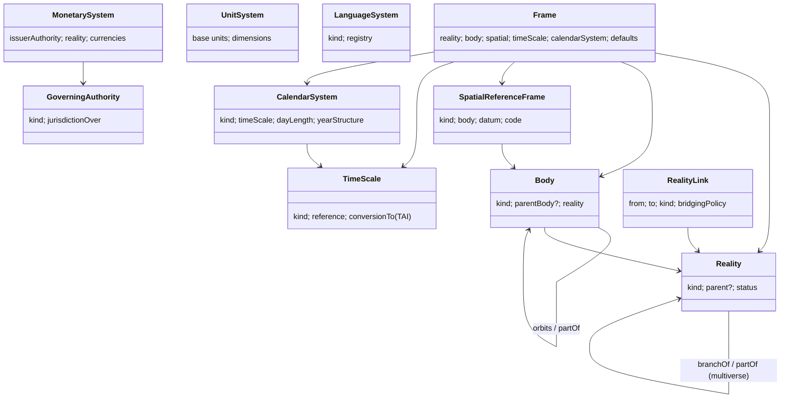

# U77 — Existence & Reality Frame Universe Constitution

| Field | Value |
|---|---|
| Universe ID | `U77-frame` |
| Layer | L1 Meta-Model / L4 Foundation (the root of all foundation universes) |
| Domain | 01 Foundation |
| Steward | `ucos:org:architecture-board` (constitutional) with delegated stewards per frame family |
| Version | 0.1.0 (Draft) |
| Delivery phase | P0 (Earth-physical default frame, frame fields on value types, registry), P6+ (additional bodies, realities, time scales via packs) |
| Depends on | U04 Meta, U08 Reference Data, U01 Authority |
| Depended on by | U12 Geography, U13 Temporal, U14 Currency & Unit, U15 Localization, U16 Context, U10 Org (jurisdiction operators), U55 Twin, U54 Simulation, U41 Media (virtual worlds), every object (via Context frame) |
| Master references | §7.6 (Reality context, Observer, Hypothetical), §29.7 (future horizon), L20 (discover the unknown), chat "Layer 0 Existence / Reality / Future Existence" |

> This universe owns **the frames of reference in which anything exists**: which **reality** (physical, digital, virtual world, simulation, hypothetical branch), on/around which **body or place-system** (Earth, Moon, Mars, orbital station, asteroid, virtual world, any future body — up to galaxies and other "universes" in the multiverse sense), with which **spatial reference frame**, which **time scale and calendar system**, which **monetary systems / issuers**, which **unit systems**, which **language systems**, and which **governing authorities**. Its single purpose is to make sure **nothing in UCOS silently assumes Earth, UTC, ISO 4217, SI, BCP 47 or nation-state law** — those are *defaults*, registered as data, replaceable and extendable without code changes to consuming universes.

---

## 1. Constitution, Authority, Principles & Laws

### 1.1 Mandate
**Owns:** `Reality`, `RealityLink`, `Body` (celestial or virtual place-system), `SpatialReferenceFrame`, `TimeScale`, `CalendarSystem`, `MonetarySystem` (issuer authority over currencies), `UnitSystem`, `LanguageSystem`, `GoverningAuthority` (non-national authorities: space agencies, station operators, virtual-world operators, DAOs, treaty bodies), `Frame` (the bundle), `FrameConversion` (registered conversion functions).
**Does not own:** places/addresses (U12 — but U12 places live *within* a Body+Frame), dates/schedules (U13 — but time values carry a TimeScale), currencies/units themselves (U14 — but they belong to MonetarySystems/UnitSystems), locales (U15).

### 1.2 Laws

| ID | Law | Enforcement |
|---|---|---|
| FRM-L1 | Every frame-dependent value (coordinate, place, instant, calendar date, currency, unit, locale, jurisdiction) is interpreted in an explicit or inherited `Frame`; the platform default frame is data (`frame:earth-physical`), never a code assumption. | Value types (U12/U13/U14/U15) carry optional `frame`; Context supplies default; lint bans literal assumptions (e.g. hard-coded 24h day, 86400 s as "day length" outside Temporal, `WGS84` literal outside Geo frame adapters). |
| FRM-L2 | New realities, bodies, frames, time scales, monetary/unit/language systems and authorities are added as registry entries plus (if needed) certified conversion packs — never by changing consuming universes. | Consumers resolve through U77 APIs; certification `ARCH-FRM-01`. |
| FRM-L3 | Conversions between frames are explicit, versioned, and record precision/uncertainty; no implicit cross-frame arithmetic. | SDK raises `FRM_CROSS_FRAME` without a conversion. |
| FRM-L4 | Objects in non-physical realities (virtual world, simulation, hypothetical) can never trigger physical-world side effects (payments, shipments, messages to real people) unless an explicit `RealityLink` with a bridging policy authorises it. | Context `reality` + Policy P-004 generalised (simulation isolation → reality isolation). |
| FRM-L5 | Every frame entity has a governing authority (who defines it) and a steward in UCOS. | Required fields. |

### 1.3 Authorities
New reality *kinds*, body *kinds*, and conversion packs: level 4. New instances (a new virtual world, a new orbital station, a simulation reality): level 2–3 depending on scope. Default frame change for a tenant: level 3.

---

## 2. Ontology & Taxonomy



### 2.1 Taxonomies (seed values; extensible as data)
- **RealityKind:** `physical`, `digital` (pure information systems), `virtual-world` (metaverse/game world with its own space/economy), `augmented` (physical with digital overlay), `simulated` (simulation runs, U54), `hypothetical` (what-if branches, plans, forecasts), `historical-reconstruction`, `fictional` (e.g. game lore — commerce on in-game items), `other`.
- **Multiverse levels:** `Reality` instances form a tree/graph: `physical` (root) → branches (`hypothetical`/`simulated`) via `branchOf`; independent roots for virtual worlds; "universe" in the cosmological sense is modelled as a `Body` kind `universe` within `physical` reality (observable universe), so the model scales from rooms to galaxies to hypothetical other universes without new primitives.
- **BodyKind:** `universe`, `galaxy-cluster`, `galaxy`, `star-system`, `star`, `planet`, `dwarf-planet`, `moon`, `asteroid`, `comet`, `orbital-station`, `spacecraft`, `habitat`, `virtual-world`, `virtual-region` (shard/zone of a world), `building-indoor` (local frame), `vehicle` (moving frame), `other`.
- **SpatialFrameKind:** `geodetic` (ellipsoid lat/lon/height; e.g. EPSG:4326 WGS 84 for Earth, IAU 2015 Mars 49900), `planetocentric`, `projected`, `local-cartesian` (indoor, site, factory), `body-fixed`, `inertial` (ICRF for space), `orbital-elements`, `virtual` (world units, possibly non-Euclidean), `graph` (topological only, e.g. network locations).
- **TimeScaleKind:** `UTC`, `TAI`, `TT`, `TDB` (barycentric, for solar-system ops), `GPS`, `MTC` (Mars Coordinated Time), `LTC` (Coordinated Lunar Time — emerging standard), `spacecraft-clock`, `world-clock` (virtual world tick time, possibly accelerated/paused), `simulation-clock`, `logical` (Lamport/vector, for distributed ordering).
- **CalendarSystemKind:** `gregorian`, `iso-week`, `islamic-umalqura`, `islamic-civil`, `hebrew`, `indian-national`, `vikram-samvat`, `chinese-lunisolar`, `persian`, `ethiopic`, `buddhist`, `japanese-imperial`, `darian` (Mars sol-based), `sol-count` (mission sol numbering), `fiscal-*` (U13), `virtual-world-custom`.
- **MonetarySystemKind:** `sovereign-fiat` (central banks → ISO 4217), `supranational`, `cbdc`, `stablecoin`, `cryptocurrency` (protocol-issued), `loyalty-points` (tenant-issued), `in-game` (virtual-world operator), `community/local`, `commodity-backed`, `colony/off-world` (future), `barter-units`, `custom`.
- **UnitSystemKind:** `SI`, `UCUM`, `imperial`, `us-customary`, `traditional-regional` (e.g. Indian tola, bigha; Chinese jin), `natural/astronomical` (AU, light-year, parsec), `virtual-world`, `custom`.
- **LanguageSystemKind:** `natural` (BCP 47), `sign` (BCP 47 sgn-*), `constructed` (Esperanto, Klingon — private-use subtags where unregistered), `historical`, `machine-protocol` (for agent/machine interfaces), `symbolic/notation` (math, music), `other`.
- **GoverningAuthorityKind:** `nation-state`, `subnational`, `supranational`, `treaty-body` (e.g. UN COPUOS, Outer Space Treaty regime), `space-agency`, `station-operator`, `virtual-world-operator`, `dao`, `platform-operator` (UCOS tenant itself for its marketplace rules), `standards-body`, `custom`.

### 2.2 Standards mapping
IAU WGCCRE (planetary coordinate systems), IAU/IERS time scales, EPSG/OGC CRS registry (OGC WKT2, ISO 19111), ISO 4217, ISO 80000 / SI Brochure, UCUM, BCP 47 / CLDR, OGC/Metaverse Standards Forum work items (virtual worlds), CCSDS (space data systems), OpenXR/USD (virtual spatial data) as adapters.

---

## 3. Registry Model & Objects

### 3.1 `ucos.frame.Reality`
`{ id (ucos:reality:physical | ucos:reality:sim/<run> | ucos:reality:vw/<world>), kind, name, parent?: RealityRef (branchOf), operator: GoverningAuthorityRef, persistence: persistent|ephemeral, sideEffectPolicy: none|bridged|full (physical only = full), status }`

### 3.2 `ucos.frame.Body`
`{ id (ucos:body:earth, ucos:body:mars, ucos:body:moon, ucos:body:iss, ucos:body:vw/<world>/<region>), kind, reality, parentBody?, names: LocalizedText, authorityCodes: [{scheme: IAU|NAIF-SPICE|custom, value}], physical?: {meanRadius: Quantity, rotationPeriod: Quantity, orbitalPeriod: Quantity, gravity?}, defaultSpatialFrame, defaultTimeScale, defaultCalendarSystem, governingAuthorities: [..], status }`

### 3.3 `ucos.frame.SpatialReferenceFrame`
`{ id, kind, body, code (EPSG:4326 | IAU_2015:49900 | LOCAL:<site> | VW:<world>), datum/ellipsoid params, axes, units: UnitRef, wkt2?: Text, conversions: [FrameConversionRef] }`

### 3.4 `ucos.frame.TimeScale` and `CalendarSystem`
```yaml
TimeScale:
  id: ucos:timescale:mtc
  kind: MTC
  definition: "Mean solar time at Mars prime meridian (Airy-0)"
  toTAI: conversion pack frame.time.mars@1   # algorithm, uncertainty
  leapPolicy: none
CalendarSystem:
  id: ucos:calsys:darian
  kind: darian
  timeScale: ucos:timescale:mtc
  dayUnit: { name: sol, length: { value: "88775.244", unit: s } }
  yearStructure: { months: 24, ... }
  cldrDisplay: custom-pack frame.calendar.darian@1
```

### 3.5 `ucos.frame.MonetarySystem`, `UnitSystem`, `LanguageSystem`, `GoverningAuthority`
```yaml
MonetarySystem:  { id, kind, issuer: GoverningAuthorityRef, reality, currencies: [CurrencyRef (U14)], settlementRails: [..], convertibility: {to: [MonetarySystemRef], via: RatePolicyRef?}, regulatoryStatus }
UnitSystem:      { id, kind, units: [UnitRef (U14)], baseMapping: {to: SI, conversions} }
LanguageSystem:  { id, kind, registry (BCP47 | private-use namespace), scripts }
GoverningAuthority: { id, kind, name, jurisdictionOver: [JurisdictionRef (U12) | RealityRef | BodyRef], lawSources: [RegulationRef (U67)] }
```

### 3.6 `ucos.frame.Frame` (bundle referenced by Context and objects)
`{ id (ucos:frame:earth-physical default), reality, body, spatialFrame, timeScale, calendarSystem, monetarySystems: [..], unitSystems: [..], languageSystems: [..], authorities: [..] }`
Seed frames: `earth-physical` (physical / Earth / EPSG:4326 / UTC / Gregorian / sovereign-fiat / SI+UCUM+regional / BCP47 / nation-states), `simulation-default` (simulated reality inheriting earth-physical spatial/time with simulation clock), `orbital-leo` (ISS-style: UTC timescale, station-operator authority), `mars-surface` (registered, P6+ example), `virtual-world-template`.

### 3.7 `RealityLink`
`{ id, from: RealityRef|ObjectRef, to: RealityRef|ObjectRef, kind: twin-of|mirrors|branch|projection|redeemable-in (virtual item ↔ physical good), bridgingPolicy: PolicyRef (what effects may cross), validity: TimeRange }`
Examples: physical warehouse ↔ digital twin (U55); in-game item redeemable for physical merchandise (bridging policy allows order creation in physical reality after payment); simulation branch of production blueprint.

### 3.8 `FrameConversion`
`{ id, from, to, kind: spatial|time|calendar|monetary|unit|language, implementation: pack@version (WASM or service), precision, validRange, uncertaintyModel }`

---

## 4. Commands, Queries, Events, APIs

| Command | Notes / Events |
|---|---|
| `RegisterReality`, `RegisterBody`, `RegisterSpatialFrame`, `RegisterTimeScale`, `RegisterCalendarSystem`, `RegisterMonetarySystem`, `RegisterUnitSystem`, `RegisterLanguageSystem`, `RegisterAuthority` | governed; `frame.*.registered` |
| `DefineFrame` | bundle; `frame.frame.defined` |
| `RegisterConversion` | requires certified pack; `frame.conversion.registered` |
| `LinkRealities` | bridging policy reviewed (level 3+) |
| `SetTenantDefaultFrame` | Context default |

Queries: `ResolveFrame(ctx|object)`, `Convert(value, fromFrame, toFrame, asOf)`, `BodiesUnder(body)`, `RealityTree()`, `IsSideEffectAllowed(reality, action)`.

```text
GET  /v1/frame/realities        GET /v1/frame/bodies?parent=     GET /v1/frame/frames/{id}
POST /v1/frame/convert          POST /v1/frame/realities          POST /v1/frame/links
```
Errors: `FRM_CROSS_FRAME`, `FRM_NO_CONVERSION`, `FRM_REALITY_SIDE_EFFECT_FORBIDDEN`, `FRM_UNKNOWN_FRAME`, `FRM_PRECISION_INSUFFICIENT`.

---

## 5. Rules & Algorithms

### 5.1 Default resolution (normative)
`frame(value) = value.frame ?? object.frame ?? ctx.frame ?? tenant.defaultFrame ?? ucos:frame:earth-physical`. Context (U16) gains dimension `frame` (resolved once; narrowing allowed for simulation/virtual branches).

### 5.2 Effects of frame on foundation universes (normative contract)
| Universe | Frame dependency | Change vs current spec (amendment) |
|---|---|---|
| U12 Geography | Places, coordinates, jurisdictions belong to a Body + SpatialFrame; `Coordinate` gains optional `frame`; Jurisdictions may be governed by non-national authorities (station operator, virtual-world operator, treaty body). | A-23 |
| U13 Temporal | `TimePoint` gains optional `scale` (default UTC); calendars belong to CalendarSystems; "day" = calendar system day unit (sol on Mars); RRULE evaluated in CalendarSystem (custom systems via conversion packs); light-time delay is a Duration fact between Bodies for SLA computation. | A-24 |
| U14 Currency & Unit | Currencies belong to MonetarySystems (ISO 4217 = sovereign-fiat system); non-ISO currency codes use `X-` namespaced ids (`X-<system>-<code>`); units belong to UnitSystems; conversion only through registered conversions. | A-25 |
| U15 Localization | Locales belong to LanguageSystems; BCP 47 private-use (`x-`) for unregistered languages; calendar display per CalendarSystem. | A-26 |
| U16 Context | New dimension `frame` (reality, body, spatial, timeScale, calendarSystem); `simulation` flag generalised to `reality.kind ∈ {simulated, hypothetical}` with side-effect rules. | A-27 |
| U03 Policy | Platform policy P-004 generalised: forbid external side effects when `context.frame.reality.sideEffectPolicy ≠ full` unless bridged. | A-28 |

### 5.3 Reality isolation
Every adapter (payments, carriers, messaging…) declares the realities it may act in (default `physical` only). Virtual-world economies use their own MonetarySystem and adapters (game-economy APIs). Crossing (e.g. buying a physical hoodie with in-game currency) is an explicit RealityLink + bridging policy + conversion via RatePolicy.

---

## 6. Security & Compliance
Frames registry `public`; tenant-defined realities (private virtual worlds, simulation branches) `confidential`. Space-law and virtual-world terms modelled as Regulations under U67 with non-national GoverningAuthorities. Export controls on space-related goods handled by U90 Global Trade.

## 7. Validation & Reuse
- Linter `FRM-LINT-001`: forbidden literals in packs (`86400` as day length, `'UTC'` strings outside Temporal SDK, `EPSG:4326` outside Geo adapters, ISO-4217-only validation regexes, assumption of 7-day week outside Temporal).
- All foundation SDK value types accept `frame` and default correctly; golden tests run every foundation algorithm under at least two frames (earth-physical and a synthetic non-Earth frame with different day length and units) — gate `ARCH-FRM-02` ("frame-agnostic proof").

## 8. Gaps & Evolution
```prolog
gap(frame_assumption_in_code, P)     :- pack(P), lint_violation(P, frm_lint_001).
gap(missing_conversion, F1, F2)      :- interacting_frames(F1, F2), not conversion(F1, F2).
gap(reality_without_side_effect_policy, R) :- reality(R), not side_effect_policy(R, _).
gap(authority_missing_for_body, B)   :- body(B), hosts_tenant_activity(B), not governing_authority(B, _).
```
Evolution: this universe is the landing zone for L20 "Discover the unknown": any newly discovered dimension of existence (new reality kind, new body kind, new time scale) is first a registry kind proposal here, then consumed generically.

## 9. AI
Agents carry the frame in context; AI never infers frame from text alone (explicit resolution); simulation/hypothetical realities are the default playground for autonomous agents (L4 autonomy allowed only in non-physical realities unless bridged).

## 10. Operations
Signals: `frame_conversions_total{kind}`, `cross_frame_errors_total`, `reality_side_effect_blocks_total`. Small registry; T0 cached in SDK.

## 11. UI
Views: `frame.registry.browser` (realities tree, bodies tree from galaxy → room / virtual world → region), `frame.default.settings` (tenant), frame indicator chip in Console header when not `earth-physical` (e.g. "Simulation: Diwali-peak-v3" or "Virtual world: Arena-1"), `reality.link.editor`.

## 12. Scale
Small data, global, replicated read-only to cells. T0 (read path).

## Appendix
- **A.** Precision policy for interplanetary time conversion (relativistic terms) — only when a real tenant need arises; pack-based.
- **B. Amendments:** A-23 … A-28 (see §5.2).
- **C.** 0.1.0.
