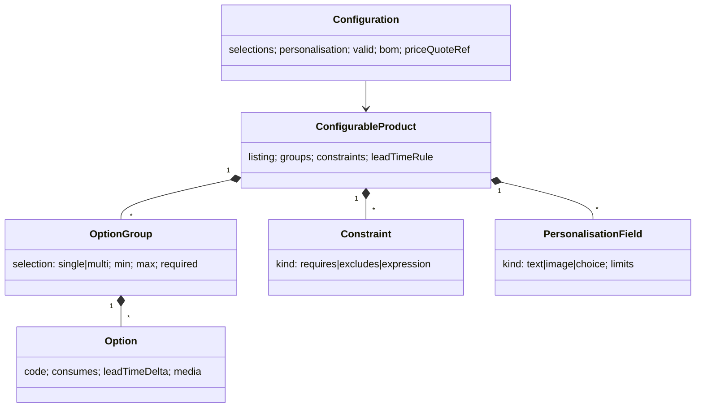

# U78 — Product Configuration Universe Constitution

| Field | Value |
|---|---|
| Universe ID | `U78-configuration` |
| Layer | L5 Business Capability |
| Domain | 04 Commerce |
| Steward | `ucos:org:commerce-configuration` |
| Version | 0.1.0 (Draft) |
| Delivery phase | P2 (options & add-ons, modifiers, personalisation), P4 (rule-based configurators, CPQ, made-to-order to manufacturing) |
| Depends on | U21 Catalog, U18 Product Intelligence (attributes, compatibility), U23 Pricing, U34 Inventory (component stock), U53 Decision (constraints), U43 Asset (personalisation files, previews), U47 Manufacturing (P6, made-to-order), U13 Temporal (see TEMPORAL-BINDING-MATRIX) |
| Depended on by | U24 Cart (configured lines), U26 Order (configuration snapshot), U35 Fulfillment (assembly/production), U23 Pricing (option prices) |
| Master references | Gap analysis "Products & Services completeness" (A-29) |

> Configuration owns **products whose final form is chosen by the buyer**: option groups and options (size/colour choices beyond variants, add-ons, modifiers like toppings), personalisation (engraving text, uploaded artwork), configurable products with constraint rules (laptop builder, furniture, cars), kits/bundles composition rules, configure-price-quote (CPQ), and made-to-order specifications. Pre-defined variants remain Catalog SellableUnits; configuration covers combinations too numerous or custom to pre-create.

## 1. Laws
| ID | Law | Enforcement |
|---|---|---|
| CFG-L1 | A configured line is valid only if it satisfies all constraint rules at order time; the evaluated configuration is snapshotted and immutable on the order. | Validation on AddLine and PlaceOrder; snapshot on OrderLine. |
| CFG-L2 | Option prices come from Pricing (option price entries/rules), never embedded in the configuration model. | Lint; Pricing waterfall includes option components. |
| CFG-L3 | Every option that consumes stock maps to a SellableUnit or component stock item; availability is checked like any unit. | Model requires `consumes` mapping. |
| CFG-L4 | Personalisation content passes moderation and IP/trademark checks before production. | Asset moderation + decision `configuration.personalisation-policy`. |

## 2. Ontology
`ConfigurableProduct` (listing extension) → `OptionGroup` (single/multi select, min/max, required) → `Option` (value, consumes component, lead-time impact, image) ; `Constraint` (requires/excludes/compatible-with/expression); `PersonalisationField` (text, font, image upload, placement area, max length, allowed characters per script); `Configuration` (a buyer's chosen set + validation result + derived BOM); `KitDefinition` (fixed components with quantities; priced as bundle; stock from components); `CPQQuote` (B2B: configured lines → U23 B2B quote).



## 3. Objects (key fields)
- `ConfigurableProduct { id, listing, baseUnit?: SellableUnitRef, groups, constraints, personalisation, leadTimeRule: DecisionRef, productionMode: assemble-from-stock|made-to-order|digital-render, previewRenderer?: pack ref }`
- `Option { id, group, code, label (LocalizedText), consumes?: [{unit|stockItem, qty: Quantity}], attributesSet?: Map<AttributeRef,value>, leadTimeDelta: Duration, availabilityPolicy?: TemporalPolicyRef (e.g. seasonal topping) }`
- `Constraint { id, kind, when (CEL over selections), then (requires/excludes/limits), message (LocalizedText) }`
- `Configuration { id, product@version, selections, personalisation: [{field, value|AssetRef, moderation status}], valid, violations[], derivedBOM: [{unit, qty}], leadTime: Duration, hash }`
- `KitDefinition { id, listing, components: [{unit, qty}], substitutionRules?, stockMode: component-derived }`

## 4. Commands, Queries, Events, APIs
Commands: `DefineConfigurableProduct`, `DefineKit`, `Configure(product, selections, personalisation)` (validate + derive BOM + request price), `SaveConfiguration` (shareable link), `ConvertToQuote` (CPQ), `ReleaseToProduction` (made-to-order → U47/U35).
Queries: `ValidOptions(product, partialSelections)` (constraint propagation for UI), `ConfigurationPrice` (via U23), `KitAvailability`.
Events: `configuration.configuration.validated`, `configuration.production.released`.
```text
POST /v1/configuration/products      POST /v1/configuration/products/{id}:configure
GET  /v1/configuration/products/{id}/valid-options?selections=
POST /v1/configuration/configurations/{id}:quote|:release
```
Errors: `CFG_CONSTRAINT_VIOLATION` (with messages), `CFG_OPTION_UNAVAILABLE`, `CFG_PERSONALISATION_REJECTED`.

## 5. Rules & Algorithms
Constraint propagation: options graph with requires/excludes edges + CEL expressions; `ValidOptions` computes the feasible set given partial selections (SAT-lite; groups ≤ 50, options ≤ 2,000 per product; larger configurators use a dedicated solver pack). Kit stock = min over components ⌊available/qty⌋. Lead time = max(component lead times) + production time (decision).

## 6. Security & Compliance
Personalisation text/images moderated (profanity, hate, trademarks); personalised goods often non-returnable — consumer-law exception rules per jurisdiction via U26 return decisions; made-to-order specs are confidential to buyer/seller.

## 7. Reuse
Cart lines carry `configurationRef`; Order snapshots it; Fulfillment uses derived BOM; Search indexes configurable products with facet ranges.

## 8. Gaps
```prolog
gap(option_without_stock_mapping, O) :- option(O), physical(O), not consumes(O, _).
gap(constraint_unsatisfiable, P)     :- configurable_product(P), not any_valid_configuration(P).
gap(personalisation_without_policy, T) :- tenant(T), personalisation_enabled(T), not personalisation_policy(T).
```

## 9. AI
Natural-language configuration ("15-inch laptop for video editing under ₹1.2L" → proposed configuration), constraint authoring assistance, visual previews (generated mockups flagged as illustrative).

## 10–12. Operations, UI, Scale
Signals: `configure_latency_ms` (p95 < 150 ms), `invalid_configuration_ratio`, `configuration_abandon_ratio`. Views: `configuration.builder` (storefront step-by-step or single-page with live price and image), `configuration.modifier.picker` (food: toppings with limits), `configuration.admin.editor` (groups, options, constraint matrix with test cases), `cpq.quote.builder` (B2B). Scale: in-memory compiled models per product, cached; T1.

## Appendix
- **C.** 0.1.0.
