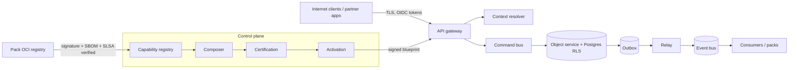

# TM-KERNEL — Kernel, tenancy and control plane

| Field | Value |
|---|---|
| Scope | API gateway, ContextEnvelope resolution (U16), command bus and idempotency, object service with RLS, outbox relay and event bus (U61), control plane (U57 registry, U58 composition, U74 certification, activation), pack admission, secrets (U65), audit (U68) |
| Data classes | All; especially cross-tenant data, credentials, keys, audit records |
| Owner | `ucos:org:security` with the kernel team |
| References | KERNEL-DESIGN.md; ADR-002, 003, 007, 009, 020; policies P-001…P-007 |

## Trust boundaries

Boundaries: Internet → gateway; tenant ↔ tenant inside the shared data plane; data plane ↔ control plane; third-party pack code ↔ kernel; operators ↔ production.

## STRIDE
| ID | Threat | Component | L | I | Mitigations | Verification |
|---|---|---|---|---|---|---|
| K-S1 | Forged or replayed tokens reach commands | Gateway | 2 | 3 | OIDC JWT validation (issuer, audience, expiry, `nbf`), sender-constrained tokens (DPoP) for partner APIs, short TTLs, revocation via session store | Gateway conformance tests; `SEC-ID-01` |
| K-S2 | Caller sets the tenant or context itself (header injection) | Context resolver | 2 | 3 | Tenant comes only from the token and the host binding; client context headers are advisory and policy-checked; `ARCH-CTX-01` static scan | `ARCH-CTX-01`, isolation suite |
| K-T1 | Cross-tenant write through a missing tenant filter | Object service | 2 | 3 | Postgres RLS on every tenant table; `SET LOCAL app.tenant_id` per transaction; service roles without BYPASSRLS; ADR-020 | `SEC-TENANT-01` leak suite |
| K-T2 | Event payload tampered between outbox and consumers | Outbox/relay/bus | 1 | 3 | mTLS to the bus, per-cell ACLs, producer identity in a CloudEvents extension, schema validation at consume time | Contract tests; bus ACL review |
| K-T3 | Malicious pack (supply chain) | Pack admission | 2 | 3 | Sigstore signature, SBOM, SLSA L3 provenance verified at admission; WASM sandbox for in-process extensions; network egress allow-lists | `SEC-SUPPLY-01`, `SEC-VULN-01` |
| K-T4 | Unauthorised blueprint activation | Control plane | 1 | 3 | Activation needs a certified blueprint digest plus a DecisionRecord from an authority of sufficient level; DSSE attestation verified by the data plane | `ARCH-AUTH-01`, `GAP-000` |
| K-R1 | Actor denies performing an action | Audit | 2 | 2 | Every command is audited with actor, on-behalf-of, context and hash chain; external anchoring of chain heads | U68 chain verification job |
| K-I1 | Cross-tenant leakage through caches, search or files | Caches / search / object storage | 2 | 3 | Tenant-prefixed keys, per-tenant index filters enforced server-side, signed URLs scoped to tenant and object | `SEC-TENANT-01` |
| K-I2 | Secrets in logs or traces | Observability | 2 | 3 | Log redaction by data class; OTel attribute allow-list; secrets only via SecretRef; DLP on log pipeline | `SEC-SECRETS-01` |
| K-D1 | One tenant exhausts shared resources | Gateway / DB | 3 | 2 | Per-tenant rate limits and quotas (U28), statement timeouts, connection pool partitioning, cell placement for large tenants | Load tests `PERF-SLO-01` |
| K-D2 | Event poison message blocks a partition | Consumers | 2 | 2 | Retry with backoff, dead-letter topics, idempotent consumers, lag alerts | Chaos tests |
| K-E1 | Operator break-glass abused | Production access | 1 | 3 | Just-in-time access via U01 BreakGlass with dual approval, session recording, automatic expiry, post-hoc review | Access review evidence |
| K-E2 | Policy layering bypass (tenant policy widens platform baseline) | PDP | 1 | 3 | Platform baseline P-001…P-007 evaluated first with forbid precedence; Cedar analysis "never permits" checks in CI | `SEC-POLICY-01` |

## Abuse cases to test
1. A token for tenant A with the `Host` header of tenant B must be rejected.
2. Replaying a command with the same idempotency key but a different payload must return a 409 conflict, not the cached success.
3. Activating a blueprint whose digest differs from the certified one must be refused.
4. A WASM extension calling a non-granted host function must trap.

## Residual risks
- Side channels between co-located tenants (timing, noisy neighbours) are accepted for shared cells and mitigated by dedicated cells for regulated tenants.
