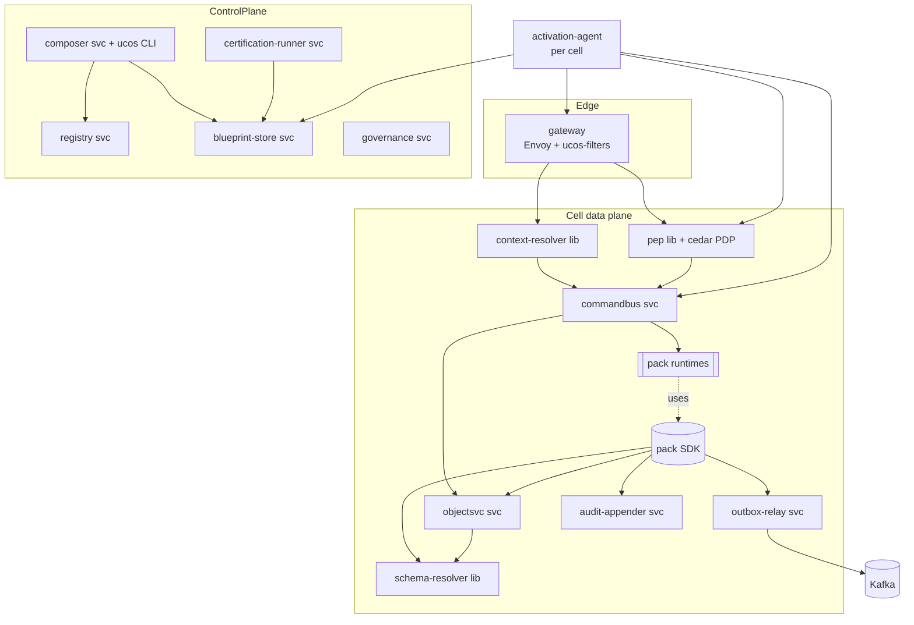

# UCOS Ω∞ — Kernel Engineering Design (Phase 0–1)

| Field | Value |
|---|---|
| Document ID | `UCOS-KERNEL-DESIGN` |
| Version | 0.1.0 (Draft for P0 build) |
| Scope | The generic platform engines that run every capability pack: Gateway & PEP, Context Resolver, Command Bus, Object Service, Schema Resolver, Outbox & Relay, Pack SDK, Registry Service, Composer Engine, Blueprint Store & Activation Agent, Certification Runner, Audit Appender. |
| Normative sources | `UCOS-MASTER-ARCHITECTURE.md` §5, §7, §8, §11–§15, §19; universe specs U03, U04, U13, U16, U57, U58, U61, U68, U73, U74, U95 |
| Language decisions | Kernel services: **Go 1.23+**. Pack SDKs: **Go** (reference) and **TypeScript**; Kotlin SDK in P2. Composer engine: Go host + embedded Datalog (decision spike S-01). Protocols: gRPC (internal), HTTP/JSON (external). |

> This document turns the architecture into **buildable component designs**: interfaces, data layouts, sequences, failure modes and performance budgets. Anything business-specific is out of scope. If you find business logic here, it is a bug (L6, CAP-L1).

---

## 0. Component map and module boundaries



**Go module layout** (`kernel/`):

```text
kernel/
  gateway/filters/        # Envoy ext_authz + ext_proc filters (Go): authn, context, PEP, rate limit, idempotency pre-check
  pkg/context/            # ContextEnvelope types, resolve, sign/verify, narrow
  pkg/pep/                # Cedar PDP wrapper (cedar-go), PartialEvaluate → SQL residual
  pkg/schema/             # schema resolver, JSON Schema 2020-12 validation (santhosh-tekuri/jsonschema), CEL constraints (cel-go)
  pkg/temporal/           # Temporal value types + pure evaluation (shared with SDK) — TMP-L7 parity
  pkg/money/              # Money/Quantity decimal (cockroachdb/apd), allocation
  pkg/ids/                # UGID/ULID
  pkg/audit/              # audit record canonicalisation + hash chain
  pkg/outbox/             # outbox write API (tx-bound)
  services/commandbus/    # gRPC CommandBus
  services/objectsvc/     # generic object CRUD/query
  services/outboxrelay/   # WAL/poll relay → Kafka
  services/auditappender/ # append + WORM replication
  services/registry/      # definitions registries (U04/U57/U61/U03/U53…)
  services/composer/      # composition engine (U58)
  services/blueprintstore/
  services/certrunner/    # U74
  services/activation/    # cell activation agent (U73)
  sdk/go/  sdk/ts/        # pack SDKs
  tools/ucos/             # CLI (lint, compose, gaps, trace, certify, pack)
```
Dependency rule (enforced by `go-arch-lint`): `pkg/*` must not import `services/*`; `sdk/*` must import only `pkg/*` public APIs and generated protos; nothing in `kernel/` may import `packs/`.

---

## 1. Gateway & Policy Enforcement Point

**Responsibilities:** TLS termination (at the edge proxy), authentication (JWT validation with JWKS cache), tenant resolution (host → tenant), context resolution, rate limiting (per tenant × API product × principal, U28/U63), idempotency pre-check, PDP authorisation for the operation, obligation attachment, request routing to the command bus or query handlers.

**Filter chain (ordered):**
1. `tenant-resolve`: `host` → tenant (edge KV cache, TTL 60 s, event-invalidated). Unknown host gives 404.
2. `authn`: validates the bearer JWT (`iss` = tenant issuer; `aud`; `exp`; DPoP if present). Anonymous requests get the `anonymous` principal.
3. `context`: resolves and signs the ContextEnvelope (U16 §4) and sets the `ucos-context` header. Deadline 5 ms, excluding the risk call. In Phase 1 risk is `unknown`.
4. `ratelimit`: GCRA token bucket (Redis cell cluster). Returns 429 with `RateLimit-*` headers.
5. `route`: matches the operation id from the compiled API config (U63 generation). Unknown route gives 404.
6. `pep`: `IsAuthorized(principal, action=operationId, resource, ctx)`. For collection reads, `PartialEvaluate` produces a residual filter that is passed to the object service. Deny gives 403 problem+json.
7. `idempotency-precheck` (mutations): a fast-path lookup returns the cached response if the key has completed.
8. Forward to the command bus (mutations) or query handlers (reads) over gRPC.

**Budgets:** total gateway overhead p99 < 5 ms in-cell (excluding the upstream).
**Failure modes:**
- JWKS unavailable: use the cached keys (max staleness 24 h).
- PDP bundle stale beyond 10 min: keep serving and alert (POL fail-safe).
- Redis down: rate limiting falls back to local token buckets per instance (approximate).

---

## 2. Context Resolver (`pkg/context`)

```go
type Envelope struct {
    V            int               `json:"v"`
    Tenant       string            `json:"tenant"`
    Blueprint    string            `json:"blueprint"`
    Actor        Actor             `json:"actor"`
    Roles        []string          `json:"roles"`
    Org          string            `json:"org,omitempty"`
    Jurisdiction map[string][]string `json:"jurisdiction"` // role-keyed (A-08)
    Locale, Currency, TZ string
    Time         TimeCtx           `json:"time"`            // now, asOf
    Frame        Frame             `json:"frame"`           // U77 (A-27)
    Channel      string            `json:"channel"`
    Device       Device            `json:"device"`
    Risk         Risk              `json:"risk"`
    ConsentRef   string            `json:"consentRef,omitempty"`
    Purpose      string            `json:"purpose,omitempty"`
    Exp          int64             `json:"exp"`
    Parent       []byte            `json:"parent,omitempty"`
}
func Resolve(ctx context.Context, req *Request, deps Deps) (*Envelope, Trace, error)
func Sign(e *Envelope, k Signer) (string, error)            // Ed25519 over canonical JSON (RFC 8785 JCS)
func Verify(token string, ks KeySet) (*Envelope, error)
func (e *Envelope) Narrow(purpose string) (*Envelope, error) // CTX-L2: only narrowing fields
```
Canonical JSON uses JCS (RFC 8785). Size is limited to 2 KB; larger references are dereferenced by id.

---

## 3. Command Bus (`services/commandbus`)

**API (proto):**
```proto
service CommandBus {
  rpc Execute(CommandRequest) returns (CommandResponse);
}
message CommandRequest {
  string operation_id = 1;          // "<slug>:<Command>" e.g. "commerce:AddLine"
  string target_id = 2;             // aggregate id (may be empty for create)
  bytes  payload = 3;               // JSON
  string idempotency_key = 4;
  string expected_version = 5;      // from If-Match
  string context_token = 6;         // signed envelope
  repeated Obligation obligations = 7;
}
message CommandResponse { int32 status = 1; bytes body = 2; string version = 3; string problem = 4; }
```
**Pipeline:**
1. Verify the context token.
2. Look up the operation in the active blueprint's routing table: owning pack, timeout, idempotency TTL, audit level.
3. Check the idempotency store (Postgres table `cmd_idempotency`, PK `(tenant, key)`):
   - completed with the same request hash: return the stored response;
   - same key with a different request hash: 409 error `IDEMPOTENCY_KEY_REUSED`;
   - in progress: 409 error `IN_PROGRESS` with `Retry-After`.
4. Insert an `in_progress` row (TTL per command).
5. Invoke the pack runtime `Handle()` with a deadline (default 2 s).
6. The pack executes its transaction through the SDK. Audit appends are part of the request path (AUD-L1): the SDK writes the audit record within the same transaction into `audit_pending`, and the appender commits it to the chain asynchronously within 1 s while guaranteeing ordering. If the audit store is unreachable, the transaction fails.
7. Update the idempotency row to `completed` with the response.
8. Return the response with an ETag of the aggregate version.

```sql
CREATE TABLE cmd_idempotency (
  tenant_id text NOT NULL, key text NOT NULL, request_hash bytea NOT NULL,
  status text NOT NULL CHECK (status IN ('in_progress','completed')),
  response jsonb, http_status int, created_at timestamptz NOT NULL DEFAULT now(),
  expires_at timestamptz NOT NULL,
  PRIMARY KEY (tenant_id, key)
) PARTITION BY HASH (tenant_id);
```
**Paths and UGIDs (A-77):** UGIDs contain colons, and so does the command suffix (`/sample/notes/ucos:note:01J…:publish`). Colons are legal in path segments (RFC 3986), so the gateway matches the id lazily up to the route's literal `:verb` suffix; ids never contain `/`. Clients may percent-encode the id's colons; the gateway decodes before matching.

**Gateway error codes (A-77):** error `AUTH_REQUIRED` (no bearer token), `AUTH_INVALID_TOKEN` (signature, issuer or expiry rejected), `METHOD_NOT_ALLOWED`, `PAYLOAD_TOO_LARGE`, `INVALID_JSON`, `KERNEL_UNAVAILABLE` (infrastructure failure; retry with the same key).

**Kernel error codes (A-75):** the command bus returns error `CTX_MISSING` (no envelope), `CTX_INVALID` (envelope fails validation or expired), `OPERATION_UNKNOWN`, `IDEMPOTENCY_KEY_REQUIRED`, `IDEMPOTENCY_KEY_REUSED`, `IN_PROGRESS`; the object store returns error `OBJECT_NOT_FOUND` and `VERSION_CONFLICT`; the trigger API returns error `TMP_INVALID_TIMEPOINT`. Replays return the stored response byte for byte (migration 0012). Implementation: `kernel/internal/bus`.

**Failure modes:**
- Pack timeout: the row stays `in_progress` until expiry, and the client retries with the same key. Handlers MUST be idempotent on their aggregate (version check).
- Pack crash mid-transaction: the transaction rolls back and no outbox event is emitted. Safe.

---

## 4. Object Service and storage layout (`services/objectsvc`)

### 4.1 Physical model (ADR-003)
Every **core** object type gets a generated table. Example DDL generated from the `commerce.order.Order@1` definition:
```sql
CREATE TABLE t_commerce_order_order_v1 (
  id               text PRIMARY KEY,                 -- UGID
  tenant_id        text NOT NULL,
  type             text NOT NULL DEFAULT 'commerce.order.Order@1',
  status           text NOT NULL,
  version          bigint NOT NULL DEFAULT 1,
  owner_id         text NOT NULL,
  -- typed attribute columns (generated):
  order_number     text NOT NULL,
  buyer_id         text NOT NULL,
  channel_id       text NOT NULL,
  placed_at_utc    timestamptz NOT NULL, placed_at_tz text,
  totals           jsonb NOT NULL,                    -- Money values as decimal strings
  -- envelope:
  custom_attributes jsonb NOT NULL DEFAULT '{}',
  classification   jsonb NOT NULL,
  valid_from timestamptz NOT NULL DEFAULT now(), valid_to timestamptz,
  recorded_at timestamptz NOT NULL DEFAULT now(), superseded_at timestamptz,
  provenance jsonb, context_hash bytea,
  created_by text NOT NULL, created_at timestamptz NOT NULL DEFAULT now(),
  updated_by text NOT NULL, updated_at timestamptz NOT NULL DEFAULT now(),
  UNIQUE (tenant_id, order_number)
);
ALTER TABLE t_commerce_order_order_v1 ENABLE ROW LEVEL SECURITY;
CREATE POLICY tenant_isolation ON t_commerce_order_order_v1
  USING (tenant_id = current_setting('ucos.tenant_id', true));
CREATE TABLE t_commerce_order_order_v1_history (LIKE t_commerce_order_order_v1 INCLUDING ALL);  -- bitemporal history
```
Mapping rules:
- `TimePoint` becomes `*_utc timestamptz` + `*_tz text`.
- `TimeRange` becomes `tstzrange` plus original tz columns.
- `Money` becomes a JSON object `{amount: text, currency: text}`, or two columns for indexed money (`amount numeric(38,18)`, `currency text`).
- `Reference` becomes `text` plus a type-checked FK where the target lives in the same cell and universe (cross-universe references are not FK-enforced; integrity comes from event-driven checks).
- `LocalizedText` becomes `jsonb`.
- `Encrypted<T>` becomes `bytea` (ciphertext, AES-256-GCM, key id header) plus an optional blind-index column.

The **generic objects table** for registry-only and low-volume types:
```sql
CREATE TABLE objects (
  tenant_id text NOT NULL, type text NOT NULL, id text NOT NULL,
  status text NOT NULL, version bigint NOT NULL,
  attributes jsonb NOT NULL, custom_attributes jsonb NOT NULL DEFAULT '{}',
  envelope jsonb NOT NULL,
  PRIMARY KEY (tenant_id, type, id)
) PARTITION BY LIST (type);
```
**Session settings:** every connection checkout sets `ucos.tenant_id` and `ucos.org_id` from the verified context (`SET LOCAL` inside the transaction). The pooler (PgBouncer, transaction mode) is safe because `SET LOCAL` is scoped to the transaction.

### 4.2 API
```proto
service ObjectService {
  rpc Get(GetRequest) returns (Object);                    // by id, optional asOf, expand
  rpc Query(QueryRequest) returns (QueryResult);           // where (CEL subset) + PDP residual + cursor
  rpc Create(WriteRequest) returns (Object);               // validates schema, constraints, lifecycle initial state
  rpc Patch(WriteRequest) returns (Object);                // JSON Merge Patch + expected_version
  rpc Transition(TransitionRequest) returns (Object);      // only via workflow identity (WF-L5)
}
```
Queries compile to SQL with parameter binding only. The PDP residual is ANDed into the WHERE clause. Cursor pagination is keyset-based on `(sort key, id)`. Query p95 < 50 ms on indexed paths.

### 4.3 Validation pipeline (each write)
1. Resolve the merged schema (canonical + tenant extension).
2. Validate the JSON Schema.
3. Evaluate CEL constraints.
4. Enforce value-type rules (META-L3).
5. Classification and encryption of fields.
6. Lifecycle guard.
7. Unique and reference checks.
8. Write the row, the history row and the outbox events in one transaction.

---

## 5. Schema Resolver (`pkg/schema`)
`Resolve(typeRef@major, tenant) → *Compiled` returns a compiled validator, CEL programs, the field classification map, the storage mapping and the encryption plan. Cache: in-process LRU (10k entries), invalidated by `meta.*.published` and `meta.extension.*` events. A cold resolve fetches from the registry replica in the cell (Postgres `meta` schema). Budget: p99 < 1 ms cached, < 20 ms cold.

---

## 6. Outbox and Relay
```sql
CREATE TABLE outbox (
  tenant_id text NOT NULL, seq bigserial, event_id text NOT NULL,
  topic text NOT NULL, partition_key text NOT NULL,
  envelope jsonb NOT NULL,           -- CloudEvents with UCOS extensions (§15.4)
  created_at timestamptz NOT NULL DEFAULT now(),
  relayed_at timestamptz,
  PRIMARY KEY (tenant_id, seq)
);
CREATE INDEX outbox_unrelayed ON outbox (created_at) WHERE relayed_at IS NULL;
```
**Relay:** logical decoding (pgoutput) on the outbox table, published to Kafka with an idempotent producer (`enable.idempotence=true`, `acks=all`); the row is marked relayed (or a relay position stored). Ordering: the partition key is the aggregate id. Lag budget p99 < 500 ms. If the relay stalls, an alert fires and a hot standby relay takes over through leader election (Postgres advisory lock). Cleanup: relayed rows are deleted after 7 days.

**SDK write API (only path to emit events):**
```go
tx.Emit(ctx, "order.order.placed", order.ID, payload)   // validates against registered schema (EVT-L1), sets envelope
```

---

## 7. Pack SDK (Go reference; TypeScript mirrors it)

```go
package ucos

// Registration (generated from capability.yaml by `ucos pack gen`)
type Pack interface {
    Commands() map[string]CommandHandler   // "AddLine": handler
    Queries()  map[string]QueryHandler
    Events()   map[string]EventHandler     // consumed event types
    Extensions() map[string]ExtensionHandler
}
type CommandHandler func(c *CommandCtx, payload json.RawMessage) (Result, error)

type CommandCtx struct {
    Ctx        *context.Envelope     // verified, read-only
    Tx         Tx                    // tenant-scoped transaction (RLS set), outbox, audit
    Objects    Objects               // typed repositories (generated) + generic access
    Temporal   temporal.Client       // pure evaluation + trigger scheduling (U13)
    Money      money.Ops             // decimal ops, Allocate, Convert (with RatePolicy)
    Decide     decision.Client       // U53 Evaluate (embedded)
    Entitled   entitlement.Client    // U28 Check/Consume
    Ports      Ports                 // outbound ports → connector runtime (U62)
    Log        Logger                // structured, classification-aware (OBS-L2)
    Obligations []Obligation         // from PEP (masking etc.)
}

type Tx interface {
    Get(typ string, id string, opts ...GetOpt) (*Object, error)
    Save(obj *Object, expectedVersion int64) error  // schema-validated; history; audit
    Emit(eventType, subject string, data any) error // outbox
    Now() temporal.TimePoint                        // respects ctx asOf (CTX-L5 read-only)
    NewID(kind string) string                       // UGID
}
```
**Prohibited in packs** (enforced by `ucos lint` and a build-time import allow-list):
- `net/http` client, raw SQL drivers, `time.Now()`, `math/rand`;
- cron, RRULE or scheduler libraries;
- vendor SDKs outside `packs/adapters/*`;
- string literals that look like ISO country or currency codes or plan names.

**Testing kit:**
- `ucostest.NewCell()` spins up an in-memory cell: Postgres via testcontainers, an in-memory event bus, a fake PDP loaded with pack policies, and a deterministic clock.
- Contract tests are generated from the manifest.

---

## 8. Registry Service (control plane)
- One service with modules per registry family: meta (U04), refdata (U08), ontology/taxonomy (U05/U06), capability/packs (U57), events (U61), policies (U03), decisions (U53), rules (U58), ui (U64), compliance (U67), temporal global calendars (U13).
- Writes come only through Governance proposals (GOV-L1). Reads are public within the platform.
- **Replication:** a signed snapshot (tar of JSON plus a Merkle manifest) every 60 s or on change. Cells pull through the activation agent and verify the signature.

---

## 9. Composer Engine (`services/composer`, CLI `ucos compose`)
**Inputs:** a PlatformDefinition (YAML) and a snapshot id.
**Outputs:** a Blueprint, a ResolutionTrace, a GapReport and a cost estimate (U58 §5).

**Steps:**
1. Load the snapshot EDB (facts generated from registries: `capability/2`, `requires/3`, `provides/3`, `abstract/1`, `adapter_for/4`, `regulation_applies/2`, `requires_control/2`, `control_implemented_by/2`, `in_scope/1`, …).
2. Encode the PD into facts.
3. Evaluate stratified Datalog (rule modules from `spec/rules/**`).
4. Solve versions (SAT; PubGrub-style solver implemented in Go).
5. Select adapters.
6. Merge config.
7. Canonicalise the output (sorted keys, JCS).
8. Hash with SHA-256.

**Engine embedding (spike S-01 decides):**
- Option A: Soufflé, compiled per snapshot to a native library and called via cgo.
- Option B: an embedded Go/Rust Datalog interpreter with semi-naive evaluation.

**Required properties either way:** deterministic, stratified negation, provenance (derivation capture), and runs over 1M facts in under 10 s.
**Reference prototype:** `tools/ucos_check.py` in this repository implements the closure, collision and gap subset for spec validation. It is not the production engine.

---

## 10. Blueprint Store and Activation Agent
- **Store:** content-addressed objects (`sha256:…`) in S3 plus metadata in Postgres (`blueprints(id, tenant, pd_ref, snapshot, status, certification, created_at)`).
- **Activation agent** (one per cell) watches approved activations (U73 §3.4) and, per wave:
  1. ensures the pack images are deployed (Argo CD application of the pack set);
  2. installs the policy bundle (PDP), decision bundle and compiled API routes (gateway xDS);
  3. runs the expand migrations;
  4. flips the tenant routing to the new blueprint id;
  5. reports health;
  6. after the hold, runs the contract migrations.
- **Rollback:** flip routing back, then unload. Contract migrations never run before the hold expires.

---

## 11. Certification Runner (U74)
- Runs a CertificationProfile over a subject digest. Criteria execute as Kubernetes jobs or queries.
- Results are written as Evidence (U68) and a DSSE-signed attestation is issued.
- CI calls `ucos certify` (with `--gates`), which submits a run and polls it.

---

## 12. Audit Appender (U68)
**Per-tenant, per-day chain:**
```sql
CREATE TABLE audit_records (
  tenant_id text, day date, seq bigint, id text, rec jsonb, prev_hash bytea, hash bytea,
  PRIMARY KEY (tenant_id, day, seq)
) PARTITION BY RANGE (day);
REVOKE UPDATE, DELETE ON audit_records FROM PUBLIC;
```
- **Sequence assignment:** a single writer per (tenant, day) shard, using an advisory lock or a sequencer service. Throughput: 50k/s per cell across shards.
- **Pending path:** SDK transactions insert into `audit_pending`, a strictly ordered queue table. The appender drains it into chained records and acknowledges.
- **Durability:** an audit write is durable when the transaction commits, and becomes chain-sealed within 1 s.
- **Anchoring:** at 00:15 UTC (a U13 trigger), the daily Merkle root is anchored to WORM storage.

---

## 13. Cross-cutting engineering standards
| Area | Standard |
|---|---|
| Errors | RFC 9457 problem+json; `ucos.code` from the error registry (generated `spec/registries/errors.yaml`); never leak internals |
| Logging | JSON, OTel log bridge, `ucos.*` attributes, classification-aware redaction at source |
| Tracing | W3C traceparent end to end; span per command, PDP decision, DB transaction and outbound port call |
| Config | Only from blueprint and registry snapshots plus cell bootstrap; no per-tenant env vars |
| Time | `pkg/temporal` only; the wall clock is injected (`Clock` interface) for determinism in tests |
| Concurrency | Optimistic version checks; no distributed locks in business paths |
| Security | Workload identity (SPIFFE), mTLS between services, no static secrets, distroless images, read-only root fs |
| Performance budgets | Gateway < 5 ms, PDP < 300 µs embedded, schema resolve < 1 ms, command end to end p99 < 150 ms (simple), query p95 < 50 ms |
| Testing | Unit ≥ 80% (kernel packages), property tests for money/temporal/allocation, fuzzing for parsers (CEL, RRULE, JSON Schema inputs), contract tests for protos, chaos tests for relay and appender |

---

## 14. Phase 0 build sequence (kernel)
1. `pkg/ids`, `pkg/money`, `pkg/temporal` (with the golden suite), `pkg/context`, `pkg/audit`.
2. Registry service (meta, refdata, capability, events, policies) and `ucos lint`.
3. Object service, schema resolver and DDL generator.
4. Command bus, outbox relay and audit appender.
5. Gateway filters and PEP with the Cedar baseline.
6. Pack SDK (Go) and test kit, plus a sample pack (`demo.notes`) proving the full loop.
7. Composer (engine chosen by spike S-01), blueprint store and activation agent.
8. Certification runner (ARCH, SEC, TEST and GAP gates first).

**P0 exit:** the sample pack's object type is defined only in `spec/`, composed, certified and activated in one cell. Tenant isolation, the audit chain and the outbox have been verified by automated tests.
